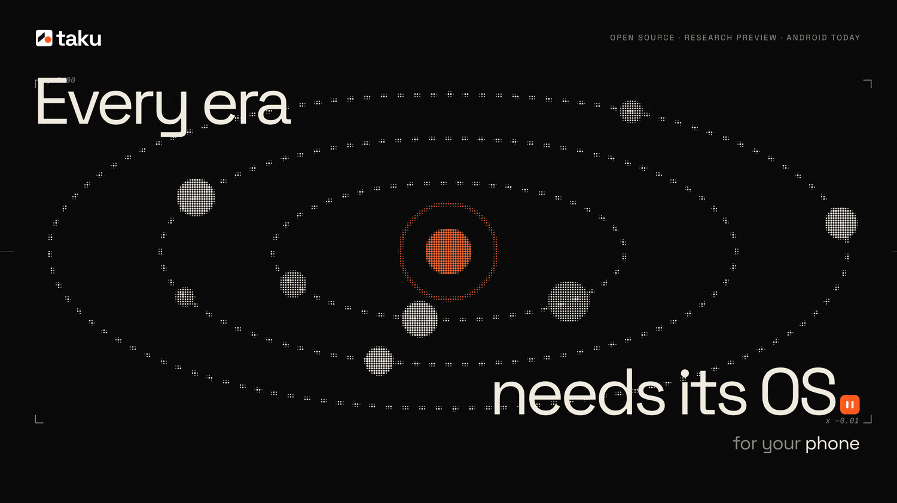

# Taku OS

<p align="center"></p>

**AI エージェントのための Android システム。**

[English](README.md) · [简体中文](README.zh-CN.md) · 日本語

Taku OS は、エージェントのランタイム、システムツール、ホーム画面、バックグラウンド作業画面をスマートフォンに統合します。ユーザーとエージェントは同じ設定とアプリ状態を利用します。モデル推論には設定したオンラインサービスを使用します。

現在は**開発プレビュー**です。Taku 独自のコードと文書は Apache-2.0、第三者の素材はそれぞれの条件に従います。

## はじめる

| 方法 | 現在の提供内容 |
| --- | --- |
| Pixel 9（`tokay`） | TakuOS 1.3.1 / Android 17 / `20261111080323`。[インストールガイド（英語）](https://docs.taku.ai/quickstart/mobile/)に完全 OTA、対応 recovery、SHA-256 と手順があります |
| エミュレーター | コンポーネントの開発・検証手順があります。ダウンロード可能なクリーンな Taku OS エミュレーターイメージは未公開です。[開発準備](docs/getting-started.md)を参照してください |
| 最初のプラグイン | 公開 [Hello World サンプル](https://github.com/Taku-OS/taku-os-plugins/tree/main/examples/taku-hello-world)と[チュートリアル（英語）](https://docs.taku.ai/os/extensions/first-plugin/)があります |
| 端末なしの SDK | アクセス権のある checkout から、モデルアカウントや npm install なしで以下を実行できます |

Pixel 9 の配布版ではシステム更新と再起動を検証済みです。純正状態からの初回インストール、他機種、すべてのアプリの互換性は未検証です。LineageOS の対応機種がそのまま Taku OS の対応機種になるわけではありません。[リリース情報](docs/releases/tokay-20261111080323.json)と[現在の状態](docs/current-status.md)を確認してください。

```sh
# アクセス権のある Git checkout、Node.js 22+ が必要です。
env -u TAKU_OS_TRANSPORT -u TAKU_OS_SERIAL node sdk/cli/taku.mjs call methods.list
```

Coding Agent にインストールを依頼する場合は、まず[実行ガイド](docs/agent-setup.md)を読ませ、端末とビルドを確認します。ロック解除やデータ消去には明示的な承認が必要です。完全 OTA ZIP は fastboot 用イメージ一式ではありません。

## 開発する

- skill や MCP ツールを追加し、インストール、呼び出し、アンインストールを確認できます。
- 対応する Android インターフェースとバックグラウンド作業画面を利用します。利用できる範囲はビルド、アプリ、権限に依存します。
- 小さなアプリや画面から始め、GUI と Agent API でデータと検証を共有します。
- カメラ、音声、ディスプレイ、センサーはそれぞれ検証範囲が異なります。特定の言語やシナリオの動作を一括して保証しません。

プラグインはホストの権限で動作します。能力宣言はサンドボックスではありません。[セキュリティ](SECURITY.md)と[プラグイン開発](docs/plugins/README.md)を参照してください。

[開発準備](docs/getting-started.md)は SDK、ネイティブコンポーネント、React Native、完全 ROM を分けて説明します。[最初の変更](docs/first-change.md)で小さな課題を試せます。ソース確認、ビルド、エミュレーター、実機の結果は区別して記録します。

このリポジトリには端末側サービス、SDK、ツール、ROM 統合と文書を含みます。ホスト型バックエンド、個人の認証情報、完全な Android/vendor ソースツリーは含みません。一部の ROM 入力には現在も非公開リポジトリへのアクセスが必要です。[公開準備状況](docs/open-source-readiness.md)で確認できます。

## 文書と貢献

[公開ドキュメント](https://docs.taku.ai/) · [構成](ARCHITECTURE.md) · [貢献方法](CONTRIBUTING.md) · [サポート](SUPPORT.md) · [行動規範](CODE_OF_CONDUCT.md) · [第三者の素材](docs/third-party-materials.md)

脆弱性は公開 Issue に書かず、[SECURITY.md](SECURITY.md) の非公開報告窓口を使用してください。

## ライセンス

Taku 独自の素材は [Apache-2.0](LICENSE) です。[NOTICE](NOTICE)、第三者のライセンス、過去に付与された権利を保持します。ソースのライセンス、リポジトリ公開、完全 ROM の再配布権は別々に扱います。
