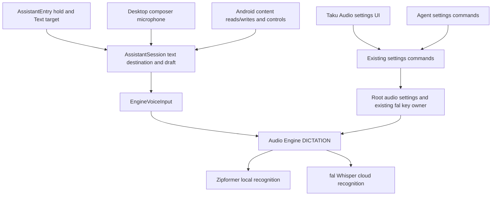

# AssistantEntry voice-input development specification

Status: source, component, and principal runtime-scenario acceptance complete. Date: 2026-11-12.

This document records contracts for integrating desktop AssistantEntry with Audio Engine, completing recognition after sliding toward Text, and Taku Audio settings. The user approved implementation, necessary builds, installation, and validation on the current isolated emulator.

2026-11-13 sync to `vela/TAKU-new-UI`: retain #55's Cancel / Keep talking gestures. The Text delivery flow below is triggered by the Text button after Keep talking; ordinary release still sends only after complete recognition succeeds. Desktop and system entry points continue sharing gesture lifecycle, voice-operation ownership, and Agent APIs. The system navigation handle still requires separate acceptance on a ROM containing the Quickstep patch.

## 1. Goals and scope

The user holds AssistantEntry to speak, then releases over **Text**. Audio Engine completes recognition of the same recording and places the complete result in the composer. The user can edit and explicitly send it. The Text path creates no Agent turn.

The desktop entry and text-composer microphone share Audio Engine. The engine owns recording, recognition backends, resource occupancy, stopping, and release. The desktop module consumes text and state only; it does not record independently, access fal, or store keys.

Remove AssistantEntry's external integration. If Audio Engine is missing or cannot connect, show the real error while allowing manual typing. An external instance without a recognizer must not indicate that recording has started.

Settings scope is `assistant-entry`, covering both hold-to-record and desktop-composer dictation. Full chat, the old assistant composer, media translation, call translation, and reading retain their configuration semantics. Shared-code external call sites must migrate with removal, leaving no dead references.

## 2. Source evidence before implementation

The following records prior behavior and the basis for these repairs.

| Location | Prior behavior | Issue to resolve |
| --- | --- | --- |
| [AssistantSession.kt](../system/agent-app/modules/taku-home/android/src/main/java/org/agentos/agent/home/assistant/AssistantSession.kt) | Chooses EngineVoiceInput or ExternalVoiceInput at startup based on service resolution. `voiceToText()` reads current transcription then calls `cancel()`. | Service discovery does not prove recognition availability. Text terminates recognition early and may lose final results. |
| [VoiceInput.kt](../system/agent-app/modules/taku-home/android/src/main/java/org/agentos/agent/home/assistant/VoiceInput.kt) | ExternalVoiceInput relies on externally pushed text; `start()` directly sets `ready=true`. | UI appears ready to record even without an external producer. |
| [HomeAssistantProvider.kt](../system/agent-app/modules/taku-home/android/src/main/java/org/agentos/agent/home/assistant/HomeAssistantProvider.kt) | `assistant/voice` injects transcription and level into ExternalVoiceInput. Other voice methods operate the GUI's AssistantSession. | Remove transcription injection; retain real recording controls and state reads. |
| [EngineVoiceInput.kt](../system/agent-app/modules/taku-home/android/src/main/java/org/agentos/agent/home/assistant/EngineVoiceInput.kt) | Uses DICTATION, with existing local defaults when profile is omitted. Final wait fixed at 8 seconds. Some Closed errors are treated as error-free completion if text exists. | Terminal results must distinguish success, cancellation, and failure. Cloud recognition cannot reuse a fixed local wait. |
| [AudioContract.kt](../system/audio-engine/contract/org/agentos/audio/AudioContract.kt), [audio-methods.mjs](../core/audio-methods.mjs) | DICTATION defaults to Zipformer; public validation does not yet allow fal-whisper for DICTATION. | fal Whisper plain dictation requires a real implementation and end-to-end contract updates; a media-translation profile cannot simply be inserted in desktop requests. |
| [AudioHomeActivity.kt](../system/audio-engine/src/org/agentos/audio/AudioHomeActivity.kt), [AudioSettings.kt](../system/audio-engine/src/org/agentos/audio/AudioSettings.kt) | Taku Audio already has a voice master switch, fal key, fal default model, reading, and translation entries. | Desktop dictation settings are missing; the existing fal default model cannot directly represent desktop recognition. |
| [AudioConfigBridge.java](../system/assistant/broker/org/agentos/lab/AudioConfigBridge.java) | Root-side audio settings expose settings commands and snapshots. `audio-settings.json` already stores reading profiles and revision. | Extend the same authoritative storage and commands; desktop and Taku Audio must not store separate copies. |

Previously, EngineVoiceInput's waveform was a recognition-activity animation. This repair sends real PCM RMS volume from Audio Engine to the same VoiceState; GUI and Agent read identical `levels` and `levelSource:"pcm-rms"`. Without samples, do not generate random or sinusoidal waveforms.

## 3. Module responsibilities



Audio Engine is the boundary for existing recognition modules. Zipformer and fal Whisper plain dictation use internal adapters. Desktop does not temporarily substitute another recognizer when services fail.

AssistantSession decides whether one recognition result enters the draft or is sent. EngineVoiceInput maps Engine sessions, events, and terminal states into desktop-consumable state. Root owns preferences, validation, and immutable snapshots.

fal keys reuse existing management. GUI, desktop state, capability snapshots, and logs may expose masks and configured status only, never raw keys.

## 4. Input and delivery behavior

### 4.1 Hold and release

Only release position determines the action. Passing through Text or Cancel must not commit early.

| Action | Recording and recognition | Text destination |
| --- | --- | --- |
| Start holding | Prepare/start one Engine session. Show recording readiness only after actual audio capture begins. | Do not modify draft yet. |
| Release in ordinary area | Stop capture and await successful recognition completion. | Preserve ordinary-release semantics: send once after success; never automatically send partial results on failure. |
| Release over Text | Call finish on the same session and await final recognition; do not substitute cancel. | Immediately open the text composer showing recognition in progress. On success, merge the final result into the draft once, without sending. |
| Release over Cancel | Cancel/release resources and discard this operation's undelivered result. | Original draft unchanged. |
| Release before preparation completes | Cancel the operation before capture; do not start recording afterward. | Send no empty message; Text may still open the original draft. |

After Text opens, keep recognition preview separate from the editable draft. Users can type immediately. When the final result arrives, merge with the draft at that moment, never overwrite new edits with the draft saved at recording start.

Switching sessions, closing the input entry, resetting the desktop session, or starting another recording while awaiting results must revoke the old operation's delivery eligibility. Late callbacks must not modify a new session/recording's draft.

### 4.2 Dictation inside the text composer

Tapping the microphone starts DICTATION in the same settings scope. Tapping again stops capture, awaits the final result, and merges it into the draft. This path always writes to the draft without sending.

Repeated stop taps, duplicate Closed events, or observer resubscription must not append a completed result twice. Each operation consumes at most one successful result.

### 4.3 Draft merging and failure

Recognition partials replace preview only. Segment finals commit using Engine segment identifiers and event sequence numbers; repeated partials must not accumulate duplicate text. After successful Engine termination, desktop delivers the complete result once.

Draft concatenation reuses existing Chinese/English joining rules. Preserve internal contents of both original draft and recognition result. Blank recognition must not erase the draft.

If concatenation exceeds the existing draft limit, preserve the original draft and complete recognition result and show that the draft is full. Users can inspect, select, and copy the result; Agents read the same result. Do not silently truncate with `take(MAX_TEXT)` or automatically send a partial message.

Preserve failure reasons. Existing partials cannot convert failure to success. A partial may remain as an explicitly labeled incomplete preview for inspection, never automatic submission or a purported complete result.

## 5. State and concurrency invariants

The model has three independent concepts: recognition state comes from Engine, delivery destination belongs to AssistantSession, and the settings snapshot is fixed at session start.

| Data | Required representation |
| --- | --- |
| Recognition state | Idle, Preparing, Capturing, Finalizing, Closed. Closed must distinguish Success, Failed, and Cancelled, carrying a structured reason. |
| Delivery destination | AwaitGesture, Draft, Submit. Holds are AwaitGesture before release; Text/composer dictation use Draft; ordinary release uses Submit. |
| Operation ownership | operationId, Engine sessionId, desktop-session generation, and whether delivery has been consumed, isolating stale callbacks and duplicate terminal events. |
| Session settings | settingsScope, settingsRevision, recognition language, requested/actual backend, processing location, and fallback use. |

`ready` is true only during actual capture. Binding, service resolution, initialization success, or receipt of a partial alone does not establish readiness. Existing `ready`, `listening`, and `final` read fields, if retained, must derive from unified state.

finish stops accepting new audio and waits for completion. cancel discards this delivery and requests resource release. Disconnection, engine-process death, and processing timeout are failures, not error-free finals.

Result delivery and resource release are separate conditions. Text receipt does not prove microphone release. Subsequent recording remains subject to Engine resource arbitration; do not bypass occupancy checks to start a second AudioRecord.

Cancellation during recognition or finalization prevents later successful results from being delivered. A successfully recognized hold not yet released still awaits the gesture's destination. Reaching the backend recording limit may stop capture and recognize, but must not automatically send.

## 6. Taku Audio settings

### 6.1 Entry and required controls

Add **Desktop voice input** to Taku Audio's home page. Explain that settings apply to AssistantEntry hold and desktop-composer microphone. Reuse existing Taku Audio layout, language resources, loading states, and errors.

| Control | Values | Recommended default |
| --- | --- | --- |
| Recognition backend | Local Zipformer, fal Whisper | Local Zipformer. |
| Recognition language | Follow system, Chinese zh-CN, English en-US | Follow system. |
| Startup fallback backend | None, or a backend different from primary | None. |
| Restore this page's defaults | Reset the three settings above. | Do not delete keys or alter reading/media/call translation. |

Voice enablement reuses the master switch. The new page displays and operates its state through the same command, without separate desktop enabled storage.

fal keys reuse the existing key entry. Clarify that the current fal default-model setting serves translation. Changing it must not implicitly change desktop recognition; selecting desktop fal Whisper must not change media/call defaults to Whisper.

Do not add auto-send, prompts, VAD thresholds, sample rates, thread counts, or arbitrary model-ID controls. Ordinary release follows this specification's delivery contract.

### 6.2 Availability and processing location

Local shows **Audio is processed on the device**. fal Whisper shows **Recordings are sent to the cloud for recognition**. Configuring cloud fallback must disclose this possible data flow too; a local primary does not mean audio can never upload.

Read-only state includes saved settings, current system-language resolution, each backend's static prerequisites, and missing reasons. A present key means configured, not that remote identity, balance, network, or model was validated online. Reading settings, opening the page, and saving preferences must not trigger paid recognition.

Follow system resolves Android's system language at each session start, not Taku Audio's per-app UI language. Supported recognition languages this cycle are zh-CN and en-US. Other system languages produce explicit UNSUPPORTED_LANGUAGE and ask users to select a supported language, without silently switching to English.

## 7. Authoritative storage and write semantics

Extend root-side `audio-settings.json`, retaining reading profiles. Desktop, Taku Audio, and Agents must not store separate recognition preferences.

Add `dictation.assistant-entry`, containing only `primaryProfileId`, `fallbackProfileId`, and `language`. Read snapshots add resolved language, default origin, and scoped errors. Derived snapshot fields are not writable through configuration commands.

Root stores preferences only. Audio Engine's shared resolver supplies language/backend availability for settings reads, capability queries, and session startup. Taku Audio no longer independently selects language or guesses the active backend.

When old files lack this block, return explicit defaults without modifying the file or revision. A corrupt block returns SETTINGS_UNREADABLE rather than presenting restored defaults. If the entire file is unreadable, do not overwrite existing reading data to repair new fields.

configureDictation validates/saves a complete configuration atomically using existing root audio write serialization and atomic-save paths. It shares a write lock/single writer with configureReading to prevent competing read-modify-write overwrites. On success, update audioRevision and broadcast a complete snapshot. Failure writes no fields.

Selecting cloud primary/fallback requires an already configured, readable fal key. Saving does not validate it online. Deleting a key does not silently change preferences; later sessions report actual failures or apply explicitly configured startup fallback rules.

Recognition-setting changes affect the next recording only; active sessions use pinned snapshots. Disabling the voice master switch or existing authorization revocation still stops active sessions immediately and prevents delivery of canceled results.

## 8. Shared GUI and Agent contract

### 8.1 Settings reads and writes

Continue using `settings` on `content://org.agentos.audio.open-access`. GUI calls the same AudioSettingsCommand and root validation.

The implemented version supports these commands. `read` retains existing fields and adds desktop dictation settings/static prerequisites.

```sh
content call --uri content://org.agentos.audio.open-access --method settings --arg '{"action":"read"}'
content call --uri content://org.agentos.audio.open-access --method settings --arg '{"action":"configureDictation","scope":"assistant-entry","primaryProfileId":"zipformer","fallbackProfileId":null,"language":"system"}'
content call --uri content://org.agentos.audio.open-access --method settings --arg '{"action":"resetDictation","scope":"assistant-entry"}'
```

New snapshot excerpt follows. Complete results retain existing enabled, audioEnabled, revision, reading, and fal fields.

```json
{
	"dictation": {
		"assistant-entry": {
			"primaryProfileId": "zipformer",
			"fallbackProfileId": null,
			"language": "system",
			"resolvedLanguage": "zh-CN",
			"isDefault": true,
			"error": null
		}
	}
}
```

resolvedLanguage is null with UNSUPPORTED_LANGUAGE when the system language cannot map. isDefault means no saved configuration for this scope, not merely values equal to defaults. Corrupt configuration returns a scoped error without fabricated saved values.

configureDictation requires scope and all three configuration fields. Only assistant-entry scope is supported this cycle. primaryProfileId accepts zipformer or fal-whisper. fallbackProfileId accepts null or the other backend. language accepts system, zh-CN, or en-US.

Unknown fields, incorrect types, unsupported scope, or identical primary/fallback return INVALID_ARGUMENT. Missing cloud keys return PROVIDER_NOT_CONFIGURED. Unreadable storage or failed writes return structured settings errors and preserve original configuration. Existing provider `ok/result` and `ok/code/message` envelopes remain.

### 8.2 Real recording controls

Retain existing home-assistant provider control methods, all operating the GUI's AssistantSession.

```sh
content call --uri content://org.agentos.agent.home-assistant --method assistant/get
content call --uri content://org.agentos.agent.home-assistant --method assistant/voice-start
content call --uri content://org.agentos.agent.home-assistant --method assistant/voice-to-text
content call --uri content://org.agentos.agent.home-assistant --method assistant/voice-finish
content call --uri content://org.agentos.agent.home-assistant --method assistant/voice-cancel
```

`assistant/voice-start` starts dictation in the Text composer, or a hold-equivalent operation in other entry states. voice-to-text stops capture, awaits results, and writes the draft exactly as release over Text. Repeated stop/cancel does not redeliver; with no active operation, state remains unchanged.

Remove `assistant/voice` transcription injection and production ExternalVoiceInput. The old method returns existing UNKNOWN_METHOD, without a compatibility branch that swallows requests. Agents use real recording controls or existing assistant/draft for text input.

Expand/improve readable voice state in assistant/get, distinguishing preparation, capture, finalization, and terminal state, and including actual backend, processing location, operation ID, preview/retained result, error, and delivery state. source consistently denotes Engine integration, not whether recording has started.

### 8.3 Engine requests and state

DICTATION accepts optional `settingsScope`; other purposes reject it. assistant-entry means Engine resolves complete dictation settings from the root snapshot at session start. Desktop need not read three preferences and assemble a backend request itself.

```json
{
	"purpose": "DICTATION",
	"settingsScope": "assistant-entry"
}
```

settingsScope is mutually exclusive with explicit language/profileId. Requests without settingsScope retain existing defaults to avoid affecting full chat and SDK calls. After implementation, explicit-profile DICTATION can select zipformer or fal-whisper without implicitly applying desktop fallback.

Session state returns settingsScope, settingsRevision, requestedProfileId, actual profileId, resolved language, processing, fallbackUsed, fallbackReason, and backend wait limits. processing distinguishes at least LOCAL and CLOUD_AUDIO. Public service-level resource status retains existing session-ownership semantics and does not expose session text to other ordinary callers.

audio.capabilities also accepts DICTATION settingsScope, mutually exclusive with explicit language. Results publish supported languages, processing, static prerequisites/missing reasons, maxCaptureMs, and drainTimeoutMs for each backend. Queries neither record nor validate online. Settings availability and startup selection reuse these rules; static availability does not mean a session is ready.

Engine centrally handles scope/backend resolution, availability, and session validation. Android transport, SDK validation, JSON schema, and public state must accept/interpret the same request; desktop-supported requests must not be rejected for Agents by stale allowlists.

## 9. Backends and startup fallback

### 9.1 Defaults and fallback

Recommended primary is Zipformer, fallback null. fal Whisper is optional plain dictation. This document does not claim it is faster or more accurate; quality and latency require actual-audio validation after implementation authorization.

Fallback handles only static prerequisite failure before capture: missing primary model files, unsupported effective language, or unconfigured cloud key. Engine selects the user's saved fallback at most once, then checks its prerequisites.

Model initialization errors, post-capture errors, network loss, cloud identity/quota errors, and processing timeouts fail directly. This cycle neither saves failed recordings for replay to another backend nor combines two backends' results.

Permission denial, master switch off, authorization revocation, microphone busy, user cancellation, and missing Audio Engine never trigger backend changes. Switching cannot bypass shared resource/authorization constraints.

Before capture, Engine determines actual profileId and returns selection/reason in open results and state. GUI shows actual processing location. Existing model files with failed initialization must not be described as automatic recovery or ready.

### 9.2 fal Whisper plain dictation

Implement fal Whisper as an Audio Engine DICTATION adapter. It emits source-language transcription without media subtitle translation, reading, or another recorder. Credentials/network reuse the existing root fal path.

fal Whisper uses a complete-audio-file interface. During capture, Engine serially recognizes newly added audio ranges, accumulating real results into one replaceable preview. After stopping, recognize the full recording again and replace preview with the final result; blank finals must also clear old previews. Preview audio ranges do not overlap or queue repeatedly. Total submitted audio is at most twice the recording; actual charges follow fal billing rules. Updates depend on upstream request completion, without claiming native token streaming or fixed response latency.

Cloud capture is limited to 60 seconds per operation, with a total processing deadline of 100 seconds after stopping. These are resource/wait bounds, not latency promises. Local recognition retains existing backend constraints, without being restricted by cloud limits.

At the cloud capture limit, Engine stops capture and finalizes; UI explicitly says recording stopped. Holds still await gesture destination. Timeout/cancel abort requests and local delivery. Temporary audio is cleaned after session end; no recording-history library is added.

Engine publishes the actual finalization deadline. EngineVoiceInput waits to that deadline plus bounded transport grace, rather than treating normal cloud processing as ended after the old fixed 8 seconds. Expiry returns PROCESSING_TIMEOUT, never fake success through end(null).

## 10. Implementation scope and gates

Follow this order. Necessary builds, installation, and validation on the current isolated emulator are user-authorized.

1. Update VoiceInput, EngineVoiceInput, AssistantSession, and every call site, removing external. Unified state must express finalization/delivery and fix premature Text cancellation, partials hiding errors, and duplicate appends. Move genuinely shared data such as waveform-history constants into appropriate existing types, without empty shell classes.
2. Extend root storage, AudioSettingsCommand, snapshots, and provider. Add Taku Audio's desktop voice-input page, reusing keys/master switch. Expose settings reads/writes to both GUI and Agent.
3. Extend AudioRequest, Engine resolution, and DICTATION backends; implement fal Whisper plain dictation, bounded startup fallback, and true terminal states. Align parameters/state in core/audio-methods.mjs, [audio.schema.json](../spec/audio.schema.json), and transport.
4. Update affected calls, behavioral tests, changelog, and preinstalled Agent docs. Include actual commands, parameters, errors, cloud-audio flow, waveform-data limits, and genuinely supported backends.
5. Obtain user approval for concrete implementation scope and builds before compiling, packaging, or installing. Use the user-designated current emulator without launching/replacing devices. Validate that GUI and standard Android commands read/write the same authoritative data on that isolated development emulator.

Do not change model weights, training, full-chat interaction, translation defaults, or other desktop visual design. Record discovered out-of-scope issues without folding them into this implementation.

## 11. Acceptance criteria

Runtime evidence is in `out/assistant-entry-voice-implementation/`. Mark failed/unexecuted scenarios separately.

| ID | Scenario | Pass condition |
| --- | --- | --- |
| A01 | Missing Audio Engine, bind failure, or process death. | Specific unavailable state, no recording-ready state or external injection. Manual Text input remains usable. |
| A02 | Actual local speech released over Text, with final speech just before release. | Desktop text matches complete Engine Success, including tail results produced after release; no Agent turn. Evidence includes real audio, Engine terminal state, UI, and standard state reads. |
| A03 | Edit draft during Text finalization. | Final text appends once, preserving intervening edits; repeated Closed/stop/subscription cannot duplicate it. |
| A04 | Ordinary release and composer-microphone stop. | Former sends once after success; latter only writes draft. Failed/empty recognition sends no unintended message. |
| A05 | Cancel during capture/finalization, or old callbacks after session switch. | Old results are not delivered and cannot alter new draft. Real recording can restart after Engine confirms resource release. |
| A06 | GUI saves all three settings, Agent reads and then modifies them. | Both paths show identical root data/revision. Invalid fields/types/backend pairs/missing-key operations fail atomically. Settings persist across restart. |
| A07 | Concurrent reading/dictation writes, or startup from old configuration without new fields. | Neither write overwrites the other. Old files expose explicit defaults, preserving keys/reading settings. Corruption does not masquerade as defaults. |
| A08 | Primary static prerequisites fail with usable configured fallback. | At most one switch before capture; GUI/Engine agree on actual backend, cloud flow, and reason. No second recorder. |
| A09 | No fallback, unusable fallback, or permission/occupancy/runtime/network error. | Corresponding failure, no external substitution, implicit upload, or partial submission. |
| A10 | Real Chinese/English fal Whisper dictation. | Pure DICTATION through existing root credentials; complete terminal result after stopping. Processing beyond local 8 seconds does not terminate early; cancellation prevents draft writes. |
| A11 | Cloud capture limit or total processing deadline reached. | Bounded capture/wait. UI distinguishes recording stopped, recognizing, and failed, without auto-send or timeout-as-success. |
| A12 | Unsupported system language or Taku Audio per-app language change. | Follow system uses actual system language; unsupported language errors explicitly. Per-app UI language does not change resolution. |
| A13 | Draft near limit, or recognition fails with existing partials. | Original draft and complete successful result/incomplete preview separately readable. No silent truncation or automatic failed-result submission. |
| A14 | Setting changes, key deletion, master-switch disable, and other audio regressions. | Ordinary changes affect next session. Master switch/revocation act promptly. Desktop preferences do not rewrite media/call/reading or unscoped-request defaults. |
| A15 | Real microphone speech and silence. | Waveform follows PCM RMS; GUI and `assistant/get` share volume history, stationary without data. |
| A16 | Continuous speech during fal capture, then stop. | Multiple real transcription updates before stop; complete final delivered once afterward. Empty finals clear old preview; cancellation delivers no partials. |

Prioritize behavioral tests for exactly-once consumption, stale-callback isolation, finish/cancel distinction, primary/fallback selection, and settings atomicity. Do not add permanent tests based on source-string checks, forwarding-call counts, or simulated successful output.

Runtime evidence must come from real Engine and UI. Record model recognition and desktop delivery separately; model omissions and premature UI cancellation are different problems. Do not publish speed/accuracy improvements before measuring them.

## 12. Review decisions

These product choices were approved under this specification.

| Decision | Implemented choice | Impact |
| --- | --- | --- |
| Default backend | Keep local Zipformer; optional fal Whisper. | No cloud upload by default. fal plain dictation implemented; validation below. |
| Settings scope | Desktop hold and desktop-composer microphone only. | Full-chat/translation settings not migrated together. |
| Fallback scope | Off by default; one switch only for static prerequisite failures before capture. | Runtime failures terminate explicitly, without seamless-recovery promises. |
| Ordinary release | Send after success; Text/composer dictation only write draft. | Focus on repairing Text delivery while retaining ordinary-release intent. |
| Cloud resource bounds | 60-second capture, 100-second total processing after stop. | Explicit memory/recording/wait bounds; latency measured separately. |

Implementation, necessary builds, installation, and current isolated-emulator validation were authorized. Expanding to complete ROM, other devices, or different product behavior requires separately defined scope.

## 13. Executed validation and evidence

Components were built and installed on existing isolated `emulator-5680`, AVD `Taku_Android17_20261111`. User data, existing fal key, and reading preferences were preserved. Audio Engine, Agent APK, Assistant APK, and root Broker actually ran.

- Fixed local Zipformer English and fal Whisper English/Chinese speech entered production AudioRecord through Android AudioPolicy routing. Text first entered Finalizing, then Success; full results matched drafts without Agent turns. Repeated finish during cloud finalization preserved Draft destination. Model recognition and desktop delivery are separately recorded; recognition accuracy was not a pass criterion.
- Continued editing a 15980-character draft during cloud Finalizing retained all 15987 characters of the new draft plus complete recognition. UI showed draft full with selectable results; Agent read the same Retained result, without truncation.
- GUI saved primary, language, and fallback; Agent read identical values/revision. Agent edits synchronized to GUI and persisted across process restarts. Concurrent reading/dictation writes did not overwrite each other. Invalid/missing-key requests failed atomically. Corrupt settings showed unreadable without fabricated defaults; explicit reselection repaired only this scope.
- Validated local startup fallback with missing key, manual typing with unavailable Engine, UNKNOWN_METHOD for removed injection, capture after cancel, immediate master-switch revocation, fixed active-session settings, and new revision on the next recording.
- Actual French system language returned UNSUPPORTED_LANGUAGE without switching to English. With Taku Audio's app UI set to Chinese, follow-system recognition still resolved system English. Original language settings were restored.
- Actual cloud capture reached 60000 ms then Finalizing, ready=false, destination AwaitGesture, without sending. Engine clock behavioral regression verified 100000 ms total processing, repeated finish not extending the deadline, and late success after timeout not delivering.
- Full-chat microphone startup, stop, and release passed. Full chat retained local Zipformer when desktop selected fal Whisper. Device-session probes verified scoped-request idempotency, old-session snapshots, new-session revision, actual finalization, and event metadata. Transport probes verified WAV bounds, upload cancellation, and parameter consistency.
- Passed 76 native checks, 16 chat-dictation checks, Audio Engine lifecycle/concurrency/dictation-deadline/policy regressions, TypeScript, and SDK/schema parameter alignment. Independent review/regression found and fixed repeated finish changing Text to Submit, asynchronous reads using old settings, and incorrect resource-recovery failure codes.

Original JSON, screenshots, pre-build component backups, and decisions are in `out/assistant-entry-voice-implementation/`. The Chinese test script initially incorrectly required English spaces; the original failure is retained. Independent validation checked successful terminal results against complete drafts using existing Chinese joining rules, without repeating cloud requests. Preinstalled Agent docs were published to the actual active directory, preserving unrelated text.

Physical microphone quality, physical devices, and complete ROM were not accepted. Actual Agent submission on ordinary release, real network blocking for the full 100 seconds, and network/balance/identity errors were not individually injected on-device; behavioral regressions cover their delivery/failure/timeout states. Emulator gRPC audio injection crashed upstream audio_forwarder_enable; this round used the repository's existing Android audio-routing probe for real AudioRecord validation.

## 14. Real-time preview and composer repair acceptance (2026-11-13)

fal dictation recognizes new audio during capture and updates the same preview, then corrects it with the whole-recording final. Microphone PCM RMS drives real waveforms; GUI/Agent share `pcm-rms` history. Composer transcription now wraps automatically with bounded scrolling. Waveform occupies its own centered row, with symmetric bars up to 32 dp.

New components were installed on current `emulator-5680`. Actual speaker playback was rerecorded through the host microphone, producing eight distinct transcriptions during playback and then successful complete delivery. The user personally confirmed UI/behavior and requested completion. No local Zipformer recognition/test ran this round.

fal lifecycle/volume regressions, 26 native voice behavioral checks, chat dictation, TypeScript, and actual WAV-range encoding probes passed. The final recording script incorrectly counted a valid tail update just after playback ended in its “still playing” assertion; the original failure remains. The same record contains readable during-playback updates and successful final results. Playback was not repeated merely for that assertion.

Final record: `out/assistant-entry-voice-implementation/realtime-layout-verification.json`; UI evidence: `realtime-layout-zh-before-finish.png`. Cleanup retained the user's later draft edits and removed temporary playback audio and one-off scripts.
