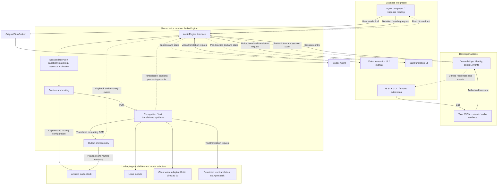

# TakuOS Audio Engine: voice AI infrastructure specification

- Status: **Implementation in progress. BYOK and top-level voice-model settings are implemented; S1 shared sessions, local dictation, and JS/CLI are under acceptance; S2 full/streaming response reading is connected; S3 Kotoba, Grok, hybrid, and Whisper segmented-caption single-utterance device checks passed, and a short synthetic-video native-overlay flow is verified, with YouTube deferred; S4 bidirectional routing and short-session cancellation checks passed, with real calls awaiting acceptance; S6 half-duplex single-round device checks passed recognition, automatic sending, audible responses, and automatic return to listening; voice interruption and echo await acceptance, while new migration of existing Codex realtime is deferred pending separate API authorization.**
- Date: 2026-10-26; last revised: 2026-10-28
- Working branch: `audio-engine`, based on `main@e9a9b56`
- Existing implementation reference: `audio-translation@d95c8f9`; that branch is retained and capabilities migrate incrementally.

## 1. Deliverables

Build a shared TakuOS voice AI module so Agent, video translation, and call translation use the same audio capture, recognition, synthesis, routing, and session management. **The audio-engine module is implemented in Kotlin**, including device sessions, capture/routing, model adapters, invocation bridge, and native client. It provides compatibility interfaces to the existing Java assistant and exposes public capabilities to the **JS SDK, CLI, and trusted extensions** through the project's unified JSON contract. Callers in different languages share one audio session and state authority. Necessary AIDL/JNI, third-party native inference libraries, and the existing JS SDK retain their technical forms; underlying inference libraries are not reimplemented in Kotlin.

The first delivery path is **Agent microphone → live transcription → composer draft → user sends → original Agent**. Agent response reading follows, then existing video captions, translated audio, and call translation migrate. Functionality can expand without tying the interface to one translation app or model.

This document distinguishes implemented settings entries from proposed voice infrastructure; see §9.1 for existing settings progress. Other capabilities are implemented/accepted by milestone. See [implementation progress](audio-engine-progress.md) for current delivery/validation scope; capabilities not listed as passed still follow this specification's milestone acceptance.

### Initial design recommendations

- Create an independent `system/audio-engine/` module owning audio sessions and device resources; business UI does not manage recognizers, players, or AudioPolicy directly.
- JS SDK / CLI integration is a first-release deliverable: expose session control, capability queries, transcription, and status events; realtime PCM and model inference stay in the device Kotlin module.
- Prefer local speech as an Agent dictation candidate while retaining cloud paths; **the default model depends on quality/latency acceptance for that scenario**. Do not transfer model rankings from video directly to microphone input.
- Retain end-to-end cloud voice adapters and support local recognition → text translation → local synthesis; do not force every model into the same three-stage pipeline.
- The first milestone delivers usable Agent voice input; video and calls migrate and pass acceptance separately.
- Users manually add fal API keys in the separate Taku Audio app; device Kotlin adapters connect directly to fal, reusing credentials/model preferences in existing root storage.

### Implementation and testing principles

Fixtures and acceptance requirements should match real use, with complexity proportionate to the current phase and failure probability/impact. Establish the normal path first, then common failures and existing regressions; do not build defenses/test matrices for arbitrary theoretical timing, infinite load, or every device combination.

- Fixtures supply only inputs, controlled dependencies, and observations needed to verify behavior: fixed audio for recognition, controlled latency for cancellation, two UIDs for source isolation. Do not duplicate the entire Android audio stack or create a general fault-simulation platform.
- Permission checks, stop/routing release, draft protection, and bounded queues are necessary constraints; prefer platform lifecycles and simple cleanup. New retries, state layers, or compatibility branches should address actual platform requirements, known issues, or reproducible failures.
- Zero latency, zero recognition errors, guaranteed failure recovery, and guaranteed delivery of every event are not required. When a system/connection fails, clean up best-effort and report failure/unknown state while communication remains possible, allowing retries; do not claim success for unobservable results.
- Add real-model, physical-device, and call-combination acceptance incrementally by milestone. Document unsupported combinations rather than exhaustively testing them ahead of time; calibrate performance/quality targets with representative measurements instead of layering implementation around unverified numbers.

## 2. Existing foundations and assumptions that cannot carry over

| Source | Reusable foundation | Current limitation |
| --- | --- | --- |
| main assistant | Microphone button, drafts, original Agent send flow; 24kHz PCM recording, AudioTrack, native realtime protocol | Composer relies on an existing system recognizer; bundled RecognitionService only returns unavailable; existing WebSocket probe failed before reaching upstream because no local API key was available; subscription WebRTC path untested |
| audio-translation audio layer | Media capture by selected app UID, original-audio retention/replacement, bidirectional call routing, PCM resampling, stop/recovery, isolation tests | Based on Android 16 development environment; Android 17, real WeChat/LINE, and Bluetooth need renewed acceptance |
| audio-translation model layer | Zipformer streaming recognition, Kokoro synthesis, fal captions/live translated audio, text translation, voice catalog, switchable pipelines | Current “local voice” path still translates text online; public videos had recognition errors; candidate models cannot immediately become defaults |
| main system AI | Taku AI settings, existing account/Magpie/model management, app authorization, call status | Public generation interface currently centers on text/images, not an audio-stream interface |
| main JS SDK / CLI | `TakuClient.call`, `taku/0.1` JSON requests/responses, method registry, ADB/device transport | Currently only three read-only device methods; parameter validation rejects nonempty params; events have only a schema, no subscription transport; no audio methods |

The latest experiment used the same 12-second public-video audio, three rounds per pipeline:

| Pipeline | Median time to first non-silent translated PCM | Range |
| --- | ---: | ---: |
| fal / Kotoba | 2339 ms | 2215–2341 ms |
| Zipformer → fast cloud text translation → Kokoro | 3454 ms | 3364–4037 ms |
| Moonshine Small → cloud text translation → MeloTTS | 3912 ms | 3791–5260 ms |

This is a fixed-sample ARM64 Android 16 AVD experiment excluding model preparation, connection establishment, and speaker hardware time; three rounds cannot establish P95. The report states `qualityApproved=false`, so this is not semantic acceptance and cannot predict Pixel 9, live calls, or arbitrary languages. Raw data remains in this workspace's ignored `out/speech-speed-native/summary.json`, not a file link assumed to exist in other checkouts.

Archive those reports and code versions together during migration; the first migration tests should regenerate a baseline on the new branch. Old experiments are not evidence that the new implementation passes.

## 3. User scenarios and scope

| Scenario | Expected behavior | Priority |
| --- | --- | --- |
| Agent voice input | Tap microphone to start, show partial recognition; final text enters current draft after stopping, ready to edit, continue speaking, or send | P0 |
| JS SDK / CLI calls | Trusted scripts discover voice capabilities, control their own sessions, and receive transcripts/status, sharing implementation and authorization with native clients | P0 |
| Agent response reading | Tap to read a completed response, with stop and voice preferences; later play completed sentences from streaming responses | P1 |
| Video speech → captions | Enable translation for the chosen video app, retain original audio, show source/translation in an overlay with auto-follow and review | P1 |
| Video speech → translated audio | Choose target language/voice, retain or replace original audio, restore original routing on stop | P1 |
| Third-party bidirectional call translation | Translate incoming/outgoing speech separately with independent voices; restore original call audio on stop | P2 |
| Continuous voice Agent | Explicitly enabled conversation mode automatically segments, sends, and plays answers, later supporting voice interruption | P3 |
| Other trusted callers | Input methods, accessibility scenarios, and other system apps use recognition/synthesis through the same interface | Future extension |

Initial language acceptance covers Chinese, English, and both translation directions. Adapter capability declarations determine the language set; the interface uses BCP 47 tags rather than hardcoding two languages. Automatic language detection is exposed only when actually supported and accepted; otherwise require explicit selection.

Continuous background listening, low-power wake words, voiceprint identity, voice cloning, cellular telephone paths, background-music separation, video lip synchronization, generic meeting notes, and automatic Memory writes are not first-release acceptance items. Future additions use the same session/authorization mechanism.

## 4. Module and interface

### 4.1 Business callers hold sessions only

Expose the same `AudioEngine` session contract through Kotlin/Java native clients and JS/JSON, hiding audio conversion, model loading, threads, backlog, focus, device changes, and routing recovery. Native clients bind to a separate process through Binder; JS SDK / CLI enter the same interface through a device bridge. The current CLI development transport uses a device-local socket restricted to root/shell and shares the Kotlin runtime with Binder, without an independent app_process impersonating an Android app to bindService. Audio is processed inside Audio Engine, not sent frame by frame through TaskBroker, JS, or assistant UI.



Solid lines indicate calls/audio processing; dashed lines return events. Native and JS callers share device sessions; model adapters follow the selected Profile. Agent dictation enters a draft first and reaches the original Agent execution flow only after the user sends it.

Suggested directories below describe proposed responsibilities, not necessarily existing implementations:

```text
system/audio-engine/
  contract/     Session requests, capabilities, events, errors, versions
  client/       Kotlin implementation directly usable from Java
  bridge/       Device adapter from JSON commands/events to the same sessions
  runtime/      Sessions, resource leases, buffering, audio clocks, stop/recovery
  capture/      Microphone, target-app media, call routing adapters
  providers/    Local recognition/synthesis, cloud streaming voice, text translation adapters
  models/       Model inventory, licenses, integrity, installation state
  tests/        Interface regression, device capture, quality/speed benchmarks
```

JS wrappers belong in existing `sdk/`; method dispatch/transport extensions use `core/` and `adapters/`, with method schemas in `spec/`. Do not duplicate another JS SDK inside the system APK.

The proposed module is a `TakuAudioEngine` system APK with package/native-client namespace `org.agentos.audio`, platform-signed with its own app UID and bound process, without root or the assistant's shared UID. Audio privileges, IPC access, and SELinux configuration ship with each feature; platform signing alone does not prove permissions are effective. The initial version serves trusted system callers and authorized development/Owner Agent environments, without first changing Android framework or adding another Agent, task database, or account system.

### 4.2 Minimal native-client call model

This is a design sketch; final types, Binder contract, and version compatibility are completed during implementation:

```kotlin
interface AudioEngine {
    fun capabilities(callback: CapabilitiesCallback)
    fun open(request: SessionRequest, listener: SessionListener): AudioSession
}

interface AudioSession {
    val id: String
    fun submit(text: TextChunk) // Reading sessions only; submit completed text in order
    fun finishInput()          // Stop accepting input; bounded drain per adapter contract; Closed confirms completion
    fun close()                // Request immediate cancellation without draining queued playback
}
```

`open` immediately returns a session handle; loading/connection are asynchronous. Do not claim capture started before `Ready`. Callbacks use ordinary interfaces so Java callers need no coroutines. Control operations do not block the UI thread.

`SessionRequest` contains purpose, source, output mode, source/target languages, voice ID, processing policy, and configuration revision. Binder UID/signature verification establishes caller identity; request fields cannot self-declare identity or acquire another caller's session.

| Purpose | Audio source | Business output |
| --- | --- | --- |
| `DICTATION` | Microphone | Partial and final transcripts |
| `SPEAK` | Caller-submitted text | Playback state, progress, completion |
| `MEDIA_TRANSLATE` | Explicitly selected app media | Source/translated text, optional translated audio |
| `CALL_TRANSLATE` | Explicitly selected app call + microphone | Per-direction source/translated text, downlink playback, uplink injection |

Capability queries return available purposes, languages, voices, processing location, required authorization, resource readiness, and unavailability reasons. They distinguish “adapter registered,” “model installed,” “service configured,” and “currently startable”; a catalog entry is not service availability.

`profileId` references controlled configuration; it does not accept arbitrary URLs, model file paths, or credentials. A session binds to the configuration snapshot at opening; the requested revision only checks whether the chosen configuration remains valid, verified by the engine with the configuration provider. To actively change processing policy, language, or voice while running, close the old session and open another, isolating old results by session generation; see §9.3 for changing defaults in settings.

### 4.3 Events and errors

Lifecycle events and status queries consistently use `Preparing / Ready / Running / Draining / Stopping / Closed`. `Listening / Text / Playback` are activities/results within a state, not another lifecycle; Draining can still deliver final Text and Playback. Every event carries session ID, generation, ordered sequence number, and monotonic time; text events also carry direction, `segmentId`, revision, text kind, and finality.

DICTATION `Level` activity events carry actual microphone PCM RMS volume `level`, normalizing -60 dBFS through 0 dBFS to 0–1, with sampling-window `frames` and `sampleRate`. They are delivered only while Running and do not change text-segment numbering. Desktop and Agent use the same history; no waveform activity is fabricated without samples. fal dictation produces replaceable previews for new captured audio, with full transcription after stopping finalizing the same segment.

- Partial transcripts replace only their segment's preview; final transcripts are immutable and not appended twice.
- Events are delivered serially within a session; slow UI can coalesce obsolete previews. Normal draining delivers final text before Closed; cancellation/failure does not wait for unfinished results, and terminal state explains incompletion.
- Binder events have size limits; long text is segmented. Do not stream continuous base64 PCM through Binder.
- `Closed` is the sole terminal state, containing termination reason, processing status of accepted content (complete/incomplete/unknown), and confirmable resource-recovery state. Report failed/unknown cleanup honestly and stop using the old handle. Later starts check actual platform resources, without demanding nonexistent recovery-readback APIs or creating infinite recovery loops.
- Fixed error types include permission denied, resources busy, unsupported language/voice, missing model, unconfigured service, vanished source, capture muted, network failure, processing timeout, queue backlog, and routing-recovery failure. Normal quiet pauses are not automatically faults.
- Missing permissions, unavailable engine, empty recognition, or service errors must not fabricate text or send the user's draft automatically.

### 4.4 Internal boundaries and adapters

Create internal boundaries only where capabilities already differ: microphone versus app audio, local versus cloud recognition, local versus cloud synthesis, and staged versus end-to-end voice translation.

Local composition produces `PCM → ASR → TextTranslator → TTS → PCM`; a cloud STS adapter can directly implement `PCM → translated text/audio` without pretending to supply separate ASR and TTS. Adapters must identify whether received text is source or translation to avoid mislabeling fal events.

Source and model adapters are independently replaceable: switching Kotoba, Zipformer, or another model does not change target-app capture. Device-routing and external-model failures converge and recover through the same session.

### 4.5 JS SDK / CLI contract

The existing public call path is `sdk/client.mjs → core/facade.mjs → adapters/android-shell.mjs → device entry`. It uses `taku/0.1` requests/responses, maps errors to JS `TakuError`, and registers methods in `core/methods.json`. SDK, CLI, and direct native/shell access may coexist. Public audio capabilities require a JS entry, not exposure of every internal Kotlin class.

The table is the target contract. S1/S2 connect capabilities, open, append, finish, close, and status for local dictation/reading; S3 adds experimental per-app MEDIA_TRANSLATE parameters; S4 adds CALL_TRANSLATE and outgoingProfileId/outgoingVoiceId/outgoingSpeed, supporting fal-kotoba, fal-grok, and local-hybrid. See [module documentation](../system/audio-engine/README.md) for current parameters/calls. Native clients and JSON methods share parameter semantics, session state, and error categories:

| JSON method | Main inputs | Return/behavior |
| --- | --- | --- |
| `audio.capabilities` | Optional purpose/language filters | Supported capabilities, profiles, voices, authorization, resource readiness |
| `audio.session.open` | SessionRequest, idempotent request identifier | Session ID, generation, initial state; events confirm readiness |
| `audio.session.append` | Session ID, ordered TextChunk | Reading accepts bounded, deduplicated text; no arbitrary raw PCM |
| `audio.session.finish` | Session ID | Request input stop and bounded draining, corresponding to `finishInput`; Closed confirms actual completion |
| `audio.session.close` | Session ID | Cancellation/recovery request; `Closed` or status queries confirm final recovery state |
| `audio.session.status` | Session ID | Current generation, phase, processing location; after ending, reason, content completion, and recovery state, without leaking other sessions' content |

`audio.capabilities` supports optional `purpose` / `language` filtering of `availability`; existing voice catalogs, profiles, and permission summaries remain global. Each item distinguishes registration, configuration, local-model resources, and current startup prerequisites, returning missing permissions/reasons; source capture, cloud authorization, and connectivity are checked at actual startup. `resourceState` exposes purpose, profile, phase, and whether ownership belongs to the current connection, excluding other session IDs, caller identities, and content. Stopping remains occupied until release confirmation. Last recovery results describe only the most recent session in the current service lifetime and become unknown after service restart.

The top-level Taku AI “Voice status” entry displays these diagnostics/current media volume read-only, without recording, playing, or changing volume. JS/CLI capability queries can independently start the host service and release it when the connection closes; actual audio sessions still require a visible developer window. This development-connection mechanism does not replace S5 ROM builds/permission integration.

The JS SDK wraps these `client.call(method, params)` calls and supplies a session-level async event iterator; native callbacks and JS events project the same device state. Events retain the protocol envelope, with session ID, generation, sequence, monotonic time, event kind, and bounded results in `data`. Control-response `ok:true` means only that command succeeded, not that capture, recognition, or recovery is complete.

No general event service exists. S1 adds an audio-specific persistent transport, but session transport, event ordering, and cancellation must still pass the following acceptance, rather than claiming streaming merely from event-schema registration:

- Establish event reception before SDK session opening to avoid losing early Ready/final transcripts; CLI session commands remain alive and output events line by line. Existing one-shot commands retain single-JSON-output semantics.
- The device bridge holds native session handles and binds them to actual caller identity/connection. SDK closure, CLI interruption, or transport loss cancels that session/restores routing; initial release does not automatically reconnect/replay capture commands.
- `open`/`append` deduplication keys are scoped to identity/connection. After request timeout, do not blindly create another session or reread text; query results while the connection remains valid, otherwise clean up.
- Slow JS consumers may coalesce previews, but final text/terminal state cannot silently disappear. Exceeding bounded buffers returns an explicit consumer-backlog error and stops; do not add recording/transcription databases for event recovery.
- Actual UID/SELinux, authorized ADB, and controlled device entry determine permissions. Self-reported extension IDs or possession of session IDs do not grant control; trusted-extension capability declarations still restrict callable methods but are not a sandbox.

Initial coverage is host Node.js via explicitly selected ADB devices and device transport with a prepared native Android Node.js environment. The engine itself requires no Node. Browsers cannot directly import the current SDK using `node:crypto`, filesystem, and subprocesses; React/WebView needs a separate controlled host adapter. Existing `Phone.callJson` serves generated-app business functions, not the complete OS audio capability, and is not a new system-permission channel.

Extend parameter validation, method dispatch, registry, CLI parameters, transport, and corresponding schemas together; the original three read-only methods still reject extra parameters. Do not add audio methods to current `methods.list` as implemented before actual implementation/validation. Verify compatibility for old/new requests and errors on transports without audio support.

## 5. Audio and lifecycle

### 5.1 Accept three audio sources separately

| Source | Proposed implementation | Required validation |
| --- | --- | --- |
| Microphone | Reuse AudioRecord, configuring source/sample rate/routing for recognition | Non-silent human speech, permissions, mute callbacks, focus/device changes |
| App media | Migrate target UID + `USAGE_MEDIA` AudioPolicy / AudioMix, copying or redirecting by mode | Target isolation, capture policy, foreground/pause behavior, original-audio restoration |
| App calls | Migrate target UID + `VOICE_COMMUNICATION` uplink/downlink routing; local recognition retains a separate microphone | Direction isolation, uplink injection, concurrent recording, hangup/process-death recovery |

Media capture and call interception are different capabilities. Ordinary MediaProjection playback capture cannot directly replace call-audio routing; report support separately. [Android playback capture](https://developer.android.com/media/platform/av-capture).

Honor target-app capture restrictions; do not use system privileges to silently upload audio allowed only for on-device use. Cloud availability depends on both source policy and user processing choice. [AudioAttributes capture policy](https://developer.android.com/reference/android/media/AudioAttributes).

### 5.2 Data format and route ownership

Internal PCM frames explicitly carry sample rate, channels, encoding, direction, monotonic time, and sample offset. The first local recognition adapter may retain 16kHz/mono/PCM16; convert cloud formats such as 24kHz at adapter boundaries instead of making 16kHz universal. Resampling preserves state across chunks; representative chunking verifies no lost samples/boundary jumps. Use reasonable implementation-specific numerical tolerances, not bit equality across inference libraries.

Each session exclusively owns its registered routes; initially only one capture/translation workflow per device holds the source lease. Ordinary Agent dictation returns resource-busy during third-party calls instead of silently taking the call microphone. Leases also check reading/translation output conflicts so translated output is not recognized again.

Existing `NativeVoiceView` creates AudioRecord/AudioTrack directly. S1 must first obtain the same resource lease through an internal compatibility interface, covering input/output and releasing on revocation, page exit, or Binder-client death. This lease interface is restricted to trusted legacy native entries, not public JS methods. If the new engine is unavailable or occupied, the old entry cannot directly record/play; S6 migrates its capture/playback into the engine and removes compatibility. Old translation A/B entries must likewise remain mutually exclusive with the new path.

Check permissions, prepare models, and establish external connections before acquiring platform sources/changing routes. Preparation may reserve a business-session slot to limit model concurrency, without implying capture/routing changes. Cancellation during warmup must prevent later capture; preparation without a source lease must still bound model memory/concurrency.

### 5.3 Ending and backlog

Normal flow is `Preparing → Ready → Running → Draining → Closed`; any nonterminal state can enter `Stopping → Closed`. `finishInput` stops capture/new text and enters Draining; repeated calls do not resubmit tails. During preparation before input acceptance, it stops preparation and closes directly. `close` can interrupt draining at any time, immediately rejecting frames, canceling network/model work, pausing/clearing playback, restoring audio policy, and reporting terminal state.

| Adapter | `finishInput` handling and completion |
| --- | --- |
| Local ASR | Process accepted PCM with supported end-input/tail-flush behavior and deliver final transcript; no speech normally returns an empty result without fabricated text |
| Local composed translation | After ASR tail completes, drain accepted text translations; if translated audio is needed, finish TTS/playback |
| Reading | Reject new TextChunks, synthesize accepted text, and wait until the player consumes its audio; submission to AudioTrack does not mean playback finished |
| Cloud STS | Declare end-input signal, final-text/audio completion evidence, and drain deadline; first verify how Kotoba's previously supported `input_audio_buffer.commit` ends the tail, rather than treating successful send/WebSocket close as completed processing. Map Grok's protocol separately |

Before enabling capture adapters, verify tail completion with an utterance not yet naturally segmented; verify reading drain with the last accepted TextChunk. Each gets a finite drain timeout. Without confirmable upstream completion, do not claim full draining; at deadline report processing timeout, mark incomplete/unknown, and release resources. Drain limits/buffer bounds accompany profile acceptance, without infinite waits. Normal completion requires final results delivered, pending audio consumed, and resources released; cancellation/failure may discard unfinished work but must state the reason.

- Model callbacks, network responses, and UI events check generation; old sessions cannot produce audio/drafts in the next one.
- Client death, service exit, system-muted recording, unexpected source loss, call hangup, and permission revocation use cancellation. Explicit normal input end and “Finish dictation” use draining. Silence alone does not prove a video ended.
- Measure input wait, untranslated text, model-output staging, and playback queues separately. One second of input and three untranslated segments are starting points for measurement, with a text-character cap; 500ms is only a playback-tuning reference, not a universal failure threshold for every model.
- Local TTS outputs chunks with cancelable backpressure controlling generation; cloud output permits bounded bursts, with separate reception/playback scheduling. Each profile specifies single-output size, total pending-audio duration/byte caps, and sustained-backlog windows; count adapter staging and AudioTrack buffers rather than hiding backlog elsewhere.
- Determine limits using representative long sentences/continuous input before enabling a profile. Normal bursts should subside; report backlog/stop only when total capacity is exceeded or processing persistently cannot catch up. Being below a queue-duration target does not prove acceptable end-to-end latency.
- Captions may coalesce previews, but final recognition and accepted translated audio cannot silently disappear. If realtime input outpaces processing, explicitly end/restore instead of extending playback delay indefinitely.
- Cloud timeouts/fallbacks have count/time limits; local or text-only policies must not automatically upload audio. Diagnostics record actual model and fallback reason.

Initial Agent microphone capture ends with the visible input UI and does not record continuously on lock screen by default. JS/CLI capture must bind to a platform-compliant visible device host with capture status/stop entry; reject unavailable hosts rather than recording in the background merely because remote JS remains alive. Cross-app translation requires a visible stop notification and purpose-appropriate foreground execution. Android 17 adds background-audio restrictions; older system UID, reflection, or `specialUse` declarations do not substitute for new-version acceptance. [Android 17 background-audio rules](https://developer.android.com/about/versions/17/changes/bg-audio), [foreground-service types](https://developer.android.com/develop/background-work/services/fgs/service-types).

## 6. Agent integration behavior

### 6.1 Dictation

1. The user taps the composer microphone; check model/language/microphone state, then show recording after readiness.
2. Partial text changes in a separate preview without repeatedly overwriting the draft body.
3. Bind thread ID, draft revision, and insertion position at startup. Insert final segments into that draft in order; module writes update its revision.
4. Manual edits, conversation changes, draft submission, or leaving the input UI end the round; late results cannot enter a new conversation or overwrite edits. Inserted text stays; uncommitted previews are canceled.
5. Tapping stop normally completes captured content; cancellation stops only this capture without clearing the original draft/attachments. Failures expose retryable state.
6. **Dictation does not send messages or create Agent tasks by default.** The original send button continues into existing TaskBroker / Codex.

Phase one replaces `ComposerToolbar`'s direct system-recognizer dependency. `RecognitionUnavailableService` retains its meaning until system-default recognizer integration is accepted; do not present it as an already-working systemwide RecognitionService.

### 6.2 Reading and continuous conversation

S2 adds read/stop buttons beside completed and generating replies; text passes through Markdown AST filtering of code blocks, HTML, images, etc. before reaching the engine. Taku AI “Local reading” selects voice/rate, and long-pressing a reply's read button opens the same settings. Full and streaming reading are supported; streaming submits completed sentences, not per-token TTS. Code blocks, tool logs, control protocols, and raw Markdown marks are not read directly. Text display does not wait for synthesis, and reading failure does not retract the response.

Stopping reading stops only sound; stopping the Agent task uses its original entry. New dictation first stops old reading. Automatic voice interruption, echo cancellation, and hands-free sending receive separate continuous-conversation acceptance; tapping to interrupt does not prove barge-in.

A default-off “Interruptible · Experimental” path is added, explicitly selected by long-pressing continuous conversation or using the microphone menu; normal taps retain turn-taking. Public SPEAK accepts boolean `interruptible`; recording, enabled device AEC, Zipformer, and Kokoro share one engine lease. Nonempty recognized interruption stops queued reading, delivers the same recognizer's final short utterance, then releases resources. Interrupted is an in-session event; subsequent Draining may still deliver final source Text, while Closed distinguishes interrupted/incomplete and recovery results. This option uses microphone and media-playback foreground-service purposes and explicitly rejects missing microphone permission or unavailable AEC.

Continuous mode requests cancellation only of its bound old Agent task; acceptance of cancellation does not mean completion. It sends the interruption through the original composer only after both old-task terminal state and audio closure are confirmed. If waiting exceeds 5 seconds or cancellation fails, retain the final interruption in the original conversation's empty draft and exit, without overwriting edits or automatically pausing the Agent goal. Real echo behavior, false triggers, human quality, and latency still need separate acceptance; compilation/lifecycle regression does not prove those effects.

### 6.3 Live Talk

The rightmost wave button in chat starts Live Talk after disclosing the possible audio recipients. **Keep talking** opens the same mode from a voice hold and keeps the existing Agent thread. Live Talk sends microphone audio, conversation context, and details needed for spoken task replies to the selected provider. The original Agent thread runs Agent tasks with its existing permissions.

Chat requests `purpose:"LIVE_TALK"` without a `profileId`. The Audio Engine uses the saved provider at open. Grok Voice via fal (`fal-grok`) is the default, and Google Gemini Live (`gemini-live`) is also available. Provider changes apply to the next open, including reconnect. There is no automatic fallback. Live Talk requires microphone permission and active acoustic echo cancellation. Playback can be interrupted while the microphone continues recording. Muting releases the microphone, stops playback, and discards unsubmitted audio. Ending Live Talk, locking the device, or leaving chat releases the session. Reconnect keeps the chat, mute state, and confirmed text context. The video control remains disabled.

The Audio Engine returns the effective `profileId` with the session ID. The Agent access API reports that ID in `liveTalk.provider`, which is null until the engine accepts the open request. The chat names the effective provider during the connection. Output subtitles have `source:"generated"` and no sample-aligned timestamps. Connection and audio errors appear in `liveTalk.error`. A missing or unreadable key reports `PROVIDER_NOT_CONFIGURED`. A rejected key reports `PROVIDER_AUTH_FAILED`. Removing the session's key reports `PROVIDER_REMOVED`. Other errors include `NETWORK_FAILED`, `RESOURCE_BUSY`, and `AEC_UNAVAILABLE`.

## 7. Video and call integration behavior

Video retains “Captions only / Captions and translated audio,” “Keep original / Replace original,” and voice preferences. Caption-only mode creates no TTS/player. Captions follow latest results by default; scrolling up pauses following and offers a return-to-latest entry, without updates stealing scroll position. Display cache is bounded, initially retaining the latest 4000 characters.

When changing pipeline, language, voice, or original-audio mode, release old routes before creating new ones. Stop, network loss, and timeout restore original audio without changing global volume. Browser capture by app UID must say it applies to the browser, not claim one web page only.

Calls retain separate uplink/downlink languages, voices, and policies. First run synthetic call fixtures with two UIDs, then accept WeChat and LINE separately. Cover common voice calls first, later adding video, headsets, Bluetooth, and lock screen as planned, without requiring every permutation. Untested combinations are unavailable/experimental; framework permissions do not prove compatibility.

Call mode must not fake integration by changing global mute, taking the original app's AudioManager mode, or recording speakers. Demonstrate target-UID PCM acquisition, translated-audio injection, and actual restoration after stop.

## 8. Models, voices, and runtime configuration

| Profile | Initial adapter candidate | Purpose and processing location |
| --- | --- | --- |
| Local dictation | sherpa-onnx + Chinese/English Zipformer; existing device recognizer may be another adapter | Audio/text stay local for Agent dictation; actual microphone needs retesting |
| Local reading | sherpa-onnx + Kokoro | Text to local speech; voice ID must match language |
| Hybrid translation | Local ASR → restricted cloud text translation → optional local TTS | Only recognized text leaves the device; translation needs network |
| Cloud captions | fal Whisper segmented recognition + system text translation, connected as experimental profile | Device uploads short WAV to fal temporary-file service for Whisper; captions only, original audio retained, no TTS/player. Requests 300-second expiry; fal controls actual retention. Not native streaming ASR |
| Cloud live translated audio | Default Kotoba STS; retain Grok adapter for comparison | Device adapter connects directly to fal, streaming translated text/audio according to actual capabilities |
| Live Talk | `fal-grok` (Grok Voice via fal) or `gemini-live` (Google Gemini Live) | `LIVE_TALK` uses cloud audio for duplex conversation. Translation sessions with `fal-grok` keep their purpose-specific behavior. |
| Existing realtime | main native realtime-session integration | Current Codex realtime uses a separate OpenAI API key; retain legacy experimental entry, without subscription integration/new realtime adapter this round. Continuous conversation uses local ASR → original Agent text conversation → local TTS |

Moonshine, MeloTTS, and others remain independent candidates rather than defaults based on one faster measurement. The old Azure implementation stays on the reference branch; first migration adds no Azure dependency and does not delete the old path.

The confirmed default cloud live-translation model is **Kotoba STS**, endpoint `wss://fal.run/kotoba-technologies/kotoba-sts/v1/realtime_voice`. Whisper is a separate short-audio recognition path, not a replacement. This default applies only to cloud live translated audio; local Agent dictation selection is independent. Preserve saved user choices during migration; old branch `MediaTranslationOptions` still defaults to `grok` without configuration, so the new module must explicitly choose Kotoba rather than claiming the old source already agrees. Default selection is not quality acceptance.

Taku AI adds “Local reading” voice/rate settings; the full target remains input language, recognition profile, output voice/rate, translation profile, processing location, and resource state. Reuse the system master toggle, consumer authorization, and existing account. Turning off system AI terminates managed voice sessions; the voice sub-toggle alone affects voice without changing ordinary text-Agent policy.

Models use separate language/capability resource packages, pinning versions, URLs, SHA-256, extracted file inventories, and licenses. Download to staging and activate atomically after verification. Missing models prompt resource preparation, without uncontrolled background downloads. Uninstall/switch must not destroy files still used by sessions.

Package reports separately state base APK, native libraries per ABI, download/install size per language model, peak installation size, and loaded memory. Roughly 500MiB of local weights from the old implementation should not be copied unconditionally for every caller or bundled wholesale in the base system APK. Development may deploy the same pinned packages offline; measurements determine release-image preinstallation.

### 8.1 Native Codex audio verification (2026-10-27)

`codex-audio-checker` independently inspected pinned Codex `rust-v0.161.0` (`979011409de0a60b52f179721948e65531d26144`) and historical probes. This was source/evidence review, with no new device/model tests.

- **Confirmed failure cause**: current UI and independent probes explicitly select WebSocket. Pinned-core `realtime_api_key()` produces `realtime conversation requires API key auth` before connecting upstream if no usable key exists; ChatGPT login credentials are not the API key this branch requires. This is not an upstream HTTP 401/403 response. [Authentication check](https://github.com/openai/codex/blob/rust-v0.161.0/codex-rs/core/src/realtime_conversation.rs#L1873), [authentication types](https://github.com/openai/codex/blob/rust-v0.161.0/codex-rs/login/src/auth/manager.rs#L565).
- **Another unverified path**: WebRTC in the same version creates calls using current authentication and includes ChatGPT backend support; actual account availability/Android media connectivity are untested here. WebSocket failure cannot establish that subscriptions support no native audio. Simply deleting transport is insufficient: default remains WebSocket, and WebRTC requires SDP/media handling. [Transport branch](https://github.com/openai/codex/blob/rust-v0.161.0/codex-rs/core/src/realtime_conversation.rs#L1407), [current authentication](https://github.com/openai/codex/blob/rust-v0.161.0/codex-rs/core/src/client.rs#L675), [call request](https://github.com/openai/codex/blob/rust-v0.161.0/codex-rs/codex-api/src/endpoint/realtime_call.rs#L146).
- **Historical test scope**: ignored `out/call-translation-codex/CodexAudioProbe.kt` and `acceptance.json` probe startup only, with no audio input; `authorizationRejected` classifies error text, not HTTP status. The built-in voice catalog does not prove service authorization. Passing `CodexTranslationEngine` tests are Zipformer → Codex text translation → Kokoro, not native simultaneous audio translation or a Kotoba performance comparison.
- **Selection boundary**: the independent OpenAI Realtime Translation API is another candidate, distinct from native Codex realtime or existing subscription-login capability. It uses a normal OpenAI project API key with appropriate permissions/billing allowance, not an “audio-specific key.” It currently provides continuous translated audio/captions but no fixed voice selection. It is not connected/benchmarked here and does not change the Kotoba default. [API guide](https://developers.openai.com/api/docs/guides/realtime-translation), [voice limitation](https://developers.openai.com/cookbook/examples/voice_solutions/realtime_translation_guide).

Under the user's latest decision, further Codex realtime work requires a separate OpenAI API key; do not continue attempting subscription integration or let it block local ASR → original Agent text conversation → local TTS. Once the chosen authorization exists, first verify startup, synthetic English input, and audible output, then compare against Kotoba with the same track. Preconnection failure is not model quality/performance failure; retain existing login without making account replacement a test prerequisite.

## 9. Credentials and invocation authorization

Recognition, synthesis, and translation each declare `LOCAL_ONLY`, `ALLOW_TEXT_CLOUD`, or `ALLOW_AUDIO_CLOUD` requirements. Reject profiles incompatible with the session; capability limits and user choices both apply.

Android runtime configuration uses Taku AI. fal uses existing root-private files; other credentials already using Keystore retain their storage, without claiming fal is Keystore-encrypted. APKs do not read developer-machine environment variables or embed keys in BuildConfig, resources, or source. Reuse existing accounts without creating another Codex login copy.

### 9.1 fal provider: manual configuration and device integration

The user entry is **Taku Audio**, managing the fal API key, default voice model, voice toggle, video/call translation, local reading, and voice status. Users can manually enter, replace, or delete the fal key without another credential copy. Saving means configured, not provider-verified. Opening/saving settings makes no paid voice requests.

The target call path is **Audio Engine device Kotlin adapter → selected fal model**. Audio Engine owns capture, sessions, playback, and routing recovery; adapters own fal protocol, authentication, and audio transfer. The fal key is independent of ChatGPT/Codex login; fal requires no prior Codex login and creates no main-assistant Agent task.

- Keys use existing device-private storage managed by root Broker. Local `taku-audio-config` lets the engine read configuration, subscribe to changes, and obtain connection credentials; it is a control/credential channel, while Kotlin adapters connect audio directly to fal. Public Taku Audio settings operations are separate from runtime key retrieval; settings readback contains only masks/configuration state.
- Broker checks socket peer UID with PackageManager against installed `org.agentos.audio`, its independent UID, and platform signature, rejecting self-reported package names/other UIDs; required SELinux rules ship with the interface. Existing root/system access to `taku-agent-native` is not expanded.
- Only this engine's credential-retrieval request returns the fal key; ordinary snapshots/change events omit it. The engine holds it only in connection-required memory, saves no extra file, and releases references when destroying the connection. JS SDK/business UI hold only provider/profile references; readback after saving is masked/configured-state only. Logs/session events exclude keys.
- Profiles associate a configured fal provider, specific model, and purpose, exposing ASR, TTS, or realtime translated audio according to actual integration, with model-declared language/voice/streaming support. Voice-profile changes do not change the main Agent model connection.
- Kotoba STS uses WebSocket handshake `Authorization: Key …`, sending JSON events such as `voice_session.update` and `input_audio_buffer.append` and continuously returning translated text/synthesized PCM. Migrate upstream protocol handling from old `KotobaTunnel.kt:92–118` into the device Kotlin adapter. [Kotoba STS contract](https://fal.ai/models/kotoba-technologies/kotoba-sts/v1/realtime_voice/api).
- Connect default Kotoba STS first; accept receiving translations/audio while continuously sending audio, plus cancellation/closure. Whisper JSON/audio-file requests are another adapter added as needed, not a Kotoba prerequisite or an attempt to cover every fal model at once.
- Updated keys apply on the next connection. Deleting a provider stops dependent voice sessions and restores audio. Authentication failures, exhausted quota, or network loss show actionable errors without switching to unselected credentials/providers.

Old fal development host `.env.local` / `FAL_KEY` and relays remain only for old-path A/B, explicitly labeled development transport, without automatic import into user configuration. The new path works independently after Android manual configuration, without a computer or `adb reverse`.

#### Early BYOK settings implementation (2026-10-27)

Taku AI adds native “BYOK · Bring your own API key,” supporting add/replace/remove for fal and OpenRouter. OpenRouter reuses pinned Magpie provider/keys APIs to read existing services and update the selected key without overwriting models/routes. Adding a service does not switch the assistant connection automatically.

The Taku AI top-level page adds “fal voice model” beside text/image models, defaulting to Kotoba STS with Grok Voice optional. Without a fal key it is disabled and rejects changes; returning from BYOK refreshes automatically. Model preference is saved independently and survives key replacement/deletion.

The device Kotlin Kotoba adapter is connected and passed direct synthetic single-utterance testing; the full video path is still under acceptance. Grok and local ASR/cloud text translation/local TTS are connected and passed single-utterance device validation. Manually entered fal keys are stored in device root-private `/data/local/agentos/ai/credentials/fal.json` (directory 0700, file 0600); settings provide “Video translation · Experimental.” The adapter reuses this credential through a restricted channel, without importing host `.env.local`.

Native settings manage credentials through a root/system-only in-memory channel; readback contains service identifiers/masks, never raw keys to JS, ordinary apps, or task files. Successful saving means verified persistence, not upstream authentication or a completed paid model call.

#### Migration to standalone Taku Audio

The standalone entry reuses `org.agentos.audio` package, signature, and data directory. Existing Taku Home discovers its standard `MAIN/LAUNCHER` Activity. Existing desktop layout, `MediaTranslationActivity`, translation preferences, and session controller retain ownership, without changing Home, Launcher3, or rebuilding the system image.

GUI and Agent share the `settings` method at `content://org.agentos.audio.open-access`. Operations include `read`, `saveFalKey`, `removeFalKey`, `selectFalModel`, `setAudioEnabled`, `configureReading`, and `resetReading`. The root configuration module performs the same validation, persistence, and revision notifications. fal settings bypass comprehensive BYOK status reads that depend on OpenRouter. The old assistant page removes its fal editor and opens Taku Audio; OpenRouter settings remain.

Ordinary readback includes system and voice toggles, configuration revision, reading preferences, and masked credential status. Public commands expose settings actions. Full credentials and translation runtime operations use private channels. Full parameter and error contracts are in the preinstalled system AI settings guide.

The 2026-10-27 BYOK section records the earlier entry's initial implementation. New app entry/settings migration still require component builds and isolated-emulator acceptance; old acceptance is not evidence this migration passed.

#### Live Talk provider and credentials

`selectLiveProvider` sets `profileId` to `fal-grok` or `gemini-live`. Grok uses the fal key shared with cloud dictation and translation. `saveFalKey` and `removeFalKey` manage that key. `saveLiveKey` and `removeLiveKey` manage the separate Gemini key. Both save actions take a string `key` and check its format locally. Removing a key stops active sessions that depend on it. The selected provider remains saved.

The settings snapshot reports the selected provider as `result.live.profileId`. `result.live.configured` reflects whether the selected key is readable. `result.live.gemini` contains the Gemini key's `configured`, `masked`, and `error` fields. `result.fal.model` controls the translation model independently of Live Talk.

The Audio Engine reads the selected provider's credentials through its private broker channel under the system and voice AI policy.

### 9.2 Invocation authorization and data

Native clients validate Binder UID, signature, and capability by purpose; JS SDK / CLI use an authorized device bridge with identical processing policies and source-foreground requirements. Forwarding bridge UID must not elevate arbitrary web pages/extensions. Future ordinary-app access needs independent authorization/quotas; apps cannot choose arbitrary targets, acquire call-routing permission, or read raw PCM.

By default, runtime does not persist raw audio, transcripts, or translations. User-confirmed Agent drafts/conversations retain existing storage behavior, clearly distinguished in UI. Recognition results are user input/external content, not system instructions; they neither unlock tools nor automatically enter Memory.

### 9.3 Configuration snapshots, changes, and session revocation

S1/S2 implement credential-free snapshot subscriptions, system revision delivery, root-saved reading voice/rate, and audioRevision. S3 adds engine-UID-only fal credential reads and key/model revision notifications; actual add/update/delete revocation acceptance is not fully complete. Target mechanism: root Broker continues owning system configuration/BYOK writes. `SystemAi` retains existing `revision`; voice settings add Broker-maintained/persisted `audioRevision`, advanced by voice toggles, profiles, model preferences, and credential mutations. The engine uses `{systemRevision, audioRevision}` snapshots and does not accept client revision values overriding actual configuration. Existing `fal-model.json` preferences survive migration. Reading preferences currently live in root-private `ai/audio-settings.json`, saved/reset/pushed through the restricted channel; model/voice defaults affect subsequent sessions only.

`taku-audio-config` first subscribes and obtains the current snapshot, then pushes credential-free change notifications. The engine checks current authorization before model connection/capture. Broker orders saving/notifications; if an existing subscriber cannot be notified, it closes that subscription, the engine stops managed sessions, and new sessions require a fresh snapshot. Use this single device notification path, not another generic event bus/configuration database.

| Change | Existing sessions | Subsequent sessions |
| --- | --- | --- |
| Disable system AI/voice or revoke consumer authorization | Stop affected sessions: master switch affects all, consumer revocation only that consumer; release capture, connections, playback | Reject affected starts until reauthorized |
| Delete fal key/provider | Stop dependent sessions; local sessions continue | fal becomes unconfigured; model preference retained |
| Replace fal key | Established connections continue; next connection, including explicit reconnect, reads the new key | Use new key |
| Change default voice model/language/voice | Retain snapshot; explicit user switching closes/reopens the current session | Use new configuration |
| Change unrelated text/image settings | Do not indiscriminately stop voice because global revision changes | Re-resolve actual session dependencies |

`SystemAi.configure` adds voice configuration notifications/toggle; `ByokProviders` fal-key mutations/model selection use audioRevision notifications. Deletion revokes fal-dependent sessions; replacement does not interrupt established connections. S1 must accept master/voice switches and consumer revocation; S3 extends to fal credentials/profiles. Voice consumers follow existing per-app registration/authorization, with the device bridge mapping actual callers; a submitted `consumer` field cannot grant authorization.

## 10. Measurement and quality acceptance

### 10.1 Distinguish timing measures

Every metric records device, OS/API, commit, build hash, profile/actual model, thread, cold/warm start, input hash, network, and round. Device timing uses one monotonic clock, without directly subtracting host/device wall clocks.

| Metric | Definition |
| --- | --- |
| `prepareMs` | Open request to model/connection readiness; report resource-download time separately |
| `firstPartialMs` | First valid source-speech sample to first nonempty partial recognition |
| `speechEndToFinalMs` | Human-annotated/fixture-defined speech end to final transcript; VAD's own decision is not ground truth |
| `textToFirstPcmMs` | Acceptance of a complete text segment to first non-silent synthesized PCM |
| `sourceToTranslatedPcmMs` | First valid source-speech sample to first non-silent translated PCM |
| `speechEndToTranslatedPcmMs` | Source-speech end to first non-silent translated PCM; may be negative |
| `audibleLatencyMs` | Actual audible-output latency confirmed through loopback/device recording, measured separately |
| `stopRestoreMs` | Stop request to player cleared, source released, routing restoration confirmed |

Report success/failure/timeout counts and missing-data reasons for each, not only successful fast requests. Short experiments report individual values, median, and range; report P95 only with at least 30 valid samples and an explicit statistical method.

### 10.2 Suggested performance targets, not current commitments

These initial targets assume Pixel 9 / Android 17 with models ready and are intended for freezing after this review. Report first load, differing networks, and actual hardware playback separately; do not exclude failures to meet targets.

| Scenario | Target |
| --- | --- |
| Local Agent dictation | First partial P50 ≤ 1000ms; speech end to final text P50 ≤ 700ms, P95 ≤ 1200ms |
| Local short-utterance reading | Complete text to first non-silent PCM P50 ≤ 500ms, P95 ≤ 900ms |
| Stop | Normally request to stop/recovery confirmation P95 ≤ 500ms; timeouts must state recovery status |
| Video migration | Same device/input/profile: median first translated-audio segment regresses no more than 10% against premigration baseline, without quality loss |
| Sustained operation | 30 minutes with bounded memory/queues and no persistent latency growth; separately report ASR/TTS realtime factors, temperature, and power |

If a candidate misses targets, retain actual results, assess bottlenecks/experience, then choose profile, implementation, or target adjustments. Do not change timing definitions or make unproven numbers hard blockers for every stage. Video speed targets do not establish call-latency acceptance; calls separately time actual speakers' utterance endings and audible translation.

### 10.3 Quality and scenario gates

Sample sizes apply when preparing feature acceptance or choosing defaults, not every edit/iteration. Routine regression uses a few representative fixed samples; expand only for relevant behavior changes, failures, or release conclusions. Cover common failures/known risks individually, without combining all faults or enumerating every race.

- Dictation: at least 30 human recordings/utterances per language, covering short/long sentences, numbers, names, mixed Chinese/English, and noise; human annotation, Chinese CER and English WER. Suggested initial quiet-scene target ≤ 10% for each; report noise separately, without substituting TTS self-recognition.
- Translation: at least 10 passages per direction, including the existing two public videos and new material. Human review of key facts, negation, numbers, times, names, and omissions; separately report accuracy, completeness, and time to first correct translation, not keyword checks alone.
- Synthesis: at least 20 short/long/mixed-language samples per language, listening again for first words, numbers, names, and segmentation; another recognizer's success does not prove pronunciation. Critical numbers/negations must not reverse or disappear.
- Drafts: previews do not pollute body text; final segments do not duplicate; cancellation, conversation switches, edits, sending, and late-result collisions preserve original drafts/attachments.
- JS/CLI: actual JS SDK capability query, open, transcript events, finish/cancel, and recovery confirmation, checking the same state as native clients. Cover unauthorized access, invalid parameters, duplicate commands, slow consumers, CLI interruption, and disconnect. Method catalogs/static JSON cannot substitute.
- fal configuration/calls: manually add a key on Android, select one fal voice profile, verify actual device Kotlin adapter → fal requests/results and independence after disconnecting the development computer. Cover key update/deletion, authentication failure, and stop/recovery with a few fixed fixtures, not every fal model. Compare the same input against the old relay and report direct-device latency; use synthetic credentials for error cases and never save real keys in reports.
- Configuration/credentials: synthetic keys verify engine identity can read and others cannot; disabling master switch, revoking consumer, or deleting key during operation actually stops it. Key/default-model changes follow §9.3; no keys in reports.
- Finish/buffering: finish a short utterance before natural segmentation and confirm the last result; also test cancellation during draining, upstream noncompletion timeout, normal bursts, and sustained backlog. Use a few controlled fixtures, adding real-model acceptance when connecting each adapter.
- Routing: synthetic sources under two independent UIDs prove target isolation; stop, faults, process kill, and target exit prove original audio/microphone recovery.
- Captions: actual acceptance of long content, line breaks, auto-follow, review, and return-to-latest.
- Physical device: nonzero recorded bytes do not prove speech capture; playback initialization does not prove correct spoken output. Record completed/incomplete scope separately.

## 11. Migration from audio-translation

Do not merge the entire old Android 16 branch. Select migration content in this order and adapt anew to main's Android 17 audio stack, Broker, and Taku AI.

| Content | Reference implementation | Migration requirement |
| --- | --- | --- |
| PCM/resampling | `Pcm16`, `PcmResampler` | Retain long-audio integer-overflow/chunk-consistency regression |
| Session management | `TranslationSession` | Extract audio lifecycle; add finishInput, tail draining, unified states; retain generation/stop/routing-recovery constraints |
| main realtime voice entry | `NativeVoiceView` | S1 shared resource lease/revocation; S6 capture/playback migration and compatibility-interface removal |
| Local speech | `LocalSpeech`, `SpeechSynthesisCallback` | Separate resource installation from instances; retain JNI callback ABI validation |
| Media/call capture | `PlatformMediaAudio`, `PlatformCallAudio` | Adapt/test Android 17 separately, without copying reflection assumptions directly |
| Model pipelines | `MediaLocalEngine`, `FalMediaEngine`, `MediaCaptionEngine`, etc. | Shared interface, retaining both end-to-end and composed forms |
| UI capabilities | Original caption overlay, voice/output options | UI holds sessions only; retain familiar functionality and stop entries |
| Evidence/tools | Audio-routing fixtures, real cloud tests, same-input latency baseline | Separate builds from benchmarks; rerun on the new module, without reusing old passes |

Use explicit old/new switches for migration A/B without double capture. Keep original paths; propose default switching/removal only after new paths pass functionality, quality, recovery, and performance gates. New documentation/experiments must not overwrite the old branch.

## 12. Implementation milestones

| Stage | Deliverable | Completion criteria |
| --- | --- | --- |
| S0: design/settings preparation | audio-engine branch, this specification; implemented BYOK/top-level voice-model settings | Implement against authorized spec baseline; completed settings do not establish Audio Engine/fal audio acceptance |
| S1: shared foundation + dictation + JS entry | Sessions/capabilities, microphone, local ASR, Agent drafts, resource preparation, configuration notifications, legacy realtime mutual exclusion, JSON device bridge, JS SDK/CLI control/events | Development build/signature/IPC permissions; new-branch emulator and Pixel 9 human-speech transcription; native/JS loops; tail drain, draft/stop/disconnect recovery, switch revocation, legacy mutual exclusion; quality/latency report; offline local path |
| S2: reading | Local TTS, voice catalog, completed-response reading, then streaming sentences | Real audible output, text order, first-word/number quality, stop/dictation mutual exclusion |
| S3: video migration + fal | Captions, translated audio, original-audio modes, profiles; manual Taku AI fal keys, restricted reads/change notifications, device Kotlin adapter | Two old demos/new material, overlay review, A/B baseline, recovery, Android 17 device acceptance; device loop for credential authorization/update/deletion/tail finish/actual requests; normal bursts/sustained backlog separately accepted; host independence |
| S4: call migration | Bidirectional routing, independent languages/voices, controlled translation | Synthetic fixtures and real WeChat/LINE calls accepted separately; enumerate supported headset/Bluetooth/video combinations |
| S5: standalone/ROM | Host independence, model delivery, system settings, Soong integration | Works after complete-image restart, preserves configuration/authorization, no temporary mounts; independent update/rollback verification |
| S6: continuous conversation/open reuse | VAD automatic turns, barge-in, legacy realtime capture/playback migration, more languages/trusted apps | Echo, interruption, concurrency, authorization, power, and added scenarios separately accepted |

Each stage first passes shared-interface behavior regression, then actual model/source tests. Do not add implementation-mirroring tests for small UI edits. CI uses minimal fixtures/deterministic input for key behavior; real cloud usage/device experiments are explicit separate acceptance. After relevant current-stage checks pass, proceed with delivery instead of repeatedly expanding tests for future stages/hypothetical extremes. Do not run long model downloads, benchmarks, and compilation simultaneously.

## 13. Design choices for this review

Recommended confirmation: make “shared voice module + Agent dictation + JS SDK/CLI entry” the first phase; prioritize local recognition/synthesis evaluation, default cloud live translated audio to Kotoba STS while retaining other cloud/hybrid profiles; migrate existing capabilities through S1–S5 and retain old paths for comparison; establish default-model scope/performance targets through physical-device quality acceptance.

fal uses manually configured keys in Taku AI and direct device Kotlin adapters. Validate the default recognizer and per-language resource preinstallation during implementation, without hardcoding them in business UI/public interfaces.

## 14. Basis and references

- Main assistant voice paths: [dictation](../system/agent-app/src/chat/useDictation.ts), [continuous conversation](../system/agent-app/src/chat/useLiveTalk.ts), and [historical voice acceptance](native-codex-implementation-2026-10-15.md).
- main: [Taku AI](../system/ai/README.md), [system surfaces](../system/surfaces/README.md), [engineering standards](standards.md), [Android 17 / 1.0.1 device-version acceptance](reviews/versioning-2026-10-26/README.md).
- Magpie used by existing system AI/OpenRouter: [device gateway/credentials](../adapters/magpie-runtime/README.md), [device startup configuration](../adapters/magpie-runtime/magpie), [existing model connections](../system/assistant/broker/org/agentos/lab/ModelConnection.java).
- Developer entries: [protocol/event status](protocol.md), [JS SDK](../sdk/client.mjs), [current method registry](../core/methods.json), [extensible system](extensibility.md), [React/WebView scope](../tooling/app-kit/README.md).
- Reference branch: `system/call-translation/README.md`, `src/org/taku/calltranslation/`, and `tests/native-speed/README.md` in `audio-translation@d95c8f9`; not migrated into this branch yet, so avoid same-path links mistakenly pointing to local caches.
- Android materials checked: 2026-10-26. Official documentation describes platform constraints; actual support still needs matching TakuOS builds/device acceptance.

Public request schema under implementation: [audio.schema.json](../spec/audio.schema.json). Current Kotlin clients support both typed AudioRequest and JSON open forms; request/chunk deduplication retains the latest 32 sessions/chunks within one connection identity, without promising replay across disconnects or indefinite retention.
