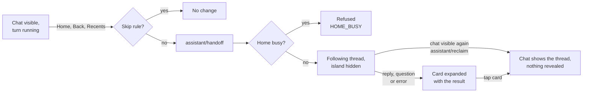

# BUG-0027 fix spec: a reply finished after leaving the chat opens in the Dynamic Island

Status: implemented on `vela/dynamic-island`, not yet compiled or verified on an emulator; see
[Implementation status](#implementation-status). Product decisions are recorded in
[Follow-ups and open questions](#follow-ups-and-open-questions).

## Summary

When the user leaves the full chat (Home, Back or Recents) while a turn is running, the chat hands
that thread to Home's island session **silently**. Nothing is drawn while Taku works. When the turn
finishes, the expanded island card opens with the reply, over whatever app the user is in. The
island only appears when it has something for the user to read or act on.

- **Bug:** BUG-0027, P1, module 对话. Steps: open the full chat from the launcher icon, start a
  long task, press Home without Collapse; the result never appears in the island.
- **Fix in this spec:** a hidden handoff on leave, and a one-time reveal of the expanded card when
  the turn finishes, needs the user, or fails.
- **No working capsule.** The rule that only app builds show a Taku capsule stays unchanged.
- **Out of scope:** an island driven by every running broker session (PRD Appendix B).

## Current behaviour

The island follows exactly one conversation, the thread held by Home's `AssistantSession`, and
the full chat only gives it a thread when the user presses Collapse. All paths below are on
`vela/dynamic-island` at `4140783f`.

| Path | What happens today | Code |
| --- | --- | --- |
| Island source | `IslandPublisherService` publishes one Taku card from `AssistantSession.state` (one `threadId`) | `system/agent-app/modules/taku-home/.../island/IslandPublisherService.kt:65` |
| Collapse button | `collapseToIsland` → provider `assistant/resume {threadId, home:false}` → then starts `HomeActivity` | `system/agent-app/modules/taku-agent/.../bridge/TakuAgentModule.kt:668` |
| Back in the chat | `hide()` flushes the draft → `closeAgent()` → `moveTaskToBack(true)`; no handoff | `system/agent-app/src/hooks/useAgentController.ts:300` |
| Home gesture / Recents | Activity stops; `ConversationVisibility` reports hidden; no handoff | `system/agent-app/modules/taku-agent/.../bridge/ConversationVisibility.kt:49` |
| Running turn | Lives in the broker, not in the chat; neither Back nor Home interrupts it | `system/assistant/broker/org/agentos/lab/TaskBroker.java` |
| Taku capsule | Only while an app build is active (`buildingApp`) | `IslandPublisherService.kt:144`, open-access skill `assistant/app-build` |
| Island hidden | `island = Hidden` cancels Taku's notification; the session can still stream its thread | `IslandPublisherService.kt:66` |
| Expansion | Only on explicit requests (`expansionRequest`) through `SystemIslandBridge.request("expand")`, which retries for about 1.5 s and then gives up | `IslandPublisherService.kt:177`, `island/SystemIslandBridge.kt:67` |

Two more facts constrain the fix:

- `AssistantSession.resume(id)` with a different thread calls `reset()`, which drops whatever Home
  was showing, including a running turn's stream (`AssistantSession.kt:1153`).
- SystemUI never suppresses Taku's card when the chat is in front, because Taku Agent is the home
  package (`system/island/src/.../IslandForeground.kt:66`). A pending reveal must be cancelled
  when the user returns to the chat, or the card would open on top of the same conversation.

Not yet verified on a device: that a turn left running in the background still reaches
`turn/completed`. The acceptance plan covers it.

## Goals and non-goals

The fix is done when a turn the user left running opens its result in the expanded island card
within 1 s of finishing, and the island shows nothing for that turn before then.

**Goals**

1. Leaving the full chat by Home, Recents or Back while its turn is running, queued or still being
   sent hands the thread to Home's session without drawing anything. A conversation already
   waiting on the user's answer is not handed off; the user just left that question.
2. When that turn completes, fails or needs the user, the expanded card opens once with the reply,
   error or question.
3. The card stays until the user acts on it; tapping it opens that conversation (existing
   `openConversation`).
4. Returning to the chat before the turn ends cancels the reveal; the island never shows a
   conversation the user is already looking at.
5. Agents get the same operations and can read the result, per AGENTS.md.

**Non-goals**

- Any visible working state (capsule, animation or card) while the turn runs.
- An island fed by every running broker session (PRD Appendix B). The island still holds one
  thread.
- Changing how turns run: the broker already continues them after the chat leaves.
- Idle conversations: leaving a chat with nothing running hands nothing off, as today.

## Design

The native chat module decides at the moment the chat stops being visible and calls a new Home
operation, `assistant/handoff`. Home keeps following the thread with the island hidden, and
reveals the card once when the turn reaches a state the user needs to see. A second operation,
`assistant/reclaim`, cancels the handoff when the chat returns. (`assistant/release` was already
taken: it releases a draft submission.)

A skipped or refused handoff leaves the turn running in the broker with no island entry, exactly
as today.

### 1. Trigger: native, at stop time

The decision runs in `TakuAgentModule` when `ConversationVisibility` reports the last chat host
stopped. It does not run in JS, because the React runtime may not get a frame after `onStop`.

- JS keeps native informed with a new `setHandoffCandidate(threadId, turnId, taskId)` (empty
  strings for none). `handoffCandidate()` in `src/model/islandHandoff.ts` names the selected
  thread with its active turn, its queued task, or neither for a send not yet reported; it returns
  null when the session is idle or waiting on a question.
- Home waits for that turn. With only a task, the first turn seen running after the handoff becomes
  the one to wait for, so an older finished turn the stream shows first is never revealed.
- Back, Home and Recents all end in the same `onStop`, so one code path covers the three routes in
  the bug.
- The decision is a pure function, `HandoffDecision.decide(...)`, so it can be unit-tested without
  Android.

| Skip when | Why |
| --- | --- |
| Candidate is `null` | Nothing is running; behaviour unchanged |
| `activity.isChangingConfigurations` | Rotation or theme change recreates the chat |
| `PowerManager.isInteractive == false` | Screen off; the user returns to the same chat |
| A `ComposerPicker` request is in flight | The chat opened the system picker itself |
| The last resumed activity is our own, other than `HomeActivity` | e.g. `ServiceSetupActivity` opened from the chat |

### 2. New Home operation: `assistant/handoff`

Provider `content://org.agentos.agent.home-assistant`, params `{"threadId":"ID","turnId"?,"taskId"?}`. It is a sibling
of `assistant/resume`, not a flag on it, because its rules differ: it never resets a busy session,
never expands and never draws anything.

| Home session state | Result |
| --- | --- |
| Already holds `ID` with the island showing | No change; `handedOff:false`, `reason:"ALREADY_SHOWN"` (covers the Collapse button, which hands off before Home starts) |
| Holds another thread that is working, needs the user, has voice or Live Talk active, has text entry open, or has its card expanded | Refused, `HOME_BUSY`; nothing changes |
| Otherwise | Follows `ID` as `resume` does (stream, polling, draft), with `island = Hidden`, no `expansionRequest`, a new `activityId`, and `handoff = true` |

It returns `{handedOff, reason}`. It never starts `HomeActivity`, never sends, stops or interrupts
a turn, and never writes the draft. While `handoff` is true and the island is hidden, no
notification is posted, so SystemUI has nothing to draw.

### 3. Reveal: the expanded card, once

Home reveals the card when a handed-off turn reaches one of these states. Each handoff reveals at
most once; `handoff` clears when it does.

| Turn reaches | Card shows |
| --- | --- |
| Completed with a reply | The reply (existing `message` phase), with its suggestion chips |
| Needs the user (question or approval) | The existing "Taku needs your confirmation" card |
| Failed | The existing "Taku couldn't finish" card, with Try again when available |
| Cancelled or stopped outside the card | Nothing; `handoff` clears |

The reveal sets `island = Expanded` and increments `expansionRequest`, the same explicit
expansion Home already uses. It does **not** use the protocol's `alert` flag: an alert card
closes itself after 5 s (`alert_timeout`), and Taku has no capsule to fall back to, so a reply
would disappear before it could be read.

Once revealed, the card follows existing island rules:

- It stays until the user taps it (opens the conversation), swipes it up (island hidden; the
  reply stays in the conversation), or returns to the chat.
- Taku's card is never suppressed by the app in front, so it opens over any app.
- **Deferred reveal.** `SystemIslandBridge.request("expand")` gives up after about 1.5 s. Home sets
  `revealPending = true` at the reveal and clears it when SystemUI accepts the expansion. Until
  then `IslandPublisherService` asks again on unlock (`ACTION_USER_PRESENT`) and every 3 s while the
  screen is on and unlocked, which covers the shade and landscape. It stops as soon as SystemUI
  reports the card expanded or the session no longer wants it, so a card the user swiped away is
  never expanded again. Any of the cancel events in §4 clears it.

An app-build turn keeps its existing "Building..." capsule while it runs. The reveal on completion
applies to it the same way.

### 4. Cancelling: `assistant/reclaim`

Params `{"threadId":"ID"}`. Native calls it when the chat becomes visible, selects `ID` while
visible, or receives an intent for `ID` (Feed, Panel) while visible.

- If Home holds `ID` with `handoff` or `revealPending` set, both clear and nothing is revealed.
- If Home holds `ID` with the card showing, the island goes `Hidden`, the same end state as
  `openConversation`. This also fixes the existing duplicate after an explicit Collapse followed
  by Recents back to the chat.
- The thread stays in the session, so the Home entry still continues it. Otherwise no change.

`handoff` and `revealPending` also clear on `openConversation`, `dismiss`, `reset`, `resume`,
and any explicit Home entry (double tap, hold) or Live Talk, because each of those means the user
has moved on.

## Conflicts with Home's session

Whatever Home is already doing wins; the handoff yields rather than replace it, because
`resume`'s `reset()` would silently drop a running Home turn.

| Situation when the chat leaves | Outcome | Reason |
| --- | --- | --- |
| Home holds the same thread, card showing (after Collapse) | No change (`ALREADY_SHOWN`) | The card already shows the turn and updates with the reply |
| Home holds the same thread, island hidden (e.g. opened from the island card) | Hand off; reveal on completion | Same thread, no reset needed |
| Home holds another thread that is working or needs the user | Refused (`HOME_BUSY`); no reveal for the chat's turn | Never drop a running Home turn; a known gap until the island can hold several sessions |
| Home holds another thread, idle, card hidden | Hand off; Home switches threads | The idle reply is still in its conversation |
| Home holds another thread, idle, card expanded | Refused (`HOME_BUSY`) | The user is reading that card |
| Voice hold, dictation or Live Talk active in Home | Refused (`HOME_BUSY`) | Never cut a microphone session |
| Home's text entry open | Refused (`HOME_BUSY`) | Would retarget a message being typed |

Between handoff and reveal, a new Home interaction (Home entry, voice hold, Live Talk) cancels the
pending reveal. The user has started something else, and the earlier reply stays in its
conversation.

Two more interactions:

- **Live Talk in the chat.** Live Talk already stops its audio when the chat leaves the foreground.
  A turn still running after that hands off like any other.
- **Drafts.** Back flushes the chat draft before leaving (`hide()`); Home and Recents do not wait.
  `handoff` calls `refreshDraft()`, and the card re-reads the draft when revealed, so the Home
  entry continues from the saved draft. The handoff itself never writes a draft.

## Returning to the chat

Every way back into the chat ends with nothing revealed for that thread, and the chat showing the
conversation rather than Taku Home.

| Route back | Before the turn ends | After the card was revealed |
| --- | --- | --- |
| Tap the revealed card | n/a | `openConversation` hides the island and opens the thread; the external-open fix (`4140783f`) closes any Taku Home overlay left open |
| Launcher icon or Recents | `assistant/reclaim` cancels the reveal | `assistant/reclaim` hides the card |
| Feed card or Panel opening a different thread | No effect on the handed-off thread; its reveal still happens | No effect |
| Swipe up on the revealed card | n/a | Island hidden; the reply stays in the conversation |

## Agent interface and documentation

Agents get both new operations on the existing Home assistant provider, with the same validation
the chat uses, and can read the handoff state back. Access follows the provider's current policy:
UID 0/1000/2000 and platform-signed callers direct, third-party apps through the App Permission
Center (default `deny`).

| Operation | Params | Result | Errors |
| --- | --- | --- | --- |
| `assistant/handoff` | `threadId` (required), `turnId`, `taskId` | `{handedOff, reason}`; `reason` = `HANDED_OFF` or `ALREADY_SHOWN` | `INVALID_ARGUMENT` (not a string, or not `[A-Za-z0-9._:-]{1,128}`), `HOME_BUSY` |
| `assistant/reclaim` | `threadId` (required) | `{reclaimed}` | `INVALID_ARGUMENT` |
| `assistant/get` | none | Adds `handoff` (boolean), `handoffTurnId` and `revealPending` beside `islandRequest`, `threadId`, `working`, `needsUser` | unchanged |

Read-back for acceptance: `assistant/get` for the session, and `cmd statusbar island state` for
the card and `presentation.reason`. The automatic trigger itself is GUI lifecycle; an Agent
performs the same operation by calling `assistant/handoff`.

Documentation to update in the same change:

- [x] `system/assistant/assets/skills/taku-open-access/SKILL.md`, "Home AI entry and Dynamic
  Island": both operations, errors, the new fields, and that a handed-off turn's result expands
  the card once.
- [x] `system/assistant/assets/skills/taku-island/SKILL.md`: when Taku's card expands without an
  explicit request.
- [x] `system/agent-app/modules/taku-home/README.md` "Full chat (2-1)" and
  `system/agent-app/README.md`: leaving the chat with a running turn opens its result in the
  island when it finishes.
- [x] `CHANGELOG.md` Unreleased entry naming BUG-0027.

## Edge cases and failures

The user has already left, so a failed handoff is logged and never surfaces as an error dialog;
the turn keeps running either way.

| Case | Required behaviour |
| --- | --- |
| Provider call fails (Home process starting, `HOME_UNAVAILABLE`) | Log with the thread id; no retry loop; no user-visible error |
| Turn finishes between `onStop` and the call | With its `turnId` known: hand off and reveal immediately. A queued task that already finished: no reveal; the reply stays in the conversation |
| Leave, return and leave again quickly | Each leave hands off again; at most one reveal per turn; never a duplicate notification (one tag per `activityId`) |
| Chat process killed after handoff | Unaffected: `IslandPublisherService` is bound by SystemUI and restores the saved thread (`IslandPublisherService.kt:47`); `handoff` and `revealPending` are saved with it |
| Island turned off (`taku_island_enabled=0`) | Session still updates; nothing is drawn; `assistant/get` still reports the fields |
| Lock screen, shade open, landscape at completion | Deferred reveal (Design §3); the card opens after unlock, or within 3 s of the shade closing or returning to portrait |
| Turn runs longer than the saved-thread window (8 h) | No reveal; the reply stays in the conversation |
| Work profile or second user | Handoff stays in the current user's Home session; no cross-user calls |

## Tests and acceptance

The fix ships with unit tests for every rule above and is accepted only after the bug's own steps
pass on an isolated emulator, as AGENTS.md requires.

**Unit tests**

- `HandoffDecision.decide`: one case per skip row in Design §1, plus the hand-off case.
- `AssistantSession.handoff`: each row of the Conflicts table, including `island = Hidden`, no
  `expansionRequest` and no `reset()` for the same thread.
- Reveal: each row of the Design §3 table; one reveal per handoff; cancelled by `reclaim`, Home
  entry, `dismiss` and `reset`; deferred reveal fires once on unlock and once on portrait.
- `IslandPublisherService`: no notification while `handoff` and `island = Hidden`; no `compact`
  except the existing app-build capsule.
- `useAgentController.test.mjs`: the candidate follows running, queued and pending-question states
  and clears when idle; a thread switch updates it.

**Emulator acceptance** (record each `assistant/get` and `cmd statusbar island state` read-back)

1. BUG-0027 steps: open the chat from the launcher icon, start a long task, press Home without
   Collapse. While it runs: `handoff:true`, `island:Hidden`, nothing drawn.
2. When the turn completes (gateway `readSession` shows `turn/completed`): within 1 s the card is
   expanded with the reply, `handoff:false`. This also closes the bug's open question.
3. Same with Back, and with Recents into another app; the card opens over that app.
4. Tap the card: the chat shows that conversation, island hidden.
5. Leave mid-turn, return through Recents before it ends: `reclaim` ran, no card after completion.
6. A turn that asks for approval, and one that fails: the card opens with the question or error.
7. Lock the device before completion, unlock after: the card opens once after unlock.
8. Collapse button: unchanged, card expanded over Home, `ALREADY_SHOWN` on the following stop.
9. Home busy: start a Home-entry turn, then leave a running chat on another thread: `HOME_BUSY`,
   Home's card untouched.
10. Screen off mid-turn, rotation, attachment picker: no handoff.
11. Agent path: `assistant/handoff` and `assistant/reclaim` by `content call` produce the same
    states as the GUI.

## Follow-ups and open questions

Both product decisions are made; the rest is follow-up work outside BUG-0027.

**Decisions**

- [x] A revealed card does not close by itself; it stays until the user taps it, swipes it up or
  returns to the chat. (Decided 2026-11-24.)
- [x] When Home is busy with another conversation, the chat's turn is not revealed (`HOME_BUSY`).
  (Decided 2026-11-24.)

**Follow-ups**

- PRD Appendix B: drive the island from broker session state for every running session, so the
  island, Feed, chat and lock screen show one state. Needs a rule for which session the island
  shows when several run.
- SystemUI: tapping a button on an `alert` card does not cancel its 5 s auto-close
  (`IslandPresenter.kt:145`). Not used by this spec, but other publishers hit it.
- `TaskNotificationReceiver`: its "Taku completed" notification opens the task page, not the
  conversation. Check whether chat turns post it, and point it at the conversation if so.

## Implementation status

Implemented on 2026-11-24; the device and compile checks below are still open.

| Area | Files |
| --- | --- |
| Pure rules | `taku-home/.../assistant/IslandHandoff.kt`, `taku-agent/.../bridge/HandoffDecision.kt`, `src/model/islandHandoff.ts` |
| Home session | `AssistantSession.kt` (`handoff`, `reclaim`, `revealShown`, reveal watcher), `HomeAssistantProvider.kt` |
| Island publisher | `IslandPublisherService.kt` (deferred reveal, saved handoff), `SystemIslandBridge.kt` (expand result) |
| Chat | `TakuAgentModule.kt`, `ConversationVisibility.kt`, `ComposerPicker.kt`, `src/native/agent.ts`, `src/hooks/useAgentController.ts` |
| Tests | `IslandHandoffTest.kt`, `HandoffDecisionTest.kt`, `src/model/islandHandoff.test.mjs`, `src/hooks/useAgentController.test.mjs` |

- [x] JS tests, typecheck and lint pass.
- [ ] Kotlin compile and JVM tests (`IslandHandoffTest`, `HandoffDecisionTest`): not run; no
  Android or Kotlin toolchain was available where this was written.
- [ ] Emulator acceptance (Tests and acceptance, steps 1–11).
