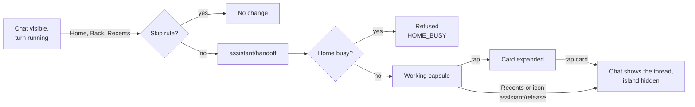

# BUG-0027 fix spec: running chat turns reach the Dynamic Island when the user leaves

Status: draft, 2026-11-24. Decisions needed before implementation are listed in
[Follow-ups and open questions](#follow-ups-and-open-questions).

## Summary

When the user leaves the full chat (Home gesture or Back) while a turn is running, the chat hands
that conversation to Home's island session, the same path the Collapse button already uses, but
without bringing Home forward. The task keeps running in the broker either way; today it simply
has no visible entry once the chat is gone.

- **Bug:** BUG-0027, P1, module 对话. Steps: open the full chat from the launcher icon, start a
  long task, press Home without Collapse; the island shows nothing.
- **Fix in this spec:** handoff on leave (Option 1), plus a working capsule so the handed-off turn
  is visible without covering the app the user switched to.
- **Out of scope:** an island driven by every running broker session (PRD Appendix B), and
  automatically expanding the card when a reply finishes. Both are follow-ups.

## Current behaviour

The island follows exactly one conversation, the thread held by Home's `AssistantSession`, and
the full chat only gives it a thread when the user presses Collapse. All paths below are on
`vela/dynamic-island` at `4140783f`.

| Path | What happens today | Code |
| --- | --- | --- |
| Island source | `IslandPublisherService` publishes one Taku card from `AssistantSession.state` (one `threadId`) | `system/agent-app/modules/taku-home/.../island/IslandPublisherService.kt:65` |
| Collapse button | `collapseToIsland` → provider `assistant/resume {threadId, home:false}` → then starts `HomeActivity` | `system/agent-app/modules/taku-agent/.../bridge/TakuAgentModule.kt:668` |
| Back in the chat | `hide()` flushes the draft → `closeAgent()` → `moveTaskToBack(true)`; no handoff | `system/agent-app/src/hooks/useAgentController.ts:300` |
| Home gesture / Recents | Activity stops; `ConversationVisibility` reports hidden; no handoff | `system/agent-app/modules/taku-agent/.../bridge/ConversationVisibility.kt:49` |
| Running turn | Lives in the broker, not in the chat; neither Back nor Home interrupts it | `system/assistant/broker/org/agentos/lab/TaskBroker.java` |
| Taku capsule | Only while an app build is active (`buildingApp`); otherwise no capsule, so a collapsed Taku card is invisible | `IslandPublisherService.kt:144`, open-access skill `assistant/app-build` |
| Auto-expand | Taku's payload never sets `alert`; the card expands only on explicit requests (`expansionRequest`) | `IslandPublisherService.kt:177` |

Two more facts constrain the fix:

- `AssistantSession.resume(id)` with a different thread calls `reset()`, which drops whatever Home
  was showing, including a running turn's stream (`AssistantSession.kt:1153`).
- SystemUI never suppresses Taku's card when the chat is in front, because Taku Agent is the home
  package (`system/island/src/.../IslandForeground.kt:66`). Once handed off, the island must be
  taken back explicitly when the chat returns, or the same thread shows in two places.

Not yet verified on a device: that a turn left running in the background still reaches
`turn/completed`. The acceptance plan covers it.

## Goals and non-goals

The fix is done when a turn the user leaves running is visible in the island within one second of
leaving, and only one surface shows that conversation at a time.

**Goals**

1. Leaving the full chat by Home, Recents or Back while its turn is running, queued or waiting for
   the user hands the thread to the island.
2. The handed-off turn is visible over any app as a working capsule, without a card covering the
   app the user switched to.
3. Tapping the capsule expands the card; tapping the card returns to that conversation (existing
   `openConversation`).
4. Returning to the chat by any route takes the island back, so the thread never shows in both
   places.
5. Agents get the same operations and can read the result, per AGENTS.md.

**Non-goals**

- An island fed by every running broker session (PRD Appendix B). The island still holds one
  thread.
- Expanding the card automatically when the reply finishes (`alert`).
- Changing how turns run: the broker already continues them after the chat leaves.
- Idle conversations: leaving a chat with nothing running hands nothing off, as today.

## Design

The native chat module decides at the moment the chat stops being visible, and calls a new Home
operation, `assistant/handoff`, that collapses the thread into the island without expanding it. A
second operation, `assistant/release`, takes it back when the chat returns.

A skipped or refused handoff leaves the turn running in the broker with no island entry, exactly
as today; only the capsule path is new.

### 1. Trigger: native, at stop time

The decision runs in `TakuAgentModule` when `ConversationVisibility` reports the last chat host
stopped. It does not run in JS, because the React runtime may not get a frame after `onStop`.

- JS keeps native informed with a new `setHandoffCandidate(threadId | null)`.
  `useAgentController` sets the selected thread when its session is running, queued or has a
  pending question, and `null` otherwise.
- Back, Home and Recents all end in the same `onStop`, so one code path covers the three routes in
  the bug.
- The decision is a pure function, `HandoffDecision.decide(...)`, so it can be unit-tested without
  Android.

| Skip when | Why |
| --- | --- |
| Candidate is `null` | Nothing is running; behaviour unchanged |
| `activity.isChangingConfigurations` | Rotation or theme change recreates the chat |
| `PowerManager.isInteractive == false` | Screen off; the user returns to the same chat |
| A `ComposerPicker` request is in flight | The chat opened the system picker itself |
| The last resumed activity is our own, other than `HomeActivity` | e.g. `ServiceSetupActivity` opened from the chat |

### 2. New Home operation: `assistant/handoff`

Provider `content://org.agentos.agent.home-assistant`, params `{"threadId":"ID"}`. It is a sibling
of `assistant/resume`, not a flag on it, because its rules differ: it never resets a busy session
and never expands.

| Home session state | Result |
| --- | --- |
| Already holds `ID` with the island showing | No change; `handedOff:false`, `reason:"ALREADY_SHOWN"` (covers the Collapse button, which hands off before Home starts) |
| Holds another thread that is working, needs the user, has voice or Live Talk active, has text entry open, or has its card expanded | Refused, `HOME_BUSY`; nothing changes |
| Otherwise | Switches to `ID` as `resume` does (stream, polling, draft), but `island = Collapsed`, no `expansionRequest`, a new `activityId`, and `handoff = true` |

It returns `{handedOff, reason}`. It never starts `HomeActivity`, never sends, stops or interrupts
a turn, and never writes the draft.

### 3. Presentation: a working capsule

`IslandPublisherService` adds `compact` when `state.handoff` is true and the turn is working or
needs the user.

- A = `ai-working` animation while working; the `taku` icon while it needs the user. No B text
  until design supplies one.
- Tap expands the existing assistant card (default `tap: "expand"`); the card tap keeps
  `tapAction: "open"` → `openConversation`.
- This changes a documented rule, "only actual app builds may show a compact pill", to "app builds
  and handed-off turns".
- `handoff` clears on `openConversation`, `release`, `dismiss`, `reset`, and any explicit Home
  entry (double tap, hold).

### 4. Taking it back: `assistant/release`

Params `{"threadId":"ID"}`. When the chat becomes visible showing `ID`, or selects `ID` while
visible, native calls it. If Home holds `ID` with the island showing, the island goes `Hidden` and
`handoff` clears; the thread stays in the session so the Home entry still continues it, the same
end state as `openConversation`. Otherwise no change. This also fixes the existing duplicate after
an explicit Collapse followed by Recents back to the chat.

## Conflicts with Home's session

Whatever Home is already doing wins; the handoff yields rather than replace it, because
`resume`'s `reset()` would silently drop a running Home turn from view.

| Situation when the chat leaves | Outcome | Reason |
| --- | --- | --- |
| Home holds the same thread, card showing (after Collapse) | No change (`ALREADY_SHOWN`) | Collapse already handed off and expanded it |
| Home holds the same thread, island hidden (e.g. opened from the island card) | Hand off as a capsule | Same thread, no reset needed |
| Home holds another thread that is working or needs the user | Refused (`HOME_BUSY`); the chat's turn has no island entry | Never drop a running Home turn; a known gap until the island can hold several sessions |
| Home holds another thread, idle, card collapsed or hidden | Hand off; Home switches threads | The idle reply is still in its conversation |
| Home holds another thread, idle, card expanded | Refused (`HOME_BUSY`) | The user is reading that card |
| Voice hold, dictation or Live Talk active in Home | Refused (`HOME_BUSY`) | Never cut a microphone session |
| Home's text entry open | Refused (`HOME_BUSY`) | Would retarget a message being typed |
| Chat's turn is an app build | Hand off; the existing app-build capsule ("Building...") takes precedence over the working capsule | `assistant/app-build` keeps its own rule |

Two more interactions:

- **Live Talk in the chat.** Live Talk already stops its audio when the chat leaves the foreground.
  A turn still running after that hands off like any other.
- **Drafts.** Back flushes the chat draft before leaving (`hide()`); Home and Recents do not wait.
  `handoff` calls `refreshDraft()`, and the card re-reads the draft when expanded, so the Home
  entry continues from the saved draft. The handoff itself never writes a draft.

## Returning to the chat

Every way back into the chat ends with the island hidden for that thread, and the chat showing the
conversation rather than Taku Home.

| Route back | What happens |
| --- | --- |
| Tap capsule → card → tap card | `openConversation` hides the island and starts `MainActivity` with the thread; the external-open fix (`4140783f`) closes any Taku Home overlay left open |
| Launcher icon or Recents | Chat becomes visible on the same thread → `assistant/release` hides the island |
| Feed card or Panel opening a different thread | `release` is a no-op for the other thread; the capsule for the handed-off thread stays, since it is still running |
| Swipe right on the capsule | SystemUI hides that activity until its notification ends; a later handoff uses a new `activityId`, so it can show again |
| Swipe up on the expanded card | Back to the capsule while the turn runs |

When the turn finishes while handed off, the capsule's `ai-working` animation stops. What it shows
next is an open design question (see Follow-ups); the card does not expand by itself.

## Agent interface and documentation

Agents get both new operations on the existing Home assistant provider, with the same validation
the chat uses, and can read the handoff state back. Access follows the provider's current policy:
UID 0/1000/2000 and platform-signed callers direct, third-party apps through the App Permission
Center (default `deny`).

| Operation | Params | Result | Errors |
| --- | --- | --- | --- |
| `assistant/handoff` | `threadId` (required) | `{handedOff, reason}`; `reason` = `HANDED_OFF` or `ALREADY_SHOWN` | `INVALID_ARGUMENT` (blank or malformed id), `HOME_BUSY` |
| `assistant/release` | `threadId` (required) | `{released}` | `INVALID_ARGUMENT` |
| `assistant/get` | none | Adds boolean `handoff` beside `island`, `threadId`, `working`, `needsUser` | unchanged |

Read-back for acceptance: `assistant/get` for the session, and `cmd statusbar island state` for
`compactVisible` and `presentation.reason`. The automatic trigger itself is GUI lifecycle; an
Agent performs the same operation by calling `assistant/handoff`.

Documentation to update in the same change:

- [ ] `system/assistant/assets/skills/taku-open-access/SKILL.md`, "Home AI entry and Dynamic
  Island": both operations, errors, `handoff` field, and the capsule rule now covering handed-off
  turns.
- [ ] `system/assistant/assets/skills/taku-island/SKILL.md`: when Taku shows a capsule.
- [ ] `system/agent-app/modules/taku-home/README.md` "Full chat (2-1)" and
  `system/agent-app/README.md`: leaving the chat hands a running turn to the island.
- [ ] `CHANGELOG.md` Unreleased entry naming BUG-0027.

## Edge cases and failures

The user has already left, so a failed handoff is logged and never surfaces as an error dialog;
the turn keeps running either way.

| Case | Required behaviour |
| --- | --- |
| Provider call fails (Home process starting, `HOME_UNAVAILABLE`) | Log with the thread id; no retry loop; no user-visible error |
| Turn finishes between `onStop` and the call | Hand off anyway; the capsule shows the finished state |
| Leave, return and leave again quickly | `ALREADY_SHOWN` or a fresh capsule; never an expanded card, never a duplicate notification (one tag per `activityId`) |
| Chat process killed after handoff | Unaffected: `IslandPublisherService` is bound by SystemUI and restores the saved thread (`IslandPublisherService.kt:47`) |
| Island turned off (`taku_island_enabled=0`) | Session still updates; nothing is drawn; `assistant/get` still reports `handoff:true` |
| Lock screen, shade open, landscape | SystemUI's existing rules: no card on lock screen or with the shade open; landscape shows the capsule only |
| Pending question in the chat (`needsUser`) | Hand off; capsule shows the `taku` icon; the card shows the existing "Taku needs your confirmation" title |
| Turn stopped from the card's Stop action | Existing `assistant/stop`; capsule disappears when the session is idle with no reply to show |
| Work profile or second user | Handoff stays in the current user's Home session; no cross-user calls |

## Tests and acceptance

The fix ships with unit tests for every rule above and is accepted only after the bug's own steps
pass on an isolated emulator, as AGENTS.md requires.

**Unit tests**

- `HandoffDecision.decide`: one case per skip row in Design §1, plus the hand-off case.
- `AssistantSession.handoff`: each row of the Conflicts table, including no `expansionRequest` and
  no `reset()` for the same thread.
- `AssistantSession.release`: hides only the matching thread; clears `handoff`.
- `IslandPublisherService` payload: `compact` present only for `handoff` and working or
  needs-user; app build still wins.
- `useAgentController.test.mjs`: the candidate follows running, queued and pending-question states
  and clears when idle; a thread switch updates it.

**Emulator acceptance** (record each `assistant/get` and `cmd statusbar island state` read-back)

1. BUG-0027 steps: open the chat from the launcher icon, start a long task, press Home without
   Collapse. Within 1 s: `handoff:true`, `island:Collapsed`, `compactVisible:true`, no card.
2. Same with Back, and with Recents into another app.
3. Wait for completion: the thread reaches `turn/completed` (gateway `readSession`). This also
   closes the bug's open question.
4. Tap capsule → card → tap card: the chat shows that conversation, island hidden.
5. Leave again, return through Recents: `assistant/release` ran, island hidden, nothing shown
   twice.
6. Collapse button: unchanged, card expanded over Home, `ALREADY_SHOWN` on the following stop.
7. Home busy: start a Home-entry turn, then leave a running chat on another thread: `HOME_BUSY`,
   Home's card untouched.
8. Screen off mid-turn, rotation, attachment picker: no handoff.
9. Agent path: `assistant/handoff` and `assistant/release` by `content call` produce the same
   states as the GUI.

## Follow-ups and open questions

Three decisions are needed before implementation; the rest is follow-up work outside BUG-0027.

**Decisions needed**

- [ ] Product and design: approve the working capsule for handed-off turns, which changes the rule
  that only app builds show a Taku capsule. The alternative is expanding the card on leave, as
  Collapse does, which covers whichever app the user switched to.
- [ ] Design: what the capsule shows after the turn finishes. Options: a static `taku` icon until
  opened, dismissed or released; or remove the capsule and rely on the conversation. A Figma frame
  is needed either way.
- [ ] Product: whether `HOME_BUSY` should leave the chat's turn without any island entry, or the
  island should first be able to hold more than one Taku session.

**Follow-ups**

- PRD Appendix B: drive the island from broker session state for every running session, so the
  island, Feed, chat and lock screen show one state. Needs a rule for which session the island
  shows when several run.
- Completion alert: set `alert: true` when a handed-off turn finishes and the user is not in that
  chat, subject to SystemUI's 5 s card and 30 s cooldown.
- `TaskNotificationReceiver`: its "Taku completed" notification opens the task page, not the
  conversation. Check whether chat turns post it, and point it at the conversation if so.
