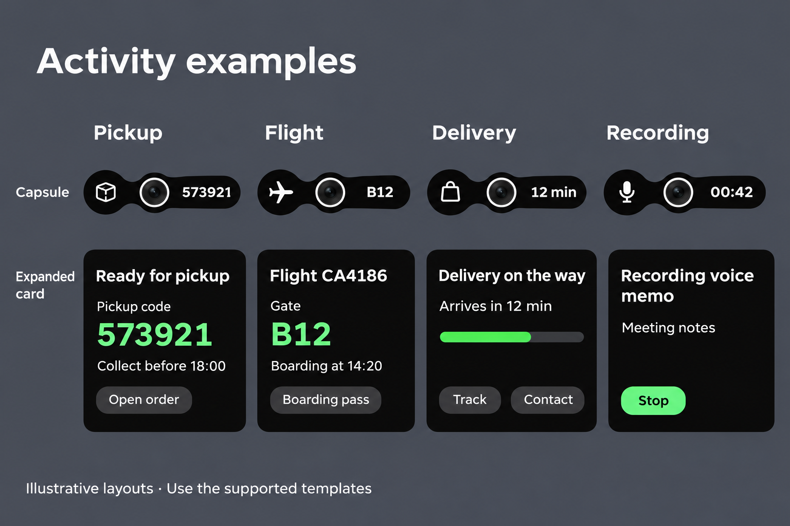
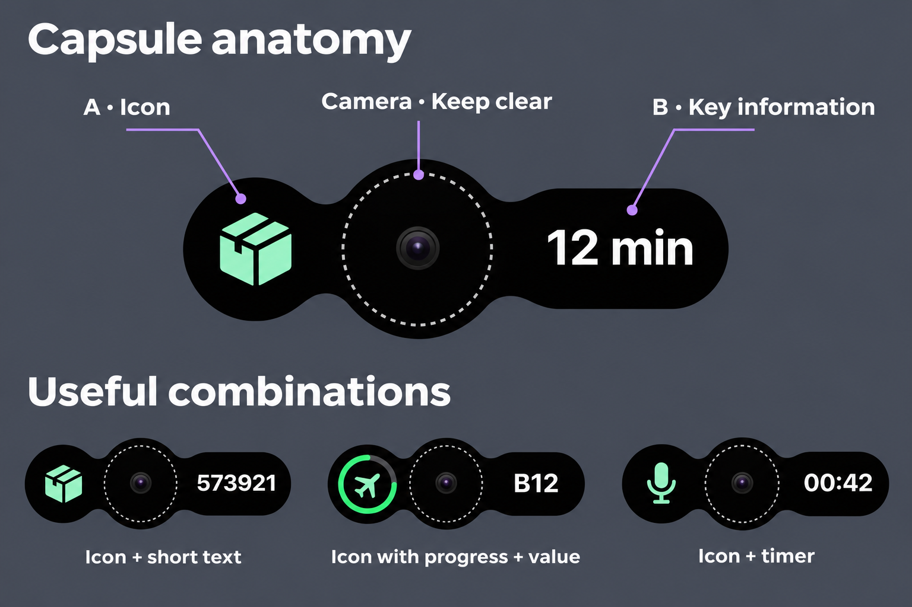
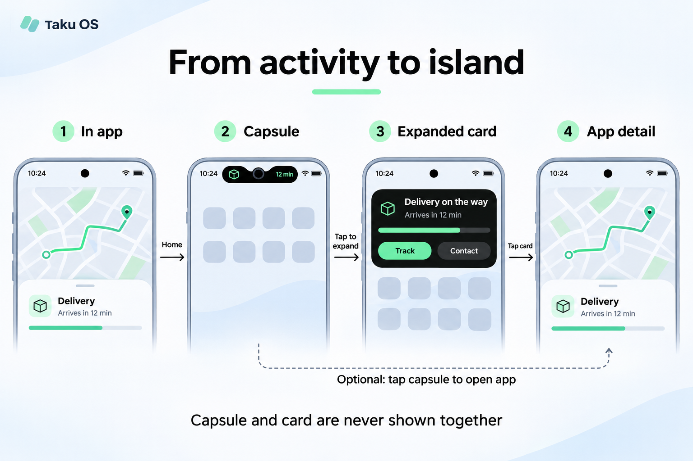

# Dynamic Island developer guide

English · [简体中文](dynamic-island-developer.zh-CN.md)

Taku OS Dynamic Island keeps an ongoing, important activity within reach while the user does
something else. Your app supplies the content and actions; SystemUI handles the camera cutout,
rendering, gestures and switching between apps.

This guide takes you from choosing a suitable activity to publishing it through **Taku's JSON
notification protocol, `taku.island.v2`**. No Taku SDK is required. Android Live Updates are also
supported; their compatibility path is described near the end.

## 1. Choose an appropriate activity

An island is for information the user is actively following, usually for **minutes to hours**.
Define its start event, completion/cancellation event and maximum duration before integrating.
**One business activity must end within 12 hours.**



*Design illustrations, not device screenshots. Each column pairs two alternative states. Camera
outlines highlight reserved space; they are not additional UI. Actual proportions follow the device.*

| Scenario | Start → end | Capsule A + B | Expanded card |
|---|---|---|---|
| Pickup | Order ready → collected, cancelled or code expired | Parcel icon + `573921` | `highlight`: pickup code, location, open order |
| Flight | User's upcoming journey enters its tracking window → journey completed/cancelled | Plane icon + gate `B12` | `highlight`: gate, boarding time, boarding pass |
| Delivery | Delivery begins → delivered/cancelled | Courier icon + `12 min` | `progress`: current stage, tracking, contact |
| Voice memo | User starts recording → stops/cancels | Microphone + running timer | `basic`: recording context, Stop action |

Do not use the island for marketing, likes/comments, static results (signed in, network connected,
update complete), errors, or indefinite stock/weather/status monitoring. A seconds-long result
belongs in a normal notification or an in-app toast. A permanent “Do not disturb is on” indicator
is not an ongoing activity with a meaningful end.

**Admission is not semantic moderation.** SystemUI checks authorization, payloads, ongoing flags
and time bounds; it cannot decide whether an app's content is valuable or promotional. Your use
case must follow these rules even if a payload passes validation. There is **no `category` field**
to declare in the Taku payload.

## 2. Design the two states

### Compact capsule: A + camera space + B



*Left: A identifies the activity. Centre: space reserved for the physical camera. Right: B conveys
one key fact. The lower examples combine an icon with a code, an icon/progress ring with a gate,
and a microphone with a timer.*

- **A is one graphic component:** an icon, an animated icon resource or a progress indicator.
  An icon can carry a progress ring. It is not a second text column.
- **B is one information component:** short text, a number/unit, timer, countdown, percentage or
  icon. Choose one; the current protocol does not compose separate prefix/body/suffix text runs.
- **Keep the centre clear.** Supply A/B data, not camera coordinates or a pre-drawn full capsule.
  SystemUI places the groups around the real cutout and draws the connecting curves. Do not bake
  a camera hole, padding or the capsule background into your icon.
- The normal graphic/pill height is 32 dp, reduced on shorter status bars. Available width depends
  on the cutout, clock and status icons. B is single-line and **ellipsized**, never scrolled or
  reduced to a smaller font; if even one character plus the ellipsis will not fit, only A remains.
- Aim for about **4 CJK or 8 Latin characters** in B; the parser accepts up to 16 Unicode code
  points for `text`, but that does not guarantee they will all fit. Put the critical value first.
  Use `text` for a six-digit pickup code; `number` accepts only one to three digits.

`compact` is optional; omitting it means no capsule. If present, provide at least A or B.
When A is absent, the system can use the notification's small icon. All content comes from the
publisher; applications must not depend on hard-coded Agent labels or graphics.

### Expanded card: choose a template and actions

| Template | Use | Required data in addition to `template` and `title` |
|---|---|---|
| `basic` | A short explanation and action buttons, such as recording | None |
| `progress` | Delivery, navigation or another measurable activity | `progress`; `{}` means indeterminate |
| `highlight` | A pickup code, gate or queue number | `highlight.text`; optional `highlight.label` |

Cards use 40 dp corners and an 8 dp screen-edge margin. The default dark fill is 92% opaque over
24 dp background blur; disabling system blur gives an opaque fallback. You may set
`backgroundColor` (for example `#FFFFFF`) and `accentColor`. Light backgrounds automatically use
dark text and controls. The accent must have at least 4.5:1 contrast against your background,
or `#121212` when no background is supplied.

`cardPosition: "cover"` places the card over the cutout area; `"below"` leaves it clear. The
keyboard limits available card height, **not the chosen position**. Content scrolls within the
bounded card, whose height is capped at one third of the screen. Buttons use one horizontally
scrolling row; the current parser accepts at most **32 action keys**. Keep actions useful and
labels short even though they can scroll.

Template styling is not arbitrary HTML, CSS or a custom Android view. Platform-signed apps can
supply their own rendered content through the advanced integration in §7. The `assistant`
template and `ai-working` / `ai-listening` animations are reserved for Taku Agent; its cards
always cover the cutout and its onboarding keeps its own layout.

## 3. Interaction and lifetime



*1 → 2: leave the app for Home. 2 → 3: tap to expand. 3 → 4: tap the card to open an app screen.
Alternatively, configure the capsule to open the app directly. The example card uses `below`.*

**Capsule and expanded card never appear together.** There is no third app-defined “small
island” state. The extra small disc and activity queue belong to the system.

| User/system event | Behaviour and app configuration |
|---|---|
| App comes to the foreground | Its capsule is suppressed and its open card folds. Home and SystemUI's own sources are exceptions |
| User leaves the app | Its capsule becomes eligible to appear, subject to queue order and display conditions |
| Tap capsule | `tap: "expand"` (default) opens the card; `"open"` sends the notification's content intent. Supply a valid content intent for direct opening |
| Long-press capsule | Opens the card regardless of `tap` |
| Swipe left on capsule | Switches to the next active activity |
| Tap the small disc on the left | Selects that waiting activity; apps do not supply a separate disc layout |
| Swipe right on capsule | Hides this activity until its notification ends; does not stop the service or cancel the notification |
| Tap card body | Sends `expanded.tapAction`, or the content intent when omitted. Opening the app folds the card; without either intent, tapping does nothing |
| Tap an action button | Sends that button's `Notification.Action`; the app implements its operation |
| Swipe up on a native card | Returns to the capsule, if eligible; a scrollable text region scrolls to its end first. Do not rely on Android Back being captured by this non-focusable overlay |
| Important milestone | `alert: true` on first post, or a later false → true transition, requests an automatic card for up to 5 seconds |

Routine updates must not alert. Space alert requests at least **30 seconds apart per notification**;
the system applies a cooldown which cancellation/reposting does not reset. Repeated `true`
updates do not create new triggers. Automatic expansion is unavailable while the app is in front,
on the lock screen, in landscape or while the notification shade is open.

SystemUI orders ordinary activities by **most recent trigger first**. A trigger is the initial
post or an accepted false → true alert transition; content updates alone do not move an activity
to the front. Recognized system calls, alarms and recording/casting take precedence. Publishers
cannot select their own priority tier. The next activity uses a system-drawn 32 dp disc with a
16 dp icon on the left; it does not move the main capsule.

### Start, update and finish

1. **Start:** post an ongoing notification when the real activity begins. There is no separate
   JSON trigger-expression field; posting is the start signal.
2. **Update:** call `notify()` with the same tag/id. Keep the business start time and deadline.
   SystemUI updates timer/countdown text itself; do not repost every second just to tick a clock.
3. **Finish:** cancel that notification on completion, cancellation or expiry. A countdown reaching
   zero is display data, not a cancellation instruction. Stopping a recording must stop the actual
   recorder as well as its notification.

| Boundary | What happens |
|---|---|
| `timeoutS` omitted | Island expires 1 hour after its first post |
| `timeoutS` supplied | 1–43200 seconds from first post; updates cannot extend it |
| Notification cancelled | Its island ends immediately |
| `staleAfterS` elapsed without an update | Capsule becomes muted; this does not finish the activity |
| Island timeout reached | Island disappears; the notification and app service are not stopped |

`Notification.Builder.setTimeoutAfter()` is Android's separate notification cancellation timer.
For custom Taku payloads, set `timeoutS` explicitly if you need a non-default island lifetime;
`setTimeoutAfter()` does not substitute for it. Whichever removes the activity first wins.

Cancelling and reposting starts a new system activity. **Do not use this to restart the same
business activity's 12-hour budget.** Persist and enforce its actual deadline in your app. The
system cannot infer business identity across unrelated notification IDs.

## 4. Integrate through an Android notification

### Eligibility and permissions

- Apps signed with the platform certificate, including appropriately signed Notebook builds,
  are automatically authorized. A package name alone does not grant access.
- Other apps need review and inclusion in the user-visible allow-list under
  **Settings → Display → Activity island**. Contact the Taku OS team with your package and use case.
- Follow normal Android notification permission/channel rules. Custom Taku extras do not require
  `POST_PROMOTED_NOTIFICATIONS` or a special `POST_ISLAND` declaration.
- Use `setOngoing(true)`. Taku Agent's conversation cards have a system exception; other publishers
  cannot use that exception for one-off messages.

The only custom protocol is `taku.island.v2`, with `version: 2`. There is no legacy custom format
to fall back to. The JSON travels **inside a locally posted Android notification**, not to a
Taku HTTP push endpoint. If your backend sends an event, your app receives it and posts/updates
the notification. Keep the ordinary notification useful on its own.

### Example: delivery

Save this payload as `res/raw/delivery_island.json`. It uses a short ETA, progress card, two
buttons and a separate card-body action:

```json
{
  "version": 2,
  "compact": {
    "a": {"type": "icon", "pic": "courier", "tint": true},
    "b": {"type": "text", "text": "12 min"}
  },
  "expanded": {
    "template": "progress",
    "title": "Delivery on the way",
    "body": "Courier is 12 minutes away",
    "progress": {"value": 0.6},
    "actions": ["track", "contact"],
    "primaryAction": "track",
    "tapAction": "open_order",
    "accentColor": "#8BF0BA"
  },
  "tap": "expand",
  "cardPosition": "below",
  "alert": false,
  "timeoutS": 7200,
  "staleAfterS": 300
}
```

Declare `android.permission.POST_NOTIFICATIONS` in your manifest and obtain the user's runtime
grant where required. The code below assumes it is granted, `ic_delivery` exists, and the two
PendingIntents were created by your app for the correct order/contact destinations. Use explicit
intents and distinct identities for different orders.

```kotlin
import android.app.Notification
import android.app.NotificationChannel
import android.app.NotificationManager
import android.app.PendingIntent
import android.content.Context
import android.graphics.drawable.Icon
import android.os.Bundle

fun publishDelivery(
    context: Context, orderId: String,
    openOrder: PendingIntent, contactCourier: PendingIntent
) {
    val manager = context.getSystemService(NotificationManager::class.java)
    val channel = "deliveries"
    manager.createNotificationChannel(NotificationChannel(
        channel, "Active deliveries", NotificationManager.IMPORTANCE_DEFAULT
    ))
    val payload = context.resources.openRawResource(R.raw.delivery_island)
        .bufferedReader().use { it.readText() }
    val track = Notification.Action.Builder(null as Icon?, "Track", openOrder).build()
    val contact = Notification.Action.Builder(null as Icon?, "Contact", contactCourier).build()
    val extras = Bundle().apply {
        putString("taku.island.v2", payload)
        putBundle("taku.island.pics", Bundle().apply {
            putParcelable("courier", Icon.createWithResource(context, R.drawable.ic_delivery))
        })
        putBundle("taku.island.actions", Bundle().apply {
            putParcelable("track", track)
            putParcelable("contact", contact)
            putParcelable("open_order", track)
        })
    }
    val notification = Notification.Builder(context, channel)
        .setSmallIcon(R.drawable.ic_delivery)
        .setContentTitle("Delivery on the way")
        .setContentText("Courier is 12 minutes away")
        .setContentIntent(openOrder)
        .setOngoing(true)
        .addAction(track).addAction(contact)
        .addExtras(extras)
        .build()
    manager.notify("delivery:$orderId", 1, notification)
}
```

Replace the example data with the current order state when updating; call `notify()` with the
same `"delivery:$orderId"` and `1`. On delivery/cancellation, call
`manager.cancel("delivery:$orderId", 1)`. Do not use a fresh ID for each progress update.

## 5. Payload reference and limits

### Top-level fields

| Field | Type and rule |
|---|---|
| `version` | Required integer `2` |
| `expanded` | Required card object |
| `compact` | Optional object containing `a`, `b`, or both; cannot be empty |
| `tap` | `expand` (default) or `open` |
| `cardPosition` | `cover` (default) or `below` |
| `alert` | Boolean, default `false`; milestone request subject to §3 |
| `timeoutS` | Integer 1–43200, default 3600; measured from first post |
| `staleAfterS` | Optional integer 1–43200; time since last update before muting |

### A/B components

Each slot is one object with a `type`. Character limits count Unicode code points.

| `type` | Allowed in | Data |
|---|---|---|
| `icon` | A, B | Required `pic` key; optional `tint` and `animate` booleans, `progress` 0–1 ring, `contentDescription` ≤80 characters |
| `progress` | A, B | `value` 0–1. In A, omit it for an indeterminate indicator. B renders a percentage; supply a value, since omitting it currently displays `0%` |
| `text` | B | Required `text` 1–16 characters; `emphasis`: `normal` (default), `accent` or `muted` |
| `number` | B | Required `value`: string of 1–3 digits, including `"0"`; optional `unit` ≤4 characters |
| `timer` | B | Required integer `startEpochMs`, Unix epoch milliseconds |
| `countdown` | B | Required integer `endEpochMs`, Unix epoch milliseconds |
| `animation` | A, B; Taku Agent only | `name`: `ai-working` or `ai-listening`; optional `contentDescription` ≤80 characters |

Epoch values accept 0–9007199254740991. For your own animated glyph, use
`{"type":"icon","pic":"mic","animate":true}` with an `AnimatedVectorDrawable` resource.
Animation runs for up to 60 seconds per update and respects disabled system animations. Do not
continually repost to defeat this bound. Static and reduced-motion states must remain meaningful.

Useful combinations: pickup B = `{"type":"text","text":"573921"}`; flight B =
`{"type":"text","text":"B12"}`; recording B =
`{"type":"timer","startEpochMs":1793990400000}` (replace with the actual recording start).

### Expanded fields

| Field | Rule |
|---|---|
| `template` / `title` | Required; template from §2, title 1–80 characters |
| `body` / `pic` | Optional body ≤2000 characters; optional header icon key, otherwise the notification icon |
| `steps` | Up to 8 objects: `kind` = `search`, `browse`, `act` or `info`; `text` 1–120 characters; optional boolean `running` |
| `progress` | Object with optional `value` 0–1; required for `progress` template |
| `highlight` | Only for `highlight` template and required there: `text` 1–12 characters, optional `label` ≤40 |
| `actions` | Up to 32 unique action keys, in display order; default empty |
| `primaryAction` | Must name a key in `actions`; draws that button filled |
| `tapAction` | Card-body action key; need not be in `actions`, but must exist in the actions Bundle |
| `backgroundColor` / `accentColor` | Optional `#RRGGBB`; colour and contrast rules in §2 |
| `content` | Optional platform-signed rich content; §7 |

### Transport and validation

- JSON: at most **8192 UTF-8 bytes**, nesting depth at most **8**. Unknown/duplicate keys and
  incorrect types are rejected; do not add `category`, priority, camera coordinates or extra states.
- Picture/action keys match `[a-z][a-z0-9_]{0,31}`. Every referenced key must exist in its Bundle.
- `taku.island.pics`: key → Android `Icon`. Use your package's (or Android's) resource icons,
  or bitmap/adaptive bitmap icons up to **512×512 px and 1 MiB**. URI/data icons are not loaded.
- `taku.island.actions`: key → `Notification.Action` with a non-null PendingIntent created by
  the posting UID. For card/capsule app navigation, supply an intent created by that UID too.
- Templates render native controls and plain text. There is no HTML/script execution or remote
  asset URL loader; text containing a URL does not become a navigation action.

Invalid/unauthorized Taku extras are ignored. A qualifying promoted Live Update may still appear
through the compatibility path; otherwise only the ordinary notification remains.

## 6. Check authorization and debug

Add this inside your manifest's root element to make the provider visible:

```xml
<queries>
    <provider android:authorities="com.android.systemui.island" />
</queries>
```

Query your own package (omitting the package resolves it when your UID has one package):

```kotlin
context.contentResolver.query(
    android.net.Uri.parse("content://com.android.systemui.island/canShowIsland"),
    null, null, null, null
)?.use { cursor ->
    if (cursor.moveToFirst()) {
        val result = org.json.JSONObject(cursor.getString(0))
        val canPublish = result.optBoolean("enabled") && result.optBoolean("customAllowed")
        // Use canPublish to explain availability; it does not guarantee immediate display.
    }
}
```

The result includes `ok`, `enabled`, `package`, `customAllowed`, `platformSigned` and `liveUpdates`.
`liveUpdates: true` describes system support, not your app's Android promotion grant.
An ordinary app cannot use this endpoint to query another package's eligibility.

Run these from a development computer with ADB; replace the example package/key:

```sh
adb shell cmd statusbar island canShowIsland org.example.delivery
adb shell "cmd statusbar island-validate org.example.delivery '{\"version\":2,\"expanded\":{\"template\":\"basic\",\"title\":\"Delivery\"}}'"
adb shell cmd statusbar island state
adb shell cmd statusbar island list
adb shell cmd statusbar island get 'KEY'
adb shell dumpsys activity service com.android.systemui/.SystemUIService IslandStartable
```

`island-validate` runs the payload parser with the package's signature identity. It **does not**
grant publishing access, check the notification's ongoing flag, or resolve picture/action Bundles.
Check `canShowIsland`, then post a real notification to validate the whole path.
`state` reports settings, activities and presentation; `get` includes payload/source/tier/expiry.
The `IslandStartable` dump includes the recent `diagnostics` entries (`KEY:error`).

| Error | Check |
|---|---|
| `publisher_not_allowed` | Platform signature or reviewed allow-list entry |
| `not_ongoing` | `setOngoing(true)` on the posted notification |
| `invalid_references_or_host` | Missing icon/action key, unsupported icon, wrong PendingIntent owner or invalid rich-content service |
| `unknown_field`, `duplicate_field`, `invalid_enum`, `text_length`, `number_range`, `expected_*` | Field names, uniqueness, types and limits |
| `missing_progress`, `missing_highlight`, `highlight_template_only` | Template/data pairing |
| `missing_primary_action`, `duplicate_action`, `too_many_actions`, `invalid_action_key` | Action keys and list size |
| `invalid_color`, `low_contrast` | Colour format and contrast |
| `reserved_template`, `invalid_animation`, `reserved_content` | Agent-only or platform-only feature |
| `payload_too_large`, `too_deep`, `invalid_json`, `invalid_payload` | JSON size, depth or syntax |
| `permission_denied` | Provider operation needs a grant or is restricted to trusted callers |

Publishing permission is separate from reading/controlling islands. Ordinary apps need the App
Permission Center's `taku.control` grant to read activity state or invoke operations; they cannot
change island settings or the publisher allow-list even with that grant. ADB/Agent UID 0/1000/2000
and platform-signed callers have direct access. There is no self-registration API for apps.

## 7. Advanced: platform-signed custom content

For layouts beyond the native templates, platform-signed publishers may set `expanded.content`.
Being allow-listed alone is insufficient. Keep valid template data as the loading/failure fallback.

| Field | Rule |
|---|---|
| `service` | Required `package/full.ServiceClass` (or `package/.ServiceClass`), in the posting package |
| `token` | Optional opaque string ≤256 characters |
| `layout` | `body` (default) or `card` |
| `heightDp` | 96–340; further limited by available space and the one-third-screen cap |

The service must be exported, owned by the posting UID and protected by a **signature-level
permission** (for example `org.agentos.permission.BIND_ISLAND_CONTENT`, declared with
`protectionLevel="signature"`). Binding returns an Android `Messenger`; the content uses
`SurfaceControlViewHost`, not a `RemoteViews` extra.

| Message | Direction | Payload |
|---|---|---|
| ATTACH (`what=1`) | SystemUI → service | Generation in `arg1`, `replyTo` Messenger; Bundle `version=1`, `hostToken`, pixel `width`/`height`, `display`, `token` |
| READY (`what=3`) | Service → SystemUI | Same generation in `arg1`; Bundle `surface` containing `SurfaceControlViewHost.SurfacePackage`, after the first frame |
| FAILED (`what=4`) | Service → SystemUI | Same generation; signal attachment failure |
| RELEASE (`what=2`) | SystemUI → service | Release the resources of that generation |

Use the supplied dimensions/display/host token, not assumed phone dimensions. Dimensions are
bounded at 4096 px and attachment has a 2500 ms timeout. SystemUI shows the template while binding
and on failure; it does not automatically retry within the same open card. Releasing the surface
or losing this service must not stop the underlying recording/delivery activity.

## 8. Android Live Updates compatibility

Apps may also post Android promoted ongoing notifications without Taku JSON. This is an
additional integration option, not a prerequisite for the custom protocol above. Follow Android's
eligibility: ongoing notification with a title, supported standard/BigText/Call/ProgressStyle,
no custom views, no colorization and not a group summary. Declare
`android.permission.POST_PROMOTED_NOTIFICATIONS`, request promotion, and check
`NotificationManager.canPostPromotedNotifications()`; the user can disable it.

With an existing eligible builder, API 36.1 supports `.setRequestPromotedOngoing(true)`; on API 36,
set boolean extra `android.requestPromotedOngoing`. Use an SDK/API guard appropriate to your app.

| Android data | Island presentation |
|---|---|
| Large icon, otherwise small icon | A (small icon tinted) |
| Short critical text, otherwise chronometer/countdown, otherwise `when` | B |
| Title / text | Card title / body |
| ProgressStyle or legacy progress | Progress card |
| Actions / content intent | Buttons / app navigation |
| `setTimeoutAfter` | Declared island lifetime; otherwise 1 hour, capped at 12 hours |

Live Updates use `tap: expand` and `cardPosition: cover`. They **keep Android's normal heads-up
notification** and do not expose Taku's automatic card alert. Custom Taku activities replace
heads-up with their card alert only while the island can present them; outside those conditions,
normal Android notification behaviour applies. System-recognized calls, alarms and stopwatches
may remain until their source ends, with a 12-hour cap instead of the one-hour default.

## 9. Before shipping

- Test start → leave app → capsule → expand/direct open → correct app screen → finish.
- Test two apps, swipe switching/hiding and the waiting disc; never publish a third state yourself.
- Check real cutout geometry, a short status bar, long/localized labels, light/dark card colours,
  keyboard visibility, disabled blur/animations and unavailable custom content.
- Test denied notification/publishing permissions, malformed JSON and ordinary notification fallback.
- Test important alerts versus routine updates, the 30-second interval, default/explicit expiry,
  stale data and business deadlines across restart/repost.
- Confirm the ordinary notification remains complete: **lock screen, AOD and secondary-display
  islands are not supported**. Landscape does not expand cards.

These are integration requirements and checks, not a claim that every device has passed them.

### Reference material

The fields and lifecycle above describe the current Taku implementation. For machine validation,
see the [JSON Schema](../spec/taku-island-v2.schema.json); device acceptance is tracked separately
in the [progress log](dynamic-island-progress.md). The organization and explanatory illustrations
reference Xiaomi's [business guide](https://dev.mi.com/xiaomihyperos/documentation/detail?pId=2140)
and [integration guide](https://dev.mi.com/xiaomihyperos/documentation/detail?pId=2131).
Xiaomi-specific APIs, admission categories and gestures are not Taku capabilities.
