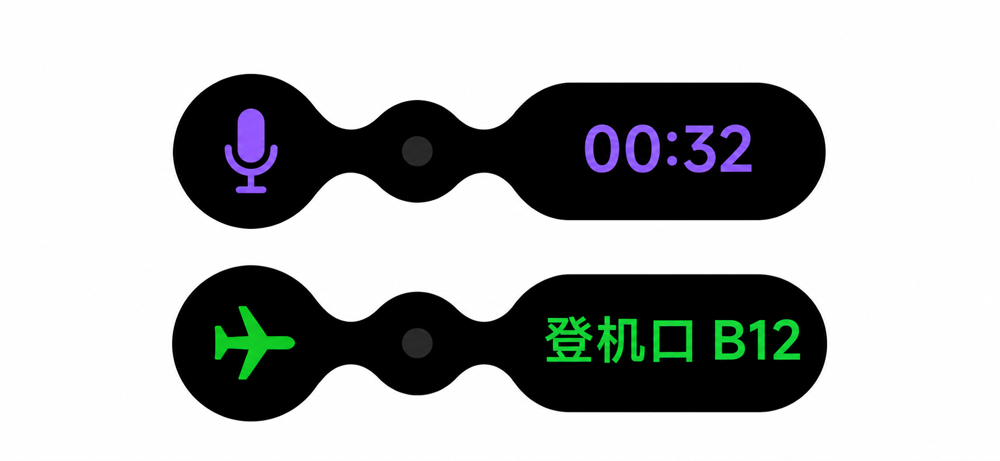
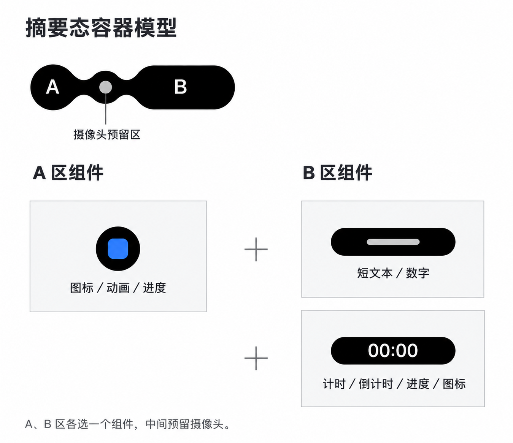
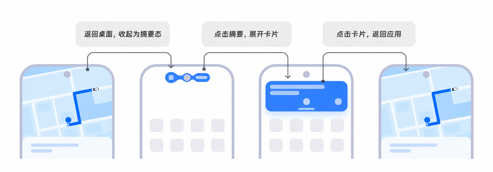
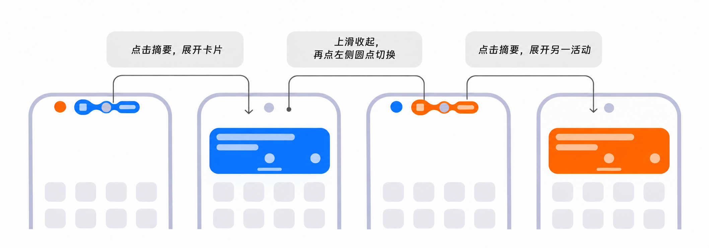
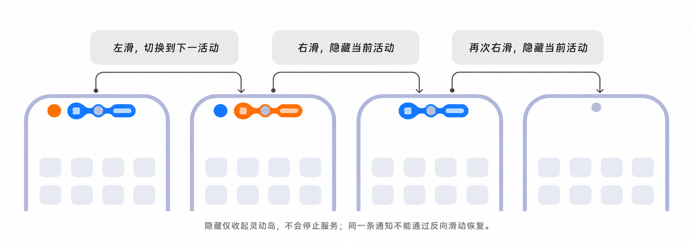

# 灵动岛开发接入指南

[English](dynamic-island-developer.md) · 简体中文

Taku OS 灵动岛用于展示用户正在关注的持续活动，让用户离开应用后仍能查看关键进展、执行操作。
应用提供内容和操作，系统负责摄像头避让、绘制、交互和多应用切换。

本文以 **Taku JSON 通知协议 `taku.island.v2`** 为主线，说明场景选择、设计、接入和验证。
不需要安装 Taku SDK。系统同时兼容 Android Live Updates，相关接入方式见文末。

## 1. 什么内容适合上岛

灵动岛适用于通常持续**几分钟到几小时**、用户关心的活动或服务。
接入前必须明确：什么时候开始、什么时候完成或取消、最长持续多久。
**同一业务活动的完整持续时长不得超过 12 小时。**



*两个独立的摘要态设计示例：麦克风 + 录音计时、飞机 + 登机口。每个摘要态围绕一个摄像头，
A 组放图形，B 组放关键信息。以上不是实机截图，实际比例随设备调整。*

| 场景 | 开始 → 结束 | 摘要态 A + B | 展开态 |
|---|---|---|---|
| 取件 | 订单可取 → 已取、取消或取件码失效 | 包裹图标 + `573921` | `highlight`：取件码、位置、查看订单 |
| 航班 | 用户行程进入跟踪时段 → 行程完成或取消 | 飞机图标 + 登机口 `B12` | `highlight`：登机口、登机时间、登机牌 |
| 配送 | 开始配送 → 送达或取消 | 配送图标 + `12 分钟` | `progress`：当前进展、查看配送、联系骑手 |
| 语音备忘录 | 用户开始录音 → 停止或取消 | 麦克风 + 计时器 | `basic`：录音信息、停止按钮 |

以下内容不应上岛：营销推广、点赞评论、已登录／已联网／更新完成等静态结果、错误提示，以及没有
明确结束条件的股价、天气或状态常驻。只持续几秒的结果应使用普通通知或应用内 Toast。
“勿扰已开启”这类长期静态状态也不属于有明确结束价值的持续活动。

**通过校验不代表场景合规。** 系统检查发布权限、数据格式、持续通知标记和时间边界，无法自动判断
内容是否重要、是否属于营销。开发者仍需遵守上述规则。Taku 协议**不要求也不接受 `category` 类别字段**。

## 2. 设计摘要态和展开态

### 摘要态：A 组 + 摄像头预留区 + B 组



*左侧 A 用于识别活动，中间给真实摄像头留空，右侧 B 表达一条关键信息。
下方展示 A 组图形组件与 B 组信息组件的组合；B 组每次选择一种信息组件。*

- **A 组放一个图形组件**：图标、图标资源动画或进度指示。图标可以附带进度环；A 不是第二列文字区域。
- **B 组放一个信息组件**：短文本、数字与单位、计时器、倒计时、百分比或图标。
  当前协议从中选择一种，不支持分别组合“前置小字／正文／后置小字”等多个文本片段。
- **中间必须避让摄像头。** 应用提交 A/B 数据，不提交摄像头坐标或整张胶囊背景。
  系统根据真实开孔位置和大小摆放内容、绘制连接曲线；不要在图标中画摄像头、预留间距或胶囊背景。
- 图形区和右侧胶囊的常规高度为 32 dp，较矮的状态栏会缩小显示。可用宽度受开孔、时间和状态图标影响。
  右侧胶囊至少宽 32 dp，单字符内容也保留圆形端部。
- 从应用返回、卡片收起以及 Android Live Update 均使用同一套摘要外形。
  第二条活动显示为左侧独立的 32 dp 圆，与主图形区相隔 4 dp；主摘要始终对准摄像头。
  两条已显示的活动都会替代各自对应的 Android 状态栏胶囊，避免重复显示。
  B 组单行显示，超宽时**尾部省略**，不滚动、不缩小字体；连一个字符加省略号都放不下时，只显示 A 组。
- 建议 B 组控制在约 **4 个汉字或 8 个拉丁字符**。`text` 最多接受 16 个 Unicode 码点，
  但不保证全部可见；把关键值放在前面。六位取件码应使用 `text`，`number` 仅接受一到三位数字。

`compact` 可以省略，省略后不显示摘要态；提供时至少包含 A 或 B。
未提供 A 时，系统可使用通知的小图标。图标和文字均由发布方传入，不应依赖系统写死的 Agent 文案或图形。

### 展开态：选择模板并配置操作

| 模板 | 适用场景 | 除 `template`、`title` 外的必填数据 |
|---|---|---|
| `basic` | 一段说明加操作按钮，例如录音 | 无 |
| `progress` | 配送、导航等有进度的活动 | `progress`；`{}` 表示进度不确定 |
| `highlight` | 取件码、登机口、排队号码 | `highlight.text`；可选 `highlight.label` |

卡片采用 40 dp 圆角、距屏幕边缘 8 dp。默认深色背景为 92% 不透明度，背后使用 24 dp 模糊；
系统关闭模糊时回退为不透明背景。应用可设置 `backgroundColor`（例如 `#FFFFFF`）和 `accentColor`。
浅色背景会自动切换深色文字及控件。强调色与指定背景的对比度必须达到 4.5:1；未指定背景时按 `#121212` 校验。

`cardPosition: "cover"` 表示覆盖开孔区域，`"below"` 表示位于开孔下方。
键盘只限制卡片可用高度，**不会改变所选位置**。内容在卡片内部滚动，卡片高度不超过屏幕的三分之一。
操作按钮排成一行并支持横向滚动；当前解析器最多接受 **32 个操作键**。即使可以滚动，也应保留有用的操作并使用短标签。

模板样式不等于任意 HTML、CSS 或自定义 Android View。平台签名应用如需自行绘制内容，可使用第 7 节的高级接入。
`assistant` 模板、`ai-working`／`ai-listening` 动画仅供 Taku Agent 使用；Agent 卡片始终覆盖开孔，
onboarding 连接引导保留自身布局。

## 3. 交互与生命周期



*1 → 2：从应用回到桌面；2 → 3：点击摘要态展开卡片；3 → 4：点击卡片进入应用页面。
也可以将摘要态配置为点击直接进入应用。图中卡片使用 `below` 位置。*

**摘要态和展开态不会同时显示。** 不存在需要应用提交的第三种“小岛状态”；旁边的小圆点和多活动队列由系统管理。

| 操作或事件 | 行为与应用配置 |
|---|---|
| 应用进入前台 | 隐藏该应用的摘要态，收起其已展开卡片；桌面应用和 SystemUI 自身来源除外 |
| 用户离开应用 | 摘要态可参与展示，是否立即出现取决于队列和显示条件 |
| 点击摘要态 | `tap: "expand"`（默认）展开卡片；`"open"` 执行通知的 content intent。直接打开应用时须提供有效的 content intent |
| 长按摘要态 | 无论 `tap` 如何配置，都展开卡片 |
| 在摘要态左滑 | 切换到下一个活动 |
| 点击左侧小圆点 | 切换到该等待中的活动；应用不用单独设计小圆点布局 |
| 在摘要态右滑 | 隐藏当前活动，直至该条通知结束；不会停止服务或取消通知 |
| 点击卡片正文 | 执行 `expanded.tapAction`，未配置时使用 content intent；打开应用后收起卡片；两者都没有时点击无动作 |
| 点击操作按钮 | 执行对应的 `Notification.Action`；具体业务操作由应用实现 |
| 在原生卡片上滑 | 收起后按条件显示摘要态；可滚动正文会先滚动到末尾。卡片窗口不获取输入焦点，不应依赖其拦截 Android 返回键 |
| 重要节点提醒 | 首次发布 `alert: true`，或后续从 false 变为 true，可请求自动展开卡片，最多 5 秒 |

普通内容更新不要触发提醒。同一条通知的提醒请求至少间隔 **30 秒**；系统也会执行冷却，取消后重发不会重置该冷却。
每个获准的 5 秒提醒窗口最多自动展开一次。卡片收起后，普通更新、`alert: false`、持续的 `true` 或冷却内的 false → true 都不会再次弹卡；冷却结束后的新一次 false → true 仍可正常提醒。
连续更新 `true` 不构成新的触发。应用在前台、锁屏、横屏或通知栏已展开时，不会自动弹出卡片。

普通活动按**最近触发优先**排列：首次发布或被接受的 false → true 提醒构成触发，常规更新不会抢占排序。
系统识别的通话、闹钟及录屏／投屏优先；应用不能自行指定优先级层级。
下一活动显示为主胶囊左侧的 32 dp 圆点，内部图标为 16 dp；主胶囊不会因此移动。

### 多活动切换与隐藏



*点击摘要态展开卡片；上滑收起后，点击左侧圆点切换活动，再点击摘要态展开新活动。展开时不同时显示摘要态。*



*左滑切换到下一个活动，右滑隐藏当前活动。隐藏不会停止应用服务或取消通知；反向滑动不会恢复已隐藏的同一条通知。*

### 开始、更新与结束

1. **开始**：业务活动真正开始时发布持续通知。JSON 没有单独的触发条件表达式字段；发布通知就是开始信号。
2. **更新**：使用相同 tag/id 调用 `notify()`，保留业务开始时间和截止时间。
   计时器／倒计时由系统刷新，不必为了每秒跳字而重复发通知。
3. **结束**：完成、取消或到期时取消对应通知。倒计时归零只是显示结果，不会自动取消活动。
   停止录音时还必须停止真实录音任务，不能只清除通知。

| 时间边界 | 结果 |
|---|---|
| 未设置 `timeoutS` | 从首次发布起 1 小时后退岛 |
| 设置 `timeoutS` | 从首次发布起计算，允许 1–43200 秒；更新不能延长 |
| 通知被取消 | 对应灵动岛立即结束 |
| 超过 `staleAfterS` 未更新 | 摘要态弱化显示，不代表业务结束 |
| 灵动岛超时 | 灵动岛消失，通知本身和应用服务不会被停止 |

`Notification.Builder.setTimeoutAfter()` 是 Android 的通知取消计时器，与灵动岛超时不同。
自定义 Taku 活动若需非默认展示时长，应显式设置 `timeoutS`，不能用 `setTimeoutAfter()` 代替；先发生的结束条件生效。

取消后重发在系统中会形成新活动，但**不得借此重置同一业务活动的 12 小时时限**。
应用应持久化并执行真实截止时间，系统无法跨不同通知 ID 推断业务身份。

## 4. 通过 Android 通知接入

### 发布资格与权限

- 使用平台证书签名的应用自动获准，包括采用该证书签名的 Notebook 构建；仅有包名不代表有权限。
- 其他应用需经过场景审核，加入用户可见的白名单，入口为**设置 → 显示 → Activity island**。
  请向 Taku OS 团队提供包名和使用场景。
- 遵守 Android 通知权限、通知渠道等要求。Taku 自定义格式不要求声明
  `POST_PROMOTED_NOTIFICATIONS` 或额外的 `POST_ISLAND` 权限。
- 通知必须使用 `setOngoing(true)`。Taku Agent 的对话卡片有系统例外，其他应用不能用该例外发布一次性消息。

当前唯一的自定义协议是 `taku.island.v2`，JSON 中使用 `version: 2`，不再提供旧自定义格式回退。
JSON 放在**应用本地发布的 Android 通知**中，不是向 Taku HTTP 推送接口提交。
服务端如有业务事件，应由应用接收后发布或更新通知。普通通知内容也要完整、可独立使用。

### 示例：配送活动

将下面的 JSON 保存为 `res/raw/delivery_island.json`。示例包含 ETA、进度卡片、两个按钮和独立的正文点击动作：

```json
{
  "version": 2,
  "compact": {
    "a": {"type": "icon", "pic": "courier", "tint": true},
    "b": {"type": "text", "text": "12 min"}
  },
  "expanded": {
    "template": "progress",
    "title": "Delivery on the way",
    "body": "Courier is 12 minutes away",
    "progress": {"value": 0.6},
    "actions": ["track", "contact"],
    "primaryAction": "track",
    "tapAction": "open_order",
    "accentColor": "#8BF0BA"
  },
  "tap": "expand",
  "cardPosition": "below",
  "alert": false,
  "timeoutS": 7200,
  "staleAfterS": 300
}
```

先在 manifest 声明 `android.permission.POST_NOTIFICATIONS`，并在适用版本取得运行时授权。
以下代码假定已经授权、项目有 `ic_delivery` 图标，且两个 PendingIntent 均由本应用创建，分别指向对应订单和联系人。
应使用显式 Intent，并给不同订单使用不同的 PendingIntent 身份。示例文案可替换为本地化内容。

```kotlin
import android.app.Notification
import android.app.NotificationChannel
import android.app.NotificationManager
import android.app.PendingIntent
import android.content.Context
import android.graphics.drawable.Icon
import android.os.Bundle

fun publishDelivery(
    context: Context, orderId: String,
    openOrder: PendingIntent, contactCourier: PendingIntent
) {
    val manager = context.getSystemService(NotificationManager::class.java)
    val channel = "deliveries"
    manager.createNotificationChannel(NotificationChannel(
        channel, "Active deliveries", NotificationManager.IMPORTANCE_DEFAULT
    ))
    val payload = context.resources.openRawResource(R.raw.delivery_island)
        .bufferedReader().use { it.readText() }
    val track = Notification.Action.Builder(null as Icon?, "Track", openOrder).build()
    val contact = Notification.Action.Builder(null as Icon?, "Contact", contactCourier).build()
    val extras = Bundle().apply {
        putString("taku.island.v2", payload)
        putBundle("taku.island.pics", Bundle().apply {
            putParcelable("courier", Icon.createWithResource(context, R.drawable.ic_delivery))
        })
        putBundle("taku.island.actions", Bundle().apply {
            putParcelable("track", track)
            putParcelable("contact", contact)
            putParcelable("open_order", track)
        })
    }
    val notification = Notification.Builder(context, channel)
        .setSmallIcon(R.drawable.ic_delivery)
        .setContentTitle("Delivery on the way")
        .setContentText("Courier is 12 minutes away")
        .setContentIntent(openOrder)
        .setOngoing(true)
        .addAction(track).addAction(contact)
        .addExtras(extras)
        .build()
    manager.notify("delivery:$orderId", 1, notification)
}
```

更新时替换为当前订单数据，继续使用相同的 `"delivery:$orderId"` 和 `1` 调用 `notify()`。
送达或取消后执行 `manager.cancel("delivery:$orderId", 1)`，不要每次进度更新都生成新 ID。

## 5. 字段参考与限制

### 顶层字段

| 字段 | 类型与规则 |
|---|---|
| `version` | 必填整数 `2` |
| `expanded` | 必填卡片对象 |
| `compact` | 可选对象，包含 `a`、`b` 或两者；不能是空对象 |
| `tap` | `expand`（默认）或 `open` |
| `cardPosition` | `cover`（默认）或 `below` |
| `alert` | 布尔值，默认 `false`；重要节点请求，规则见第 3 节 |
| `timeoutS` | 整数 1–43200，默认 3600；从首次发布计算 |
| `staleAfterS` | 可选整数 1–43200；距离上次更新多久后弱化显示 |

### A/B 组件

每个槽位是一个带 `type` 的对象，字符数限制按 Unicode 码点计算。

| `type` | 可用位置 | 数据 |
|---|---|---|
| `icon` | A、B | 必填 `pic`；可选布尔值 `tint`、`animate`，0–1 的 `progress` 环，以及不超过 80 字符的 `contentDescription` |
| `progress` | A、B | `value` 为 0–1；A 省略该值时显示不确定进度。B 显示百分比，应提供值，当前省略会显示 `0%` |
| `text` | B | 必填 `text`，1–16 字符；`emphasis` 为 `normal`（默认）、`accent` 或 `muted` |
| `number` | B | 必填 `value` 为 1–3 位数字字符串，包含 `"0"`；可选 `unit` 不超过 4 字符 |
| `timer` | B | 必填整数 `startEpochMs`，Unix 毫秒时间戳 |
| `countdown` | B | 必填整数 `endEpochMs`，Unix 毫秒时间戳 |
| `animation` | A、B，仅 Taku Agent | `name` 为 `ai-working` 或 `ai-listening`；可选 `contentDescription` 不超过 80 字符 |

时间戳接受 0–9007199254740991。应用自己的动画图标应使用
`{"type":"icon","pic":"mic","animate":true}`，指向 `AnimatedVectorDrawable` 资源。
每次更新最多播放 60 秒，遵循系统关闭动画的设置；不要靠不断重发绕过该边界，静态和减少动画的状态也应表达清楚。

常见组合：取件 B 为 `{"type":"text","text":"573921"}`；航班 B 为
`{"type":"text","text":"B12"}`；录音 B 为
`{"type":"timer","startEpochMs":1793990400000}`（替换为真实录音开始时间）。

### 展开态字段

| 字段 | 规则 |
|---|---|
| `template` / `title` | 必填；模板见第 2 节，标题为 1–80 字符 |
| `body` / `pic` | 可选正文不超过 2000 字符；可选顶部图标键，默认使用通知图标 |
| `steps` | 最多 8 个对象：`kind` 为 `search`、`browse`、`act` 或 `info`；`text` 为 1–120 字符；可选布尔值 `running` |
| `progress` | 对象，可选 `value` 0–1；`progress` 模板必填 |
| `highlight` | 仅用于 `highlight` 模板且在该模板中必填：`text` 为 1–12 字符，可选 `label` 不超过 40 字符 |
| `actions` | 最多 32 个不重复的操作键，按显示顺序排列；默认无按钮 |
| `primaryAction` | 必须是 `actions` 中的一项，显示为填充按钮 |
| `tapAction` | 正文点击动作键；可不在 `actions` 中，但必须存在于操作 Bundle |
| `backgroundColor` / `accentColor` | 可选 `#RRGGBB`，颜色与对比度规则见第 2 节 |
| `content` | 可选的平台签名应用自定义内容，见第 7 节 |

### 传输与校验

- JSON 最多 **8192 UTF-8 字节**，嵌套最多 **8 层**。未知字段、重复字段、错误类型会被拒绝；
  不要增加 `category`、优先级、摄像头坐标或额外形态。
- 图片／操作键须匹配 `[a-z][a-z0-9_]{0,31}`，所有引用都必须存在于对应 Bundle。
- `taku.island.pics`：键 → Android `Icon`。支持本应用或 Android 的资源图标，以及不超过
  **512×512 px、1 MiB** 的 bitmap／adaptive bitmap；不加载 URI 或 data 图标。
- `taku.island.actions`：键 → `Notification.Action`，其中 PendingIntent 不可为空，且必须由发布 UID 创建。
  用于卡片／摘要态跳转的 Intent 也应由该 UID 创建。
- 模板使用原生控件和纯文本，不执行 HTML／脚本，也没有远程图片 URL 加载器；文本中的 URL 不会自动变为跳转操作。

无效或未获授权的 Taku 数据会被忽略。通知若同时满足已获提升的 Live Update 条件，可通过兼容路径上岛；
否则只保留普通通知。

## 6. 查询资格与排查问题

在 manifest 根元素内添加以下声明，使应用能发现该 Provider：

```xml
<queries>
    <provider android:authorities="com.android.systemui.island" />
</queries>
```

查询本应用的发布资格；UID 只对应一个包时，省略包名会自动查询自身：

```kotlin
context.contentResolver.query(
    android.net.Uri.parse("content://com.android.systemui.island/canShowIsland"),
    null, null, null, null
)?.use { cursor ->
    if (cursor.moveToFirst()) {
        val result = org.json.JSONObject(cursor.getString(0))
        val canPublish = result.optBoolean("enabled") && result.optBoolean("customAllowed")
        // Use canPublish to explain availability; it does not guarantee immediate display.
    }
}
```

结果包含 `ok`、`enabled`、`package`、`customAllowed`、`platformSigned`、`liveUpdates`。
`liveUpdates: true` 代表系统支持，不代表本应用已经取得 Android 通知提升授权。
普通应用不能借此接口查询其他应用的发布资格。

在开发电脑通过 ADB 执行以下命令，将示例包名／KEY 替换为实际值：

```sh
adb shell cmd statusbar island canShowIsland org.example.delivery
adb shell "cmd statusbar island-validate org.example.delivery '{\"version\":2,\"expanded\":{\"template\":\"basic\",\"title\":\"Delivery\"}}'"
adb shell cmd statusbar island state
adb shell cmd statusbar island list
adb shell cmd statusbar island get 'KEY'
adb shell dumpsys activity service com.android.systemui/.SystemUIService IslandStartable
```

`island-validate` 使用实际包签名身份运行数据解析器，**不代表取得发布权限**，也不检查实际通知的 ongoing
标记或解析图片／操作 Bundle。应先查 `canShowIsland`，再发布真实通知验证完整链路。
`state` 返回设置、活动和呈现状态；`get` 包含数据、来源、优先级层级及到期信息。
`IslandStartable` dump 包含近期 `diagnostics`，格式为 `KEY:error`。

| 错误码 | 检查内容 |
|---|---|
| `publisher_not_allowed` | 平台签名或审核后的白名单 |
| `not_ongoing` | 实际通知是否设置 `setOngoing(true)` |
| `invalid_references_or_host` | 图片／操作键缺失、图标类型不支持、PendingIntent 归属错误或自定义内容服务无效 |
| `unknown_field`、`duplicate_field`、`invalid_enum`、`text_length`、`number_range`、`expected_*` | 字段名称、重复字段、类型和边界 |
| `missing_progress`、`missing_highlight`、`highlight_template_only` | 模板与数据是否匹配 |
| `missing_primary_action`、`duplicate_action`、`too_many_actions`、`invalid_action_key` | 操作键与按钮数量 |
| `invalid_color`、`low_contrast` | 颜色格式与对比度 |
| `reserved_template`、`invalid_animation`、`reserved_content` | 是否使用了 Agent 或平台专属能力 |
| `payload_too_large`、`too_deep`、`invalid_json`、`invalid_payload` | JSON 大小、深度和语法 |
| `permission_denied` | Provider 操作需要授权，或只向受信任调用者开放 |

发布资格与读取／操作灵动岛是两套权限。普通应用读取活动状态或执行操作，需要应用权限中心授予
`taku.control`；即使获准，也不能修改灵动岛设置或发布白名单。
ADB／Agent UID 0/1000/2000 和平台签名调用者可直接访问。没有供普通应用自行注册白名单的接口。

## 7. 高级接入：平台签名应用自定义内容

原生模板之外的布局，可由平台签名应用通过 `expanded.content` 提供。
仅加入发布白名单不足以使用此能力；仍需保留有效模板数据，作为加载中或失败时的回退。

| 字段 | 规则 |
|---|---|
| `service` | 必填 `package/full.ServiceClass` 或 `package/.ServiceClass`，必须属于发布包 |
| `token` | 可选不透明字符串，最多 256 字符 |
| `layout` | `body`（默认）或 `card` |
| `heightDp` | 96–340，并受可用空间和屏幕三分之一高度约束 |

服务必须 exported、属于发布 UID，并受**签名级权限**保护，例如声明
`protectionLevel="signature"` 的 `org.agentos.permission.BIND_ISLAND_CONTENT`。
绑定返回 Android `Messenger`，内容使用 `SurfaceControlViewHost`，不是通知里的 `RemoteViews`。

| 消息 | 方向 | 数据 |
|---|---|---|
| ATTACH（`what=1`） | SystemUI → 服务 | `arg1` 为 generation，提供 `replyTo` Messenger；Bundle 含 `version=1`、`hostToken`、像素 `width`／`height`、`display`、`token` |
| READY（`what=3`） | 服务 → SystemUI | `arg1` 回传同一 generation；首帧就绪后在 Bundle 的 `surface` 中返回 `SurfaceControlViewHost.SurfacePackage` |
| FAILED（`what=4`） | 服务 → SystemUI | 回传同一 generation，表示挂载失败 |
| RELEASE（`what=2`） | SystemUI → 服务 | 释放该 generation 的资源 |

使用系统传入的尺寸、display 和 host token，不要假定手机尺寸。宽高不超过 4096 px，挂载超时为 2500 ms。
绑定期间及失败时继续显示模板，同一次卡片展开不会自动重试。
释放展示 Surface 或服务退出，不能连带停止底层录音／配送等业务活动。

## 8. 兼容 Android Live Updates

应用也可以不带 Taku JSON，直接发布 Android promoted ongoing notification。
这是额外接入选择，**不是前述自定义协议的前置条件**。需满足 Android 条件：持续通知、有标题，使用支持的
标准／BigText／Call／ProgressStyle 样式，无自定义 View、无 colorization、不是分组汇总。
声明 `android.permission.POST_PROMOTED_NOTIFICATIONS`、请求提升，并检查
`NotificationManager.canPostPromotedNotifications()`；用户可以关闭此能力。

在已有合格 Builder 上，API 36.1 可调用 `.setRequestPromotedOngoing(true)`；API 36 可设置布尔 extra
`android.requestPromotedOngoing`。请根据应用的 SDK 和运行版本做好兼容判断。

| Android 通知数据 | 灵动岛展示 |
|---|---|
| 大图标，否则小图标 | A 组，小图标会着色 |
| short critical text，否则计时器／倒计时，否则 `when` | B 组 |
| 标题／正文 | 卡片标题／正文 |
| ProgressStyle 或旧式 progress | 进度卡片 |
| actions／content intent | 按钮／应用跳转 |
| `setTimeoutAfter` | 声明的灵动岛展示时长；否则默认 1 小时，上限 12 小时 |

Live Updates 固定使用 `tap: expand`、`cardPosition: cover`，**保留 Android 原有的横幅通知**，
不提供 Taku 的主动弹卡提醒。自定义 Taku 活动仅在灵动岛可展示时使用弹卡替代横幅；其他条件下仍遵循 Android 通知行为。
系统识别的通话、闹钟和秒表可随其来源持续至结束，上限 12 小时，不使用一小时默认值。

## 9. 发布前检查

- 走通开始 → 离开应用 → 摘要态 → 展开／直接打开 → 正确业务页面 → 结束的完整流程。
- 同时运行两个应用，验证切换、隐藏和等待圆点；不要自行发布第三种状态。
- 检查真实开孔、较矮状态栏、较长／多语言文案、浅深色卡片、键盘、关闭模糊／动画，以及自定义内容不可用时的展示。
- 检查通知权限／发布权限被拒、JSON 错误、普通通知回退。
- 检查重要提醒与普通更新、30 秒间隔、默认／显式到期、数据过期，以及重启／重发后的业务截止时间。
- 保留完整的普通通知：当前**不支持锁屏、AOD 和副屏灵动岛**；横屏不展开卡片。

以上是接入要求与检查项，不代表所有设备均已通过实机验收。

### 参考资料

本文字段和生命周期以当前 Taku 实现为准。机器校验可使用 [JSON Schema](../spec/taku-island-v2.schema.json)，
实机验收状态单独记录在[进度日志](dynamic-island-progress.md)。内容组织和示意图参考小米的
[业务介绍](https://dev.mi.com/xiaomihyperos/documentation/detail?pId=2140)与
[开发指南](https://dev.mi.com/xiaomihyperos/documentation/detail?pId=2131)，不代表 Taku 支持小米专有接口、准入类别或手势。
