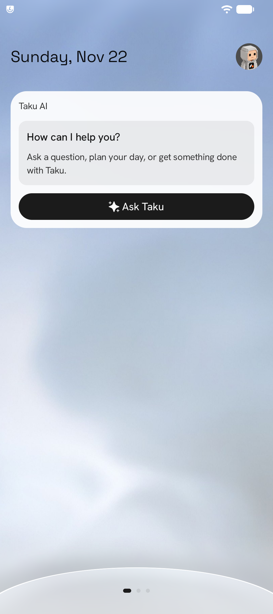
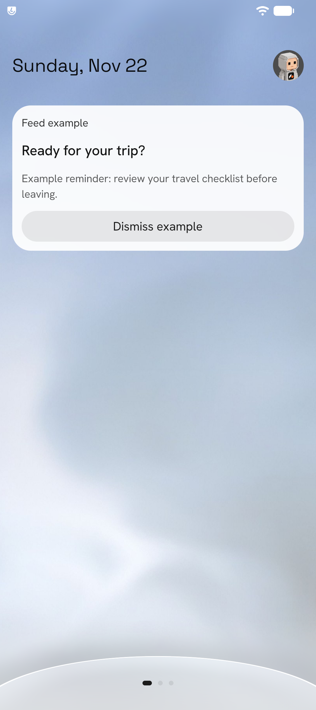

# 把推荐接入 Taku Home Feed

[English](feed-recommendation-api.en.md)

第三方 Android App 获得 App Permission Center 授权后，可以直接向本机 Home Feed 发布卡片。Taku Agent、App 和桌面 GUI 使用同一个 `FeedRepository`。

## 接入与权限

入口为 `content://org.agentos.agent.home-feed`，通过 `ContentResolver.call` 调用。Provider 已导出，每次方法调用及事件流打开都会检查调用 UID。

- 普通第三方 App 使用 `taku.control` 权限，默认模式为 `deny`。用户可在 **App permissions** 的手动模式下，为对应应用开启「调用 Taku 模块与 AI」（Use Taku modules & AI）。实际判定遵循权限中心当前模式。
- Home 自身 UID、root/system/ADB shell（0/1000/2000）及与 Home 同签名的组件直接通过。
- 校验失败或权限服务不可用时拒绝访问，方法调用返回 `PERMISSION_DENIED`。事件流打开失败通过文件异常返回。
- `taku.control` 同时控制 Feed 读取、发布、管理、动作和事件流。当前授权后的调用方共享发布卡片，尚无按 App 划分的卡片归属隔离。请使用自己的 ID 前缀，只操作自己的卡片。

Provider 的公开声明与调用时授权共同生效。完整策略见[权限说明](agent-open-access.md#caller-trust-boundary-and-app-permission-center)，实现见 [HomeFeedProvider](../system/agent-app/modules/taku-home/android/src/main/java/org/agentos/agent/home/feed/HomeFeedProvider.kt) 和 [TakuCallerAccess](../system/agent-app/modules/taku-home/android/src/main/java/org/agentos/agent/home/TakuCallerAccess.kt)。

## 选择发布方式

| 方法 | 请求 | 适用场景 |
| --- | --- | --- |
| `feed/publish` | `{"card":{…}}` | 推荐持续更新。同 ID 替换整张卡片，返回 `id`、`replaced` |
| `feed/generate` | `{"card":{…}}` | 导入完整卡片，校验主体后创建新 ID，无模型调用 |
| `feed/generate` | `{"prompt":"…"}` | 用已核实的事实生成布局，调用设备配置的 Magpie `generateUi` 路由 |

`generate` 每次创建 `agent-generated:<uuid>`，重设 `createdAt`、`rank`、`pinned:false`，并返回新 ID，描述生成还返回实际 `model`。更新推荐通常选 `publish`。所有发布入口将 `source.id` 写为 `agent`，这个字段表示当前来源分类；真实访问权限由调用 UID 决定。

外部 App 通过以上 Provider 接入。进程内 `FeedSource` 的 `recommendation` 来源仍为预留能力，远端 Webhook 暂未提供。

## 最小卡片示例

将下面内容保存为 `rec-card.json`。这是截图使用的演示内容，实际推荐请使用自己的 ID、真实内容和适当的 `expiresAt`。

```json
{
  "schema": "taku.feed-card/1",
  "id": "rec.docs.feed-example",
  "source": {"id": "agent", "app": "Feed example"},
  "layout": {"span": "full", "surface": "card"},
  "rank": 0,
  "pinned": false,
  "summary": "Example reminder: review your travel checklist before leaving.",
  "pin": {"label": "Travel checklist", "icon": {"kind": "pixel", "glyph": "list"}},
  "ui": {
    "catalog": "taku-feed-1",
    "state": {},
    "spec": {
      "root": "card",
      "elements": {
        "card": {"type": "Column", "props": {"gap": 12}, "children": ["header", "title", "detail", "dismiss"]},
        "header": {"type": "AppHeader", "props": {"title": "Feed example"}, "children": []},
        "title": {"type": "Text", "props": {"text": "Ready for your trip?", "variant": "body-xl-medium"}, "children": []},
        "detail": {"type": "Text", "props": {"text": "Example reminder: review your travel checklist before leaving.", "tone": "tertiary"}, "children": []},
        "dismiss": {
          "type": "Button", "props": {"label": "Dismiss example", "variant": "secondary"}, "children": [],
          "on": {"press": {"action": "dispatch", "params": {"actionId": "dismiss"}}}
        }
      }
    }
  },
  "actions": {"dismiss": {"label": "Dismiss example", "intent": {"type": "dismiss"}}}
}
```

| 空 Feed | 发布示例后 |
| --- | --- |
|  |  |

截图来自 Android 17 模拟器，Taku Agent 0.5.1（12）。空态的 Ask Taku 入口由桌面显示，可通过 `feed/list.emptyState` 读取。

## 从 Android App 调用

目标 SDK 30 及以上，在应用 Manifest 中声明包可见性，并先取得上述授权。

```xml
<queries>
  <provider android:authorities="org.agentos.agent.home-feed" />
</queries>
```

以下 Java 片段在工作线程执行，`card` 为解析后的 JSON 对象。调用还需处理 Provider 不可见或不可用时的 Android 异常，以及 JSON 解析异常。

```java
Uri uri = Uri.parse("content://org.agentos.agent.home-feed");
JSONObject request = new JSONObject().put("card", card); // card is a JSONObject
Bundle out = context.getContentResolver().call(
    uri, "feed/publish", request.toString(), null);
if (out == null || out.getString("result") == null) {
    throw new IllegalStateException("Feed provider returned no result");
}
JSONObject reply = new JSONObject(out.getString("result"));
if (!reply.optBoolean("ok")) {
    throw new IllegalStateException(reply.optString("code") + " " + reply.optString("message"));
}
JSONObject result = reply.getJSONObject("result"); // id, replaced
```

所有方法返回 `Bundle` 的 `result` 字符串，内容为 `{"ok":true,"result":{…}}` 或 `{"ok":false,"code":"…","message":"…"}`。这些是同步调用，`list/get` 最多等待 5 秒加载，`generate` 的调用方等待上限为 120 秒。

## 用 ADB 调试

在保存 `rec-card.json` 的主机目录执行，修改 `SERIAL` 为实际设备。JSON 经 stdin 传入，保留引号和中文。ADB 使用可信 shell 身份，第三方授权需另外以该 App 身份验证。

```sh
SERIAL=emulator-5596
FEED='IFS= read -r req || exit 1
exec content call --uri content://org.agentos.agent.home-feed --method "$0" --arg "$req"'
feed() {
  printf '%s\n' "$2" | adb -s "$SERIAL" shell -T "sh -c '$FEED' $1"
}
card_request() {
  python3 -c 'import json,sys; print(json.dumps({"card":json.load(open(sys.argv[1],encoding="utf-8"))},ensure_ascii=False,separators=(",",":")))' "$1"
}

feed feed/publish "$(card_request rec-card.json)"
feed feed/get '{"id":"rec.docs.feed-example"}'
feed feed/list '{}'
feed feed/retract '{"id":"rec.docs.feed-example"}'
```

## 卡片和动作规则

| 字段 | 当前规则 |
| --- | --- |
| `schema`、`id` | `taku.feed-card/1`；ID 匹配 `^[A-Za-z0-9._:-]{1,96}$`，推荐使用 `rec.<app>.<key>` |
| `source` | `app` 为非空显示名称，`package` 可选，`id` 在发布时强制设为 `agent` |
| `summary` | 必填。主体校验或渲染失败时显示的文本，也用于“问 Taku”上下文 |
| `layout` | `span` 为 `full/half`；`surface` 为 `card/control/media`，默认 `full/card` |
| `rank`、`createdAt` | 按 `rank` 降序排列，同分保持来源顺序；`createdAt` 不参与排序 |
| `expiresAt` | epoch 毫秒或 `null`，到期后从可见 Feed 中过滤 |
| `pinned`、`pin` | 建议 `pinned:false`；`pin` 必填，需图标和 `label`（最多 24 字符）或 `value`（最多 12 字符），`detail` 最多 32 字符 |
| `ui` | `catalog:"taku-feed-1"`，`spec.root` 指向 `spec.elements` 中的节点；`state` 保存初始交互状态 |
| `actions` | 动作 ID 对应 `label` 和 `intent`；交互通过 `dispatch` 引用已声明 ID |

正文可用组件及属性以 [feedCatalog.ts](../system/agent-app/src/feed/feedCatalog.ts) 为准。使用目录内的布局、文字、图片和交互组件及颜色/字号令牌，宽度适配宿主，半宽卡片主体为正方形。图片引用支持 `https://` 或 APK 中实际存在的 `asset:feed/…`，远程 SVG 受静态子集约束。原生 Pin 对远程图片的显示能力有独立限制。

`feed/publish` 校验外层和根节点，完整主体校验在渲染端进行，失败时显示 `summary`。发布前可使用同一个校验器，先在 `system/agent-app` 安装项目依赖，使用 Node 22.18+ 或 24。

```sh
cd system/agent-app
node --input-type=module -e '
import {readFileSync} from "node:fs";
import {validateFeedSpec} from "./src/feed/feedCatalog.ts";
const card = JSON.parse(readFileSync(process.argv[1], "utf8"));
const issues = validateFeedSpec(card.ui.spec, card.ui.state ?? {}, new Set(Object.keys(card.actions ?? {})));
console.log(issues.length ? JSON.stringify(issues, null, 2) : "ok");
process.exit(issues.length ? 1 : 0);
' /absolute/path/rec-card.json
```

`publish` 当前按序列化字符串的 UTF-16 长度检查大小，上限 262,144；`generate` 请求上限为 96,000 UTF-8 字节，prompt 上限 16,000 UTF-16 单元，主体最多 96 个元素。同时只运行一个生成请求，并发返回 `BUSY`。连接中断导致结果未知时，先查询 Feed 再决定是否重试。

| `intent.type` | 参数和行为 |
| --- | --- |
| `open-app` | `package`，可选 `uri`，打开目标 App 或其页面 |
| `open-url` | `url`，打开 HTTPS 网页 |
| `share-text` | `package:"com.whatsapp"`、`text`（1–16,000 字符）。打开 WhatsApp 分享选择器，由用户选群并发送。 |
| `ask-taku` | `prompt`，创建对话并保存为可编辑草稿，等待用户发送 |
| `dismiss` | 隐藏卡片，与用户删除相同 |
| `none` | 记录操作，返回 `effect:"none"` |

动作在用户点击或调用 `feed/action` 时执行。`select` 可把指定状态路径的值随动作传出。OpenTable 订位卡片由 Home 增加 `confirm-dining-share` 动作，用户可在发回原群后点击确认。该动作仅能从卡片上执行。

## 更新、撤回和反馈

- **更新**使用相同 ID 调用 `feed/publish`，整张替换，已钉住状态保留。
- **撤回**调用 `feed/retract {"id":"…"}`，同时取消钉住。过期卡片仍在存储中，失效后请主动撤回。
- **尊重用户删除**。`feed/list.removed[]` 或 `feed/get.removed` 可读删除状态，再次发布同一 ID 会清除该状态并重新展示。
- **读取反馈**。先取 `feed/list` 快照，再从返回的 `eventCursor` 订阅事件，避免快照与后续事件之间漏读。

从仓库根目录运行事件读取工具，替换游标并使用自己的 ID 前缀。

```sh
node system/agent-app/modules/taku-home/scripts/read-feed-events.mjs \
  --serial "$SERIAL" --after '<eventCursor>' --card-prefix 'rec.docs.' --follow
```

Android App 用 `ContentResolver.openFileDescriptor(uri, "r")` 读取 `content://org.agentos.agent.home-feed/events?after=<cursor>&follow=1`。游标为不透明字符串，放入 URI 时需编码。事件为 NDJSON，支持 `cardId`、`cardIdPrefix`、`origin`、`op` 筛选。处理完成后保存 cursor，完整处理 checkpoint 后保存 through；遇到 EOF 从已处理游标重连。`action` 事件的 `phase:"accepted"` 表示操作已记录，外部动作的执行结果需另行确认。筛选条件只用于选择事件，所有权和权限由接口本身决定。

当前卡片和事件保存在本机 SQLite，无固定卡片张数或事件保留期限。`feed/reset` 清空当前卡片和偏好并保留事件历史。更多管理操作、事件字段和错误见[模块 README](../system/agent-app/modules/taku-home/README.md#agent-access)及[事件协议](../system/agent-app/modules/taku-home/CONTRACT.md#event-stream)。

## 常见错误

| 代码 | 处理方式 |
| --- | --- |
| `PERMISSION_DENIED` | 检查该 App 的 `taku.control` 授权和权限中心状态 |
| `INVALID_ARGUMENT`、`INVALID_CARD`、`CARD_TOO_LARGE` | 按返回 message 修正请求或卡片 |
| `INVALID_SPEC`、`INVALID_MODEL_OUTPUT` | 修正生成卡片主体或模型输出 |
| `NOT_FOUND`、`ID_CONFLICT`、`NOT_AGENT_CARD` | 检查 ID、当前卡片状态和来源 |
| `STATE_WRITE_FAILED` | 检查存储错误，读取当前状态后再决定是否重试 |
| `BUSY` | 当前生成完成后重试 |
| `RUNTIME_UNAVAILABLE`、`RUNTIME_LOST`、`RUNTIME_TIMEOUT` | 检查客户端生成运行时；prompt 路径另需可用的模型配置 |
| `APP_NOT_INSTALLED`、`NO_ACTIVITY` | 检查目标 App 和 URI 是否可打开 |

本文按 `main` 的 `65917a4a` 核对。示例通过主体校验，并在上述模拟器验证发布、读取、同 ID 更新、事件回放和撤回，截图后已撤回演示卡片。第三方授权路径依据源码核对，本轮设备调用使用 ADB shell。
