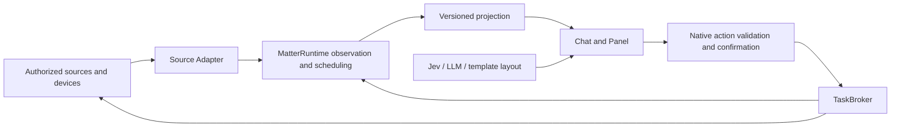

# Generative UI: composable components and persistent state specification

Status: design and implementation contract. Shared V2 presentation, shared state, and native Matter flow are implemented; three weather sizes verified against a real source. The 21 business capabilities and unconnected sources are tracked separately; this does not claim complete functional acceptance.

Based only on [issue #2] and user additions: cross-scenario component composition, flexible parameters, and long-term state updates; unified JS state management uses Zustand. Existing source constrains integration; proposed engineering parameters are adjustable implementation choices. Quotations in this English version are translations of the original issue prompts.

## 1. Goals and completion criteria

Natural language gives users actionable interfaces driven by real data and capable of ongoing updates. Components combine by data structure, interaction, and information hierarchy; weather, coffee, and home control are recipes rather than mutually exclusive scenario protocols. Layout generation is separate from business-state updates: changing temperatures, orders, votes, captions, or playback position does not require another layout-model call.

The design must meet all of these conditions:

1. Reuse the same layout, metric, collection, time, spatial, media, and input components across scenarios. Composers can adjust parameters, hierarchy, colors, gradients, and size without building 21 separate whole-card components for 21 cases.
2. A Matter shares data, selections, confirmations, and execution receipts between this implementation's chat and Panel entry points. Multiple views share one current version; historical chat versions cannot execute old actions. Verify consistency with Feed, lock screen, or other surfaces only where issue #2 explicitly requires and implements them, without making every surface universally mandatory.
3. Shared native runtime owns source subscriptions, polling, retries, scheduling, and recovery. RN views lease projections and submit intents; they do not own business-request timers.
4. Judge visual and functional acceptance separately. Fixed data, simulated devices, and design images are not evidence of real orders, playback, device control, recording, or background-rule execution.
5. Section 11 maps all 21 prompts, follow-ups, historical examples, and punctuation to composition, sources, actions, and acceptance points. This English version labels the quotations as translations. Any unconnected real Adapter must explicitly block that item's functional acceptance.

Non-goals: a new business-task engine, general script executor, or arbitrary RPC; requiring a same-name plugin first; equating an app's running screen with its business interface; expanding scope to other information sources, long-term preference learning, or automatic purchasing.

Implementation verification uses actual programs, real primary user flows, and common failures. Do not add extreme-edge-case tests or simulated business fixtures. Use the data and boundaries already listed in issue #2 without expanding the fault matrix. The existing local component catalog aids development inspection and does not replace real functional acceptance.

## 2. Existing code and actual gaps

The following preserves the design-time source baseline; current implementation, tested scope, and blockers are in section 13.

| Existing implementation | Reusable | Changes or gaps |
| --- | --- | --- |
| [genuiCatalog.ts](../system/agent-app/src/model/genuiCatalog.ts), [genuiRegistry.tsx](../system/agent-app/src/components/genuiRegistry.tsx), [genuiWidgets.tsx](../system/agent-app/src/components/genuiWidgets.tsx) | One json-render catalog, official/custom RN components, gradients, component events | Business blocks currently flatten values into strings; weather/flights lean toward whole cards. Add composable typed content and actual controlled inputs |
| [genui.ts](../system/agent-app/src/model/genui.ts), [genuiCompose.ts](../system/agent-app/src/model/genuiCompose.ts) | Templates, Jev candidate composition, LLM JSONL compilation, shared validation; currently up to 24 layout elements | Stop deriving entire layouts from `kind=weather/media/flight/...`; validate business-field coverage, not merely block-path existence; collections require stable IDs |
| [useGenUi.ts](../system/agent-app/src/hooks/useGenUi.ts) | Store for the same `(thread,key)`, layout cache, `/data` and `/ui` separation | `/ui/bN` and option labels cannot be persistent identities; validate cache hits; layout-parse timing is not end-to-end first-content timing |
| Former `ChatEnhanceHost` (design baseline, replaced by main-reply stream) | Automatic card path after the main Agent's real reply | Its organized text was derived content; current main replies follow section 5.1 without an additional formatting model |
| Design-time AgentPanels (retired) | Previously owned listing, saving, and input state | [PanelRegistry](../system/assistant/src/org/agentos/assistant/PanelRegistry.kt) now owns the catalog; [CardViewStateStore](../system/assistant/src/org/agentos/assistant/CardViewStateStore.kt) owns drafts/selections. Migration and acceptance: [Panel rebuild contract](panel-rebuild-spec.md) |
| [AgentGatewayProtocol.kt](../system/assistant/src/org/agentos/assistant/AgentGatewayProtocol.kt), [sessionStream.ts](../system/agent-app/src/model/sessionStream.ts) | Signature protection, request allowlist, session-event epoch/seq/resync pattern | Only `subscribeSession` exists; no general Matter/external-resource subscription. Add explicit protocol; session deltas are not business updates |
| [Shared proactivity protocol](../system/proactivity/API.md) | Observer package, signature, authorization checks, existing `settled_event` source | Current v1 is neither a durable event queue nor general background scheduler; do not expand semantics or bypass user authorization |
| TaskBroker, existing native approvals and workspaces | Task execution, cancellation, user confirmation, real receipts, background UI operations | Remains sole business-execution owner; new runtime must not mirror a task state machine. Background screen Running does not establish access to Google Maps or other app data |

Continue using installed json-render 0.21.3 and one catalog; no library upgrade prerequisite. Full catalog and Jev candidates differ: renderable does not mean Jev-selectable or connected to real actions. Existing Slider displays but cannot drag; SearchBar does not write input back. Add actual controlled range input to the existing registry; search can combine writable TextInput with submit actions. Local gallery buttons do not replace Android gesture, keyboard, and business-receipt acceptance.

## 3. Identity, ownership, and state

### 3.1 Four identities

| Object | Identity and owner | Invariant |
| --- | --- | --- |
| Matter, one user concern | `matterId`; native runtime owns index and relationships | Multiple threads can reference one Matter; schedules, orders, results, and follow-ups reuse identity; identical text does not automatically merge independent Matters |
| View, a Matter presentation | `viewId`, `matterId`, `viewRevision`; presentation layer | Cards and Panels are view types; keeping a Panel does not duplicate business data; layout revisions do not change Matter identity |
| Operation, one execution | `operationRef` references TaskBroker or its external business receipt | UI cannot declare execution; status comes from the actual executor; new runtime does not duplicate TaskBroker lifecycle |
| Rule, future trigger policy | `ruleId`, `ruleRevision`; shared native scheduler | Schedule, pause, authorization, and occurrence records persist; rules may survive Panel removal |

The runtime also derives `resourceKey` from user, Adapter, account, target, normalized query, projection version, and authorization scope; models cannot specify another account/scope. A resource may serve multiple Matters/views, but read results never cross accounts, users, or privacy scopes.

Generate IDs on first Matter creation; subsequent Agent requests first resolve the current Matter and related objects. Ambiguous “Put these together” requires listing mergeable objects, not merging distinct orders by keywords. Preserve a deterministic old-reference-to-new-Matter mapping after merging and invalidate old actionable cards; do not maintain two interactive copies indefinitely.

### 3.2 State store

| Path | Writer | Content and constraints |
| --- | --- | --- |
| `/data` | Runtime projection | Source facts, typed business values, deterministic calculations; views/models cannot overwrite through local setState |
| `/meta` | Runtime projection | Source references, field states, time zones, observation times, validity, revision, permissions, available capabilities |
| `/ui` | User input and explicit migration | Drafts, selections, expanded regions, current date page; keyed by `fieldId`/`itemId`, not array index or display text |
| `/commands` | Native action receipts | pending, desired, failures, unknown outcomes, real receipt references; cannot overwrite reported state in `/data` |

Shared Matter drafts/selections live at `/ui/fields/<fieldId>` and `/ui/collections/<collectionId>/selectedItemIds`; view preferences such as expansion, scrolling, and active tabs live at `/ui/views/<viewId>`. Host applies JSON Pointer escaping to IDs in paths; reject model-built arbitrary write paths.

JS uses a Zustand vanilla store as the sole write entry for each Matter. json-render StateStore adapts it without a separate business/input copy. React selectors subscribe to needed projections; native events, input, layout, and persistent recovery update the same Matter record.

Trusted data projections perform business calculations: money uses decimal fixed point with currency/scale. Price comparison, bill splitting, date ordering, and vote deduplication must not parse displayed strings or rely on the layout model. Do not choose a minimum across currencies; missing exchange rates, tax, or delivery fees make values incomparable.

Missing, empty, failed, unauthorized, and expired are distinct. Field state is `known | missing | unavailable | denied | error | conflict`; separate freshness is `fresh | stale | unknown`, preventing read failure from overwriting a displayable known historical value. Required fields carry `observedAt`, `validUntil`, `sourceRefs`, and applicable recognition confidence/problem flags. Screenshot capture time, inference time, and actual order state are not interchangeable. Provenance distinguishes authoritative sources, user input, UI observation, traceable derivation, and fixtures; notifications are authoritative only about receipt of that notification.

### 3.3 Updates and draft conflicts

Collection items require stable source IDs. If absent, Adapters derive stable IDs from provable source identity, never display order. Repeated messages are multiple evidence references for one item; unsupported cross-source matches remain pending verification rather than merging by similar titles.

Reordering, renaming, and layout changes preserve selections. A deleted option retains the old selection marked Unavailable; select again, never silently choosing the new first option. Field-type/unit changes require explicit migration; incompatible conversions preserve drafts with a review notice. Conflicting source updates and unsubmitted edits retain both; check current revision before submission instead of overwriting active typing with a new snapshot.

Device settings distinguish at least `draft`, `desired`, and `reported`: entering 23°C can show Setting to 23°C while retaining the old reading. Only device confirmation or authoritative query of 23°C marks success. Failure does not write reported state; timeout with uncertain execution shows Outcome needs verification.

## 4. Composable components and flexible parameters

### 4.1 Three composition layers

Reuse official Row/Column/Grid/Container, text, images, avatars, buttons, and inputs as primitives. Middle layers add cross-scenario metrics, collections, time, routes, and media. Top-level recipes can be selected, expanded, and rearranged by Jev/models. Recipes are ordinary json-render trees, not another scenario switch, and own no fetching, polling, or task execution.

Expose only one json-render `Spec`. Semantic regions such as primary, supporting, and controls are composition-input/recipe metadata compiled into ordinary nodes and `children`. Do not assume arbitrary named slots in the current RN pipeline or invent a parallel layout language unknown to the renderer.

During migration, existing WeatherCard, MediaPlayer, FlightCard, PlaceCard, and FocusTimer can become recipes built from these capabilities. Remove old block protocols/branches after switching; do not retain a second component catalog or compatibility aliases for historical scenarios.

### 4.2 Component capabilities

Names below are proposed catalog contracts. Reuse means parameterizing the same capability, not copying scenario-specific components. Layout primitives retain official parameters; middle-layer components handle only display and interaction.

| Capability | Parameters and composable content | At least two reuse scenarios |
| --- | --- | --- |
| Card/Container/Row/Column/Grid | Single outer surface, optional heading, regions, direction, wrapping, spacing, alignment, relative size, background/gradient, radius, border | Standalone weather gradient; unified coffee frame; five compact home rows; meal-planning sections |
| Metric | `value`, type/unit, precision, primary/secondary font size, prefix/suffix, icon, quality; no business-string parsing | Large weather 18°C; compact home 26°C; parcel count; per-person meal budget |
| Collection | Stable item ID; row/grid/table/horizontal/timeline layout; groups, sorted results, empty state, pagination, item children, selection | Five-day horizontal forecast; parcel deadlines; quote table; Kyoto timeline; grouped tasks; illustrated news rows |
| ChoiceGroup | Stable option ID, single/multiple selection, disabled reason, selection binding, change event | Ride class; coffee options; meal voting; camera style; delivery preferences |
| TimeDisplay | Instant/duration/deadline, IANA zone, source clock anchor, date-change marker, precision, paused state | Local flight times; pickup deadlines; recording duration; elapsed/remaining song time |
| Progress | Value/limit, segments, source, unknown progress, status label; not proof of business completion | Price verification; pickup process; translation progress; trusted playback position |
| RouteView | Ordered place IDs, names/addresses, optional coordinates/source route, text/map mode, local time | Ride endpoints; flight airports; saved Kyoto places; screenshot itinerary |
| MediaSurface | `assetRef`/native session reference; image/audio/video/camera mode, ratio, crop, comparison, playback state | Cover/player; warm-film before/after; composition camera; video captions; meeting-audio playback |
| Overlay | Lines/boxes/text bound to media coordinates/time; explicit realtime status, readable areas, touch-through rules | Composition lines/full-body frame; bilingual captions; OCR source regions |
| ControlledInput | Reuse/complete TextInput/SearchBar/Slider/Switch/Counter; type, range, step, draft binding, onChange/onCommit, error/disabled reason | Home temperature/curtains; camera strength; coffee reminder time; city selection; bill corrections |
| ActionBar | Buttons/capsules/More; action ID, submission preconditions, pending, disabled reason, confirmation | Ride confirm/cancel; order modify/confirm; meeting pause/end; poll sharing |
| SourceAnchor/Status | Source ID, text/icon, optional card entry; missing fields, stale/offline/conflict/progress | Chat source; screenshot location; original news; meeting-time anchor; offline device |

`Collection` shares collection presentation, not a universal business object containing every domain field. Adapt ItemList/ListItem renderers or expand ordinary children via `repeat`; projections supply grouping/filtering/comparison. Stable `repeat.key` is mandatory; reject missing IDs rather than falling back to index. Large lists use pagination/virtualization; budget limits must not silently omit flights or day five.

Canonical Money is `{currency, minorUnits, scale}`, with minorUnits an integer string to avoid precision loss. Time is an instant, local date, or duration with explicit zone semantics, never conflated. Coordinates include reference system/source; media references include authorization/validity. Models choose formatting but cannot turn unverified prices, estimates, or unknowns into Confirmed.

### 4.3 Styling and surface ownership

Allow registered/custom RN components and valid colors, gradients, sizes, density, image ratios, and alignment. No additional restriction to a few palettes or three whole-card layouts. Validation limits executable code, unbounded resources, and unreadability; consistent style must not remove reasonable visual capabilities.

Each independent card has one outer-surface owner. White surfaces use a hairline border; colored independent components render directly without another white Card; no shadows. Internal rows may have soft backgrounds, such as today's coffee-order region, but remain subdivisions of the same frame. Validation distinguishes independent surfaces from internal regions rather than rejecting every nested background.

Optional headings consume no blank row. Business names such as track, store, airport, device, and place remain required; omitting Card.title cannot remove them. Missing covers use recognizable placeholders, not unrelated assets masquerading as album/product images.

At 360dp, 411dp, landscape, and enlarged system fonts, allow natural height, wrapping, horizontal collection scrolling, and wrapped actions. Measure numbers/units together; do not crop temperature/time. Buttons need readable labels and adequate touch areas; check contrast for dark/gradient/disabled states. Unreadably small fonts, fixed-height cropping, or truncated key amounts/airport times cannot pass acceptance.

### 4.3.1 Choose content size by user intent

`config.size` is a default information/hierarchy budget, not proportional scaling or three fixed business cards. It still combines generic Metric, Collection, TimeDisplay, and other capabilities, with valid styling parameters adjustable.

| Parameter | Selection condition | Default content and details | Surface owner |
| --- | --- | --- | --- |
| `full_size` | Weather is the user's main question | Large temperature, icon, conditions, high/low, complete five-day forecast, source time; hierarchy follows design 01 | Weather owns the independent card's gradient outer surface |
| `medium_size` | Weather explains advice or supports judgment | Temperature, conditions, high/low in a supporting region; full forecast/verification time expandable; no invented precipitation probability, hourly forecast, or travel-period data | Shares the explanatory content frame; no separate weather card |
| `small_size` | Main intent is a larger Matter such as an itinerary | Compact icon/temperature/conditions row; expand full source details as needed without dominating the itinerary | Embedded inside and reusing the itinerary frame |

Composer chooses size from main intent, context, surrounding layout, and explicit user requirements, not hardcoded keywords or screen width alone. Native weather defaults to `full_size`; callers select supporting/embedded sizes via target binding `config.size`. Stable `config.group` relates content; first Metric carries primary information and expansion, with details retained in its subtree.

All three sizes share weather reads/updates for the same `resourceKey`, without separate business copies. Expansion at `/ui/views/<group>/expanded` survives leaving/reopening; city/date/selections retain stable IDs. Changes to temperature, icon, forecast, or verification time do not rearrange layout; changing information budget selects the corresponding cache. Missing source/location/permission remains truthful at every size.

### 4.3.2 Minimum information, visual, and state quality

Size budgets and content quality are separate constraints. Filling the screen, repeated headings, empty image frames, duplicate summaries, and decorative color are not useful information. A unit is an independently sourced value, candidate with rationale, or state supporting user judgment; repeated facts count once.

| Dimension | Minimum and scope | Missing-data handling |
| --- | --- | --- |
| Information density | compact ≥1 useful unit; standard ≥2; rich ≥4. Preserve source candidate identities and substantive reasons/comparisons; card heading cannot replace item names | Retain loading/updating while generating; explicitly disclose insufficient complete sources without inventing filler |
| Visual/media richness | ≥1 meaningful organization, such as comparable collection, metric, route, or real media; count only supplied usable media. Media-led views require real assets for that quality | Without media retain clear identity, explanation, structure; collapse failed-image placeholders rather than treating blank space as richness |
| State dimensions | Persistent-state cards have ≥1 real observable/editable dimension and meaningful follow-up actions. Informational cards must not invent business state to meet a count | Unconfirmed outcomes stay unknown; separate presentation loading from order/device business state |

All asynchronous cards cover loading, updating, complete, failed/interrupted presentation lifecycles. These describe data preparation, not successful business execution. Long list text sits below item identity; comparable short scalars such as money stay aligned. Item names and reasons remain readable without images.


### 4.4 Parameter and event examples

The following fixed-data example illustrates the proposed catalog, not connected weather-service evidence. Both Metrics use the same schema; data and style change independently.

```json
{
  "weatherMetric": {
    "type": "Metric",
    "props": {
      "value": {"$state": "/data/weather/temperature"},
      "unit": "°C",
      "emphasis": "hero",
      "quality": {"$state": "/meta/fields/weatherTemperature"}
    },
    "children": []
  },
  "homeTemperature": {
    "type": "Metric",
    "props": {
      "value": {"$state": "/data/devices/ac/setpoint"},
      "unit": "°C",
      "emphasis": "inline",
      "quality": {"$state": "/meta/fields/acSetpoint"}
    },
    "children": []
  }
}
```

Input bindings use supported catalog expressions, such as `{"$bindState":"/ui/fields/acSetpoint/draft"}`. Writable bindings target only `/ui`; runtime alone updates native receipts under `/commands`. Slider onChange edits local draft; onCommit submits one action, never a device command each drag frame. Switch shows pending/reported, not local-toggle success. SearchBar must update query draft and explicitly search/filter. Camera-style preview strength can coalesce updates as supported natively, but photo writes require explicit actions.

## 5. Layout generation, validation, and caching

Composition inputs include Matter identity, field schemas/IDs, quality, allowed actions, optional regions, importance, viewport, and display choices; the model need not find a whole card by scenario name. Ordinary data changes retain the accepted tree; recompose only for field structure, available actions, user layout intent, or readability changes.

Ordinary chat main replies directly receive main-model data/components under section 5.1. The cache/Jev/layout-model steps below apply only to actual Matter/tool cards without main-reply views; never use them to repair or supplement main replies.

Flow:

1. First render a valid layout or deterministic template over existing trusted projections. With no data, show actual missing/authorization/error states; a spinner is not first useful content.
2. Read version-matching cache and revalidate. Ordinary composition uses Jev candidates; special layouts use LLM according to existing settings. On failure return to template, not serially invoking every model as fallback.
3. Jev selects legal subtrees/parameters; facts still come from bindings. LLM emits supported JSONL patches compiled to the same Spec. Source samples follow authorization/privacy policy; Jev selection descriptions need not contain unauthorized business text.
4. Replace layout after validation, preserving `/ui` and current data; stale asynchronous results cannot overwrite newer Matters or field schemas.

Shared validation covers catalog version, tree/acyclicity, component/props types, real event support, stable collection keys, required field/business-name coverage, allowed read bindings, writes only under `/ui`, native-capability actions, no nested independent surfaces, accessible resources, layout budgets, and responsive constraints. Cache/Jev/LLM/templates share validation; broken templates show explicit errors rather than executing unknown layouts unchecked.

Hidden-node path bindings do not prove completeness. Coverage requires semantic regions and visible content: all flights accessible, all five itinerary days preserved, source anchors traceable from details, required actions operable or explicitly unavailable.

Cache only layouts/display parameters, never business snapshots, credentials, confirmation proofs, or replayable execution state. Keys include at least `contractVersion + catalogVersion + recipeVersion + schemaFingerprint + capabilityFingerprint + layoutClass`. Shared cache contains no user-specific literal business values; LLM layouts are shareable only after pure-binding checks, otherwise Matter-local. Amounts, temperatures, counts, and source revisions alone do not invalidate layouts. Incompatible fields/actions, absent source state in old cache, or new surface-rule violations invalidate/recompose without restoring old broken styles.

Retain the current 24-element initial composition budget; use reusable Collection/native media for large content. Complex Panels can compose pages by semantic region; limits do not justify dropping final items. Jev/LLM currently wait up to 8s/12s. Add queue time, actual native-call completion, and end-to-end timeout records to prevent unbounded new requests while the UI times out but underlying work continues.

### 5.1 Early cards and continuous updates

The ordinary chat main model directly emits `@taku.reply/1` with strict JSONL. `begin` opens the reply; `block`/`item`/`action` provide typed content; `element` appends complete components under existing parents; `done` seals it. Publish usable prefixes immediately after complete-record validation, without waiting for the full reply or another model. Components bind the same semantic data; displayed IDs, types, parents, props, and events remain fixed. Later records update data or append complete children only.

Native `AgentViews` owns sole snapshot `turn.mainReplies[id]`, publishing atomic `session/reply:{turnId,reply,items}` through existing epoch/seq session streams. Identity derives from native thread, turn, and user-message order, not SDK item IDs that canonical reads may rename. Do not mix new anchors with late old events; shorter active-source readbacks cannot roll back accepted content.

Copy, search, history, native chat, and chat-result files share readable text generated natively from semantic data, without separate prose or displaying wire JSON as an ordinary answer. Unmarked plain text remains text; malformed, oversized, or truncated declared protocols preserve the last valid prefix and report failure without a repair model.

Progressive assembly uses outer `assembly:{version:1,fields:{...}}` with `title`, `summary`, `body`, `actions`, `blocks/<id>/<field>`, and stable item paths. States: `pending`, `streaming`, `ready`, `absent`, `failed`. Only explicitly pending fields wait; undeclared optional media/icons, empty strings, and typed nulls do not automatically create placeholders. Native snapshots already preserve known content; clients do not merge again or invent fields. One renderer store retains drafts, selections, expansion, and scrolling.

Logical `done` yields only `sealed`; `completed` requires a successful native turn and full content/component coverage. Failure, interruption, or runtime loss retains known content and stops waits in unfinished regions. Stop uses actual native interrupt and confirmed terminal state; a stop request is not stopped. Main replies have no separate routing, formatting, Jev, or layout-model request, nor configuration reads in fragment callbacks.

Partial presentation and native executability are separate. Only successfully completed native main replies can attach to Matters and receive existing capabilities. In-progress replies save only native source references and local `/ui` preferences, without temporary executable Matters or early Keep permission. Clients cannot supply authoritative request/view/reply; native recovery resolves references and returns trusted snapshots. Actual Matter/tool cards and main replies retain separate source ownership.

Export component/action schemas and prompts from existing `genuiCatalog.ts` into ignored build output for packaging; native/client validate current catalog, bindings, types, and tree. Existing frozen sessions receive confirmed `replyContract` updates before the next turn; structured `outputSchema` tasks, MemoryGen, and realtime retain their formats. Agents read the same snapshot through standard Android `reply/read`; exact parameters/errors: [gateway guide](../system/assistant/agent-gateway.md).


## 6. Shared native state runtime

### 6.1 Placement and small interface

Add MatterRuntime within the existing `system/assistant` native runtime to centrally own source reads, shared observation, rule scheduling, durable snapshots, deduplication, and recovery. Business execution still enters TaskBroker. Trusted Adapters connect observation sources; views never receive account credentials, call arbitrary URLs, or directly operate workspaces.



Callers need only three entry points: `read(matterId)` returns a displayable snapshot; `watch(matterId, cursor, lease)` returns deltas or requests resync; `dispatch(matterId, command)` submits a preconditioned intent and returns a receipt reference. Saving views and managing rules also use explicit typed commands, not a new entry point per scenario.

Proposed additions to signature-protected AgentGateway: `readMatter`, `subscribeMatter`, `unsubscribeMatter`, `dispatchMatter`. These are new contracts, not existing methods. Requests accept only declared fields and natively verified principals; Matter access checks and existing gateway signature permission both apply. Runtime resolves source package, signature, account, and scope; models cannot self-declare permissions.

### 6.2 SourceAdapter interface

Each Adapter declares these capabilities and implements the supported subset:

- Typed resource description, read schema, source identity/quality, original anchors; conditional-read cursor/ETag/source version.
- Support for push, delta, batch reads, read cancellation, conditional writes, idempotency keys, operation queries; quotas, suitable freshness, and terminal states for each.
- Native `read`, optional `watch`, controlled `command`; unsupported capabilities return explicit `unsupported`, never timed fake values.
- Explicit outcomes for source deletion, logout, expired permissions, rate limits, network errors, and partial-field failures; not every error becomes an empty list.

At least two real Adapter types verify integration: existing native ContentProvider/ContentObserver and read-only TaskBroker receipt patterns. Media, durable recording, weather, rides, Luckin, Studio North, home platforms, X, Slack, Linear, etc. register as available only after individual connections work. AppKit experimental query/idempotent-receipt patterns may inform design, but current hook polling/experimental services do not own production execution. An audio artifact alone does not establish durable recording, ASR, or translation contracts.

Third-party UI data read through background workspaces is `ui_observation`, recording page, time, extraction basis, and confidence; never label it an official realtime API. A running workspace does not prove ongoing business-state reads. Without a Google Maps Adapter, show only the latest actual observation or explicit unavailability. Decorative maps are not route sources.

### 6.3 Snapshots, versions, and projections

Matter local revision is the runtime's monotonically increasing commit sequence; source versions are separate and cannot be ordered by timestamps from different services. Events include `runtimeEpoch`, `seq`, `matterId`, `baseRevision`, `revision`. Ignore duplicate seq within an epoch; gaps, unknown epochs, or base mismatches stop delta application and trigger `readMatter` resync. Reconnection snapshots establish a new baseline.

Discard stale ordered source versions. Unversioned sources use one in-flight read per resource and generation fences to prevent late old responses overwriting new data. Unreliably versioned push is only an invalidation signal followed by an authoritative snapshot read. Only changed valid content/quality advances projection revision; identical repeated events do not trigger actions.

Persist observation, rule evaluation, and unique trigger record in one transaction before publishing. Subscribers may receive duplicate notifications and must reduce idempotently. Event streams have bounded replay windows; beyond them read a snapshot. Large images/audio/video travel as authorized references. Suggested limits: 48KiB per event, 128KiB per snapshot; use pagination/resync, never truncated JSON or dropped fields. Coalesce replaceable state deltas for slow consumers, but never silently lose command receipts or committed content.

Source metadata covers both source and required-field levels: an unannounced gate does not invalidate the whole flight; one disconnected briefing service does not erase another's results. Old snapshots remain readable with observation time/staleness. Before actions, reverify price, address, inventory, and device state according to requirements.

### 6.4 Shared observation and leases

After `resourceKey` normalization, maintain one upstream watch or in-flight read per user authorization scope. Cards, Panels, and rules share results. Merging freshness needs cannot exceed source/system budgets; explicitly report degradation when unmet.

| Consumer | Lifecycle | Observation effect |
| --- | --- | --- |
| Visible card/Panel | Foreground lease, bounded expiry after departure/process death | Lower latency allowed; cancel high-frequency reads after the last visible consumer leaves |
| Kept but unopened Panel | Saved reference and selection | Alone grants no background capture or long-term polling permission |
| Unfinished business Operation | Persistent owner required by TaskBroker/business receipt | Observe until actual terminal state or confirmed cancellation |
| Enabled Rule | User-authorized persistent owner | Schedules with UI closed; pause/delete removes its ownership |
| Completed one-off result | Bounded history | No upstream watch; reopen shows historical time before optional refresh |

Explicit unsubscribe releases foreground lease immediately. Process-death recovery uses Binder/pipe closure and expiry, not React unmount alone. Persistent owners do not depend on RN heartbeats. Foreground reentry obtains a fresh lease, never restoring an immortal Visible flag from disk.

### 6.5 Push, polling, and Android scheduling

Prefer native callbacks, provider observers, service push, and existing task events. Use cursor/ETag deltas where supported rather than refetching full content. Poll after push loss only under the Adapter's declared fallback; manual refresh joins the same deduplicated read queue.

Scheduling parameters are runtime policy, not arbitrary model input. Visible reads respect source minimum intervals; invisible persistent observation uses low frequency and terminal-state stopping. Deadlines may raise priority within quotas. One in-flight request per resource, request deadlines, limited retries, exponential backoff, jitter, and Retry-After; prolonged failure becomes degraded with last-success time. Removing an owner cancels pending work/callbacks and fences late results by generation.

Android periodic JobScheduler has an approximately 15-minute minimum and imprecise execution; one-shot jobs are not second-level persistent timers. Doze, background limits, network, charging, and quotas can delay them. Short intervals require allowed foreground/running sessions with push or bounded immediate reads, not repeated one-shot jobs bypassing restrictions. Recording, playback, camera, and translation use their native sessions and compliant foreground execution; Panel existence does not justify a permanent foreground service.

Daily rules persist local time, IANA zone, weekday definition, and lateness window, then compute the next absolute trigger; fixed 24-hour repetition does not represent 08:00. Explicitly choose fixed-zone or user-zone following and recompute on zone changes. Missing DST times move to that day's first valid instant; repeated times execute once. Workdays default Monday–Friday; public holidays require an authorized calendar.

Issue times are planned trigger times. If device, permission, or source cannot meet timeliness, functional acceptance is limited/blocked; a May be delayed label alone cannot pass. Record expectedAt, eligibleAt, startedAt, and actual lateness reason; system queue admission is not on-time execution.

Exact alarms, background location, and app UI automation obey platform permission/execution conditions. Without authorization show pending enablement/degradation, not guaranteed punctuality. Waveforms/camera frames use native media paths; RN countdown/playback interpolation only changes display, not business polling. Playback derives from source position, speed, monotonic anchor, and duration, resetting on pause/seek/track change. Elapsed time cannot imply flight departure or order completion.

### 6.6 Persistence, recovery, and boundaries

Use user-isolated native app-private storage for Matter links, bounded latest snapshots, rules/occurrences, observation owners, action links, and required cursors. Tasks store only TaskBroker references; large media stays in source/media storage, not Panel JSON. Active records cannot be ordinary-history cleanup targets; terminal records follow explicit retention rather than an unlimited event ledger.

Current implementation reclaims ownerless temporary Matters/orphan sources on demand, oldest-updated first. Preserve Keep, edited drafts, selections, fields needing review, foreground leases, reads in progress, active rules/audio, and pending commands. Shared sources require release of every reference before deletion. Persist terminal receipts to archive before removing them from bounded projections; repeated requestId still returns the original result. Rule-occurrence deduplication fences survive projection cleanup. If all records are protected, return `MATTER_STORAGE_FULL` rather than dropping user state. Admit the Matter before saving a view; capacity rejection leaves existing Panel files intact.

After process death/restart, restore persistent owners/rules, query real pending Operation states, then resume permitted observation; never restore foreground leases. Respect Android force-stop: reopening shows missed/pending recovery instead of promising autonomous relaunch. Before unlock after reboot, do not read credentials/protected content; recheck authorization after unlock before scheduling.

Network recovery performs one merged catch-up read, not replay of every offline tick. Logout/revocation immediately stops relevant observation/new actions, marks projections denied/disconnected, and removes sensitive lock-screen content. Source deletion/clearing handles stored content per user choice. Relogin creates a new authorization generation; old cursors/receipts cannot leak across accounts.

Runtime centrally bounds concurrency, per-source requests/traffic, persistent owners, snapshot size, replay windows, and background duration, returning understandable degradation/pause reasons at limits. Tune intervals to actual Adapter quotas/device checks; per-second refresh of every card is not default capability. Acceptance may record request/wakeup/cache-hit counts, without collecting new business text as telemetry.

## 7. Actions, confirmation, and versioned wire protocol

### 7.1 Capability resolution and execution

Runtime issues opaque `actionRef` from actual connections/user authorization, binding parameter schema, target resource, permitted fields/ranges, quote/capability version, and expiry. Models reference only supplied actionRefs; JSON `authorized:true`, invented methods, or button wording cannot grant permission. Source opening uses controlled resolvers; native images/media/screenshot anchors cannot jump through arbitrary URIs/file paths.

Separate local presentation/rule transactions from real execution: changing tabs, keeping views, and pausing rules can be controlled local transactions. Orders, messages, reservations, device control, and cancellation use existing native confirmation/TaskBroker. Reuse `phone/confirmAction`, `phone/action/requestApproval`, and other existing approval semantics, not another model confirmation. `reply` explains, gathers information, or requests conversational edits; sending text to the Agent is not a business-success receipt.

Confirmation binds the full payload: brand, product/options, quantity, store/address, currency, total mandatory fees, quote ID/validity, and actual side effects. Any change invalidates it. Final submission uses a merchant-lockable quote/version or refuses changed execution and reconfirms. Reservations, orders, and payment requests need separate authorization; food selection, voting drafts, or “Let's eat this” do not authorize purchase or external sending.

Repeated clicks reuse `requestId + payloadHash`; persist unique intent before native submission. TaskBroker and supported external Adapters use the same idempotent identity. Acceptance means receipt only; actual success needs TaskBroker/external receipt or authoritative state. Timeout, lost ACK, or post-submission crash becomes `unknown-outcome`: reconcile by idempotency key/external order ID first. Without reconciliation retain Outcome needs verification, never automatically order again. No unconditional cross-system exactly-once guarantee.

Before acceptance, `/commands` stores delivery state keyed by requestId; afterward atomically links operationRef. Phases project native receipts rather than creating another execution state machine. Cancellation also waits for real receipts; card removal does not cancel an order. Revision conflicts return current values/conflicting fields, never silently overwriting changed price, stock, or settings.

### 7.2 Gateway contract

Everything below is a new design; existing clients cannot assume availability. Overall protocol `taku.matter/1`; generative UI data contract/catalog version separately. Reject unknown fields/actionRefs, invalid types/ranges, unauthorized Matters, expired quotes, and writable bindings outside `/ui`.

| Gateway action | Request and result | Key constraints |
| --- | --- | --- |
| `readMatter` | `{matterId}` → `{snapshot,cursor}` | Read local trusted projection first, explicitly stale if applicable; no model wait; native lock/surface controls projection access |
| `subscribeMatter` | `{matterIds,cursor?}` → `{subscriptionId,streamUri,leaseExpiresAt}` | One native client multiplexes up to 32 Matters through existing protected pipes, not one pipe per card |
| `unsubscribeMatter` | `{subscriptionId}` → release result | Idempotently releases foreground lease, retaining rule/operation owners |
| `dispatchMatter` | `{matterId,requestId,actionRef,expectedRevision,values}` → delivery receipt | Only actionRef-declared field IDs/types accepted; results read through `/commands` in read/watch |

Native facade single-Matter watches can share a multiplex stream. Snapshot/watch registration share a version commit point, closing the read-before-watch lost-update window. Oversized snapshots use protected expiring references while retaining deltas after the cursor; replay-window overflow explicitly requests resync. Subscription URI binds UID, user, and client session and opens only within that lifecycle; private source URIs never go to the model.

The event shape below illustrates a planned protocol, not a real home device. Example data is only for protocol/display verification.

```json
{
  "schema": "taku.matter-events/1",
  "runtimeEpoch": "runtime-example-1",
  "seq": 12,
  "method": "matter/patch",
  "matterId": "matter-home-example",
  "baseRevision": 7,
  "revision": 8,
  "changes": {
    "/data/devices/ac/setpoint": 23,
    "/meta/fields/acSetpoint": {
      "status": "known",
      "freshness": "fresh",
      "provenance": "fixture",
      "sourceRefs": ["source-home-example"]
    }
  }
}
```

Allowed methods: `matter/snapshot | matter/patch | matter/resync | matter/heartbeat`; patches modify only `/data`, `/meta`, `/commands`. Fixture scope never enters production rules, execution, or functional-pass records. Native fills required source times, identity, quality, and capabilities; never trust model-supplied sourceRefs.

### 7.3 View lifecycle and lock screen

| User action/event | Exact effect |
| --- | --- |
| Close, hide, leave page | Release this view's foreground lease; retain business operations/rules |
| Keep/reopen Panel | Save Matter reference/layout/stable input; reopen reads snapshot and leases; keeping alone starts no permanent monitoring |
| Remove Panel | Remove view reference; running rules remain accessible in independent management |
| Pause/resume rule | Stop/recompute future triggers, preserve history; do not cancel accepted orders |
| Dismiss reminder / Not now | Handle this reminder only; explicit Later changes only this occurrence's time |
| Skip today | End today's occurrence; tomorrow/subsequent workdays continue |
| Cancel order / Stop task | Submit cancellation to actual executor and await result |
| Terminal Operation | Stop unneeded observation, retain result; related recurring rules persist independently |

Native generates minimal allowlisted lock-screen projections; do not pass full private data to RN and hide text. Video translation/meetings expose runtime status and appropriate controls only, excluding captions, transcripts, meeting names, and thumbnails; parcel views hide pickup codes/private details. Locking withdraws unlocked projections/queued batches; action clicks recheck lock and confirmation eligibility. If lock screen is unimplemented in this round, explicitly mark untested.

## 8. Long-term rules and continuous sessions

### 8.1 Manageable finite rule types

Rules support explicit schedules, typed conditions, and arrival triggers, not arbitrary scripts. Record target, parameter version, authorization, timezone, deadline, lateness window, deduplication, and effects. Condition evaluation uses no layout model; authorized summary/model work runs only for actual new occurrence content and records calls/cost.

| Scenario | Trigger and deduplication | Updates and recovery |
| --- | --- | --- |
| Jacket strictly below 145 | Same item/size/color, confirmed currency and tax/shipping basis, fresh verified final price; strict `<145`, not 145; notify once at first trustworthy low-price episode | Continuous 144→143, duplicates, restart do not repeat; only fresh trusted `>=145` rearms; missing/stale/errors do not reset episode; pause retains results, purchase separately confirmed |
| Workday coffee | Confirmed fixed zone, Monday–Friday 08:50, later 09:00; unique `(ruleId,localDate,slotId)` excluding time/ruleRevision | Freeze execution payload's rule version; changing time after today's trigger creates no duplicate; history unchanged; confirm every order; Later/Skip today preserves future rules |
| Daily X/Figma | Only these sources, independent cursors, complete pagination checkpoints, item-ID deduplication; 08:00 in confirmed zone | Failed source does not advance its cursor; late source supplements same briefing; no new content means no fabricated summary; pause keeps history, resume does not redeliver consumed content |
| Near-home reminder | Explicit home location, permission, radius/arrival condition; fresh sufficiently accurate position; outside→inside starts episode | Initially at home does not imply arrival; hysteresis/dwell handles boundary jitter; duplicate positions notify once; missing location cannot authorize device control |

Claim the price-episode unique delivery key transactionally. Threshold revisions retain old reminders/deduplication and show new conditions taking effect, not deleting history to manufacture repeats. Unverified, stale, or cross-currency prices cannot participate in minima/triggers; partial failure across four sellers shows actual coverage.

Coffee-time changes before today's trigger move future due time; if already delivered/pending confirmation, show Next workday 09:00. Proposed coffee lateness window: 30 minutes, then missed without catch-up ordering. Daily briefings may catch up within bounded same-day limits and merge missed content, labeling incomplete coverage. These windows are proposed policy, not implemented guarantees.

Persist briefing items/coverage before generating summary/delivery intent; notification retry does not regenerate it. Interrupted pagination retains unfinished checkpoint; repeated pages deduplicate by source ID. Catch-up has item/page/time limits; exceedance explicitly marks Incomplete rather than silently skipping and advancing cursor.

Show/confirm arrival conditions rather than hiding a constant behind Near. For example, 500m and dwell are adjustable initial options only. Verify actual accuracy, background permission, and GMS/native location capability. Arrival reminders only notify; they do not automatically set air conditioning.

### 8.2 Recording, translation, camera, and playback

Native sessions own recording/translation resources; TaskBroker owns task controls. Microphone, media capture, decoding, ASR, translation, encoding, and storage are separate capabilities; AudioRecord or an audio APK does not prove the chain. Cross-app video audio also requires source capture permission and platform requirements such as MediaProjection. Any absent real capability yields Unavailable.

Captions/transcripts use `sessionId + streamEpoch + segmentId + segmentRevision`: partial replaces same segment, final persists, late partial cannot replace final. Video seek changes timeline generation and invalidates old caption windows; captions follow media time, unclear/silence explicitly marked. Overlay analysis also matches frame revision; old composition boxes cannot overlay new frames. Pausing translation and player are distinct actions with explicit control targets.

RN receives bounded segments, anchors, and low-frequency state, never PCM, video frames, or large base64 through the state bus. Native handles backpressure/bounded buffers, flushes completed segments on finish, and preserves results on source failure. Offline local recording continues only with authorization/space and explicit transcription waiting; otherwise actually pause and explain. Process death marks interrupted and retains safely stored segments; restart never automatically opens mic/camera or reacquires capture authorization.

Recording duration excludes paused time. Music interpolates available playback anchors, clamped to duration, stopping extrapolation at expiry. Hidden views stop display animation; continued native execution depends on real session capabilities. Camera style changes affect current preview/future explicitly captured photos, not old images. Composition state requires actual-input analysis, never fixed animation posing as realtime alignment.

### 8.3 Initial budgets and policies

Numbers below are proposed baselines to tune after device verification, not measured performance. Source quotas, authorization, and Android restrictions prevail; real push need not trigger redundant polling to satisfy this table.

| Item | Proposed baseline | At the limit |
| --- | --- | --- |
| Visible network reads | Minimum 15s, default 60s; unchanged content backs off toward 5min; weather uses longer business TTL | Show last verification and nextEligibleAt; no second-level realtime claim |
| Short-lived orders/offscreen price watches | In permitted foreground/native sessions, orders start at 30s then back off; ordinary offscreen polling uses Android jobs ≥15min, price watches initially 30min | Without push/legal persistent session show potential system delay; no 30s job-loop bypass; stop at terminal state |
| Concurrency/failure | One in-flight read/resource, four external reads globally; ≤5 short-term failed attempts, backoff to 6h, jitter not before Retry-After | degraded; await network recovery, slow health probe, or explicit retry |
| Foreground lease | Native renews about every 45s, expires at 120s; release immediately on backgrounding/pipe close | Never restore dead-process visibility; persistent rule/operation owners independent |
| Storage/owners | Per user ≤256 sources, 64 enabled rules, 32 nonterminal operation watchers; initial metadata DB 32MiB | Reclaim ownerless cache/eligible terminal history first; retain active rules, pending intents/current cursors; reject new work if no room |
| Briefing catch-up | Initially ≤7 days, 200 items/20 pages per source; one normal summary per occurrence | Mark incomplete coverage beyond limits; bounded model-failure retry, no content-generation loop |

Continuous media has separate native bounds for buffers, recording duration, and file space, warning before safe stop; Panel JSON limits cannot discard recorded segments. Count actual background requests/wakeups: four seller calls are not one Collection refresh. Under battery/thermal pressure prioritize accepted user sessions/operations and defer nonurgent monitoring; do not disable power saving to claim reliability.

## 9. Code placement and migration order

Files below are an implementation plan; this document creates no product code. Track external Adapter connections individually; one local sample response cannot establish every merchant's execution capability.

| Location | Responsibility and migration requirements |
| --- | --- |
| `system/assistant/src/org/agentos/assistant/MatterRuntime.kt`, `MatterStore.kt`, `SourceAdapter.kt`, `SourceAdapters.kt` (proposed) | Small interface/serial owner; CE SQLite transactions, observation, rules, occurrences, intents, recovery; verify worker/authorization generation when single-flight I/O returns |
| Same directory `MatterJob.kt`, `MatterReceiver.kt`, `MatterProjection.kt` (proposed) | Shared due worker; unlock/time/network recovery; deterministic normal/lock-screen projection; own job ID, not Memory's queue |
| Existing AgentGatewayProtocol/Provider, Android bridge | Add section 7 allowlisted actions/protected stream and MatterEventReader; reuse signature, closure/backpressure patterns without changing session stream |
| [UiCardRequest.kt](../system/assistant/broker/org/agentos/lab/UiCardRequest.kt), [MainReplyStream.kt](../system/assistant/broker/org/agentos/lab/MainReplyStream.kt), AgentViews/tool contract | Typed fields, stable IDs, source projections, main-model component stream, native readable text; no extra ordinary-reply formatting call; Matter/tools still own real sources/operations |
| `genui.ts`, catalog/composer, registry/widgets | Stable IDs, generic capabilities/recipes, coverage/surface checks, controlled range/search; never derive prices/time from displayed strings |
| Existing `useGenUi.ts`, GenUiCard, native agent bridge | New `matterStream.ts`/`useMatter.ts` reducer/leases; preserve input, absolute deadlines; same cache/hydration validation; supersede same Matter and invalidate old actions |
| PanelRegistry, CardViewStateStore, session presentation | Catalog stores native source references; cards store input, selection, view preferences; chat/desktop reuse TakuPanel/GenUI/current Matter projection; sourceless history cannot auto-upgrade to live or restore old confirmations |
| [TaskBroker.java](../system/assistant/broker/org/agentos/lab/TaskBroker.java) and existing confirmation/receipt paths | Controlled actionRef resolution/receipt integration; it still executes external actions, with no second Agent/task queue in the native runtime |
| Continuous sessions, manifest, gallery, docs | Add FGS/permissions only for actually implemented recording/capture; gallery verifies cross-scenario parameters using the same components, labeled fixtures; update both schemas, relevant tests, integration docs |

Dependency order: unify schema/identity/binding/source state; verify runtime/stream/recovery with two real native sources; connect generic components, controlled inputs/actions; switch automatic cards/Panels; then connect rules/media/external Adapters individually and accept under section 11. Retain working templates/original text at every stage without false success for unconnected capabilities.

Formal migration covers all production callers, tool descriptions, Java/TS validation, model instructions, templates, candidates, gallery samples, and relevant contract tests. Bump catalog/cache versions; after one migration remove old scene blocks, b-index/label selections, and action aliases. History without recoverable real sources remains explicitly read-only; never run old timers/actions/confirmations.

## 10. Acceptance methods and evidence

### 10.1 Common behavior gates

1. Chat/Panel viewing one Matter share one observation; closing either retains updates; with both closed only explicitly enabled rules/operations continue observing.
2. Actual data changes update projections with zero layout-model calls; follow-ups, option reordering, layout changes, and normal reopening preserve input/selections.
3. Common disconnect/reconnect restores latest state; failed connections preserve known content and show update time/retry.
4. Actual confirmation/submission/cancellation has receipts; repeated clicks do not repeat execution; changed quotes reconfirm; ordinary timeouts do not claim success.
5. Verify below-145, workday reminders, change to 09:00, Skip today, and pause/resume from issue #2 without expanding extreme timing/failure combinations.
6. Actual media/recording controls, permission denial, common network failures, and normal reopening preserve results. Inspect/operate real UI at 360dp, 411dp, and enlarged fonts. Verify extra surfaces only within this round's implemented scope.

### 10.2 Latency, cost, and records

Measure first useful real content `TTFC` from prompt submission, and `TTI` when required controls are operable and accurately show capability/confirmation state. Main replies separately record main-model first content, native prefix acceptance, persistence, bridge, and visible frame, without independent routing/formatting/layout calls. Time actual Matter/tool source reads separately from layout calls. Layout time is not end-to-end time; drawn buttons do not establish actionable business capability.

Record actual path `primary | cache | jev | llm | template`, call counts, input/output tokens, known costs, fallback reason, source freshness, observer/request counts, and native-projection-to-visible-frame delay. Main replies have zero independent layout calls; main-model usage comes only from actual native accounting. Missing usage is unknown, not zero. Cache hits still record revalidation/business updates.

Record actual first-content/state-update timing and summarize success rate/P50/P95 across comparable executed samples. 150ms/250ms are optimization references only, without additional fixed sample counts or artificial stress acceptance. Identify unavailable source/account blockers specifically; fixtures cannot fill passing records.

| Case/stage | App/runtime/catalog versions and device | Dataset, authorization, real connection | Actual path | TTFC/TTI, P50/P95, sample count | Model calls, tokens/cost | Visual | Functional | Blockers/screenshots/source/receipt evidence |
| --- | --- | --- | --- | --- | --- | --- | --- | --- |
| Fill 01–21 individually | Pending execution | Identify real sources or fixtures | Pending | Pending | Unknown/measured | Untested | Untested/blocked | Corresponding evidence |

Each following item's visuals may first use authorized fixed data; functionality requires real sources/actions/recovery. This document delivers a complete design/acceptance contract without declaring future behavior passed.

## 11. Composition and acceptance mapping for 21 original prompts

All composition names refer to section 4; structures below are not a second layout language. References use fixed issue commits and show expected designs/example data, never substitutes for real screenshots. Prompts were extracted directly from the issue snapshot; quotations below are English translations, retaining follow-up order, historical variants, quoted wording, and punctuation where applicable. Execute follow-ups in sequence.

### 01. Weather

```text
What is the weather like today?
```

**Composition**: standalone blue-gradient Card + hero Metric + weather icon + horizontal Collection + TimeDisplay; omit the city row and its spacing when city is absent.

**Data, state, prerequisites**: authorized city/location and weather Adapter; city selection in /ui; temperature, icon code, forecast, verification time in source projection. One-off read plus visible lease, no default Panel. Without a real Adapter, functionality is blocked; fixed data verifies visuals only.

**Test data/sequence**: 18°C, partly cloudy, high 20°C/low 13°C, five-day forecast; also missing location/weather, refresh, selected city.

**Acceptance**:

- Temperature/unit match source icon; five days date-ordered/horizontally scrollable. Missing location offers city selection/permission, never fake temperatures.
- Refresh same matter/view, retaining city; explicit update time, no extra cards/long-term rules.
- Large temperature, unit, and forecast readable at 360dp/411dp and enlarged fonts; standalone gradient.

**Design reference**: [Expected card for prompt 1](https://github.com/QuantVela/taku-os-goose/blob/57aee8f94f7f6b1c5581e225a3f96c718d498a4e/images/01.png?raw=true).

### 02. Ride home

```text
Call me a ride home.
```

**Composition**: Card + RouteView (text or real map) + endpoint inputs + ride-class ChoiceGroup + estimated-price Metric/pickup TimeDisplay + ActionBar.

**Data, state, prerequisites**: authorized home address/location, actual route/quote/ride Adapter; operation owner tracks accepted order. Without a map retain verifiable route text, not decorative navigation. Without a real Adapter, functionality is blocked; fixed data verifies visuals only.

**Test data/sequence**: normal quote; missing home address, location failure, no cars, expired quote, repeated clicks, unknown cancellation outcome.

**Acceptance**:

- Endpoints inspectable/editable; ask for unknown home address. Accurate ride class, currency, estimate nature/range, and pickup time.
- No order before unified confirmation; repeats correspond to at most one actual order; changed price/address reconfirms.
- Requesting, accepted, driver/vehicle, and cancellation receipts update the original card; hiding does not cancel.

**Design reference**: [Expected card for prompt 2](https://github.com/QuantVela/taku-os-goose/blob/57aee8f94f7f6b1c5581e225a3f96c718d498a4e/images/02.png?raw=true).

### 03. Today's parcels

```text
Summarize parcels arriving today and their pickup deadlines.
```

**Composition**: compact white Card + count Metric + deadline-sorted Collection + inline TimeDisplay/SourceAnchor; lightly emphasize most urgent item.

**Data, state, prerequisites**: authorized delivery notifications/order sources; deduplicate by parcel identity, distinguishing user-marked collection from carrier receipts. Derive redacted lock-screen summary from the same projection. Without a real Adapter, functionality is blocked; fixed data verifies visuals only.

**Test data/sequence**: two arrivals today, deadlines 18:00/20:00, duplicate notifications, collected event; missing deadline, empty result, passed deadline.

**Acceptance**:

- Duplicate notifications do not increase count; collection updates state/count. Rows open corresponding parcels, with correct ordering/status.
- Missing deadline says Not provided; No arrivals today only when source coverage is complete and empty.
- If implemented, lock screen shares count while hiding pickup codes/private data; otherwise mark untested.

**Design reference**: [Expected card for prompt 3](https://github.com/QuantVela/taku-os-goose/blob/57aee8f94f7f6b1c5581e225a3f96c718d498a4e/images/03.png?raw=true).

### 04. Today's flights

```text
Check today's flight schedule.
```

**Composition**: white Card + Collection keyed by flight ID; each uses RouteView, airport Metrics/names, TimeDisplay with each local zone, and status row.

**Data, state, prerequisites**: authorized itinerary/live flight sources. Today follows user timezone; departure/arrival show respective zones; changes merge by original flight ID. Transport/location are separate prerequisites for departure advice. Without a real Adapter, functionality is blocked; fixed data verifies visuals only.

**Test data/sequence**: single/multiple flights, delay, cancellation, gate change, next-day arrival, missing transport data.

**Acceptance**:

- Every flight accessible, with correct airport codes/local times/zones/date-change markers, not only the first.
- Unannounced gates and unknown transport/location explained locally; no unsupported departure advice.
- Changes update in place with source access; elapsed time is not actual departure/arrival status.

**Design reference**: [Expected card for prompt 4](https://github.com/QuantVela/taku-os-goose/blob/57aee8f94f7f6b1c5581e225a3f96c718d498a4e/images/04.png?raw=true).

### 05. Music playback

```text
Play a song.
```

**Composition**: compact horizontal white Card + MediaSurface (audio/cover) + actual track/artist + transport ActionBar + Progress/TimeDisplay.

**Data, state, prerequisites**: real music-service/MediaSession Adapter; native callbacks supply playback state/anchors, local progress interpolation, controls use actual supported capabilities. Without a real Adapter, functionality is blocked; fixed data verifies visuals only.

**Test data/sequence**: playable track/real duration; missing service/cover, unplayable item, pause, track changes, progress boundaries.

**Acceptance**:

- Actual track name required, missing cover placeholder, no invented artist; disconnected state offers connection/selection.
- Play/pause/track changes synchronize real receipts; unsupported actions cannot appear falsely active. Pause freezes and track change resets anchors.
- Clamp progress; time such as 2:22 without duplicate zero-padding; no default long-term Panel.

**Design reference**: [Expected card for prompt 5](https://github.com/QuantVela/taku-os-goose/blob/57aee8f94f7f6b1c5581e225a3f96c718d498a4e/images/05.png?raw=true).

### 06. Recover a jacket, compare prices, monitor price

```text
Find the jacket I saw last week, compare Black Friday final prices, and notify me below 145.
```

**Composition**: Card + product MediaSurface/recovery SourceAnchor + four-seller Collection (table) + price-check Progress + threshold/rule status and More.

**Data, state, prerequisites**: browsing/original-post evidence and matching SKU/size/color; four-seller quotes including mandatory fees; confirm currency before creating rule, display source absence/unverified price separately. Without a real Adapter, functionality is blocked; fixed data verifies visuals only.

**Test data/sequence**: four tax/shipping-inclusive quotes, one unverified; 146→145→144→143, duplicates, restart, dismiss reminder, return to 145 then fall again.

**Acceptance**:

- Verify matching item and currency/basis of 145 first; only verified comparable prices participate in minimum.
- Trigger strictly below, never at 145; continuous lows/restarts do not repeat. Rule enablement/threshold inspectable/editable.
- Pausing price checks preserves results; same Matter/Panel updates. Dismissing current reminder retains rule/Panel; purchase separately confirmed.

**Design reference**: [Expected card for prompt 6](https://github.com/QuantVela/taku-os-goose/blob/57aee8f94f7f6b1c5581e225a3f96c718d498a4e/images/06.png?raw=true).

### 07. One-time Luckin coffee

```text
Order me an oat latte from Luckin; ask me before placing the order.
```

**Composition**: one-time white confirmation Card + Luckin product image/brand + options ChoiceGroup + store/delivery inputs + fee Collection/total Metric + Confirm/Modify.

**Data, state, prerequisites**: real Luckin product, oat-milk options, stock, store/address, final quote; TaskBroker links merchant receipt, without a recurring rule. Without a real Adapter, functionality is blocked; fixed data verifies visuals only.

**Test data/sequence**: available oat latte; missing options/store/address, out of stock, price increase, failure, lost ACK, repeat submission.

**Acceptance**:

- Retain Luckin and oat milk, never substitute brand/milk; missing specifications offer actual choices.
- Await explicit confirmation after final product, delivery location, and fee-inclusive total are complete; price changes reconfirm.
- At most one order per confirmation; reconcile unknown outcomes first. Pickup code/progress/receipt follow original Matter; no default long-term Panel suggestion.

**Design reference**: [Expected card for prompt 7](https://github.com/QuantVela/taku-os-goose/blob/57aee8f94f7f6b1c5581e225a3f96c718d498a4e/images/07.png?raw=true).

### 08. Workday coffee schedule and orders

```text
Remind me every workday at 8:50 a.m. to order a Studio North oat latte; ask before ordering. Follow-ups: “Keep the coffee schedule and orders together after all” “Change it to 09:00.”
```

**Composition**: one coffee Card only: Studio North/product + workday time + today's order awaiting confirmation + brief history/next reminder; rule management in More.

**Data, state, prerequisites**: confirmed-zone workday rule, daily occurrences, real Studio North product/quote/order; schedule/orders share Matter, history uses actual occurredAt. Without a real Adapter, functionality is blocked; fixed data verifies visuals only.

**Test data/sequence**: 08:50 rule and two historical orders, follow-ups to keep/change to 09:00 in original order; simulate next workday, weekend, time change after today's trigger, reopen.

**Acceptance**:

- Only one Panel/main coffee card, without separate pause-rule/saved-schedule card or schedule/order columns.
- Changing to 09:00 affects future reminders only; no second occurrence after today's trigger; history unchanged, no weekend trigger.
- Confirm each cup independently; Later/Not now/Skip today preserves future rules. Pause, remove Panel, and cancel today's order are distinct.
- Reopen retains time/options/history/actual state; removing view does not affect rule.

**Design reference**: [Expected card for prompt 8](https://github.com/QuantVela/taku-os-goose/blob/72849f7fee7c067419673f15415bdd6824c842ac/images/08-v2.png?raw=true).

### 09. Dinner with friends, ordering, and splitting costs

```text
“Dinner Saturday with Maya, Leo, and Jun near SoMa, $50 each; help set time/place and split the bill after ordering.” Follow-up: “Keep the time, place, menu, and bill together.”
```

**Composition**: one dining Panel, sections/tabs reusing Collection for time/place/menu/bill; Avatar, budget Metric, per-person amounts, confirmation actions.

**Data, state, prerequisites**: stable identities for me/Maya/Leo/Jun, SoMa/$50-per-person constraints; separate real reservation/order/payment receipts; deterministic fixed-point bill calculation. Without a real Adapter, functionality is blocked; fixed data verifies visuals only.

**Test data/sequence**: $168 bill = $144 food split four ways + $24 drinks split only Maya/Jun; Maya paid upfront. Cover stage transitions and save/reopen.

**Acceptance**:

- Unset time/place cannot show Reserved; follow-up groups time/place/menu/bill into one Matter without lost selections.
- Me $36, Maya $48, Leo $36, Jun $48 total $168; Maya does not pay herself; other three owe $120 total.
- Confirm reservation, ordering, and external payment requests separately; actual evidence distinguishes paid/unpaid.

**Design reference**: [Expected card for prompt 9](https://github.com/QuantVela/taku-os-goose/blob/57aee8f94f7f6b1c5581e225a3f96c718d498a4e/images/09.png?raw=true).

### 10. Group-chat extraction and dinner poll

```text
Original prompt (translated): “Use the group chat to arrange dinner for four of us Saturday in SoMa, $50 each; summarize everyone's availability and tastes, then vote.”
```

**Composition**: white decision Card + four-person Avatar/availability/taste Collection + restaurant/time ChoiceGroup + votes/deadline/nonrespondent count + Share/Submit.

**Data, state, prerequisites**: authorized group chat/calendar and traceable original messages; real polling/reply source deduplicated by participant/reply revision. Local selection does not increment votes. Without a real Adapter, functionality is blocked; fixed data verifies visuals only.

**Test data/sequence**: four-person availability conflict/unknown tastes, SoMa candidates at $50 each; individual, duplicate, and revised replies; deadline, tie, unshared draft.

**Acceptance**:

- Unknown availability/tastes await confirmation; key inferences trace to original messages, no invented preferences.
- Poll supports selection/submission/update; confirm before sending/sharing. Draft is not Sent; duplicate replies do not duplicate votes.
- Deadline, nonresponses, ties have state/next steps; later reservation, departure, ride, ordering, splitting retain Matter/address.

**Design reference**: [Expected card for prompt 10](https://github.com/QuantVela/taku-os-goose/blob/57aee8f94f7f6b1c5581e225a3f96c718d498a4e/images/10.png?raw=true).

### 11. Five-day Kyoto itinerary

```text
Original prompt (translated): “Put the five-day Kyoto itinerary, places, and reservations together.”; historical example: “Put the five-day Kyoto itinerary and saved places together.”
```

**Composition**: persistent travel Panel + five-day date ChoiceGroup/horizontal Collection + daily timeline Collection + RouteView/place list + reservations/contextual input.

**Data, state, prerequisites**: authorized itinerary, saved places, reservation proofs; linked date/place/reservation IDs, selected date in /ui; unknown date/time never implies booking success. Without a real Adapter, functionality is blocked; fixed data verifies visuals only.

**Test data/sequence**: five days, places, hotel/restaurant proofs; one missing time and one awaiting confirmation; each original wording separately tested as equivalent input.

**Acceptance**:

- Both wordings organize the same Kyoto context; historical example does not create a second trip; all five days accessible.
- Places/reservations cross-reference; confirmed/pending distinct; missing date/time flagged; maps require actual map data.
- Panel follow-ups retain Kyoto context; chat/history return to same Panel; reopen retains selections/edits.

**Design reference**: [Expected card for prompt 11](https://github.com/QuantVela/taku-os-goose/blob/57aee8f94f7f6b1c5581e225a3f96c718d498a4e/images/11.png?raw=true).

### 12. Home controls and arrival reminder

```text
Original prompt (translated): “Put the home's air conditioner, lights, curtains, and TV together, and remind me when near home.” Follow-up: “Set the air conditioner to 23 degrees.”
```

**Composition**: one compact white home Card only, Collection with five rows: AC, lights, curtains, TV, arrival reminder. Metric with controlled inputs, not a large dashboard or multi-mode selector.

**Data, state, prerequisites**: actual device connections/reported states, controls, arrival rule/location Adapter. Initial request only reads; follow-up submits AC setpoint only; pending/desired/reported remain separate. Without a real Adapter, functionality is blocked; fixed data verifies visuals only.

**Test data/sequence**: AC cooling at 26°C, lights on, curtains 50%, TV off, arrival reminder on; follow-up 23°C with successful receipt; offline, failure, timeout, missing location permission.

**Acceptance**:

- All five share one frame; no initial temperature change. Example 26°C is not a user setting request.
- Follow-up changes only original card's AC 26→23 and needed feedback; lights/curtains/TV/reminder/layout/selections remain. Two images represent before/after.
- Distinguish sending from device confirmation; failure/unknown cannot falsely report 23°C achieved. Chat/GUI use the same receipt.
- Explicit arrival condition/authorization; connection is not execution. Missing location cannot auto-adjust temperature; device control follows shared authorization/confirmation.

**Design reference**: [Prompt 12 initial card](https://github.com/QuantVela/taku-os-goose/blob/72849f7fee7c067419673f15415bdd6824c842ac/images/12-initial.png?raw=true) · [Same card after follow-up](https://github.com/QuantVela/taku-os-goose/blob/72849f7fee7c067419673f15415bdd6824c842ac/images/12-updated.png?raw=true).

### 13. Camera style customization

```text
Original prompt (translated): “Customize my camera: warmer and film-like, while preserving natural skin texture.” Follow-up: “Switch to black and white.”
```

**Composition**: dark camera interface: original/effect MediaSurface comparison + style ChoiceGroup + strength ControlledInput + Apply/Capture ActionBar.

**Data, state, prerequisites**: authorized portrait sample or real camera session, actual filter pipeline/save capability; persist style, strength, and original asset separately, explicitly label samples. Without a real Adapter, functionality is blocked; fixed data verifies visuals only.

**Test data/sequence**: fixed authorized portrait, warm film then black/white; varying strength, reopen, absent capture capability, old-photo check.

**Acceptance**:

- Warm film retains natural skin/detail rather than heavy smoothing; original/preview comparable, strength drag actually changes preview.
- Apply/capture output matches preview; black/white updates existing My camera/control state without creating another.
- Never rewrite old photos; only actual save receipt shows Saved; absent capability explicitly unavailable.

**Design reference**: [Expected card for prompt 13](https://github.com/QuantVela/taku-os-goose/blob/57aee8f94f7f6b1c5581e225a3f96c718d498a4e/images/13.png?raw=true).

### 14. Portrait composition before historic architecture

```text
Original prompt (translated): “Help compose a portrait in front of historic architecture, preserving the building and steps' depth.” Follow-up: “Switch to full body.”
```

**Composition**: reuse MediaSurface + Overlay lines/candidate frames + direction/alignment Status + composition selection/post-shot comparison; retain original My camera style controls.

**Data, state, prerequisites**: authorized camera frames/fixed sample, actual analysis with frame revision and sensor input; boxes/transforms follow current frames, never fixed animation posing as recognition. Without a real Adapter, functionality is blocked; fixed data verifies visuals only.

**Test data/sequence**: historic building, steps, person; candidate→full-body→movement/alignment; missing camera/sensors, late old frame, post-shot review.

**Acceptance**:

- Preserve architectural/step depth; full body includes head/feet. Movement/alignment feedback matches actual input.
- Original Matter updates candidates/preview, retains style, invalidates mismatched old-frame boxes.
- Post-shot comparison available; old photos retain original composition; sample/disconnected status explicit.

**Design reference**: [Expected card for prompt 14](https://github.com/QuantVela/taku-os-goose/blob/57aee8f94f7f6b1c5581e225a3f96c718d498a4e/images/14.png?raw=true).

### 15. Food-delivery selection and ordering

```text
Original prompt (translated): “Order me some delivery.” Follow-up: “Budget within 30, not spicy, delivered to the office.”
```

**Composition**: same Card evolves from light recommendations to order confirmation: food MediaSurface, preference ChoiceGroup, fee Collection, office address, confirmation.

**Data, state, prerequisites**: real delivery candidates/quotes/stock and authorized office address; budget/currency/nonspicy/delivery constraints accumulate in Matter, not layout-model price filtering. Without a real Adapter, functionality is blocked; fixed data verifies visuals only.

**Test data/sequence**: candidates with mandatory-fee-inclusive totals; follow-up within 30/nonspicy/office; no match, missing address, price rise, out of stock, repeated submission.

**Acceptance**:

- Retain all three constraints, establish currency of 30, include delivery/other fees; ask for unknown office address.
- Confirm after item/total/address complete; price increase/unavailable stock returns to editing; repeat clicks do not repeat orders.
- Delivery/receipt remain in same Matter; offer Panel only for a user's ongoing keep/favorite need.

**Design reference**: [Expected card for prompt 15](https://github.com/QuantVela/taku-os-goose/blob/57aee8f94f7f6b1c5581e225a3f96c718d498a4e/images/15.png?raw=true).

### 16. Progressive recommendations for uncertain tastes

```text
Original prompt (translated): “I'm hungry and a little tired today, but don't know what to eat.” Follow-ups: “No soup, but something hot and a little crispy.” “Lunch was already oily; something lighter, not too greasy.”
```

**Composition**: light recommendation Card + one main food image, short rationale, accumulated taste tags, a few alternatives in Collection, selection actions; no stream of duplicate cards.

**Data, state, prerequisites**: temporary Matter constraints and candidates with explainable evidence; both follow-ups accumulate filters, exclusions have stable identities, no automatic long-term preference writes. Without a real Adapter, functionality is blocked; fixed data verifies visuals only.

**Test data/sequence**: original order: tired/unsure, not soup/hot/crispy, light/not oily; candidates include exclusions; reopen/edit.

**Acceptance**:

- Few initial suggestions; final choices satisfy not soup, hot, crispy, light/not oily together, not just the last sentence.
- Reasons explain tradeoffs, excluding rejected soup/heavy fried foods; selection remains editable.
- “This one” selects only; purchase still requires verification/confirmation. Fatigue/mood never auto-saves as long-term preference; reopen retains Matter constraints.

**Design reference**: [Expected card for prompt 16](https://github.com/QuantVela/taku-os-goose/blob/57aee8f94f7f6b1c5581e225a3f96c718d498a4e/images/16.png?raw=true).

### 17. Video translation

```text
Original prompt (translated): “Translate this video for me.”
```

**Composition**: two-line bilingual Overlay on MediaSurface with compact runtime ActionBar; expandable Collection transcript timeline; stopping retains results/original-video SourceAnchor in the same Matter.

**Data, state, prerequisites**: authorized video/real timeline, working ASR/translation session, source anchors; cues ordered by media time, not network arrival; controls affect actual task. Without a real Adapter, functionality is blocked; fixed data verifies visuals only.

**Test data/sequence**: clear speech plus silence/unclear segments, language pending selection; pause/resume/stop/seek/source access/missing translation capability.

**Acceptance**:

- Two readable synchronized language lines do not obscure key controls; unknown language selectable, unclear speech not invented.
- Timestamps locate original video; stop retains completed segments/source; task pause and player pause have explicit targets.
- Controls have actual receipts; unavailable capabilities explicit; lock-screen acceptance, if performed, includes only state/controls, no captions.

**Design reference**: [Expected card for prompt 17](https://github.com/QuantVela/taku-os-goose/blob/57aee8f94f7f6b1c5581e225a3f96c718d498a4e/images/17.png?raw=true).

### 18. Daily X and Figma briefing

```text
Summarize updates from X and the Figma blog every day at 08:00.
```

**Composition**: white news-list Card + 08:00 rule summary + X/Figma source Status + thumbnail/title/summary/publication-time Collection + history/pause.

**Data, state, prerequisites**: only user-specified X/Figma blog; actual authorization/read method/cursor for each. Cross-source duplicates may merge while retaining attribution. Without a real Adapter, functionality is blocked; fixed data verifies visuals only.

**Test data/sequence**: fixed updates from both sources, duplicates, no-update day, one unavailable source, interrupted pagination, daily 08:00, pause/resume.

**Acceptance**:

- Explicit timezone, X/Figma only, no added Dribbble or other sources; every item traces to original/publication time.
- Deduplicate repeats; no updates shown accurately. Unauthorized/unavailable sources listed missing, not design-image text presented as news.
- Pause affects future only, retaining history/Panel; resume/late content does not redeliver batch; briefing follows same Matter.

**Design reference**: [Expected card for prompt 18](https://github.com/QuantVela/taku-os-goose/blob/57aee8f94f7f6b1c5581e225a3f96c718d498a4e/images/18.png?raw=true).

### 19. Meeting recording

```text
Original prompt (translated): “Record this meeting.”
```

**Composition**: compact running Card with TimeDisplay/waveform/pause/end; becomes summary in place, Collection of decisions/tasks/owners with audio SourceAnchors.

**Data, state, prerequisites**: user-authorized real recording session, safely stored audio, source segments for transcription/summary. Timer accumulates actual recording time; unspecified owner/deadline stays unknown. Without a real Adapter, functionality is blocked; fixed data verifies visuals only.

**Test data/sequence**: authorized meeting with decisions, two tasks, one item without stated owner/deadline; start/pause/resume/end, mic denial, failure, full storage, process death.

**Acceptance**:

- Actual capture/timer/pause synchronized; permission/recording failure never shows successful recording.
- Ending retains audio; decision/task anchors replayable; unknown owners/times await confirmation, absent original evidence disclosed.
- Running/result share Matter; lock screen only state/controls without meeting contents; sharing separately confirmed.

**Design reference**: [Expected card for prompt 19](https://github.com/QuantVela/taku-os-goose/blob/57aee8f94f7f6b1c5581e225a3f96c718d498a4e/images/19.png?raw=true).

### 20. Slack and Linear follow-up work

```text
Summarize today's follow-up items in Slack and Linear”
```

**Composition**: task Collection grouped by Needs my action/Overdue/Waiting for others, with source, owner, deadline, original message/issue entries; disconnected sources offer Connect/Skip.

**Data, state, prerequisites**: authorized actual Slack/Linear items/states, Today in user timezone; evidence-based cross-source deduplication retains both attributions. Disconnected cursor does not advance; skipping preserves coverage notice. Without a real Adapter, functionality is blocked; fixed data verifies visuals only.

**Test data/sequence**: same Matter across services, completed/overdue/waiting items; disconnect/reconnect Slack; unexecuted actions must not change external state.

**Acceptance**:

- Categorize by source state, justify cross-service matches, explicitly unknown owners/deadlines; reading is not completing.
- Missing connection offers Connect/Skip; reconnect resumes checkpoint; skipped summary states Slack excluded.
- Entries target correct message/issue; follow-up/sending use shared confirmation. If Feed implemented, shares chat projection; unreceipted clicks cannot become Completed.

**Design reference**: [Expected card for prompt 20](https://github.com/QuantVela/taku-os-goose/blob/57aee8f94f7f6b1c5581e225a3f96c718d498a4e/images/20.png?raw=true).

### 21. Organize itineraries from screenshots

```text
Put the itinerary information in these screenshots together.
```

**Composition**: authorized-material Gallery above a Card timeline Collection grouped by known date/time; per-item screenshot SourceAnchor, conflict/pending Status, Review/Save.

**Data, state, prerequisites**: three user-specified screenshots with verifiable OCR regions; source hash/entity-identity deduplication; separately recorded manual corrections distinguish source facts from user edits. Without a real Adapter, functionality is blocked; fixed data verifies visuals only.

**Test data/sequence**: flight/hotel/train screenshots, missing year/timezone, duplicates, conflicting times; review/correction/save/reopen.

**Acceptance**:

- Read authorized material only; every item returns to original image/region; no automatic inclusion of other screenshots.
- Date/place/order number/timezone faithful to screenshots; flag/ask about low confidence, missing fields, conflicts; no automatic year completion.
- Sort known times, separate unknowns, no duplicate itinerary for repeated images; in-place corrections survive reopen. Organization does not mean calendar creation/reservation.

**Design reference**: [Expected card for prompt 21](https://github.com/QuantVela/taku-os-goose/blob/57aee8f94f7f6b1c5581e225a3f96c718d498a4e/images/21.png?raw=true).

## 12. References and implementation register

- [Latest requirements and 21 original prompts](https://github.com/QuantVela/taku-os-goose/issues/2). Item 08 uses `08-v2.png`; item 12 uses `12-initial.png`/`12-updated.png`, without splitting into duplicate cards as in older designs.
- [Unified visual reference](https://github.com/QuantVela/taku-os-goose/blob/57aee8f94f7f6b1c5581e225a3f96c718d498a4e/images/reference.png?raw=true): hierarchy, radii, whitespace, subtle separators; written criteria override incidental glyphs/example values in images.
- [Agent App/local component catalog](../system/agent-app/README.md), [experimental AppKit interfaces](../tooling/app-kit/API.md), [native-app shared-state acceptance](agent-system-app-acceptance-2026-10-15.md): basis for reused capabilities and experimental limits.
- [Shared proactivity protocol](../system/proactivity/API.md), [background workspaces](background-workspaces.md), [system surfaces](../system/surfaces/API.md): retain existing identity, authorization, execution, and presentation responsibilities.
- [Android JobInfo.Builder](https://developer.android.com/reference/android/app/job/JobInfo.Builder#setPeriodic(long)): periodic intervals, JobScheduler restrictions, imprecise execution; actual background permission/timeliness requires testing on the target Android version.

Register each implemented Adapter's version, actual source/account scope, readable fields/quality, push/poll method, permissions, quotas, command/reconcile capability, tested device/evidence. Unregistered capabilities cannot be available. Renderability, local clickability, actual execution, and offscreen recovery are four separately proven facts.

## 13. Implementation and per-item acceptance

Current source has switched to V2 generic content, stable IDs, Zustand input state, native Matter/source subscriptions, opaque actionRef, and persistent rule management. Native can create source cards directly from real sources without model-authored initial UI data; custom structures remain strictly validated. Saving a view no longer overwrites an existing native source projection.

All three weather sizes were verified in a GUI emulator against the same real Open-Meteo source, including details expansion, leaving/reopening, and repeated manual refresh. Workday-rule 08:50→09:00, Skip today, and independent pause have actual ordinary-app-UID receipts. Evidence for templates, source reads, original multi-turn conversations, existing contract checks, and all 21 independent visual/functional states/blockers is centralized in the [2026-11-02 acceptance record](reviews/generative-ui-v2-2026-11-02/README.md).

That record distinguishes source reads, native rules, component interaction, and complete business outcomes. Missing merchant/account/device connections or authorized assets cannot be replaced with design images/local samples/simulated business fixtures to fill passes. Incomplete capabilities such as video timeline alignment and full incremental X/Figma briefings are explicit; metrics without usage/first-frame observations are unknown, never inferred as zero or end-to-end performance.
