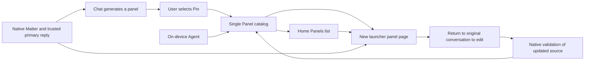

# Unified Panel rebuild specification

Status: implementation delivered; acceptance in progress. This document records the delivered Panel contract, boundaries after the switch, and required acceptance checks. The 17 checks in section 10 have not all been signed off; section 12 lists observed evidence and uncovered scope. Until all section 10 checks pass, do not describe this feature as accepted, released, or included in an official image.

## 1. Product goal

A user receives a real panel in chat and selects **Pin to Panels** to see it in the home **Panels** list. Selecting the list item opens its page on the new launcher; continuing edits returns to the original conversation. The list and launcher read one catalog, and content and actions use the same native Matter source.



The implemented product state follows. Retirement of the old paths is reflected in source and artifact inventories; other behavior requires individual sign-off under section 10.

- One Panel catalog, one operation named **Pin**, and its corresponding **Unpin**.
- Pinned panels have the same ID, order, title, and content source in the home list and launcher.
- Updates across turns retain `panelId`; generating a new reply does not add a list item.
- Users and on-device Agents can perform the same query, pin, unpin, open, rename, reorder, and continue-editing operations.
- The old generic business panels, half-marathon compatibility entry, separate Keep list, and three launcher examples are retired from runtime paths.

## 2. Scope and retained capabilities

This rebuild covers chat actions, the Panel catalog, home list, launcher host, continued editing, persistence, Agent Interface, build and installation, bundled documentation, and old-code retirement.

Existing MatterRuntime, primary-reply source validation, GenUI catalog, TaskBroker, audio and camera execution, approvals, conversation history, and Home Feed remain. Having been called by old Panels does not make them part of the implementation to remove. Home Feed `feed/pin` and Panel pinning are distinct product operations; their data is not merged.

This work adds no separate model, task queue, background poller, arbitrary script executor, or APK per panel. Existing business capabilities remain available through native Matter actions. Pinning a panel alone neither authorizes background collection nor starts a new rule.

## 3. Retirement results

The table records retirement work; evidence is in section 12. The disposition column describes current source and worktree state, not sign-off for the section 10 retirement row.

| Previous implementation | Previous responsibility | Actual disposition |
| --- | --- | --- |
| `PanelNativeTools` and `taku_panel` | NativeBridge registered and ran old tools, launching the old desktop after creation | Classes removed; namespaces, dispatch, capability flags, and old prompts are no longer registered. `NativeBridge.retiredPanelTool` returns a real failure for old tool names retained in frozen sessions, without approval cards or panel operations |
| `ScenePanelView`, `PanelModuleViews` | List, creation, detail, and four module types in old `CodexHomeActivity` | Panel-specific host and rendering removed; Activity code still used by other features retained |
| `PanelHandoff` | Input handoff for old panels and ordinary old-home input | Removed; ordinary text now uses existing draft handoff (`org.agentos.agent.extra.DRAFT`) and Home's ask-Taku path |
| `PanelClarifications` and `panel/clarification` | Old panel confirmation cards and original-conversation continuation tasks | Dedicated protocol and render branches removed; questions and approvals retain generic capabilities |
| `tooling/panels`, old `panel.schema.json` | Generic app-kit panel business protocol and native tool-contract build | Source, schema, and packaging removed; only untracked `tooling/panels/node_modules` dependency cache remains in the worktree. Generic app-kit (`tooling/app-kit`) retained |
| `half_marathon` compatibility entry | Old list read the half-marathon list and opened its APK | Product reads and navigation removed, along with example defaults; generic installation tooling retained |
| `examples/scenarios/half-marathon-panel` and `spec/scenarios/task-panel.schema.json` | Complete half-marathon app, business implementation, build/install scripts, skills, tests | Old scenario and dedicated schema removed from the repository; indexes, dependency fallbacks, and install probes removed. Historical acceptance evidence moved to `docs/reviews/half-marathon-panels-2026-10-20/`, retaining its original date |
| `AgentPanels`, `savePanel/readPanel/listPanels` | Keep list plus input drafts, selections, and trusted reply snapshots for all chat cards | Old protocol removed; inputs/selections moved to `CardViewStateStore` (`card-view/read`, `card-view/apply`), trusted snapshots to native `primary_snapshots` and the primary-reply path |
| `PanelsSheet`, `Kept panels` | Separate saved list and detail sheet in new chat | Removed; home Panels list and unified open route are the only entry |
| `PanelState`, `PanelCards`, old `PanelsProvider` | Kyoto, Home, Work examples, SharedPreferences, example actions | Fixed IDs, sample data, sample-card bridge, and old provider removed; launcher now uses a dynamic catalog driven by `PanelDirectory`, `PanelDirectoryPages`, and `HomeController` |
| `taku://panels/...` and old `OPEN_PANEL` | Old Markdown links and old launcher Activity navigation | Old routes removed without a forwarding shim; no `taku://panels` handler remains. New open actions accept only new `panelId` values (`org.agentos.agent.action.OPEN_PANEL` or `panels/open`) |
| Old tests, fixtures, skills, harness prompts, image artifact requirements | Protected or released the old behavior | Removed or rewritten for the new contract; image validation no longer requires the old panel schema in Assistant APK. Historical acceptance records retain dates and scope |

`PanelActivity` is a shared assistant entry and was not removed wholesale by name. Only old Panel branches were removed from `NativeMarkdownLinks`, `ComposerDraft`, `ComposerPreferences`, `TaskRequests`, and the Feed bridge; ordinary conversations, external links, workspaces, and Feed remain.

## 4. Target architecture

### 4.1 Native Module owns the authoritative catalog

`PanelRegistry` is the sole Panel Module (`system/assistant/src/org/agentos/assistant/PanelRegistry.kt`). Its Interface handles source resolution, catalog mutations, source publication, version checks, durable receipts, and navigation requests. Chat, Compose launcher, and on-device Agents are Adapters across the same seam; none owns business validation or catalog storage.

`PanelRegistry` shares the native Assistant process with Matter persistence. Catalog records, retention of pinned sources, and mutation receipts reside in new `matters.db` tables created by the version 2 upgrade. `panel_records.matter` and unsettled `panel_updates` rows express retention; the collector protects those Matters. Pin catalog writes and source retention commit in one local transaction.

`MatterStore.onUpgrade` from version 1 to 2 creates `panel_records`, `panel_updates`, `panel_directory`, `panel_receipts`, `card_view_states`, `card_view_receipts`, `primary_snapshots`, `card_state_migrations`, and `display_supersessions`, then writes the initial catalog row. Other version combinations still fail explicitly; installation does not require clearing app data.

`MatterStore` opens `matters.db` with WAL. `onOpen` fixes the database limit at 32 MiB and sets `PRAGMA journal_size_limit=4194304`. The latter controls retained log size after checkpoints, not a hard quota for an active WAL. Card-state receipt archival handles only committed rows: `onOpen` and each transaction start move old `card_view_receipts` to disk history. New state and its receipt still commit together; rollback does not archive uncommitted receipts.

| Data | Sole authoritative owner |
| --- | --- |
| Panel ID, current source, title, order, pinned state | `PanelRegistry` (`panel_records`, unique `matter` constraint) |
| Matter data, source quality, action capabilities, rules, execution associations | Existing MatterRuntime and its native sources |
| Unsubmitted card inputs, selections, display preferences | `CardViewStateStore` (`card_view_states`) |
| Primary-reply content, source identity, completion state | Existing native primary-reply path and native-validated retained snapshots (`primary_snapshots`). Snapshots are derived copies, written only after native revalidation of the authoritative reply |
| Task execution, stop, cancellation, results | Existing TaskBroker and business executors |
| UI state caches for lists, pages, cards | Disposable display projections, never a data source |

### 4.2 Launcher reuses actual GenUI rendering

The launcher RN root `TakuPanel` accepts only `panelId` and is registered in `system/agent-app/index.ts`. Compose `PanelPage` owns page structure, title, navigation, and lifecycle. The RN root resolves Matter through the shared catalog, reusing chat's GenUI rendering and native Matter subscriptions.

`TakuFeedCard` still handles only FeedCard; Matter records are never disguised as FeedCards. Dedicated `PanelCards` and `isPanelCard` branches are removed; real panels no longer use the sample-card bridge.

The launcher mounts only the visible panel and one bounded preload page on either side (`HomeController.mountedPanelIds`). Unopened Pins retain sources without keeping an RN Surface or frequent subscription alive for every pinned panel.

### 4.3 Shared subscriptions without stopping another surface

The old bridge had one `matterReader`: a new subscription stopped the old one, and backgrounding either Activity also stopped it. Directly mounting chat cards on the launcher would therefore break updates elsewhere. The new path coordinates subscriptions by visible surface inside the shared ReactHost.

Chat and launcher independently register visible sources with `src/panels/matterDemand.ts`; leaving one entry releases only its lease. Native readers are independent per lease (`TakuAgentModule.matterReaders` is keyed by subscriptionId, and `MatterStreams` Lease is UID-bound), replacing the former global replacement behavior.

Subscriptions group at most 32 Matters per batch, respecting the native limit of two simultaneous leases. Clients renew every 90 seconds; native leases expire after 120 seconds. Only visible and bounded preload content is subscribed; catalog size is not limited. Excess preloads are dropped; excess visible items show their real state (client error `SUBSCRIPTION_LIMITED`) without silently stopping another surface. Renewal, reconnection, and foreground restoration reread full snapshots rather than assuming cursor replay.

### 4.4 Implementation locations

| Location | Delivered responsibility |
| --- | --- |
| Assistant `PanelRegistry.kt` and `PanelProtocol.kt` | Catalog, parameter/native-command validation, source publication, receipts, contract description (`taku.panels/1`) |
| Assistant `MatterStore.kt` (version 2), `MatterRetention.kt`, `CardViewStateStore.kt`, `PanelNativeServices.kt` | Database upgrade, Pin retention/collection, separation of card state and trusted snapshots, notification/navigation services |
| `AgentGatewayProvider.kt`, `AgentGatewayProtocol.kt`, `AgentOpenAccessProvider.java` | GUI `panels`/`cardView` actions and ordinary-UID `panels/*`, `card-view/*`, `matter/read`, `matter/dispatch`, sharing validation and results |
| `MatterRuntime.kt` and `PanelRegistry.publish` | Trusted target context, exact completion-source association, old-action invalidation, `sourceVersion` protection, publication transaction |
| Agent App `src/panels/PanelRoot.tsx`, `client.ts`, `host.ts`, `usePanelCatalog.ts`, `matterDemand.ts`, `cardViewSync.ts` | Resolve native sources by Panel ID, reuse GenUI/shared inputs without copying business state; JS catalog, navigation, subscription coordination |
| `src/chat/TakuHomePage.tsx`, `src/panels/PanelCatalogView.tsx`, `src/components/GenUiCard.tsx`, `src/hooks/useGenUi.ts` | Real list, Pin state, Open/Unpin, rename/reorder, replacement of old save path |
| `index.ts` and Home `panels/PanelDirectory.kt`, `PanelDirectoryPages.kt`, `PanelNavigation.kt`, `PanelNavigationProvider.kt`, `PanelPageUi.kt`, `ui/HomeController.kt`, `ui/HomeScreen.kt`, `HomeActivity.kt`, `apps/HomePanelAnchor.kt` | New RN root registration, dynamic pages in catalog order, reanchoring/exact navigation by `panelId`, `panels/navigation` projection |
| `TakuAgentModule.kt`, `PanelLaunch.kt`, `PanelLaunchIntents.kt`, `LaunchRoute.kt` | Independent leases per visible entry, persistent Panel conversation route, version-checked composer sends |
| Assistant skills, harness, build/image validation | New contract discovery (bundled `taku-open-access`), existing-install upgrade, old-asset retirement, real APK binding |

## 5. Panel identity and source

### 5.1 Catalog record

`PanelRecord` contains the following fields, matching records returned by `panels/list` and `panels/get`.

| Field | Meaning |
| --- | --- |
| `panelId` | Native-generated UUID, stable during one pinned lifetime |
| `originThreadId` | Original conversation resolved at first Pin; clients cannot rebind it |
| `matterId` | Native Matter ID of the current display source |
| `sourceVersion` | Current source-binding version, increased only when the source changes |
| `metadataRevision` | Catalog metadata version, including renames |
| `title` | Initially from the trusted source; subsequently renameable by user or Agent |
| `position` | Explicit catalog order; IDs are not generated from array indexes |
| `createdAt`, `updatedAt` | Native commit timestamps |

A global `listRevision` increases on pin, unpin, reorder, rename, or source switch. Matter content revisions are independent of catalog versions. Catalog commits notify `content://org.agentos.assistant.open-access/panels` through standard ContentResolver; card-state commits notify the corresponding Matter URI.

The catalog stores no model-generated business facts, arbitrary client views, command authorizations, or copies of task state. Each current `matterId` belongs to at most one pinned Panel, enforced by the unique `panel_records.matter` constraint. Concurrent Pins of one source create one entry; other calls return that record with `created:false`.

### 5.2 Native resolution of pin sources

`PinSource` has two mutually exclusive forms below.

```json
{
  "kind": "matter",
  "matterId": "7d8bd450-e9c8-40fb-a50f-75a261111111/trip-plan"
}
```

```json
{
  "kind": "primary",
  "threadId": "7d8bd450-e9c8-40fb-a50f-75a261111111",
  "turnId": "turn-104",
  "replyId": "reply-22222222222222222222222222222222",
  "revision": 3,
  "contractHash": "1111111111111111111111111111111111111111111111111111111111111111"
}
```

Example values illustrate structure and are not real device IDs. Pinning native Matter validates its source and current capabilities. Pinning a primary reply reads the exact reply natively (falling back to its trusted `primary_snapshots` entry when necessary), verifies provenance, revision, reply key, and current component contract, and performs required Matter admission. Clients cannot submit `reply`, `request`, `view`, or `commands` as authoritative content.

A primary reply must actually be `completed` and have a usable card presentation (`card.request` passes `UiCardRequest.validate` and contains no native `actionRef`). `streaming`, logical `sealed`, failed, and interrupted replies cannot Pin and return `REPLY_INCOMPLETE`. Completed plain-text replies without a valid card do not trigger an extra model call to generate a panel. A changed source-contract hash returns `SOURCE_CHANGED`; invalidated presentation returns `STALE_SOURCE`.

### 5.3 Updates across turns must retain Panel ID

Matter identity includes `threadId/key`. A new card in a later turn may have a different key and must not be assumed to update the previous Matter automatically.

Each continuation binds the request to the Panel ID, original conversation, current source version, and saved source. The model receives the current Panel context before the turn. After native completion, the Panel keeps its ID, title, and order while its `matterId` and `sourceVersion` advance to the validated replacement.

Native publication enforces all of these constraints.

- Accept only actual completion of the bound task and original conversation; never infer a target from reply text, matching titles, or the globally latest record. Task `request.json`, `state.json`, `runtime-info.json`, and completion manifest must agree or return `SOURCE_CHANGED`.
- Publish only by comparing and updating the same `sourceVersion`. An older task arriving late cannot overwrite a newer source (`STALE_SOURCE`).
- If the Panel was Unpinned, do not recreate it. Record `unpinned` in the receipt; task results remain in the original conversation.
- Failed, interrupted, or plain-text-only tasks retain the old source and record the real outcome (`failed`, `interrupted`, `REPLY_INCOMPLETE`) instead of replacing it with an empty panel.
- Old display actions for the replaced source become invalid natively (`display_supersessions` plus removal of `actionRef` during reconstruction). Old chat history remains readable; expired buttons cannot execute, and direct dispatch returns `STALE_SOURCE`.
- A replacement can change an input value saved when the request was sent. A newer manual edit takes precedence. If the schema becomes incompatible, the prior draft remains available for review.
- A replacement must be a completed primary reply declared with `mode:"panel"`. The broker considers only marked replies when a turn also has other cards. Multiple marked replies return `PANEL_UPDATE_AMBIGUOUS`. Zero marked replies return `REPLY_INCOMPLETE`. Both outcomes retain the previous Panel and the conversation results.
- Source switch, old/new retention, old-action invalidation, and publication receipt commit in one native transaction. Invalidating old presentation does not cancel real tasks or rules already running.
- A new source belonging to an existing Panel update task returns `PANEL_UPDATE_PENDING` at `pinCode`, preventing Pin of the new reply from creating a second Panel. A source already owned by another panel returns `SOURCE_ALREADY_PINNED`; no automatic merge occurs.

Publication is part of the new path and cannot be replaced by rereading when a list item is selected.

## 6. User-visible behavior

### 6.1 Pin and Unpin

Chat cards show **Pin to Panels** according to native `pin.canPin`. An already-pinned source shows **Pinned**, **Open panel**, and **Unpin**. Launcher panel pages render the card without chat's **Pinned**, **Open panel**, or **Pin to Panels** controls. Long-pressing a pinned card opens a native confirmation dialog containing only Cancel and **Unpin**; confirmation uses the same `card.unpin` as chat. Only pinned cards respond, and no dialog opens while Pin/Unpin is in progress. The launcher avoids a persistent destructive button that could be tapped accidentally. Retained draft fields appear in a collapsed-by-default **Review saved inputs** section; expansion lists original values without clearing or rewriting native data. Pin eligibility and state always come from native capabilities; incomplete sources cannot bypass validation.

The old Keep condition `request.mode === 'panel'` is removed. Pin eligibility comes only from native `pin`; `mode` retains card-layout meaning without Panel registration or ownership duties.

Pin appears complete only after durable commit. Repeated taps, simultaneous Pins from two entries, and retries after a lost IPC response create one entry. New Pins append to the catalog by default.

Unpin removes the Panel from both the home list and launcher page sequence. It releases only pin retention; it does not delete conversations, cancel tasks, or stop rules. Other retention owners remain governed by existing Matter rules. If later collection finds no remaining owner, native retention policy may collect the Matter; this is not conversation deletion by Unpin, and device records must include the actual collection code.

Repinning after Unpin is a new explicit operation and may generate a new `panelId`. Replaying an old request ID returns its original receipt without repinning an already-removed Panel.

### 6.2 Home list and launcher

Home **Panels** contains only real catalog entries, with no production samples. An empty catalog displays a prompt to pin panels from chat. This is currently text rather than a clickable entry; making the prompt actionable remains additional work if required. The old **Kept panels** entry and sheet no longer exist.

The list supports open, rename, move up/down, and Unpin. Pagination covers all pinned entries without the old file store's 64-item truncation. Catalog changes during paging trigger a fresh read without duplicate or missing entries.

The launcher places panels after app pages in catalog order, using `panelId` as a stable Pager key. Adding/removing pages must not reinterpret the selected ID as another panel. Removing the current page selects the nearest surviving neighbor, or the main desktop when none remains.

On cold start, each RN root runs one read queue: contract check, `panels/get`, and `readMatter` execute serially; only the latest queued request is retained and obsolete-generation results are discarded. Three mounted roots each have at most one active read; catalog/foreground notifications do not accumulate parallel requests. Subscribe to invalidations before the initial read and retain the first catalog replay, which may contain commits made during startup. The queue coalesces duplicate notifications; repeated observer startup does not launch another read. Failed `readMatter` requests show an error and **Retry**, not a blank page.

Open launches only the new `HomeActivity` and selects the requested ID. A missing panel returns `PANEL_NOT_FOUND`, without old-Activity or sample-page fallback. Assistant/Agent App contract mismatch displays an update prompt (client `PANEL_CONTRACT_MISMATCH`) rather than invoking old code. Launcher card load failures likewise show an error and Retry, not an empty panel.

### 6.3 Content, input, and actions

Chat and launcher read the same current Matter projection. Inputs and selections are stored in that Matter's shared card state (`card-view/read`, `card-view/apply`); purely visual state such as scroll position may be local.

Business actions still pass native Matter validation of `actionRef`, current revision, inputs, and required confirmation before reaching real executors. Pin, reopen, reconnect, and layout restoration cannot replay actions.

Offline or unavailable sources may display the last native-retained trusted snapshot with its time and status. Unavailable actions must fail explicitly, never display false success.

### 6.4 Continued editing and source deletion

**Continue editing** opens the original conversation with the Panel's title and a link back to its page. Each new send uses the current Panel source version and the usual composer and submission receipts. Agent callers can use `panels/continue` with the current source version from `panels/get`. Opening another chat or explicitly opening the original conversation from history exits Panel editing.

The bottom assistant entry on a Panel page displays the Panel's name. Double-tap to type or hold to speak. Both submit to the original conversation as Panel updates.

Archiving the original conversation does not invalidate a pinned panel. Pin ownership protects required native sources and trusted snapshots. After permanent conversation deletion, retained panels show the last trusted content and an unavailable-conversation state; continued editing returns `SOURCE_THREAD_NOT_FOUND`. Never silently create another conversation or switch panels.

## 7. Interface

The public on-device entry is `content://org.agentos.assistant.open-access`, usable by ordinary on-device Agents and shell. Panel operations are not gated by package name, system UID, or signature.

The GUI gateway adds two restricted actions, both taking `{operation,args}`: `panels` and `cardView`. Public provider methods `panels/...`, `card-view/...`, `matter/read`, and `matter/dispatch` forward to the same `PanelRegistry` and MatterRuntime Interface. Parameter validation, errors, idempotency, and transactions have one implementation.

### 7.1 Catalog and navigation methods

| Method | Arguments | Result |
| --- | --- | --- |
| `panels/describe` | `{}` | Method schemas, fields, limits, error codes, contract version, navigation notes, card-state migration report |
| `panels/list` | `{limit?,cursor?}` | `{items,nextCursor,listRevision}` |
| `panels/get` | `{panelId}` | `{panel,sourceState,updateReceipt,capabilities,listRevision}`; content is read through current Matter |
| `panels/pin` | `{source,requestId}` | `{panel,created,listRevision,replayed}` |
| `panels/unpin` | `{panelId,expectedListRevision,requestId}` | `{removed,listRevision,replayed}` |
| `panels/rename` | `{panelId,title,expectedMetadataRevision,requestId}` | `{panel,listRevision,replayed}` |
| `panels/move` | `{panelId,beforePanelId,expectedListRevision,requestId}` | `{listRevision,replayed}`; `beforePanelId:null` means the end |
| `panels/open` | `{panelId}` | `{accepted:true,panelId}` means navigation accepted, not that the page has rendered |
| `panels/navigation` | `{}` | `{available,visible,selectedPanelId}`; reading does not launch the desktop |
| `panels/continue` | `{panelId,text,expectedSourceVersion,requestId}` | Existing TaskBroker submission receipt plus `panelId`, durable `update` receipt, and `replayed` |

`limit` defaults to 50 and accepts 1–100. Trimmed titles contain 1–120 Unicode characters. IDs and input lengths are explicitly validated; unknown arguments are rejected and unknown methods return `UNKNOWN_METHOD`. `requestId` is a UUID; reusing it with different arguments returns `IDEMPOTENCY_CONFLICT`. Unknown `panelId` values (get, open, move target) and get after Unpin return `PANEL_NOT_FOUND`.

Pagination cursors are HMAC-SHA256 signed with the catalog key, binding catalog revision, position, and `panelId`; clients cannot alter ordering identity. Invalid signatures return `INVALID_ARGUMENT`; changed revisions return `LIST_CHANGED`. Mismatched `expectedListRevision`, `expectedMetadataRevision`, or `card-view/apply.expectedUiRevision` returns `VERSION_CONFLICT`. Unchanged ordering retains the version; moving an item before itself is a no-op, and a nonexistent target returns `PANEL_NOT_FOUND`.

`panelId`, `originThreadId`, and `requestId` use lowercase UUIDs. Matter retains native `threadId/key` identity. Versions are nonnegative integers. Continue text accepts 1–16000 characters; ordinary requests retain the gateway's 48000-character limit. A primary source must include the real `turnId`, native reply ID, nonnegative revision, and exact contract hash, verified by reading that precise source.

`panels/get.sourceState.state` is `current`, `offline`, `thread-unavailable`, or `unavailable`, with `observedAt` and optional `code`. `capabilities` contains `canOpen`, `canContinue`, and `canUnpin`. `updateReceipt` is the latest durable update receipt with `outcome`, `code`, `publishedSourceVersion`, `publishedMatterId`, `settled`, and timestamps.

CLI and `am start` navigation carry `launchId`. Only new external navigation gets a new identity; redelivery of the same Intent retains it. Continue consumption is persisted by intent identity before releasing the pending receipt. On saved-state restoration or return from Recents, consumed identities discard the `panelId`, `sourceVersion`, and `originThreadId` extras, making entry an ordinary turn without carrying panel context into another send. This handles old-Intent restoration after process death and cannot rely on an in-memory flag.

### 7.2 Public Matter and card-state access

New Panels expose actual content as well as the catalog through the public provider, reusing native Matter and card-state validation.

| Method | Arguments and behavior |
| --- | --- |
| `matter/read` | `{matterId}`; returns the same Matter `snapshot` as GUI (data quality, UI capabilities, current actions, `pin`, `cardView`, `presentation`) |
| `matter/dispatch` | Existing `dispatchMatter` arguments `matterId/requestId/actionRef/expectedRevision/values`; returns the same execution receipt |
| `card-view/read` | `{matterId}`; reads shared inputs/selections, `uiRevision`, and `review` |
| `card-view/apply` | `{matterId,expectedUiRevision,requestId,changes}`; edits presentation inputs/selections by semantic field ID, not business facts or permissions |

`changes` lists declared fields, each `{kind:"field",id,value}` or `{kind:"selection",id,itemIds}`. Unknown fields, type mismatches, and removed options fail explicitly. `false`, `0`, empty text, and cleared selections retain their actual values. Successful commits notify the corresponding Matter URI and advance `uiRevision` even without a business-revision change.

Writes mark a field `edited:true`. The public Interface cannot clear this flag, so acceptance scripts can restore drafts/selections but cannot reset `edited`; device records must state this.

`panels/describe` also supplies these schemas and limits. Business requests remain subject to actual source capabilities and platform permissions; results cannot be fabricated. Missing Matter returns `MATTER_UNAVAILABLE`, malformed input `INVALID_ARGUMENT`.

### 7.3 Notifications, durability, and errors

Catalog commits notify `content://org.agentos.assistant.open-access/panels` through standard ContentResolver. Cross-process clients register observers and reread `listRevision` on reconnect/foreground restoration. Notifications signal invalidation, not a durable event log. Matter content retains existing native subscriptions.

Public Agents can repeatedly read complete authoritative state. Results over 256 KiB return `{ok:true,resultUri}`; the same provider's `openFile` returns the full original envelope. Temporary results are caller-UID scoped, expire in 30 seconds, and allow at most 8 buffers totaling 16 MiB. A result over 8 MiB returns `RESULT_TOO_LARGE`; exhausted buffers return `RESULT_BUFFER_FULL`; expired, consumed, or wrong-UID reads fail with `RESULT_EXPIRED`, without truncation. GUI retains its existing large-result transport. These limits/expiry were checked on-device at transport-module scope; see section 12.

Errors use `{ok:false,code,message}`. `panels/describe` reports `INVALID_ARGUMENT`, `UNKNOWN_METHOD`, `PANEL_NOT_FOUND`, `REPLY_INCOMPLETE`, `SOURCE_CHANGED`, `SOURCE_UNAVAILABLE`, `SOURCE_THREAD_NOT_FOUND`, `SOURCE_ALREADY_PINNED`, `PANEL_UPDATE_AMBIGUOUS`, `STALE_SOURCE`, `VERSION_CONFLICT`, `LIST_CHANGED`, `IDEMPOTENCY_CONFLICT`, `MATTER_STORAGE_FULL`, `MATTER_UNAVAILABLE`, `STORAGE_ERROR`, `USER_LOCKED`, `DEVICE_LOCKED`, `RESULT_TOO_LARGE`, `RESULT_EXPIRED`, `RESULT_BUFFER_FULL`, `THREAD_BUSY`, `THREAD_QUEUED`, `DRAFT_REVIEW_REQUIRED`, `PANEL_UPDATE_PENDING`, and `CARD_STATE_MIGRATION_PENDING`. Submission busy/idle, cancellation, and unknown outcomes retain actual existing receipts, never success wrappers.

Missing native Matter returns `MATTER_UNAVAILABLE`, including fabricated `panels/pin` sources. The code appears in `provider-acceptance-complete/02-01-describe.json.errors`, and `06-05-rejected-inputs.json` returns exactly `MATTER_UNAVAILABLE` for a fabricated source. Both were obtained from rebuilt artifacts; source, description, and response agree.

The GUI gateway accepts only allowlisted actions; unknown actions throw `UNSUPPORTED_ACTION`. Chat and launcher treat both `UNKNOWN_METHOD` and `UNSUPPORTED_ACTION` as contract mismatch, showing an update prompt (`PANEL_CONTRACT_MISMATCH`) without old-code fallback. Older GUI versions lack `panels` and `cardView`, so this path exposes version incompatibility rather than failing silently.

Pin retention, catalog record, catalog version, and idempotency receipt commit atomically, without partial records. Unknown responses retain the original `requestId` for checking/retry instead of automatically creating a new write ID. Publication receipts and catalog versions survive process restart. Unpin returns the advanced `listRevision` in the same transaction; clients need not guess it, and later writes using the old version receive `VERSION_CONFLICT`.

`primary_snapshots` is derived from authoritative replies. Only for the same reply/revision, `completed` state, and missing snapshot row may native code backfill after checking provenance, `baseRequest`, and the known reply; any mismatch returns `SOURCE_CHANGED`. This permits repinning old Matters after snapshot loss without promoting inconsistent content to trusted sources.

Matter persistence limits Matters and sources to 256 each, alongside WAL/database capacity constraints. The catalog never silently deletes existing Pins to free space. `MatterRetention` first protects `panel_records`, unsettled `panel_updates`, card state, and in-flight task sources, then collects temporary Matters; insufficient capacity returns `MATTER_STORAGE_FULL`.

Source resolution and external reads never invoke models or await task completion inside database transactions. Required reads happen before commit, with source identity/version rechecked at commit.

### 7.4 Agent command examples

The Panels section in preinstalled `taku-open-access` ([`system/assistant/assets/skills/taku-open-access/SKILL.md`](../system/assistant/assets/skills/taku-open-access/SKILL.md)) documents the full command set: `describe`, paged `list`, `get`, both `pin` sources, `rename`, `move`, `open`, `navigation`, `unpin`, `continue`, `matter/read`, `matter/dispatch`, `card-view/read`, `card-view/apply`, error envelopes, result-URI reads, and equivalent `am start` navigation (`org.agentos.agent.action.OPEN_PANEL` with `panelId` extra).

```sh
content call --uri content://org.agentos.assistant.open-access \
  --method panels/describe --arg '{}'

content call --uri content://org.agentos.assistant.open-access \
  --method panels/pin \
  --arg '{"source":{"kind":"matter","matterId":"7d8bd450-e9c8-40fb-a50f-75a261111111/trip-plan"},"requestId":"ab18875c-90e6-494a-8665-609333333333"}'

content call --uri content://org.agentos.assistant.open-access \
  --method panels/list --arg '{"limit":50}'
```

Bundled documentation and installed managed copies were synchronized to the new contract. The old copy `9b8381…` was confirmed to be a program-written live-audio merged guide, not a user edit. Its body and original receipt were archived byte-for-byte read-only, then receipt-proven stock body `cbbc6a…` restored before invoking the existing upgrader through ordinary-UID `skills/read`. Final body, management receipt, and APK documentation all have SHA-256 `d2d296ed3095c86c18e40ee9b4890abb2f539112045722f3b3640dd3167bf0dc`, with the skill still enabled, managed, and nativeRecognized. Receipts were not rewritten to seize ownership, and other skills were unchanged. Evidence: `out/panel-rebuild/managed-skill-final/report.json`.

## 8. Data and installation transition

### 8.1 Old panels leave the runtime

The default is a new empty Panel catalog. Old generic panels, half-marathon records, Keep records, and sample state are not automatically imported and have no runtime read/fallback path.

Retiring old paths does not authorize deletion of user data. Old business records and unconvertible sources are archived read-only and are not loaded by the new feature. If the half-marathon APK is independently installed, remove only its TakuOS compatibility entry; do not uninstall it or clear its data without authorization.

Old Keep pin relationships are not migrated. Ordinary chat-card inputs, selections, and native trusted snapshots that must survive are converted through a versioned one-time upgrade into their new responsibilities. Conversion preserves `false`, `0`, empty values, and drafts requiring review, accepting only allowlisted fields. Old client layouts cannot become trusted business sources. Unverifiable state is archived and reported, never silently discarded.

Implementation: `MatterRuntime.migrateCards` reads old `agent-ui-panels/*.json`, writes per-record `card_state_migrations` markers (`stateImported`, `uiDisposition`, `snapshotDisposition`, `complete`, optional `code`), and makes source files read-only without deletion. Trusted snapshots enter `primary_snapshots` only after native revalidation of the original reply. Mismatched/unreadable sources are marked `archived-source-mismatch`, `pending-source-verification`, or `retry-required`. Until migration completes, `reclaim` returns `CARD_STATE_MIGRATION_PENDING`; `panels/describe.migration` exposes all markers. Reinstallation does not reimport. Known source-retention relationships are rebuilt before Matter collection.

The upgrade was checked using Android module fixtures against installed APK classes: 138 assertions cover blocked 1→2 upgrades, failure retaining `user_version` 1 without new tables, preservation of every v1 row, retry creating all tables and one empty catalog, preservation of `false`/`0`/empty-text drafts, review for orphan/incompatible drafts, pinned-source survival under collection/pressure, both Matter/source capacity limits, and reopening after rollback. This uses the helper's module fixture and does not claim a real public-Pin upgrade test.

### 8.2 Coordinated build and existing-session transition

One release candidate must contain the new Assistant and Agent App contracts together. Incompatible versions show an explicit update-required error without old-implementation fallback.

The transition covers the following. Completed means the current worktree and inspected artifacts; pending means checks still required on rebuilt artifacts.

- Old provider Manifest declarations, Intent routes, and sample ID constants: completed.
- NativeBridge old-tool registration/dispatch, per-turn old-focus injection, capability flags: completed; only real failure replies for frozen sessions remain. Device checks show old-runtime sessions restored in the new binary no longer include `taku_panel` or `taku_panel_old_action`; other tools, including a deliberately retained `taku_panels`-prefixed tool, remain.
- Old dynamic tools and harness prompts in new/frozen sessions: old harness panel module removed and bundled skills rewritten; residual frozen-session tool names receive real failures from `retiredPanelTool`.
- Old pending-confirmation cards and panel-specific handoffs: dedicated classes removed. Ordinary draft handoff (`home-pending-*`, `ComposerDraft`) continues serving ordinary conversations without clearing or changing its meaning.
- Old native schema build/asset packaging in `system/assistant/build.sh`: removed.
- Image artifact checks and source inventory requiring old panel schemas: removed.
- Root `Android.bp` `spec/panels` assets (old schemas no longer packaged in Assistant APK), Agent App sample WebP/icons, and old-example installation probes: source references removed.
- Installer HOME selection cannot restore the old launcher as the main entry after updates: completed.
- Device installation: `install.sh` installed both APKs on the data partition with `-r`, retaining existing data. In the same run, `system_ext` copying failed with `ENOSPC` on the SDK's 51 MiB scratch overlay. No ROM, system-partition, or image-level installation is claimed. `main-baseline-install.json` records the pre-upgrade baseline.
- Agent APK rebuilt and bound: `0.4.0`(9), SHA-256 `2e39dbbf25015ed75caf8346cf9373617e08aa0dac0f3e6d4e6135a6515e3b9e`, source commit `92414bd6b80e46ad56906c8ca499bd24f0c0a26e`. `image/agent_ui.py pin --local` and `check` passed; 25 removed sample assets no longer enter the source-input set. The lock identifies a local unpublished artifact without a fabricated download URL. Full-image snapshot passed the Agent gate, then stopped on the existing stale Audio ROM input lock; see section 12.
- Managed `taku-open-access` upgraded through the existing path to the APK's new documentation; old merged guide/receipt retained in a read-only archive. Independent fixtures verify stock upgrade, custom-body protection, old `taku-panels` retirement, and repeat execution. No live `taku-panels` directory or receipt exists; other skill bodies remain unchanged.
- Old TypeScript/Kotlin/JVM fixtures, source-shape tests, and build references rewritten for the new contract; device driver now uses `scripts/test-panels-device.py` plus an independently signed probe APK.

Old callers and protocols are retired in one transition unit. The current worktree has no dual catalogs, dual writes, or compatibility shim.

## 9. Implementation units and completion criteria

The table lists dependencies and completion criteria; status reflects only source and inspected evidence.

| Unit | Deliverable | Completion criteria | Status |
| --- | --- | --- | --- |
| A. Native authoritative catalog | `PanelRegistry`, database upgrade, source retention, receipts, public/GUI Adapters, separated card state | Concurrent Pins of one source produce one ID; crash recovery is checkable; ordinary UIDs can read/write; Matter collection remains consistent | Delivered. Ordinary-UID/shell concurrency, lost-response recovery, durable replay passed; Android module fixtures verify upgrade, capacity rejection, and retention |
| B. New product path | Chat Pin, real home list, dynamic launcher pages, RN root, continued editing/native publication | Pin visible in both places; reopen/cross-turn update retains ID; Unpin removes both | Delivered. Real GUI Pin, long-press Unpin, cold load, cross-surface input, and actual continuation on final APK passed |
| C. Old-path retirement | Section 3 code, protocols, examples, build/managed prompts removed | No executable old entry in source/final artifacts; ordinary chat, Feed, background tasks unaffected | Delivered. Frozen-session tools, installed providers/links, APK samples, live managed docs checked |
| D. Release-candidate acceptance | Same-version APK installation, data upgrade, Agent docs, isolated-emulator end-to-end evidence | All section 10 checks pass, unverified scope listed separately before completion claim | Isolated-emulator acceptance and local APK binding completed for this feature. Evidence types for 17 checks follow; no full-ROM or physical-device pass claimed |

A precedes B. C spans caller transitions in A and B. D verifies complete artifacts, not a substitute single-module build.

## 10. Required acceptance

The table retains the previous 17 functional checks and their scoped evidence in `out/panel-rebuild/`. These records do not establish visual-layout acceptance. After the user reported a blank vertical bar and duplicate open entry on 2026-11-16, the actual UI was separately reproduced, fixed, and checked under section 10.1. Real GUI means actual taps, UI hierarchy, and screenshots; public Interface calls use shell and an unprivileged ordinary-app UID 10128 probe; Android module fixtures use installed artifacts and isolated data. Evidence types are not interchangeable.

Earlier Agent APK `2e39db…` underwent cold-page, long-press-menu, and continuation checks, which did not catch this layout defect. The 14-case public-provider matrix is bound to Assistant APK `60da8e…` and remains historical rather than a claimed rerun. Layout-fix APK `e15c18f7bbe212b24c68280e3122506721cbd1081914722015db502f2c3485df` was verified against installed bytes; separate UI evidence follows.

| Scenario | Pass condition | Result and evidence |
| --- | --- | --- |
| GUI Pin | Pin a real completed card; public list/get, home, launcher share one ID | Passed. `final-gui-pin.json`, `final-home-panels-list.png`, `release-ui-smoke.json`: actual chat Pin created `4e5fc976-741f-428a-a2d7-f3ff370e491d`, consistent across public catalog, home, and launcher |
| Agent Pin | Ordinary UID pins an existing trusted source through public Interface; GUI immediately shows same record | Passed. `agent-pin-gui.json`: UID 10128 created `21638f25-287c-4f73-a2ae-91357c2191bf`; home and actual launcher showed the same entry and renamed title. Test entry cleaned up |
| Concurrent entries | Two simultaneous Pins create one Panel and no duplicate retention | Passed. `provider-acceptance-release/03-02-race-pin.json`: overlapping shell/ordinary-UID windows yielded one creation and one ID |
| Incomplete sources | Streaming, sealed, interrupted, failed, fabricated sources cannot Pin or alter original data | Passed. Public provider rejects fabrication; real GUI Stop covers streaming/interrupted. `negative-lifecycle/report.json` has 45 device-module assertions for four lifecycle states, unchanged full storage, and completed positive control; `stale-contract.json` verifies `SOURCE_CHANGED` for a real source with stale contract |
| Process recovery | Lost response/UI death after commit recovers once under original request ID and survives restart | Passed. `lost-pin-response.json` discards write responses from process creation; independent read confirms commit. After stopping Assistant, replay of the UUID retains ID/full catalog. Final provider matrix also checks restart persistence |
| Unpin | List, launcher, current page update; original chat and running tasks survive | Passed. `long-press-unpin.json` records ordinary tap without menu, long-press menu, Cancel without mutation, confirmed removal in both places, and neighbor fallback. `late-update-and-actions.json` records continuing tasks/approvals and late completion marked only `unpinned` |
| Cross-turn continuation | Original conversation generates new trusted card; ID/title/order survive while source changes | Passed. `release-gui-continuation.json` performs actual Continue/send on final APK and generates Count 4; `sourceVersion` 0→1, same ID/title/position, settled publication. `continuation-process-death.json` checks restored old Intent does not repeat update context |
| Late/stale updates | Old task, version conflict, or Unpin during update cannot overwrite or repin | Passed. Device `late-update-and-actions.json` covers `STALE_SOURCE`, `VERSION_CONFLICT`, and no revival after Unpin; native `rejectedAndLateCompletions` covers an older task arriving after newer publication, rejection of 35 ambiguous candidates, and retention of original source |
| Historical actions | Native code rejects replaced-source buttons; reopen executes nothing | Passed. `late-update-and-actions.json` rejects old `actionRef` with `STALE_SOURCE`; `long-press-unpin.json` compares native turn ID/status around reopen/menu actions, with no new turn |
| Input consistency | GUI/public Agent edits agree across surfaces, retaining false, 0, empty values, review state | Passed. Provider card-view checks, `multi-surface-inputs.json`, `long-press-controls.json`, and offline-review screenshots cover shared values, false/0/empty values, normal controls. `receipt-archive/report-20261116T020220.json` verifies archived receipt replay cannot roll back newer drafts |
| Metadata | Rename/order agree across surfaces; stale writes cannot replace newer catalog | Passed. Public renames in `final-gui-pin.json`/`agent-pin-gui.json` appear on home and launcher; final provider rename/move checks and `directory-stress/summary.json` verify conflicts, pagination, stable selected IDs |
| Multiple pages/large results | Complete paging beyond old 64-item limit, stable page IDs, full large-result reads | Passed. Nine directory-pressure steps with 65 real sources; final provider reads actual large Matter via complete resultUri. Device transport fixture `android-buffer/summary-20261116T010004.json` covers byte boundaries, 8 MiB, buffer capacity, expiry, single consumption |
| Multiple surface subscriptions | Chat/launcher keep current updates during foreground changes/coexistence; closing one leaves the other active within native lease limits | Passed. `multi-surface-inputs.json` covers real dual readers; nine real-gateway cases in `matter-leases/summary.json` cover two groups of 32 sources, third-lease rejection, independent release, renewal at 90002 ms, expiry at 120001 ms |
| Source/conversation changes | Archive, permanent deletion, offline state are explicit; retained snapshots do not impersonate live data | Passed. `source-lifecycle.json` and deletion/offline screenshots verify states, snapshots, continuation failure; `final-cold-panels.json` records reread after background changes, final `release-ui-smoke.json` cold-loads three real pages |
| Upgrade/storage pressure | Retryable upgrade preserves drafts/pins; capacity failures leave other panels intact | Passed (Android module fixture). `android-upgrade/report.json` has 138 assertions for rollback/retry, drafts, pin retention, capacity rejection, entry isolation; old Keep migration also has `migration-offline-verification.json` |
| Retirement | Old tools/providers/routes absent, no samples in empty list, no obsolete skill calls | Passed. `runtime-retirement/report.json`, `final-retired-entrypoints.json`, absence of sample assets in final APK, `managed-skill-final/report.json`; old docs archived read-only, active skills use new contract |
| Non-Panel regression | Ordinary chat input/send/stop/approval, Home Feed pin, app paging, native business actions remain valid | Passed. `non-panel-chat.json`, `non-panel-feed/proof.json`, `non-panel-app-pagination.json` cover real chat/Stop/approval, Feed pin/retract, bidirectional app paging; ordinary card controls still write through native card-view |

Reusable checks include `scripts/test-panels-device.py`, the ordinary-UID probe in `system/assistant/tests/panels-device/`, native runtime/gateway/routing host scripts, Agent App tests/typecheck/lint, and existing Home/Agent Gradle unit tests. Standalone CLI `wait-update` and `preflight` were actually run; the same argument-binding fix applies to other single-command entries. Device fixtures/raw output under `out/panel-rebuild/` are local acceptance evidence, not product assets.

The provider driver does not itself create a streaming model source; real GUI, stale-contract, and lifecycle fixtures supplement `05-rejected-inputs`. Final `10-card-view` preserves upgrade-era `charger-packed`, which does not match the current schema, rather than rewriting it for the test; valid fields/review state have separate evidence above. Public writes cannot clear `edited`, so restoration resets only drafts, source, and review values, retaining real edit markers.

### 10.1 Card-layout correction

The original screenshot was reproduced on isolated `emulator-5682`. The blank bar at `[42,811][105,1099]` in the native hierarchy came from `FeedStatus` misused in a horizontal button row; the launcher also reused chat's **Open panel**. The fix distinguishes existing `surface` presentations, uses plain text for chat **Pinned**, and removes chat pin/navigation controls from launcher cards. Successful update time becomes plain text below the card. Native errors, the existing **Continue editing** primary button, and long-press confirmation remain.

`out/panel-card-fix/verify-layout.py` records duplicate entry, blank status bar, and missing draft-detail entry on the old APK; all 15 checks pass on the new APK. It depends on this isolated AVD's existing sources, not a device-free unit test. Old APK is `before.apk`; results are `before-result.json`/`after-result.json`; final launcher, expanded drafts, and visible chat-button screenshots are `final.png`, `after-review.png`, and `after-chat-pinned.png`. All are local acceptance artifacts.

Expanding/collapsing **Review saved inputs** leaves native `ui`, `review`, and `uiRevision` identical. Four historical records expose booleans, `0`, empty text, and empty selection. Historical fields use their own IDs as labels without borrowing new titles/units. Original historical titles are absent from native review records and were not fabricated. Reads/writes remain through `card-view/read`/`card-view/apply`; collapse state does not write native data.

`controls-result.json` records GUI switches/numbers/text reaching native state and public-Agent `false`, `0`, and text returning to GUI; actual text clearing saves `""`. Fcitx Pinyin was selected, so injected Latin keys produced Chinese; comparison used the text actually visible in controls. The text-selection toolbar was unconfirmed and is not counted as passed. `unpin-result.json` confirms Unpin only on a temporary panel created for this check, preserving all three original panels. `chat-result.json` records continuation, the chat pin row, and Open panel; the pin row was scrolled above the composer/blurred area before inspection.

`after-chinese-review.png` and `locale-result.json` cover draft details in Chinese at 150% font scale. Original font scale and empty app-language override were restored afterward. Android Gradle `assembleRelease`, typecheck, and lint passed. The default build wrapper timed out after Expo prebuild output; the actual APK used the generated Android project with Android Studio JDK 25.0.3 for Gradle build, alignment, platform signing, and signature verification.

The emulator host later reported hung QEMU main-loop/CPU threads and exited for an undetermined reason. The same AVD was cold-started with software graphics and preserved data; installed APK hash was unchanged, all 15 `recovered-result.json` checks passed again, and visible chat-button navigation was repeated. The user's `emulator-5680` was untouched.

### 10.2 Panel continuation

The component upgrade on `emulator-5682` verified the named chat entry and return to the same Panel. Two consecutive chat edits published counts 41 and 42. The Home text and hold-to-send paths published 43 and 44 through the original conversation. Agent readback matched the Panel values. A subsequent turn published count 45 and created a separate ordinary Matter card.

The stale composer check returned `VERSION_CONFLICT`, kept the draft, and released the pending slot. Chat collapse selected the same Panel on Home. After Agent process death, invoking the retained Edit Activity with its original arguments restored the saved draft. Reset rejected a replay of that intent. Evidence is in the local `out/panel-continuation/` directory. The test upgraded the Agent APK, Assistant APK, and broker JAR. It used synthetic microphone input and a connected model.


## 11. Alternatives and tradeoffs

| Candidate | Decision | Reason |
| --- | --- | --- |
| Add a home entry to Keep | Rejected | Retains coupling of card drafts/saved items, old list/limits/protocol, failing the cleanup goal |
| New UI on old app-kit panels | Rejected | Retains Node service deployment and a separate business model parallel to Matter |
| Treat panels as Home Feed cards | Rejected | Feed publication/expiry/removal/compact-pin semantics differ and would mix catalog lifecycle into Feed |
| Native Panel catalog referencing trusted Matter | Selected | List, launcher, Agent share one catalog; execution stays in existing runtime; pin and retention commit atomically |

The work centers on catalog, cross-turn source publication, actual launcher hosting, and old-caller retirement. Existing GenUI rendering does not connect those paths automatically; the launcher therefore adds a `panelId`-only root instead of reusing the Feed-card root.

## 12. Evidence and boundaries

All device operations were limited to `emulator-5682` / `Taku_Panels_20261115`, SDK 37, ARM64; the user's `emulator-5680` was untouched. `out/panel-rebuild/final-installed.json` records final installed bytes:

| Artifact | Version | SHA-256 |
| --- | --- | --- |
| Assistant | `20261115-panels` (78) | `60da8e394430dedf375e37d5a40891fec70be5368284f795be1cc9ee868c35ba` |
| Agent App | `0.4.0` (9) | `2e39dbbf25015ed75caf8346cf9373617e08aa0dac0f3e6d4e6135a6515e3b9e` |

Final Agent source inputs are bound to `92414bd6b80e46ad56906c8ca499bd24f0c0a26e`. Implementation was committed before `image/agent_ui.py pin --local`, then `check` passed. Local-unpublished lock status does not mean artifacts were uploaded. `release-ui-smoke.json` and `release-gui-continuation.json` bind to this final APK. Public-interface matrix and native upgrade/admission/receipt checks bind to the unchanged Assistant; earlier Agent hashes remain in their original reports.

Main code and Interface entries:

- [Authoritative catalog](../system/assistant/src/org/agentos/assistant/PanelRegistry.kt), [MatterRuntime](../system/assistant/src/org/agentos/assistant/MatterRuntime.kt), [shared card state](../system/assistant/src/org/agentos/assistant/CardViewStateStore.kt), and [persistence](../system/assistant/src/org/agentos/assistant/MatterStore.kt).
- [Public provider](../system/assistant/src/org/agentos/assistant/AgentOpenAccessProvider.java), [GUI gateway](../system/assistant/src/org/agentos/assistant/AgentGatewayProvider.kt), [preinstalled commands](../system/assistant/assets/skills/taku-open-access/SKILL.md).
- [Launcher root](../system/agent-app/src/panels/PanelRoot.tsx), [shared GenUI](../system/agent-app/src/components/GenUiCard.tsx), [lease coordination](../system/agent-app/src/panels/matterDemand.ts), [launcher catalog](../system/agent-app/modules/taku-home/android/src/main/java/org/agentos/agent/home/panels/PanelDirectory.kt), and [native launcher contract](../system/agent-app/modules/taku-home/CONTRACT.md).
- [Device acceptance CLI](../scripts/test-panels-device.py), [ordinary-UID probe](../system/assistant/tests/panels-device/org/agentos/panelsprobe/PanelsProbe.java), [APK input validation](../image/agent_ui.py), and [asset lock](../image/runtime-assets.lock.json).

Verification boundaries:

- Section 10 retains each evidence type. Lifecycle, upgrade/storage pressure, and transport boundaries use isolated module fixtures; they do not claim actual model output after sealing, a genuinely full disk, or over-limit business data. Managed-skill fixtures redirect only two equal-length paths in installed broker dex and recompute checksums, with byte differences reported; actual managed-doc upgrade separately uses public `skills/read`.
- `matter-leases/summary.json` measures native leases and the real gateway. Existing module tests cover the 90-second JavaScript timer coordination; `multi-surface-inputs.json` separately covers actual chat/launcher coexistence. System time was unchanged.
- Agent APK `pin`/`check` passed in `image-input-binding.json`, with 25 sample inputs removed. Full `scripts/pixel9-image.py.snapshot()` then stopped on stale source closure/content in existing `system/audio-engine/rom-input-lock.json`: `Audio source input closure changed; rebuild and refresh the release lock`. That acceptance round changed neither Audio source nor lock and did not reattribute old Audio artifacts to pass checks.
- Installation used data-preserving `-r`. Earlier `install.sh` copying to the SDK's 51 MiB `system_ext` scratch failed with `ENOSPC`; no full-ROM, system-partition, physical-device, flashing, or artifact-publication claim is made.
- An acceptance skill helper once damaged the test device's Binder mount through shared mount propagation. Normal console shutdown and cold start of the same AVD restored it with data preserved; all 14 public-provider checks then passed. Later skill fixtures use no mounts and verify unchanged live bodies/receipts; the original incident is in `bundled-skill-upgrade/summary.json`.
- Android build, typecheck, lint, and 29 image-artifact behavior checks passed. Earlier native/app test records retain their execution-time logs and are not presented here as reruns.
