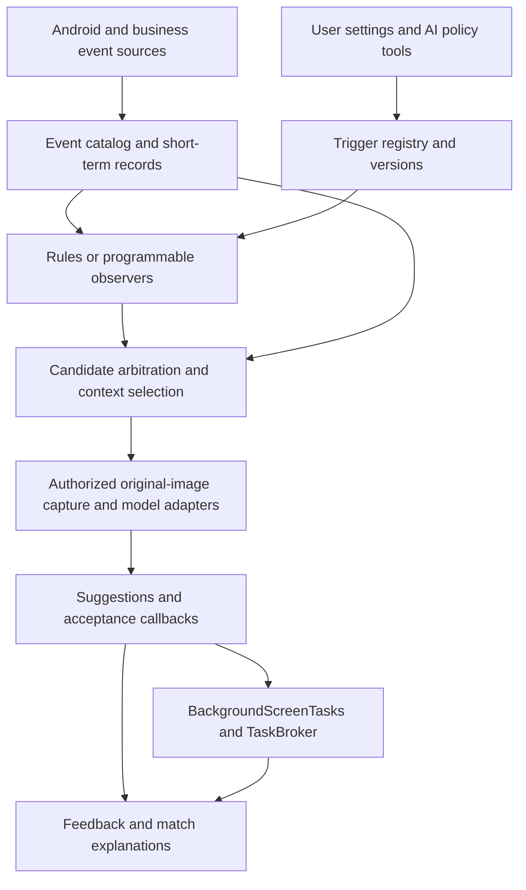

# Taku proactive triggers and policy maintenance design

Taku proactivity serves the developer community as an independently buildable, installable, maintainable, and replaceable app and extension contract. The official project provides system capabilities, stable protocols, and a reference experience; developers maintain event sources, observers, policies, and scenario extensions, while users and AI can modify, combine, and share them.

Execution follows an event/observer model: sources report changes, registered observers discover candidates under policies, selectors supply context, and Jev judges the current original image before suggesting action. User acceptance hands work to the existing background Agent. Users customize behavior through natural language or policy UI; AI maintains policies through the same versioned interfaces.

**Design proposal, 2026-10-24.** Code baseline matches the [event catalog](proactivity-events-2026-10-24.md): branch `codex/power-screen-assist-20261023`, HEAD `81524acaba06356964cbad5017e18c99c59194da`, including uncommitted dev68 worktree changes. This round adds standalone proactivity 0.1 and an external-observer example, bounded below. Full layering, generic interfaces, model flows, and defaults later in this document remain target designs; public API documentation governs callable 0.1 contracts.

## 0.1 implementation checkpoint

Source [system/proactivity](../system/proactivity/README.md), public [Messenger protocol/SDK](../system/proactivity/API.md), [JSON Schema](../spec/proactivity-v1.schema.json), and [standalone plugin](../examples/proactivity-observer/README.md) ship together. The official host has only the platform signature needed for the existing Surfaces bridge; plugins use independent signatures/UIDs without referencing private Memory, Assistant, or host classes.

| Capability | Actual 0.1 behavior | Remaining gap |
| --- | --- | --- |
| Community registration | Own-namespace `register/event/inspect/capabilities/disconnect`, binding identity, installed version, signature; initial registration/updates await user confirmation | Generic event catalog, dependency drafts, replaceable-host selection, public migration |
| Rules/records | One stable-event rule; 64 in-memory metadata records per observer, time-window deduplication, latest-N selection frozen chronologically | Global sources, cross-source selection, independent image capture, generic code-callback runtime |
| User maintenance | Native heatmap/trend/ring charts and source ranking; observer/activity pages; authorization, enable/disable, four parameters, history, policy rollback/removal; expected-version validation | Field-level user-override merging, import/export, replay comparison |
| AI maintenance | AI uses the same register operation to change its own plugin, still requiring user confirmation; repeating original declarations does not overwrite user adjustments | Authorized cross-plugin AI patches, natural-language tools, conflict preview |
| Suggestions | Real Surfaces publication ACK, TTL, acceptance receipts; lock/disconnect/update revoke old candidates | Jev decisions, original-image suggestions, and public post-acceptance Agent bridge not connected |
| Independent updates/rollback | Example independently builds v1/v2; same-signature in-place update retains data; policy rollback creates a new revision, debug APK can actually downgrade and reconfirm | Production distribution, signature rotation, production Android rollback, full-ROM integration |
| Lifecycle | Management UI/plugin binding keeps host alive; persists authorization, versions, activity, cooldown; no replay of pre-process events | No always-running boot observation/global background collection |

This version establishes the actual independent-developer registration-to-maintenance path. Synthetic page metadata cannot replace S04 original-image Jev, nor does it mean all 89 events are connected. See [this round's record](reviews/proactivity-2026-10-24/README.md) for acceptance/native screenshots.

Next steps in order: **independently authorized real sources → image capture/ContextBundle → Jev/image-suggestion adapters → sole TaskBroker acceptance bridge → authorized AI policy tools/user-override merging**. In-host script hot loading and sources such as notifications remain later extensions; U02 power-key work coordinates separately with ROM.

## Product requirements and design boundaries

The following consolidates product requirements and designs. Public candidates retain requirements without internal-chat links or verbatim statements; subsequent engineering contracts describe design, while actual scope follows this page's acceptance records.

| ID | Product requirement | Design |
| --- | --- | --- |
| S01 | Open event catalog | Collect from authorized, available sources without requiring every source first |
| S02 | Registerable triggers | Shared registration, updates, enable/disable, history, rollback; AI and UI share interfaces |
| S03 | User-editable policies | Editable source filters, conditions, frequency, priority, with retained overrides |
| S04 | Context appropriate to each match | Each policy declares selector, scope, window, count; select against match anchors |
| S05 | Programmable observers | Declarative/code observers share lifecycle/output, retaining state, timers, extension interfaces |
| S06 | Modularity/community extensions | Official foundation/reference experience; community develops/releases/maintains under the same contract |

Retain existing boundaries: current-screen proactive flows require an actual original image; events, notifications, or Memory bodies cannot replace it. No execution task before acceptance; manual screen requests skip Jev. Policy registration does not grant Android/account/external-action authorization. See the [89-event catalog](proactivity-events-2026-10-24.md) for individual public sources/ROM boundaries.

## Component ownership and community development

Under [core philosophy](../PHILOSOPHY.md) and [ecosystem strategy](ecosystem-strategy.md), developers should independently supply, replace, and maintain default components. Proactivity uses a standalone app host with its own UID, configuration, and short-term records; policy management is its default UI. Memory may supply an entry/context adapter, Assistant model/task adapters; neither owns the host or requires community authors to edit their source.

A standalone APK is the default delivery boundary; events, registries, selectors, and scheduling remain library modules, without one app per extension point. Users/system configuration select the active host; replacements share the contract to avoid duplicate subscriptions, suggestions, and tasks.

| Participant | Maintains | Required integration |
| --- | --- | --- |
| Official system foundation | Android/ROM adaptation, actual permission bridges, task runtime, protocol compatibility, component lifecycle | Explicit callable capabilities/failures; extensions needing no new system primitives require no ROM rebuild |
| Default proactivity app | Registry, short-term event journal, candidate scheduling, maintenance UI, public client | Independent builds/upgrades, versioned cross-app protocol, thin SDK, CLI, diagnostics |
| Official reference extensions | Sources, observers, selectors, defaults sufficient to validate value | Same community-accessible interfaces and runnable examples, without Assistant-private Java classes |
| Community developers | Sources, code observers, context adapters, models/handlers, policy templates, replacement hosts | Maintain/build/release in their own repositories; install/load under valid authorization without merging core |
| User and Owner Agent | Adjust policies, write/verify extensions, enable/disable, upgrade, rollback, share | Conversation, UI, structured interfaces, authorized shell all serve the same actual state |

Public integration must not require private platform signatures, shared system UID, or internal-registry changes from every developer. System privileges stay in capability bridges; extensions receive declared scope by caller identity/user authorization. Explicitly state prerequisites for specific privileged capabilities. SDKs are convenience wrappers; publish protocols/event formats so authors can implement clients. Preserve authorized Owner Agent shell/native development paths.

Separate current conditions: [SystemAiProvider][code-ai-provider] already offers ordinary-app text/image models by calling-package identity; [Surfaces API][surface-api] still requires host-matching signatures, Memory reads have signature permissions, and background-task acceptance remains inside Assistant. P0 must provide explicit bridges/public contracts to the proactivity host rather than claiming external apps already have the full flow. Ordinary extensions join through host authorization; capability bridges hold platform privileges, reusing model credentials and the sole task queue.

**The first release must ship an extension example outside host source**: using public contracts only, an author independently builds/installs an APK, registers an event/code observer, subscribes to authorized events, queries bounded context, produces a genuinely displayed candidate, then independently upgrades/disables/rolls back. None of this edits Memory, Assistant, or host source or rebuilds ROM. Missing public APIs/permission bridges are first-release gaps, not replaced by built-in host tests.

## Layers and extension contracts



These are standalone-app module boundaries and cross-app extension contracts. The first host packages independently; Memory, Assistant, and references use declared interfaces. Sources/UI remain thin adapters, without policy scattered through broadcast receivers/window code.

| Extension point | Minimal contract | Customization |
| --- | --- | --- |
| `EventSource` | `describe/start/stop`, unified Event output; version, availability, authorization, loss/reconnect | Notifications, location, connectors, etc. without changing observer scheduling core |
| `EventCatalog` | Register schemas/providers/fields/capabilities by namespaced type ID | 89 entries are a starting point, not closed enum; custom types include source documentation/licensing |
| `TriggerRegistry` | Policy versions, user overrides, enablement/dependencies, atomic effective-version publication | Sources, conditions, frequency, priority, context, model routes, presentation |
| `Observer` | `onEvent/onTimer`, restricted state, `skip/defer/candidate` with reasons | Stateless rules, counts, ordering, pauses, code heuristics |
| `ContextSelector` | Bounded anchor/policy query returning selected/excluded/missing items and reasons | Recent/source-specific/authorized business records, later retrieval methods |
| `DecisionProvider` | Image/context capabilities, input bounds, result schema, unified decision | Existing Jev initially; other adapters without provider-response coupling in policies |
| `EffectHandler` | Consume valid candidates, return publication/interaction receipts | Screen suggestions initially; later reminder/result handlers declare authorization/lifecycle |

Outer Event carries at least `id/type/schemaVersion/sourceId/sourceVersion/userId/profileId/displayId/package/windowId/observationEpoch/sourceSeq/correlationId/causationId/observedAt/receivedAt/bootId/permissionEpoch/payloadRef`; unavailable fields are explicitly null, restricting dependent policies. Type schemas describe `payload`; event types do not own full-content collection. Host verifies user/source identity and authorization generations rather than trusting payload claims. Optional schema fields preserve compatibility; semantic changes require a major version. Unknown majors report `unsupported_dependency`, not silent old semantics.

`describe` returns real source capabilities. Users/AI can register drafts depending on unavailable sources; runtime shows `waiting_capability` and reasons. Revalidate on recovery rather than inventing capabilities from imports. Start sources only for effective subscriptions/collection permissions, releasing unused listeners/timers when the last subscription disappears.

Preserve source sequences/causal relationships for redelivery deduplication across sources. Main-display observation keeps existing exclusions for Assistant, Memory, Surfaces, and execution screens; suggestion layout, progress refresh, and policy receipts cannot retrigger themselves. Internal feedback driving another observer requires explicit subscription and bounded causal-chain reentry to avoid loops.

### Two observer forms

**Declarative rules** cover source matching, `all/any/not`, counts, ordering, time windows, stability after change, and absence of specified events. Host centrally times stability/absence; operators extend by namespace/version rather than forcing every scenario into one expression.

**Programmable observers** handle multistep/heuristic logic. Illustrative interface, with `state` isolated by trigger ID, version, and user scope:

```text
onEvent(event, state, host) -> { nextState, timers, result }
onTimer(timer, state, host) -> { nextState, timers, result }
result = skip(reason) | defer(until, reason) | candidate(contextRequest, reason)
```

`host` exposes only declared event queries, monotonic clock, bounded state/timers. Respective layers arbitrate model calls, screenshots, presentation, and execution; code observers cannot bypass budgets or submit TaskBroker tasks. Bound callback runtime, state size, and timer count; overrun/repeated failure isolates only that policy with inspectable reasons, without blocking others. Runtime capabilities publish exact limits.

P0 ships both rule interpreter and external-APK observers so community authors write real code/build/upgrade independently. External observers run in their own app process and exchange events/state/candidates through public protocol; the default example validates this. Code compiled into the host shares its process; configuration validation is not a security sandbox.

Under user authorization, AI can generate observer APKs, scripts, and replay cases and verify with available tools. Generic in-host script hot loading is P1, with runtime/resource/version management, not a prerequisite to community code in release one. Runtime is replaceable; JS, Wasm, or a particular engine is not fixed as the product contract. Authorized Owner Agent shell remains an existing development path, without mandatory policy-interpreter mediation.

## Trigger registration and execution

A trigger has an exportable declaration and separate runtime state. Declaration fields follow; editable policy files exclude state, leases, cooldown counts, and model receipts.

| Group | Content |
| --- | --- |
| Identity | `id/schemaVersion/revision/name/owner/createdBy/updatedBy/reason/provenance`, traceable to template, user request, or group discussion |
| Dependencies | IDs/version ranges/required capabilities for events, observers, selectors, model adapters, handlers |
| Subscriptions/scope | `subscriptions`, user/profile scope, apps, displays, source filters; main display by default |
| Decision | `observer.kind/ref/config` for both rules/code |
| Scheduling | Stability/max wait, candidate TTL, grouping/dedup keys, priority, cooldown, request budget |
| Context | Selector version/types/association fields/lookback/`maxRecords`, byte/image limits, required items/missing handling |
| Subsequent handling | Decision role/presentation-handler references; initially image Jev and `screen.offer`, execution still requires acceptance |
| Maintenance | `enabled/effectiveFrom/expiresAt`, template origin/version, overrides, migration version, optional automatic-tuning scope |

Registration: **declare dependencies → validate → local replay → atomic activation → listen under effective subscriptions**. Registry may save drafts; missing dependencies, incompatible schemas, or insufficient permissions retain drafts/errors without subscriptions. Replay processes event fixtures/preset model receipts only, defaulting to no network, actual presentation, or tasks.

Proposed shared identity-checked service interfaces for settings UI, Agent tools, and importers:

| Operation | Core input/behavior |
| --- | --- |
| `capabilities/list/get` | Query actual events, extension points, policies; return effective config/override origins |
| `validate` | Schema, dependencies, scope, resource bounds, user authorization; field errors |
| `simulate` | Policy version/accessibly replayable range; expected matches/exclusions/call-volume differences |
| `apply` | `id + expectedRevision + mutationId + patch + reason`; atomic complete change, reject stale versions, same mutation retry returns same receipt |
| `setEnabled` | Optional time/source limits; immediate effective-config update/revoke unexecuted candidates |
| `history/rollback` | Compare history; rollback creates a new revision checked against current dependencies/authorization, without reverting permissions |
| `export/import` | Declarations/provenance only, excluding record bodies/credentials/leases; same validation and explicit ID conflicts |
| `inspect` | Candidate causal chain: rule, version, records, gate producing the outcome |

These are proposed public service APIs, not registered `NativeBridge` methods. Release one must define cross-app transport, identity, authorization, subscription/version handshake and publish both SDK and implementable protocol. Effective versions/overrides commit transactionally in host-private storage; acknowledge only after persistence, retaining the old active version on failure. Policy API accepts structured parameters; authorized shell remains separate, and patches are not executable commands.

Activating a new version increments registry generation and clears old observer state/timers/queued candidates. If an old model request cannot cancel, its result still cannot display. Recheck policy version, user limits, permissions, and capture identity before publication and acceptance. Accepted tasks follow TaskBroker cancellation/authorization, without automatic redo/restart on policy changes.

One event may match multiple policies. Schedule budgets by user limits, priority, freshness, and fair rotation. Merge the same image/overlapping matter into one candidate retaining contributing policies, without merging unrelated evidence. Display priority cannot override user disablement, Do Not Disturb, or global resource limits; one source's continuous events cannot starve others indefinitely.

## AI and users editing policies together

Users can edit through conversation, toggles, source settings, or suggestion feedback. Natural language is an input form; persistent state must be an inspectable policy revision/override, not chat context alone. AI first queries effective policy/capabilities, converts intent into scoped patches, validates/replays, applies within expressed intent, and returns changes/undo.

Editing binds actual user identity and authorized automatic-tuning scope. Screenshot, notification, webpage, and history text are analysis data, not self-authorizing registration/edit instructions; model decisions do not acquire policy-write rights.

| User expression | Structured change | Application |
| --- | --- | --- |
| “Stop notifications from this app triggering it” | Source-disable override for explicit app/notification type, without disabling all app functions | Apply/receipt when scope is clear; resolve/ask if app reference unclear |
| “It happens too often; less frequently” | Longer cooldown/lower budget in current scope, stating concrete values | Tighten current suggestion/explicit scope, without expanding to all policies |
| “Work apps matter more” | Priority adjustment for confirmed app/tag, retaining hard gates | Apply if identified; disambiguate duplicate names/work profiles |
| “Wait two seconds after scrolling” | Change stability time only, not source permission, record type, execution rights | Apply validated parameter change directly |
| “Only remind me about dinner plans” | Events still create stable candidates; add semantic-filter intent to the later model | Do not claim event metadata recognizes dinner plans; original-image model still decides |
| “Add a cross-app heuristic” | Select observer or generate new code/tests/candidate config | Register available capabilities; remain pending if new runtime/source permissions needed |
| AI infers lower frequency from low acceptance | Evidence-based proposed patch/expected impact | Draft by default; auto-adjust only within authorized parameters, ask outside scope |

Explicit user disablement outranks templates/AI suggestions; specific settings outrank broad defaults. Template updates preserve overrides and show field conflicts. Users can pause all/one policy, defer until a time, restore a field, or roll back one change. Dismissing one suggestion is feedback, not inferred permanent disablement.

Store policy, overrides, and counters separately. Each edit records initiator, reason, before/after versions, scope, replay summary; raw voice/full chat is not mandatory audit data. `expectedRevision` prevents stale AI patches overwriting fresh user changes. AI code observers follow the same registration/validation/replay/version process without bypasses.

The standalone first-release maintenance UI shows enablement, sources, frequency, extension packages, effective-policy explanation, recent-match reasons, history, undo. Memory/system settings may link to it. Advanced rules/code/JSON import/export share public services, with editors added later. Ordinary users need not understand internal event IDs/model request formats.

## Selecting the latest N records

S04 “latest N” means **at most N records authorized and constrained by type, time, and association to this policy's match anchor**. N is a cap, not a guaranteed count, chat-message count, or Memory's five-record analysis batch. Return fewer available records; defer/skip with reasons if required sources are insufficient.

### Records and Memory responsibilities

| Record | First-release role/boundary |
| --- | --- |
| Event metadata | P0 short-term history: type, source, time, observation epoch, state; no keystroke content/accessibility body |
| Current original image | Lawfully captured after match/gates as current-screen facts; Jev, image suggestions, acceptance bind one capture ID |
| Source-native structured records | Later authorized calendar/notification/business adapters, preserving type/origin; no notification bodies by default |
| Current Memory records | Separate optional context, subject to Agent-query toggle/API permission; changed/deleted versions no longer reused |
| Model inferences/summaries | Explicitly labeled inference with input provenance, never real events/original records; P0 does not use these to fill N |

New EventJournal stores bounded, expiring short-term metadata; do not turn Memory's record table into an unlimited event log. Start small, at most 2,000 records or 10-minute retention, reclaim by rules/report gaps. Keep only the current candidate image, not a historical screenshot sequence by default. Audit indices retain candidate/version links; body expiry/deletion must not leave copies under an audit rationale.

### Deterministic selection order

1. **Fix the anchor.** On observer match, pin `anchorEventId/anchorSeq`, policy revision, observation epoch, and permission generation. Select only records already present at/before the anchor; later arrivals belong to another candidate. The later post-stability image separately records `capturedAt` and capture-time event watermark rather than pretending simultaneity. If target window/key content generation changes meanwhile, revoke/reassess with a new anchor.
2. **Filter permissions/scope first.** Exclude other users/profiles/displays/unauthorized sources; select declared apps/types/reliable association keys. P0 uses system-known app/window/observation epoch, not invented WeChat conversation IDs. Without trustworthy business keys, do not concatenate cross-conversation content.
3. **Bound the time window.** Use monotonic time within one boot; preserve business source time/time zone. Record observation and receipt separately; delayed reports are not newly occurring. Do not mix monotonic clocks across boots or backfill frozen contexts with late history.
4. **Deduplicate/merge.** Merge repeated notification updates/event redelivery/brief scrolling under type rules, retaining first/last times/counts, before counting N. Do not force different business IDs or unproven identical views together.
5. **Select relevance/recency.** Retain the trigger anchor; prioritize same-epoch/explicitly associated records, then source sequence/stable ID. Select newest eligible items and present chronologically to the model. P0 is deterministic; later retrieval/reranking must be versioned with reasons.
6. **Enforce multiple budgets.** Respect per-source quotas, global `maxRecords`, context bytes, image count. Required records take priority; remove lower-priority excess and mark truncation rather than silently changing facts. Images retain adapter limits.
7. **Freeze/recheck.** Produce immutable `ContextBundle`. Before model call, adopting results, and acceptance, recheck permissions/current record versions/candidate validity. Policy edits, withdrawn sources, or Memory deletion invalidate dependent candidates without reusing old content.

`ContextBundle` includes at least policy/selector revisions, anchor, time bounds, permission generation, capture ID/digest, record IDs/versions/types/sources/times/association strength, selection reasons, exclusion counts, missing/truncated markers. Capture digest binds the same pixels/dimensions; a different encoding is not new evidence. Jev decisions, image suggestions, and acceptance receipts share a context ID. Execution needing updated context creates/revalidates another version rather than silently replacing accepted evidence.

Initial defaults are **120-second lookback, at most 8 merged metadata records, at most 1 current original image, serialized metadata ≤16 KiB**, pending replay tuning. Users may adjust within declared resource capabilities, later per policy; current image-model limits do not expand. If the required current image is unavailable, screen policies stop rather than falling back to old images/text.

Example: the user scrolls a chat app and pauses. Anchor at scroll stop; select main-display/same-epoch window/scroll metadata within 120 seconds, merge contiguous scrolling, cap at 8. With only 3, provide 3 plus the current gated capture. This does not invent 8 chat messages or extract group-chat body through accessibility; dinner-plan semantics still come from the image model.

### Example policy configuration

This illustrates interface shape, omitting registry-generated ownership/audit fields. `org.example.chat` is a placeholder; registration resolves actual packages/capabilities and binds user/profile scope to caller identity. It creates an image-viewing candidate after event stability, without claiming dinner recognition from metadata alone.

```json
{
  "id": "user.chat.screen-opportunity",
  "schemaVersion": 1,
  "revision": 1,
  "name": "Check whether help is useful after the chat page settles",
  "enabled": true,
  "scope": {"displayId": 0, "packages": ["org.example.chat"]},
  "subscriptions": ["taku.android.window.content_changed@1", "taku.android.view.scrolled@1"],
  "observer": {"kind": "rule", "ref": "taku.rule.settled@1", "config": {"quietMs": 1500}},
  "schedule": {"groupBy": "observationEpoch", "candidateTtlMs": 120000, "offerCooldownMs": 300000},
  "context": {
    "selector": "taku.context.recent-observation@1",
    "lookbackMs": 120000,
    "maxRecords": 8,
    "maxMetadataBytes": 16384,
    "required": ["current_image"],
    "optional": ["event_metadata"],
    "onRequiredMissing": "skip"
  },
  "decision": {"provider": "system.jev", "requires": ["image"], "intent": "Find a useful next step to help with"},
  "effect": {"handler": "taku.screen.offer@1", "requiresUserAccept": true}
}
```

Host adds global AI budgets, unlock/protected-window gates; omitted fields cannot remove them. Conversation edits may patch only `observer.config.quietMs` or an app override, without rewriting the whole policy. More complex scenarios can select registered code observers while retaining selectors/handlers.

## Current code and first-release gaps

| Capability | Current implementation basis | Required first-release work |
| --- | --- | --- |
| Independent delivery/community access | Existing Memory, Assistant, Surfaces only at this design baseline, without a standalone proactivity APK/public SDK | Independent host/lifecycle, public protocol/tools; default/external extensions share paths; separate build/install/upgrade acceptance |
| Cross-app bridges | [SystemAiProvider][code-ai-provider] ordinary-app text/images; Surfaces/Memory signature constraints; background acceptance inside Assistant | Host image decisions/presentation/task contracts; ordinary extensions avoid private platform signatures/classes; replacement hosts have authorization/compatibility paths |
| Event collection | [ObservationService][code-observer]/[configuration][code-observer-config] listens to three window/scroll types, coalescing at 900ms; depends on Memory toggle/text | Independent metadata, source descriptions/epochs, separate Memory/original-image observation toggles, input-activity gates |
| Policies/versions | [MemoryStore][code-memory-store] setting generation, record revisions, queue leases; [SystemAi][code-ai] configuration revision | Reuse design patterns without calling them TriggerRegistry; add policies, overrides, history, atomic activation |
| Recent-record query | [MemoryProvider][code-memory-provider] public signature-protected `search/get`; [MemoryStore][code-memory-store] internal browse sorted by `last_seen` | Bounded EventJournal/anchor selectors; Agent search cap 20 is not “this policy's latest N,” internal browse is not public API |
| Original capture | Memory screenshot is protection-check-only then released; [AssistantSession][code-session] uses system invocation capture | Validate lawful automatic image source, bind capture/context; no background self-invocation to obtain screenshots |
| Jev/image suggestions | [AgentRepository][code-repository] `analyzeJev/analyzeScreen`; [JevScreenDecision][code-jev]/[ImageScreenSuggestion][code-image] original images, capture times, receipts | Existing inputs lack ContextBundle; `pageText` is not image-flow body input. Add typed context/policy versions and identical evidence across Jev/image stages |
| Authorization/models | [SystemAi][code-ai]/[MagpieDecisions][code-magpie] model catalogs, image capabilities, current-config rechecks | Add policy rights/revisions over existing AI authorization; no duplicated credentials; adapters expose actual input capabilities |
| Automatic hints | Existing JevHintView acceptance in [AssistantSession][code-session]; publication/user actions in [Surfaces API][surface-api] | Automatic-candidate owner, preacceptance presentation, revoke/dedup, candidate/revision checks at acceptance |
| Background execution | dev68 [BackgroundScreenTasks][code-background]/[TaskBroker][code-broker] background tasks and partial bottom-sheet questions | Reuse sole queue; free text, generic approvals, idempotent acceptance, real terminal state per task |
| Policy maintenance | Settings scattered across Memory/Jev/system AI; [NativeBridge][code-native] lacks proposed policy contracts | Shared inspectable UI/AI tools, edit receipts, pause/undo; settings are not chat memory |

### P0 implementation order

| Order | Deliverable/ownership | Completion criteria |
| --- | --- | --- |
| 1 | Standalone proactivity app, public Event/Trigger/Observer/ContextBundle, capabilities, SDK | Independent build/install; verifiable cross-app identity/authorization/subscription/version; boot/binding/recovery not only Assistant onReady; external extensions need no core edit/ROM rebuild |
| 2 | TriggerRegistry, overrides/persisted versions, management UI/AI policy entry | Query/validate/replay/atomic apply/enable/history/rollback; concurrent changes do not overwrite, failed writes do not claim activation; exported declarations readable elsewhere |
| 3 | Independent metadata, short-term EventJournal/ContextSelector | W01/W05/I03 and necessary input/lock gates first; observation independently authorized with Memory off; N-record selection replayable/explainable/permission- and capacity-bounded |
| 4 | Rules, external APK observers, ProactiveScheduler | Official/community packages share API; stable timing, merge/dedup, budgets/fairness; edits/lock/revocation/time anomalies invalidate old candidates |
| 5 | Automatic originals, ContextBundle, model adapters | Lawful image source verified on target device; same capture/context through Jev/image suggestions; explicitly skip unavailable image capabilities; manual path stays available |
| 6 | Automatic Surfaces hints/dev68 background handoff | No Agent execution before click; afterward preserve foreground/drafts, one task for duplicate acceptance, questions obtain actual missing information |
| 7 | Community development loop, policy maintenance, replay report, same-version device acceptance | External independent build/register/run/upgrade/rollback; explainable/undoable policies; full image-to-background-task loop with layered evidence |

Items 1–4 are application/service additions. Item 5 depends on images actually permitted by the system; readable events do not imply screenshots. Double-power invocation remains separate framework/ROM coordination under U02, not a prerequisite for registry, maintenance, or context selection.

### P1 and later extensions

- Notification/resource sources, handling disconnect, historical replay, permission changes, source loss; new descriptors/adapters reuse registration/selection/explanation.
- In-host dynamic scripting/hot loading/resource bounds; external-APK code/version/rollback is P0 and does not wait for a generic script runtime.
- Template packages, import/export UI, migration tools; version/author/provenance, retained overrides, conflict preview on upgrade.
- Authorized structured records/optional Memory selectors. Memory query toggles/revisions use existing signature APIs or explicit extensions, not internal root batch APIs to widen reads.
- Other models/connectors/handlers share registration. Devices may report different capabilities; unavailable ones remain pending rather than requiring core-policy edits per device.

## Maintainability and acceptance

Every match/skip yields a bounded Trace: event/policy revision → decisions/timing → gates/budget → selected records/missing reasons → model receipt → hint/feedback → accepted task ID. Fixed reason codes include `disabled_by_user/capability_missing/context_insufficient/budget_exhausted/stale_revision/capture_denied`, plus a plain-language explanation. Diagnostics omit original images/bodies by default.

Version policy packages/runtime separately and provide old-config migration fixtures. Failed migration retains declarations, pauses affected policies, and explains why without clearing customization. Export declarations/fixtures for maintenance, excluding private events, screenshots, accounts, and permission state by default. Journals have capacity/expiry/deletion rules; cooldown/budget counts persist within bounds so restarts grant no extra budget. Restore observer state only under explicit compatible migration; otherwise rebuild from new events without replaying external actions.

| Acceptance scenario | Required observation |
| --- | --- |
| Independent community maintenance | External repository depends only on public protocol/SDK; ordinary extensions need no private platform signature/core changes; example independently installs/upgrades/rolls back, with no private shortcut for official equivalents |
| New source/observer | Registration enables capability reporting, matching, explanation, disablement without changing scheduling branches; missing dependencies retain drafts only |
| Natural language/concurrent edits | Intent maps to explicit fields; stale revision rejected; failures do not partially apply; undo creates traceable revision |
| Model return during policy edits | Requests may complete but stale results never display; tighter app rules revoke queued/displayed old candidates |
| N-record context | Fewer than N, event bursts, duplicates/out-of-order, missing sources, changed business content within one window, cross-profile/boot; no later records inserted or fabricated conversation identities |
| Deletion/revocation | Memory deletion, source revocation, AI changes invalidate related context; caches do not restore old bodies |
| Code-observer failure | One timeout/exception/bad state does not block others; isolation/fallback receipts; live upgrade does not inherit incompatible state |
| Suggestions/execution | Multiple policies do not spam duplicates; acceptance submits once; completion matches actual task/turn, cancellation waits for actual terminal state |

Continue comparing fixed-interval, event-stability, and event-plus-policy scheduling, reporting misses, unwanted interruptions, latency, power, model calls, and postacceptance success. Also track policy-edit success, undo counts, missing dependencies, insufficient context, and invalid stale results. After replay passes, accept lawful original captures, real models, and target devices in stages; host/emulator passes do not automatically become complete-ROM acceptance.

[code-observer]: ../system/memory/src/org/agentos/memory/ObservationService.java
[code-observer-config]: ../system/memory/res/xml/observation.xml
[code-memory-store]: ../system/memory/src/org/agentos/memory/MemoryStore.java
[code-memory-provider]: ../system/memory/src/org/agentos/memory/MemoryProvider.java
[code-ai]: ../system/assistant/broker/org/agentos/lab/SystemAi.kt
[code-ai-provider]: ../system/assistant/src/org/agentos/assistant/SystemAiProvider.java
[code-magpie]: ../system/assistant/broker/org/agentos/lab/MagpieDecisions.java
[code-session]: ../system/assistant/src/org/agentos/assistant/AssistantSession.java
[code-repository]: ../system/assistant/src/org/agentos/assistant/AgentRepository.java
[code-jev]: ../system/assistant/src/org/agentos/assistant/JevScreenDecision.java
[code-image]: ../system/assistant/src/org/agentos/assistant/ImageScreenSuggestion.java
[code-background]: ../system/assistant/src/org/agentos/assistant/BackgroundScreenTasks.java
[code-broker]: ../system/assistant/broker/org/agentos/lab/TaskBroker.java
[code-native]: ../system/assistant/broker/org/agentos/lab/NativeBridge.java
[surface-api]: ../system/surfaces/API.md
