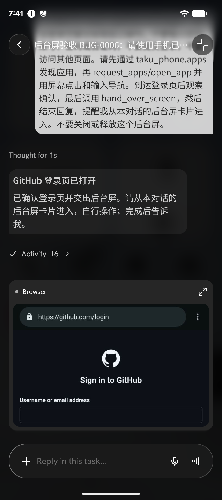
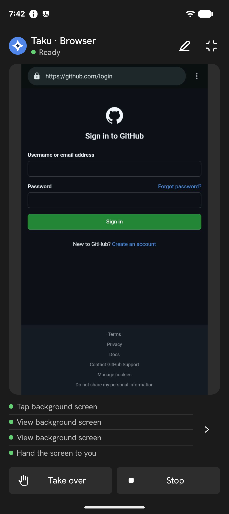
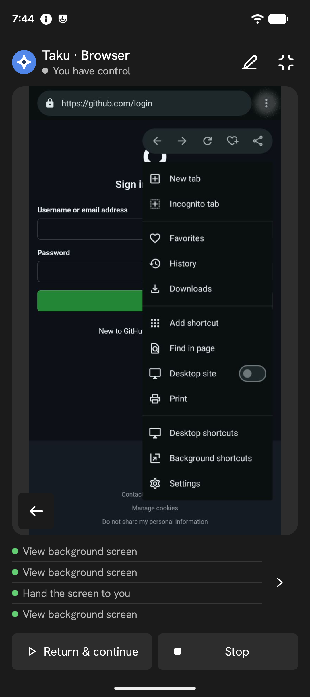
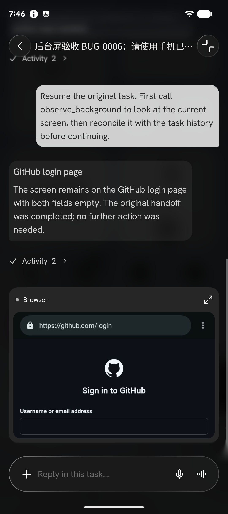
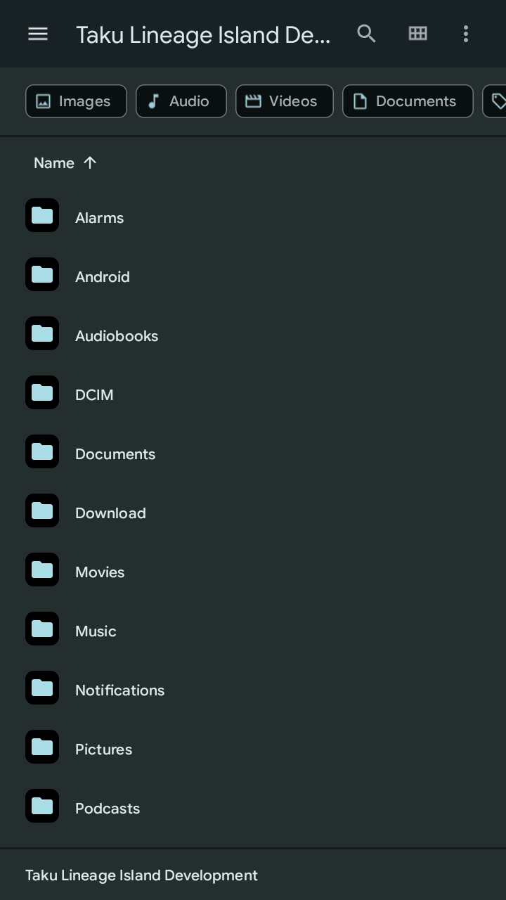
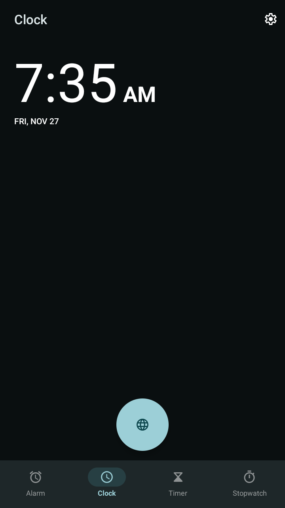
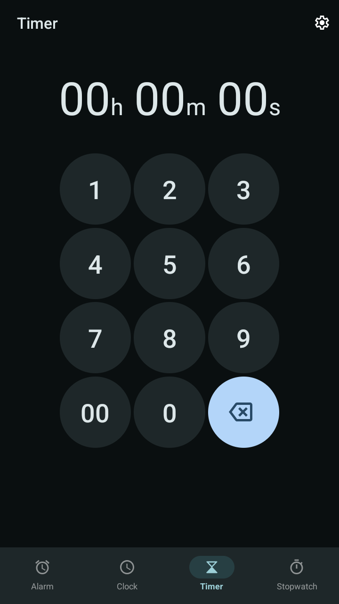
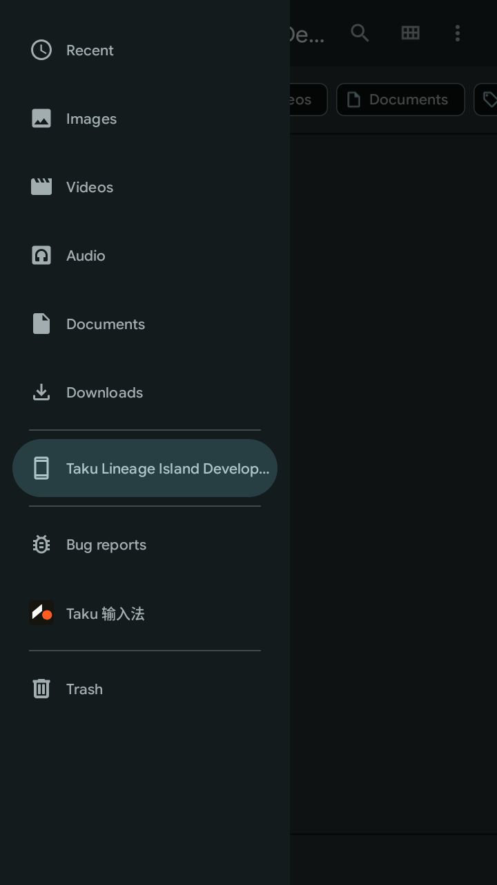
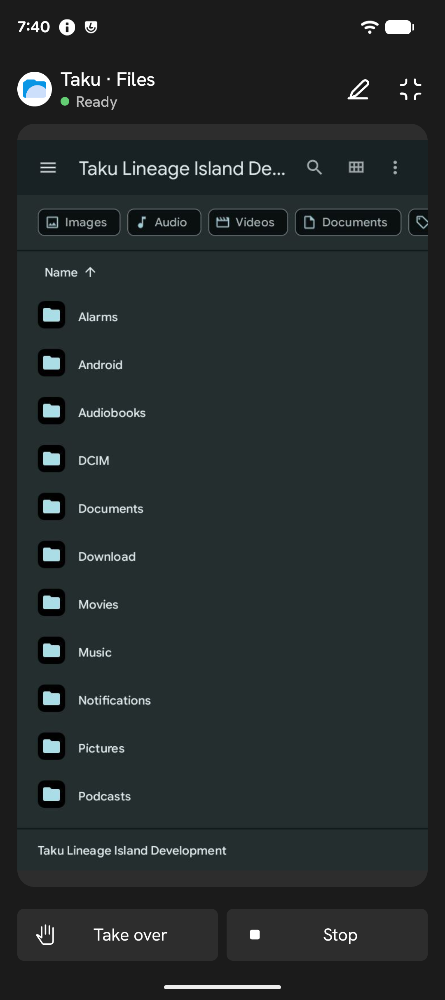

# Background workspace acceptance — 2026-11-27

The three targeted bugs passed the emulator scenarios below on `vela/bg-workspace` at **`3f43ef972bde738a3b76b8dd255908bbb9773814`**. This is component-level acceptance, not a full-ROM or physical-device sign-off. The evidence-only commit publishing this report does not change the tested code.

## Environment and deployment

- Device: `Taku_PR27_Fresh`, `emulator-5596`, Android 17 / API 37, ARM64, userdebug.
- Fingerprint: `Taku/lineage_taku_emu_arm64/taku_emu64a:17/CP2A.260605.016/20261123024500:userdebug/test-keys`.
- Build: cloud x86_64 host targeting ARM64. Framework target: `lineage_taku_emu_arm64-cp2a-userdebug`, module `services`.
- Assistant APK, broker and display components: `3f43ef97`. Framework `services.jar`: fix `d4dd73aa` (included in that head). Taku Agent APK: `723d4170`, with unchanged Agent app sources through the tested head.
- System components were installed with runtime bind mounts; APKs were updated while preserving data. **A full emulator reboot removes the runtime mounts.** No complete system image was flashed.
- Diagnostics used root/ADB; ADB was returned to UID 2000 afterward. Existing accounts, default launcher and keyboard were preserved. QA workspaces were released, and the pre-existing empty default display was restored.
- A stale default-display host left after the framework restart was restarted before the final handoff run. Final evidence below is from the successful rerun.
- [Installed artifact hashes](installed-artifacts.json) and [sanitized device results](results.json) are included. Raw conversation transcripts, credentials and build binaries are excluded.

## Results and reproduction

| Bug | Reproduction and observed result | Scope |
| --- | --- | --- |
| BUG-0006: no usable chat entry for a background login page | The model opened the public GitHub login page in Browser, observed it, called `hand_over_screen`, then ended its reply. The chat displayed a real Browser preview card. Tapping it opened the same page; **Take over** changed ownership to `user` and the browser overflow menu accepted a tap. **Return and continue** changed ownership back to `agent`; the model observed the same page. Two takeover/return cycles and three model turns completed. | Pass with Browser substitute. No login credentials entered. Original Xiaohongshu / Pixel 9 path remains pending. |
| BUG-0034: locking the main screen stops independent apps | Files and Clock each completed three cycles: open, turn the main screen off, observe, wait about 7 seconds, tap a menu/Timer control, observe again, wake. Main display 0 remained `OFF` and group 0 remained `Asleep` before and after background input. The independent display remained `ON`, with a newer frame sequence and visible UI changes. An additional Files cycle produced the populated-folder screenshots. | Pass on emulator. Six scheduled cycles plus one screenshot cycle; physical screen-off behavior remains pending. |
| BUG-0044: successful launch leaves the independent screen unobservable | Native Agent tools `request_apps → open_app → observe_background → tap → release_apps` completed three Files cycles. Launch returned success, captures contained real app content, taps changed the menu/frame sequence, and release/reacquire worked. Three additional workspace launch/preview/release cycles passed. | Pass on emulator using Files. Original Lark / physical-device scenario remains pending. |

### Additional repair found during acceptance

At `723d4170`, BUG-0034 still reproduced: an explicit independent display was assigned to the main power group, and turning off the main display also stopped the background screen. Commit **`d4dd73aa`** fixes Android 17's display-group allocator so an explicit `FLAG_OWN_DISPLAY_GROUP` bypasses the separate-timeout content-mode grouping path. The framework patch is pinned to upstream `frameworks/base` revision `7f6de40b6429462d47ba9ba351b99943269c8067`, wired into both image build paths, and covered by patch/idempotency tests. The final rerun above includes this rebuilt framework.

### Idle lease check

After **671.88 seconds** idle, the Settings workspace reported `keptAwake=false`. The first observation succeeded in **1.12 seconds** and reacquired the lease (`keptAwake=true`). The display was already `ON` before observation: this verifies lease expiry/reacquisition, **not an OFF-to-ON or deep-idle wakeup**. A static screen's old frame timestamp alone is not proof of a stale capture.

## Build and host checks

- [Code-head CI at 3f43ef97](https://github.com/Taku-OS/taku-os/actions/runs/45988955882): passed.
- [Framework-fix CI at d4dd73aa](https://github.com/Taku-OS/taku-os/actions/runs/45988563954): passed.
- Cloud build completed successfully; Android API reference check reported zero missing references.
- Host checks passed: FrameCoalescer (16 assertions), DisplaySlot (54), phone-display wrapper (106 invocations; no device), PhoneConfirmation (83), UiCardRequest (40), BackgroundQuestion (50), PhoneExecutionScreens (49), and ScreenOffCapture (90).
- Framework patch tests passed, including pinned-source application and repeat application/build-path coverage. The cloud builder was stopped after artifacts were retrieved.

## Agent and GUI agreement

The handoff flow exercised native Agent tools and the real chat card/viewer. Workspace state changed to `controlOwner=user` when the GUI took control, then to `controlOwner=agent` on return. Native observe/tap/release tests verified actual frames and app behavior, not only success return values. Updated commands and behavior are documented in [the preinstalled Agent skill](../../../system/assistant/assets/skills/taku-open-access/SKILL.md) and [the workspace guide](../../background-workspaces.en.md). This is not a comprehensive permission or every-setting audit.

## Remaining work

- Pixel 9 and the original Xiaohongshu/Lark scenarios require physical-device re-verification. The corresponding Lark records remain **fixed, awaiting acceptance**, with emulator results and screenshots attached.
- Full-ROM boot/OTA integration, reboot persistence, and actual deep-idle OFF-to-ON recovery were not accepted in this run.
- The broader retention/Jev policy, queue saturation, reconnect and error-path changes in `3f43ef97` have host-test/CI coverage; these three bug scenarios do not exhaustively verify them on-device.

## Screenshots

These are actual emulator or independent-display captures, copied unchanged from the acceptance run. BUG-0034 pictures show the background display while the main screen is off; the accompanying state records establish the main-screen power state. They are not pictures of an illuminated main screen. [Screenshot hashes](screenshot-sha256.json) identify the exact files.

### BUG-0006

<strong>Chat contains the Browser handoff card</strong> 

<strong>Opening the card shows the login page</strong> 

<strong>User takeover accepts browser menu input</strong> 

<strong>Return hands control back to the Agent</strong> 

### BUG-0034

<strong>Files remains visible with the main display off</strong> 

<strong>Files responds to input while the main display stays off</strong> 

<strong>Clock remains visible with the main display off</strong> 

<strong>Clock responds to input while the main display stays off</strong> 

### BUG-0044

<strong>Files launches with observable content</strong> 

<strong>Native input opens the Files menu</strong> 

<strong>Workspace viewer shows the live Files screen</strong> 

