## Result

**Not ready for full design acceptance.** Tested `vela/chat-polish` at `fb39079009d5c68d041c2043ae5cbf328b462f66` on the existing **Taku_PR27_Fresh / emulator-5596**, Android 17 ARM64 (1080 × 2424, density 420), with the Taku keyboard. The remote branch still pointed to this commit when testing finished.

Built **TakuAgent.apk, AgentOSAssistant.apk and task-broker.jar on the cloud x86 builder for ARM64**, installed them together, and verified the installed hashes. The builder has been stopped. This was an incremental component build; SystemUI was not rebuilt. The broker deployment is a bind mount and must be reapplied after an emulator reboot.

Design baseline: [Chat Polish, 1482:963](https://www.figma.com/design/MdImIDNqePpNZ62C0GLArW/Taku-Mobile-OS?node-id=1482-963), with the agreed [centered Taku header, 1628:1774](https://www.figma.com/design/MdImIDNqePpNZ62C0GLArW/Taku-Mobile-OS?node-id=1628-1774). The deferred chat three-dot/model menu is **not** counted as a defect. Example brands in Figma are not required to be installed.

All images below are fresh, unedited device captures from this build. The repository's real `org.example.provider` plugin and a disposable `Chat Polish QA` Panel were used for controlled tests. [Install hashes and test evidence](./evidence/summary.json).

## 1. [P1] A second Panel edit changes the chat reply but does not update the saved Panel

**Reproduce**

1. Create and pin a test Panel with `Count = 1`.
2. Open it through the sidebar's Panels page and choose **Edit with Taku**.
3. Send `Set Count to 2. Keep this Panel. No tools or external actions.` Wait for completion.
4. Without re-entering Edit with Taku, send `Now set Count to 3 in the same Panel. No tools or external actions.`
5. Reopen that Panel from the Panels page.

**Actual:** The first request updates the saved Panel to 2 (`sourceVersion: 0 → 1`). Its context chip then disappears. The second reply shows 3, but the saved Panel still shows 2 and remains at source version 1. This is a persisted-state discrepancy, not a screenshot timing issue: both the Panel detail page and `panels/get` agree on 2.

**Expected:** Follow-up edits continue to update the same Panel until the user explicitly leaves Panel editing. This is the previously requested continuous Panel workflow; it is not necessarily a regression introduced by this branch.

**Code:** [`useAgentController.ts:602–605`](https://github.com/Taku-OS/taku-os/blob/fb39079009d5c68d041c2043ae5cbf328b462f66/system/agent-app/src/hooks/useAgentController.ts#L602) consumes the launch and clears the target after the first accepted continuation. [`:640–646`](https://github.com/Taku-OS/taku-os/blob/fb39079009d5c68d041c2043ae5cbf328b462f66/system/agent-app/src/hooks/useAgentController.ts#L640) therefore routes the next request as an ordinary message.

[First update receipt](./evidence/31-panel-update-receipt.json) · [State after second reply](./evidence/32-second-panel-receipt.json)

| Chat says 3 | Saved Panel still says 2 |
| --- | --- |
| 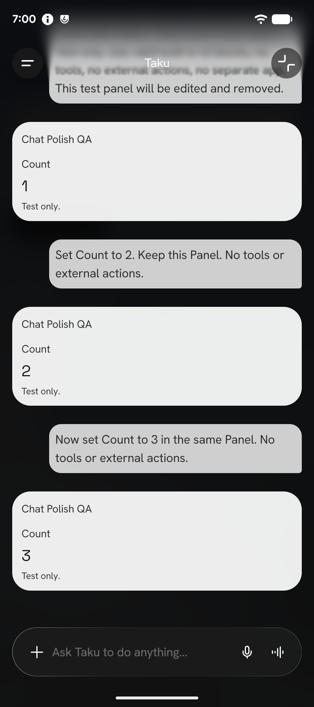 |  |

## 2. [P2] Selecting a plugin dismisses the keyboard

**Reproduce:** Focus the composer, tap **+ → Plugins**, then tap the installed **Local provider example** option. No Back press is involved.

**Actual:** The picker has the keyboard visible. Choosing the plugin inserts its chip but dismisses the keyboard; the user must tap the input again before continuing. Repeated with taps only in a separate test conversation. The native draft correctly contains the plugin, so this is a focus/keyboard defect rather than failure to attach it.

**Expected:** Keep the composer focused and the keyboard visible, as in the [Plugin Input frame](https://www.figma.com/design/MdImIDNqePpNZ62C0GLArW/Taku-Mobile-OS?node-id=1482-1195).

**Investigation entry points:** [`pickPlugin`](https://github.com/Taku-OS/taku-os/blob/fb39079009d5c68d041c2043ae5cbf328b462f66/system/agent-app/src/components/AgentChatScreen.tsx#L535) does not restore focus; the input becomes non-editable while `busy` is true ([line 631](https://github.com/Taku-OS/taku-os/blob/fb39079009d5c68d041c2043ae5cbf328b462f66/system/agent-app/src/components/AgentChatScreen.tsx#L631)), and attaching a plugin uses the controller's busy operation wrapper. The exact focus-loss mechanism still needs debugging.

[Native draft containing the plugin](./evidence/37-plugin-native-draft.json)

| Before selection | After selection |
| --- | --- |
| 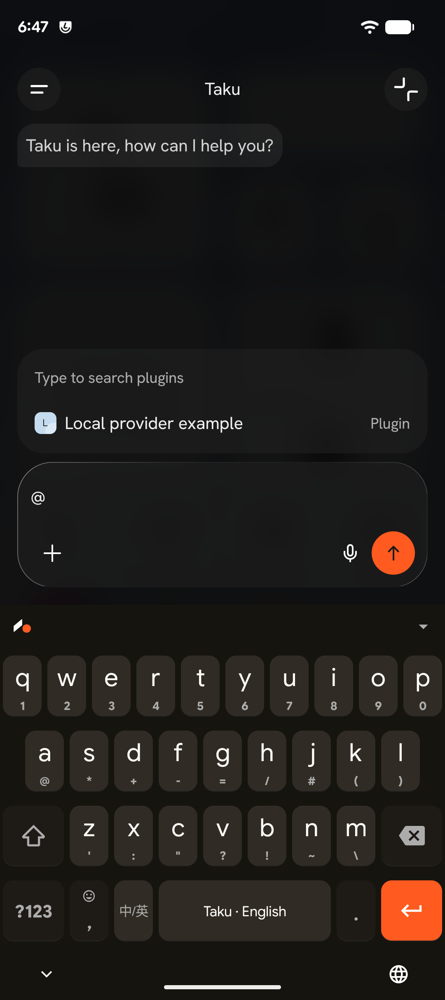 | 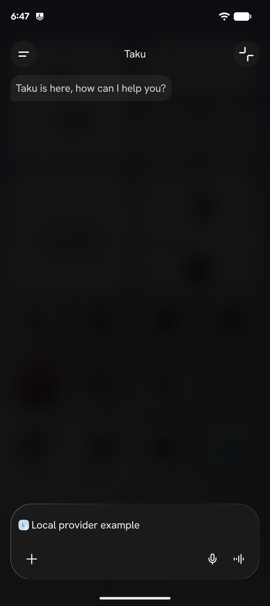 |

## 3. [P2] New Panel and Plugin routes use black status-bar content on a dark background

**Reproduce:** With chat appearance set to dark, open **Sidebar → Plugins**, a plugin's detail/settings, or **Sidebar → Panels** and a Panel detail.

**Actual:** The time, Wi-Fi and battery are black and almost invisible. Returning to chat restores white status-bar content.

**Expected:** Status-bar content follows the background/theme on every route.

**Code:** [`src/app/_layout.tsx:20`](https://github.com/Taku-OS/taku-os/blob/fb39079009d5c68d041c2043ae5cbf328b462f66/system/agent-app/src/app/_layout.tsx#L20) sets `StatusBar style="dark"` globally. Chat supplies its own theme-aware override; the new routes do not.

| Plugins | Panels |
| --- | --- |
| 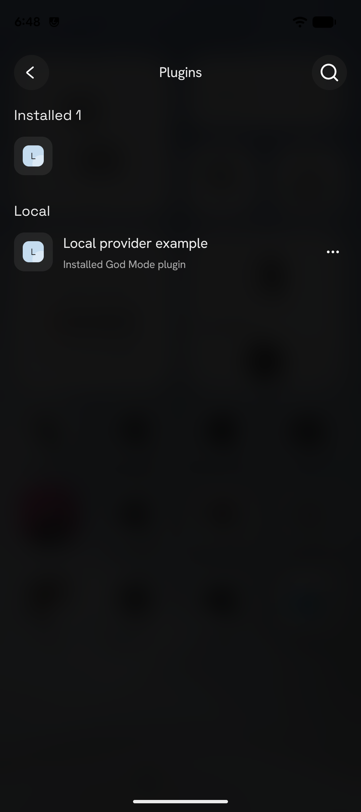 | 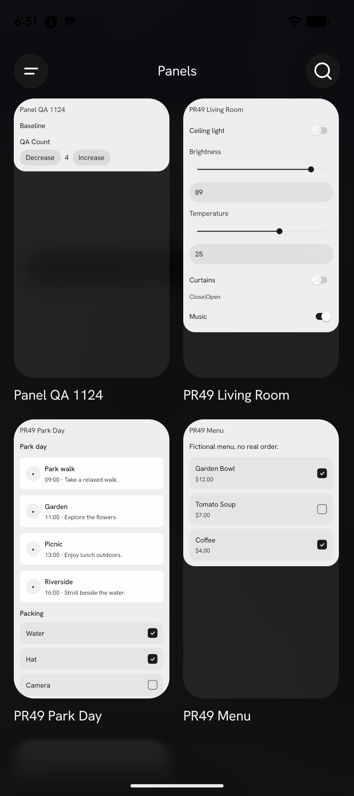 |

## 4. [P2] A long plugin name forces multiline message text into a narrow side column

**Reproduce:** Attach **Local provider example** and type `Chat Polish acceptance. Reply only OK. Do not run tools.`

**Actual:** The plugin occupies the left half of the composer and is vertically centered next to the entire message. Text wraps down a narrow right column, making the composer unnecessarily tall.

**Expected:** The plugin token and multiline text should remain easy to read; the full text should not be constrained beside a long token for every line. Wrap the message below the token, or use a bounded token width/appropriate flow.

**Code:** [`composerEntry` / `inputExpanded`, lines 876–878](https://github.com/Taku-OS/taku-os/blob/fb39079009d5c68d041c2043ae5cbf328b462f66/system/agent-app/src/components/AgentChatScreen.tsx#L876).

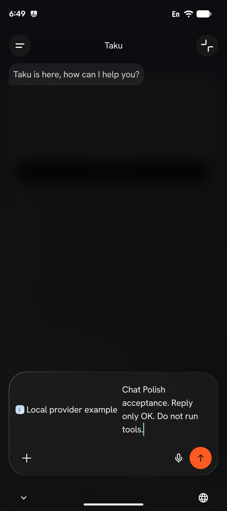

## 5. [P2] Panel edit guidance is not brought into view in a previously scrolled conversation

**Reproduce:** Use a Panel whose conversation has several previous edits and a restored scroll position. Open **Edit with Taku**. Then focus the composer.

**Actual:** The Panel attachment appears, but “What would you like to change?” and its suggestions remain below the visible chat area. Manually scrolling reveals them; opening the keyboard can move them offscreen again. A fresh, short Panel conversation shows the prompt correctly.

**Expected:** Entering this mode should reveal the edit prompt and suggestions above the composer, consistent with [1482:2586](https://www.figma.com/design/MdImIDNqePpNZ62C0GLArW/Taku-Mobile-OS?node-id=1482-2586), while still allowing the user to scroll back afterwards.

**Investigation entry points:** [`onContentSizeChange` restores the old offset](https://github.com/Taku-OS/taku-os/blob/fb39079009d5c68d041c2043ae5cbf328b462f66/system/agent-app/src/components/AgentChatScreen.tsx#L679); [`PanelEditPrompt` is a list footer](https://github.com/Taku-OS/taku-os/blob/fb39079009d5c68d041c2043ae5cbf328b462f66/system/agent-app/src/components/AgentChatScreen.tsx#L711). Check the transition into editing and the keyboard geometry against restored reading position.

| Immediately after entering edit | After manually scrolling | After opening keyboard |
| --- | --- | --- |
| 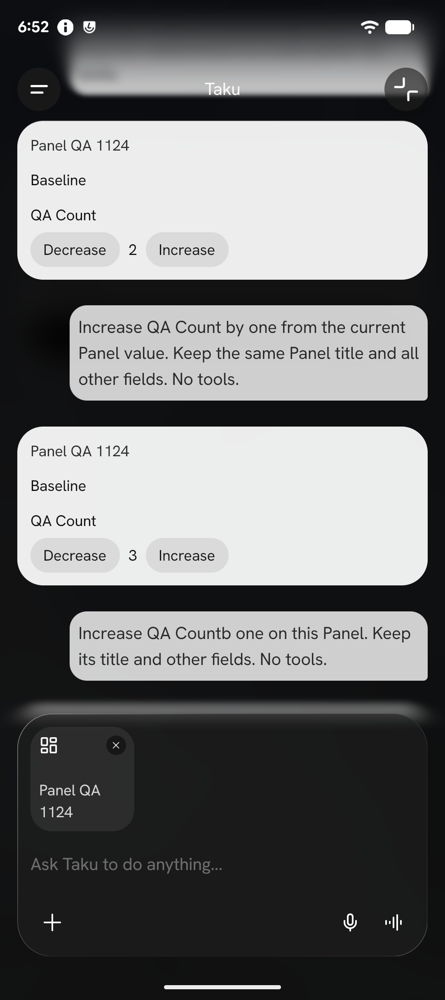 | 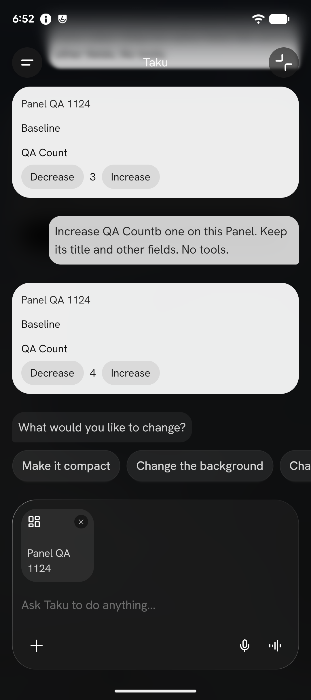 | 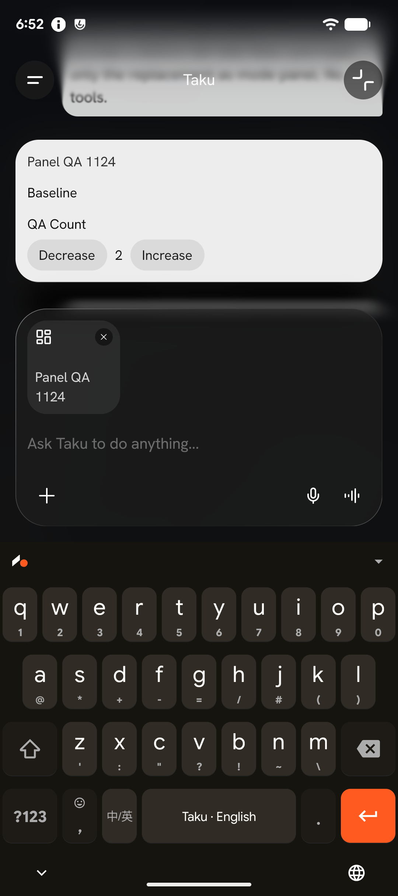 |

## Design coverage still incomplete — separate from the reproduced defects

- **Online plugin discovery/install:** The current native repository returns an empty catalog unconditionally ([`nativeRepository.ts:112–114`](https://github.com/Taku-OS/taku-os/blob/fb39079009d5c68d041c2043ae5cbf328b462f66/system/agent-app/src/plugins/nativeRepository.ts#L112)). The real local plugin renders correctly, but Popular/Productivity/Life and installing a new catalog plugin cannot be accepted end to end. This is not a demand to hard-code the mockup's brands.
- **Plugin permission policy and skill navigation:** [Figma 1482:2190](https://www.figma.com/design/MdImIDNqePpNZ62C0GLArW/Taku-Mobile-OS?node-id=1482-2190) shows an interactive “Always ask” permission row and navigable skills. The implemented settings page has an Enabled switch plus read-only permission/skill strings, including the raw path `skills/example/SKILL.md`. See [`PluginDetailScreens.tsx`](https://github.com/Taku-OS/taku-os/blob/fb39079009d5c68d041c2043ae5cbf328b462f66/system/agent-app/src/plugins/PluginDetailScreens.tsx#L113). An explicit scope decision or real backend integration is needed before calling this part complete.

| Plugin detail | Plugin settings |
| --- | --- |
| 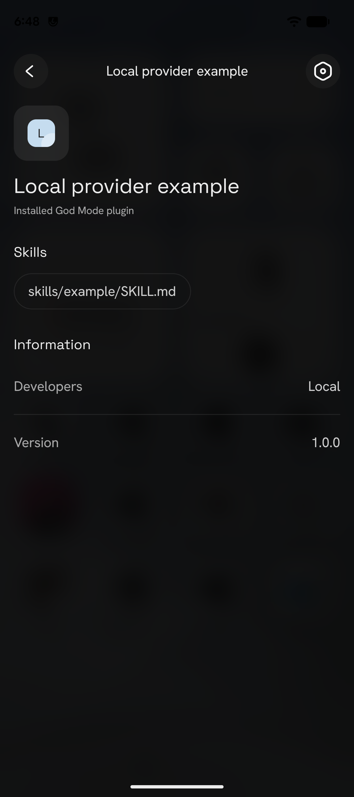 | 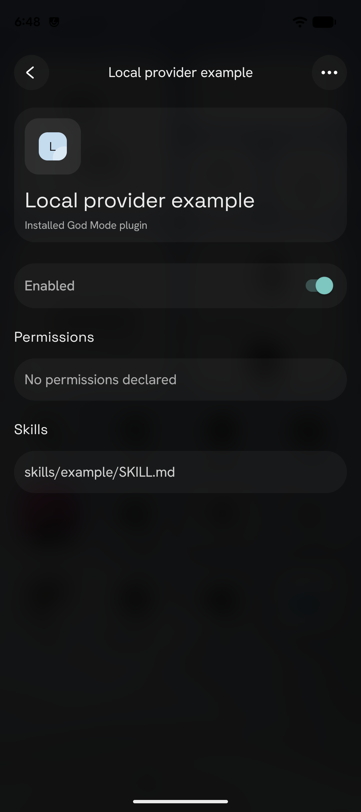 |

## Additional observation requiring isolation

Opening the existing test thread externally with `MainActivity --es threadId ...` twice produced **“Your saved draft could not be restored. Refresh before sending.”** Tapping refresh recovered it. This also prevented the Plugins entry from inserting `@` until refreshed. I have not established the root cause or whether this occurs through every normal navigation path, so it is not counted as a confirmed general navigation regression.

External-open draft warning screenshot

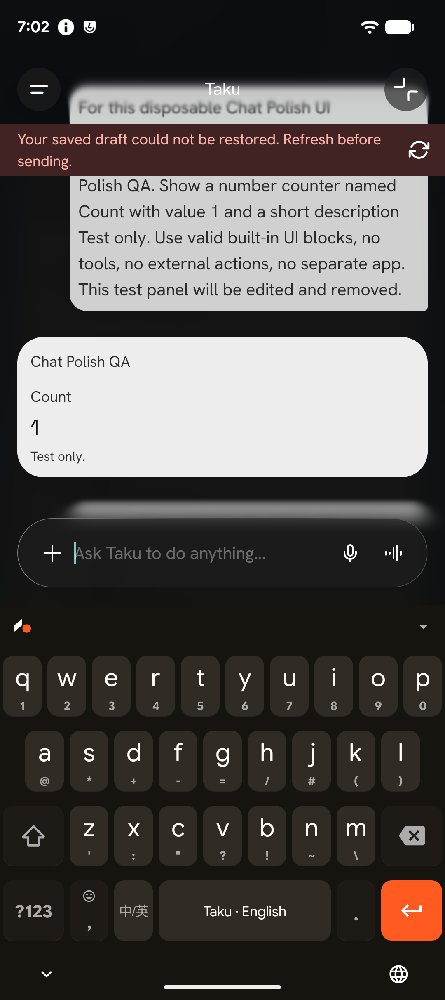

## Checks that passed / limits

| Flow | Result |
| --- | --- |
| Centered Taku header, burger and collapse control | Present; follows the separate approved header frame |
| New Chat from drawer | Opens an empty greeting/composer |
| + menu | Camera / Photos / Files / Plugins; menu above composer and Taku keyboard |
| Plugin attachment | Native draft contains installed plugin; submitted message displays its tag and composer clears it; removing chip clears native draft |
| Drawer search | Filters the real conversation list |
| Drawer gear | Opens existing Taku AI settings |
| Panels list/detail/search | Opens real saved Panels and their current content |
| Panel rename | GUI title and native metadata agree; metadata revision increments |
| First Panel edit | Saved Count changes 1 → 2; second edit fails as above |
| Panel deletion | Confirmation works; only disposable test Panel removed |
| Appearance | Light-mode smoke test passed; original dark setting restored |
| Automated/build checks | 489 JS tests pass; typecheck and lint pass; cloud Android builds pass |

Camera/photo/file attachment submission, live audio, production third-party plugin execution, offline behavior, rotation, and exhaustive accessibility testing were **not** completed in this pass. There is no claim that these passed. The keyboard-focus reproduction uses tap-only interaction; text in other tests was entered with ADB.

The original five Panels remain unchanged. The temporary plugin was uninstalled and its test draft selection cleared. The emulator remains on the updated build and a fresh chat. No feature-source changes were made during acceptance.

More acceptance screenshots: menu, search, rename, edit, delete, light theme

| Header / empty chat | Attachment menu | Search |
| --- | --- | --- |
| 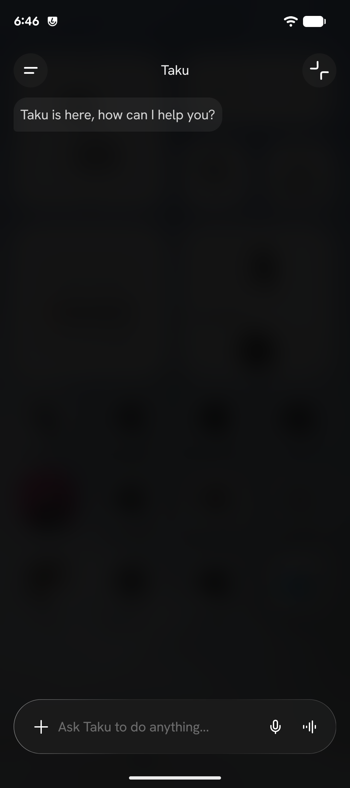 | 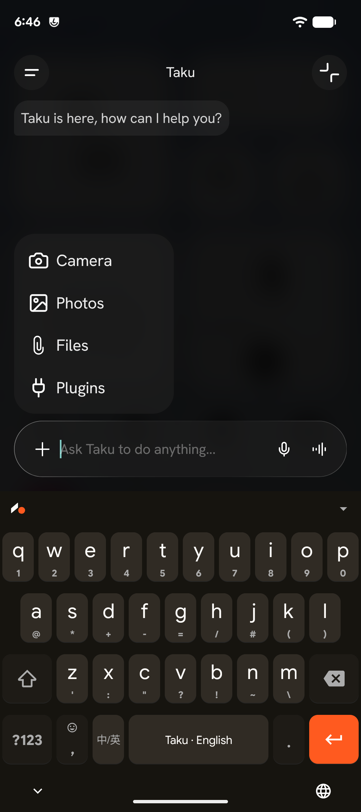 | 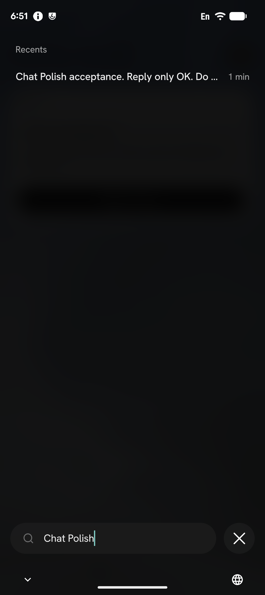 |

| Renamed Panel | Edit with Panel attached | Delete confirmation |
| --- | --- | --- |
| 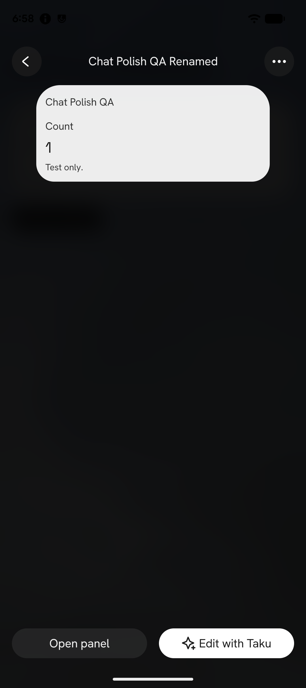 | 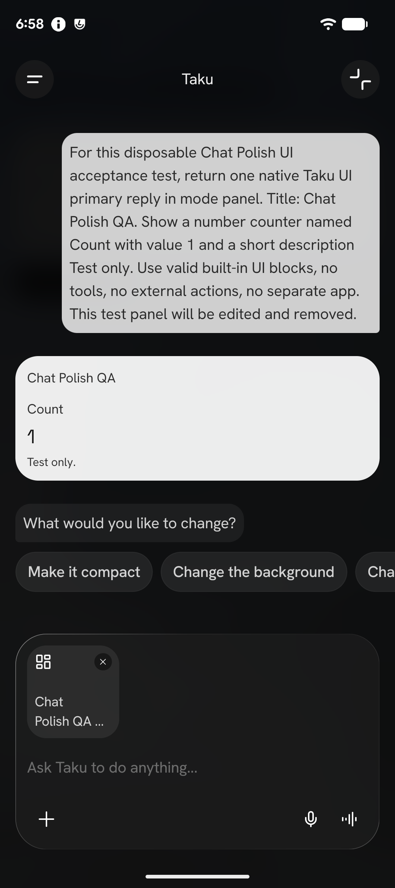 | 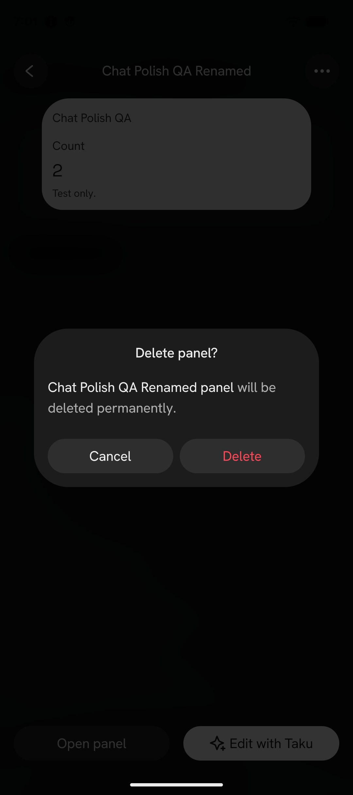 |

| Plugin message submitted (while awaiting reply) | Light theme |
| --- | --- |
| 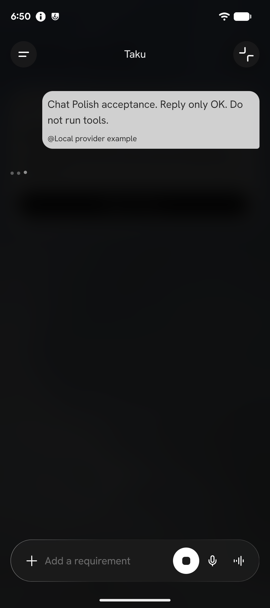 | 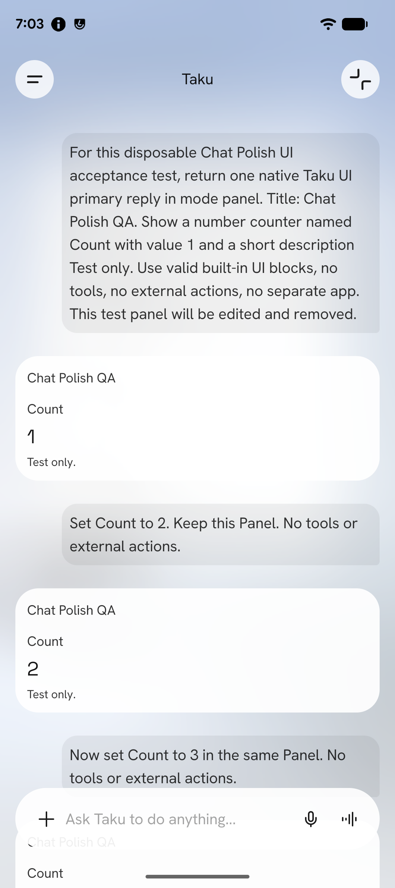 |

