# Chat Polish reacceptance — 2026-11-25

**Four of the five original defects pass. Item 5 still fails, so #52 should remain open.** Two additional visual issues and two intermittent error states are documented below.

Tested `vela/chat-polish` at **`54f44099f314d74223d6ffce3a6dfd2df4d2df14`**, pulled from the remote branch, on the existing **Taku_PR27_Fresh / emulator-5596**, Android 17 ARM64, 1080 × 2424, density 420, with the Taku keyboard. The remote branch was checked again during this run.

The Agent APK, Assistant APK and Broker JAR were built on the cloud x86 machine for ARM64 and installed without clearing app data. Installed/running hashes match the downloaded artifacts. **492 tests, typecheck and lint passed.** SystemUI was preserved; it was not rebuilt. The cloud machine is stopped. The Broker deployment is a runtime bind mount and must be reapplied after a reboot.

All screenshots are fresh, unedited emulator captures from the installed build, including its single camera cutout. They were visually checked. Tests use a disposable **Chat Polish Retest** Panel and the repository's real **Local provider example** plugin. [Build, install and persisted-state evidence](evidence/summary.json).

Design references: [Chat Polish](https://www.figma.com/design/MdImIDNqePpNZ62C0GLArW/Taku-Mobile-OS?node-id=1482-963), [plugin input](https://www.figma.com/design/MdImIDNqePpNZ62C0GLArW/Taku-Mobile-OS?node-id=1482-1195), [Panel editing](https://www.figma.com/design/MdImIDNqePpNZ62C0GLArW/Taku-Mobile-OS?node-id=1482-2586), [plugin settings](https://www.figma.com/design/MdImIDNqePpNZ62C0GLArW/Taku-Mobile-OS?node-id=1482-2190).

## Original issue checklist

| Item | Result | Device evidence |
| --- | --- | --- |
| 1. Second Panel edit does not save | **PASS** | Same Panel: Count 1 → 2 → 3; sourceVersion 0 → 1 → 2. Both update receipts are `published`; saved matter content and reopened detail show 3. No re-entry between sends. |
| 2. Plugin selection dismisses keyboard | **PASS** | Tap-only + → Plugins → Local provider example keeps the Taku keyboard and focused composer. Repeated in a fresh chat. Native draft contains the plugin. |
| 3. Dark status bars unreadable | **PASS** | White time/Wi-Fi/battery on dark Plugins, plugin detail/settings, Panels and Panel detail. Normally entered light pages use dark status content. Live switching has a separate caveat below. |
| 4. Long plugin name squeezes text | **PASS** | Plugin chip occupies its own row; message spans the width below it, including with the keyboard open. Sending retains the plugin label. |
| 5. Panel edit guidance offscreen | **FAIL** | Re-entering Edit with Taku leaves the prompt below the visible area; opening the keyboard does not reveal it. Manual scrolling is still required. |

## Still failing: item 5 — edit guidance remains hidden

1. Use the test Panel's conversation after the initial card and several turns, including the two edits above.
2. Open the saved Panel from the sidebar and tap **Edit with Taku** again.
3. The Panel chip appears, but **“What would you like to change?”** and its suggestions are not visible. This was captured both on initial entry and on re-entry after both successful edits.
4. Focus the composer: the keyboard opens, but the guidance remains hidden. Manual scrolling reveals it; refocusing the composer hides it again.

On the keyboard-open capture, the prompt's layout bounds are around **y=2267–2330**, while the Panel composer begins around **y=867**. Its presence in the accessibility tree is not proof that a user can see it.

| After re-entering edit | Keyboard open; prompt hidden | Visible only after manual scroll |
| --- | --- | --- |
| 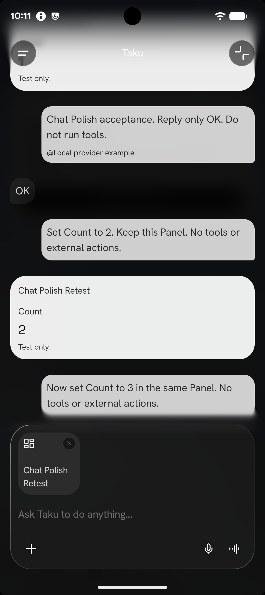 | 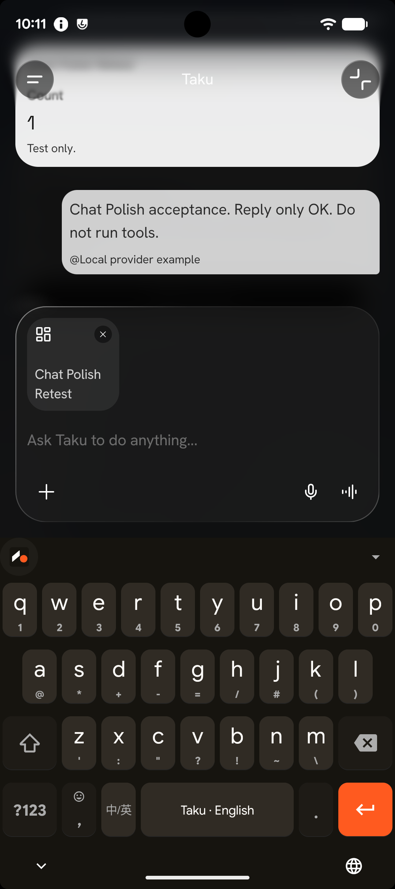 | 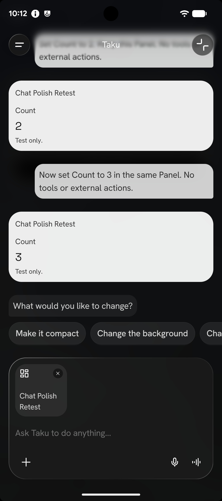 |

Investigation entry points: [`AgentChatScreen.tsx:414`](https://github.com/Taku-OS/taku-os/blob/54f44099f314d74223d6ffce3a6dfd2df4d2df14/system/agent-app/src/components/AgentChatScreen.tsx#L414), [`:685`](https://github.com/Taku-OS/taku-os/blob/54f44099f314d74223d6ffce3a6dfd2df4d2df14/system/agent-app/src/components/AgentChatScreen.tsx#L685) and the footer at [`:718`](https://github.com/Taku-OS/taku-os/blob/54f44099f314d74223d6ffce3a6dfd2df4d2df14/system/agent-app/src/components/AgentChatScreen.tsx#L718). Recheck follow-to-end after the Panel composer and IME geometry settle. The precise cause is not established by this acceptance run.

## Additional visual findings

### A. Attachment menu lets underlying conversation text show through

Focus the composer in a populated conversation and open **+**. The Camera/Photos/Files/Plugins menu overlaps a message; that message remains sharply readable through the menu and competes with its labels. The new glass edge is visible, but the content behind this popup is not sufficiently obscured.

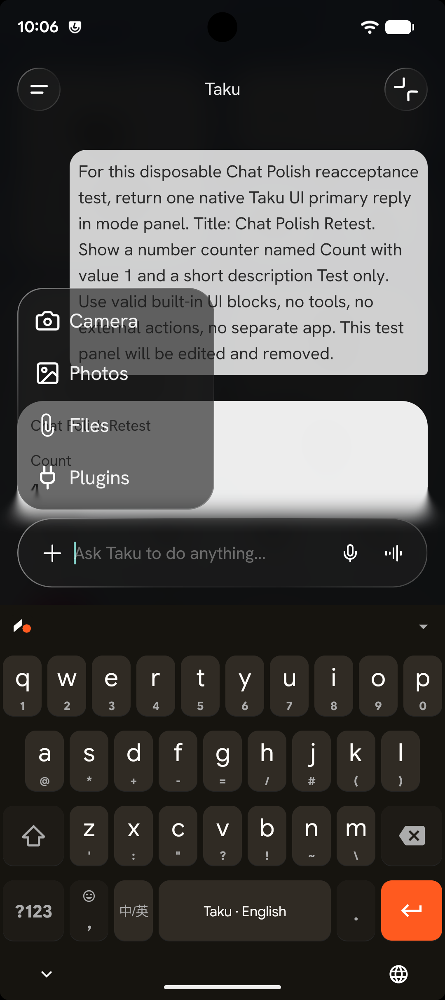

The menu uses the new translucent fill ([`ComposerMenus.tsx:111`](https://github.com/Taku-OS/taku-os/blob/54f44099f314d74223d6ffce3a6dfd2df4d2df14/system/agent-app/src/chat/ComposerMenus.tsx#L111)); the conversation's uniform blur is conditional on `replyMenu`, not the attachment popup ([`AgentChatScreen.tsx:673`](https://github.com/Taku-OS/taku-os/blob/54f44099f314d74223d6ffce3a6dfd2df4d2df14/system/agent-app/src/components/AgentChatScreen.tsx#L673)). Please make popup labels readable over real conversation content, with blur or an appropriate fallback.

### B. In-place appearance updates leave the native background on the previous theme

This is specifically an **Agent/system-settings update while a chat-styled page remains mounted**. On dark plugin settings, run `settings put secure taku_chat_appearance light`: labels and status icons become dark, but the background stays dark. The reverse direction on Panel detail leaves white status content over the old light background. Leaving and re-entering the page corrects it.

Changing appearance through **Taku AI settings** and then re-entering chat/Plugins/Panel pages passed. This is not a claim that normal light-theme navigation is broken.

| Live update: background still dark | Re-entered: correct light theme |
| --- | --- |
| 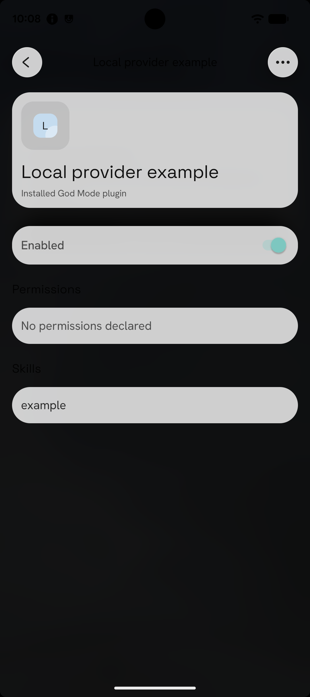 | 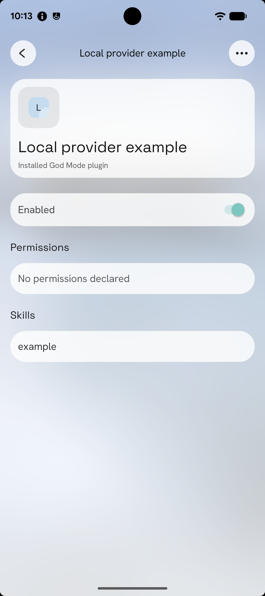 |

[`useChatBackdrop.ts:14–21`](https://github.com/Taku-OS/taku-os/blob/54f44099f314d74223d6ffce3a6dfd2df4d2df14/system/agent-app/src/chat/useChatBackdrop.ts#L14) applies the native backdrop only on mount (`[]` dependencies), whereas the React palette follows appearance changes. This is the investigation entry point.

## Passing flows — fresh screenshots

| Two sequential edits in one chat | Reopened saved Panel: Count 3 |
| --- | --- |
| 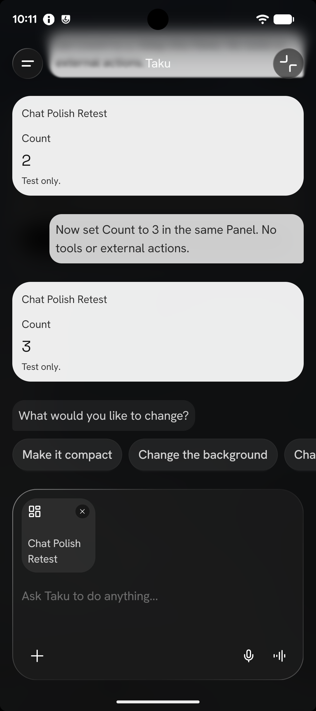 | 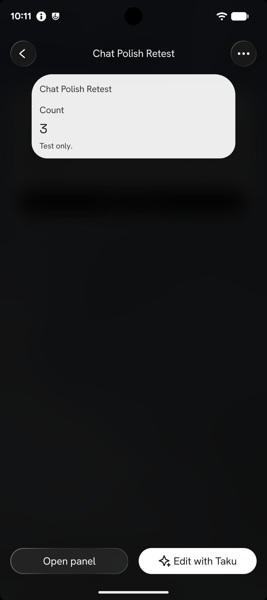 |

| Picker with keyboard | Selected; keyboard retained | Full-width message below chip |
| --- | --- | --- |
| 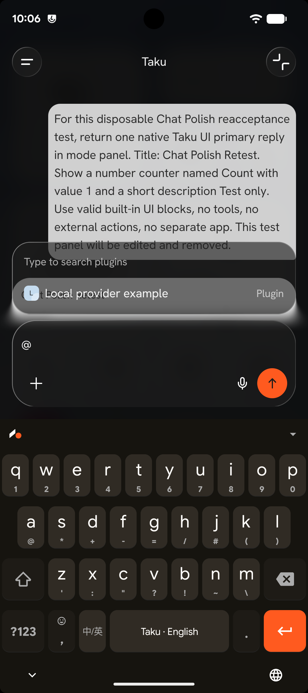 | 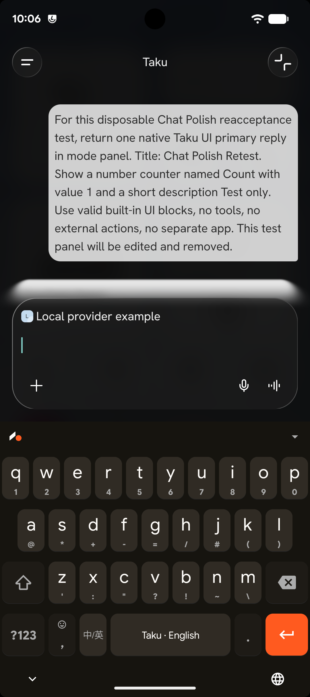 | 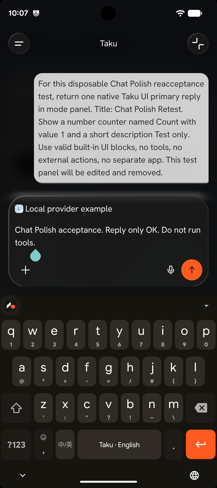 |

| Dark Plugins | Dark plugin detail; friendly skill name | Dark plugin settings |
| --- | --- | --- |
| 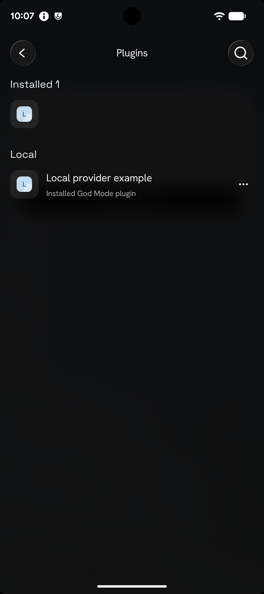 | 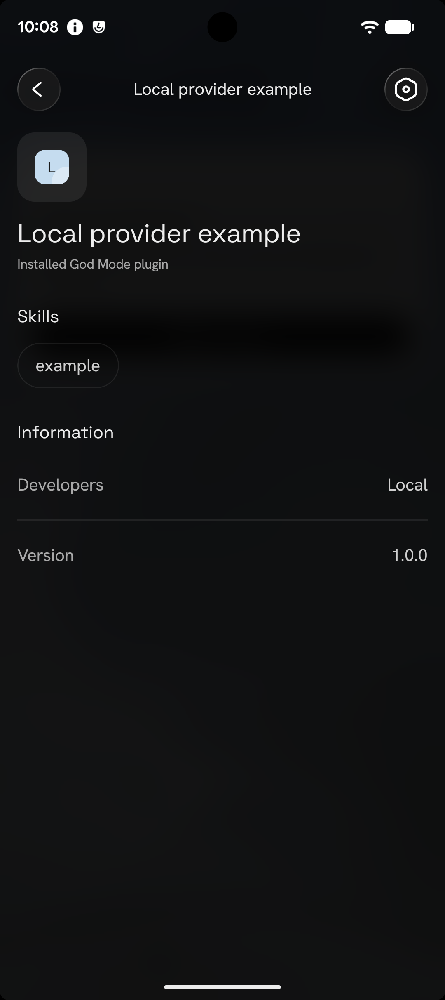 | 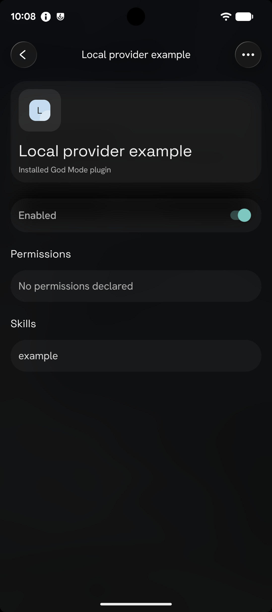 |

| Dark Panels, filtered to this test | Light Plugins | Light Panel detail |
| --- | --- | --- |
| 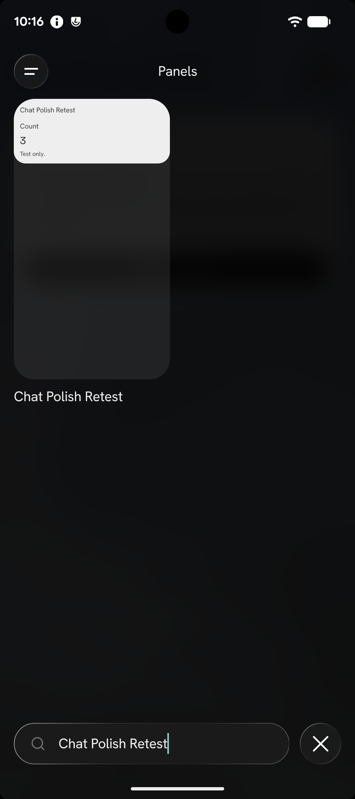 | 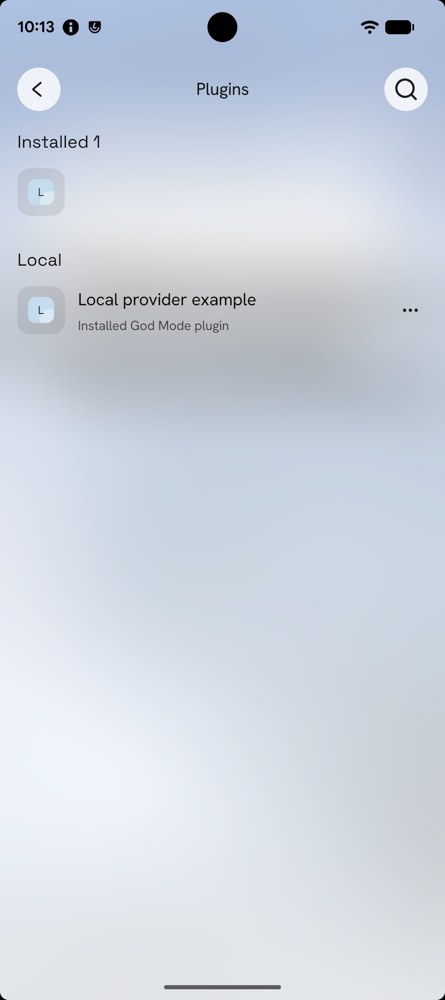 | 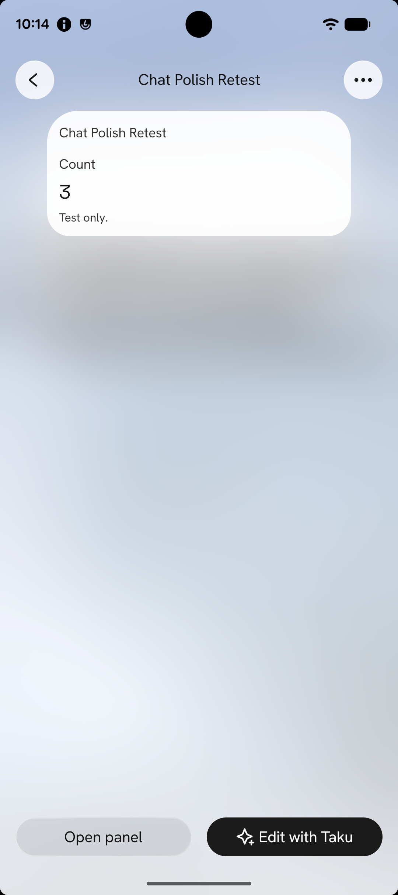 |

| Plugin label on sent message | New chat; no old Panel context | Second keyboard-retention test |
| --- | --- | --- |
| 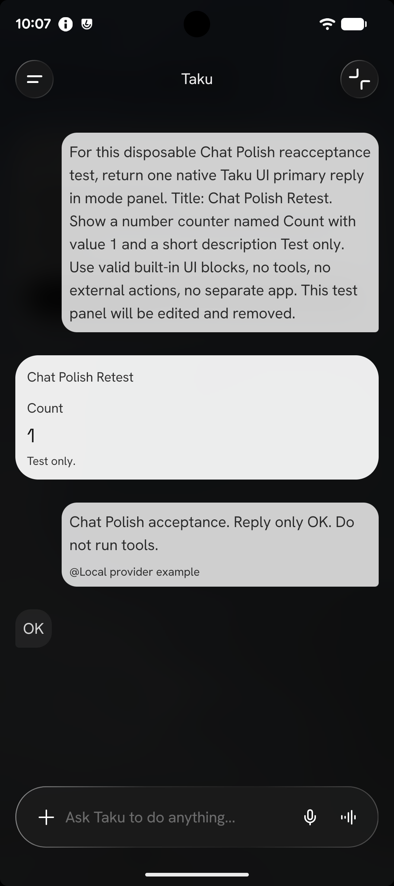 | 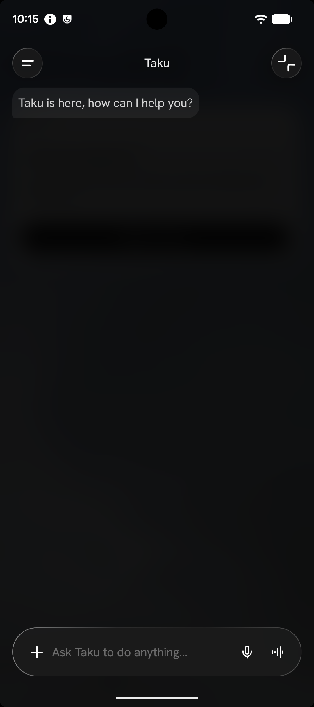 | 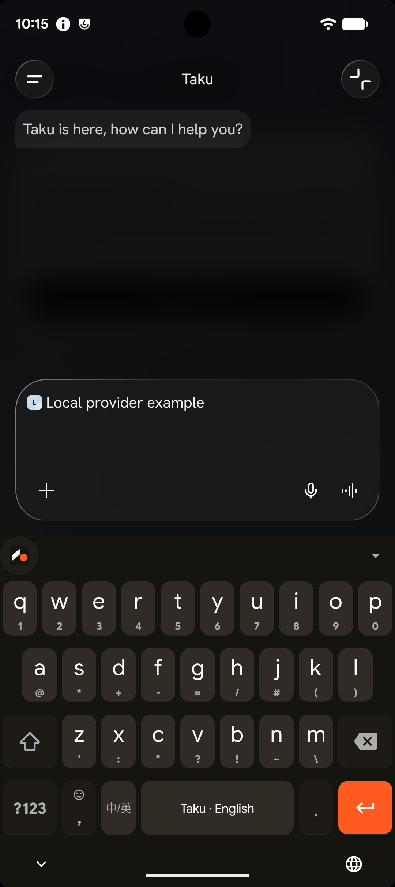 |

Plugin removal also cleared the native draft. Registered `skills/example/SKILL.md` now appears as **example** in both detail and settings.

## Intermittent observations — not counted as fixed

- Returning from plugin settings to chat once showed **“Your saved draft could not be restored. Refresh before sending.”** Reading the test draft through the native interface succeeded; tapping **Try again** cleared the banner. This resembles the earlier report's restoration warning, but the exact trigger/root cause remains unconfirmed.
- The first filtered Panels visit once showed **“Could not load panels. Try again.”** over cached content. Later visits loaded normally. This was not a stable reproduction and is recorded separately from the five pass/fail results.

| Draft restoration warning | After refresh | One Panels loading warning |
| --- | --- | --- |
| 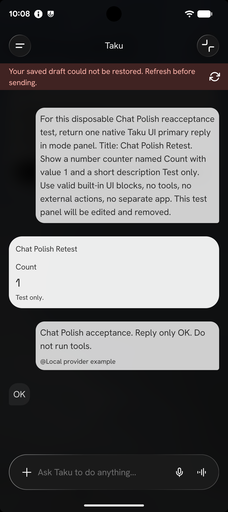 |  | 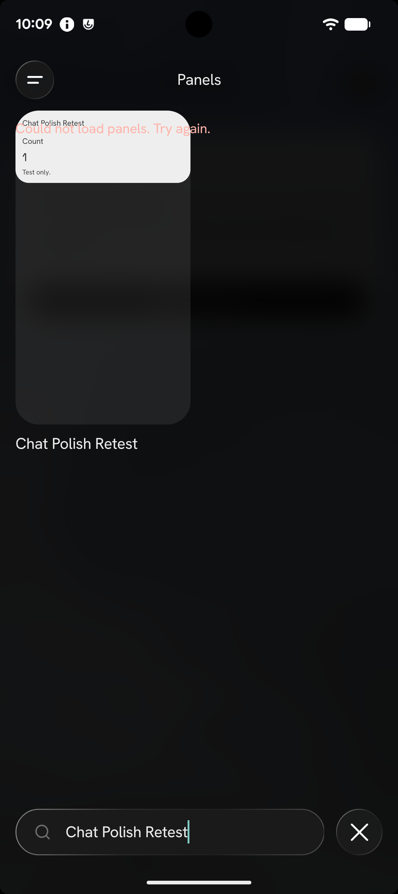 |

## Scope and cleanup

Online plugin discovery/install and an **Always ask** permission policy remain outside verified coverage: the native catalog/policy limitations described in the original report remain. A local installed plugin does not prove the online marketplace works. The deferred chat model menu is not counted as a defect.

The temporary Panel/plugin were removed after evidence capture. Existing Panels, accounts, input method, SystemUI and the original dark appearance were preserved. Product source was not changed during acceptance. The main local checkout remains on `vela/chat-polish`; this evidence lives on a separate report branch.
