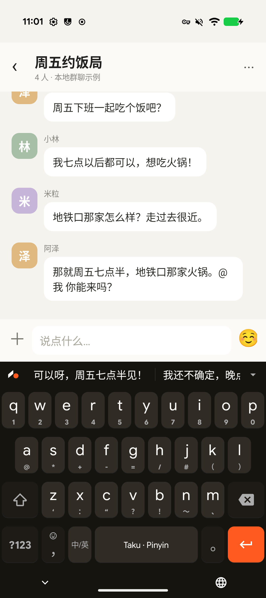
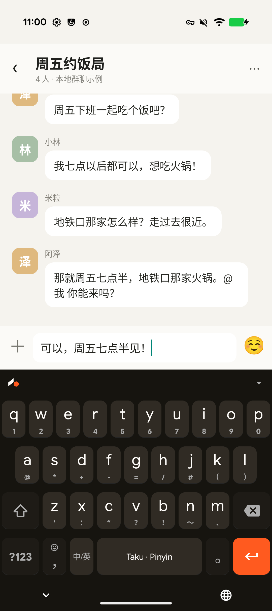

# Taku IME screenshot replies: real-model hardware acceptance

Status: `physical_verified`. Pixel 9 / Android 17 / API 37, independently signed IME 0.2.2, system assistant v61, matching Broker. Screenshot → `codex/gpt-6-luna` → JSON → native suggestion strip → tap-to-fill actually worked, with two generations taking 8340 ms and 6609 ms. Source was a synthetic group-chat page; model responses were real.

## Actual 0.2.2 results

The user correctly observed no predictions: old phone refresh credentials had expired. At the owner explicit request, the [official OpenAI auth-cache migration method](https://learn.chatgpt.com/docs/auth#fallback-authenticate-locally-and-copy-your-auth-cache) copied the valid local subscription over USB into root-private phone Codex storage, mode 0600; old phone credentials were backed up privately. Credentials were not printed or included in APK/source/evidence. Native `account/read` confirmed ChatGPT Pro; main Agent model/connection settings were unchanged.

English translation of the actual first model JSON (original Chinese bytes remain in the linked evidence):

```json
{"version":1,"candidates":[{"text":"Sure, see you Friday at 7:30!"},{"text":"I should be able to come. Meet at the place by the metro entrance at 7:30?"},{"text":"Thanks for inviting me. I cannot make it this time; let us eat together next time."}]}
```

Seven AI hardware checks passed: actual JSON shown in the original 40dp strip, exact tap-to-fill without sending, waiting copy/native height, first actual Pinyin key dismissing AI, cancellation preventing late results, protected-window screenshot rejection, and password exclusion. Temporary probe removed; phone ended on ordinary group chat with the second actual suggestions.

0.2.2 / assistant v61 also maps credential failures wrapped in HTTP 502 to fixed `auth_required`, persistently showing “Codex login expired; tap to reconnect” (translated) in the original strip; tap opens account connection. Typing immediately dismisses it. Other gateway failures return fixed text, not upstream bodies. Twelve error-classification checks and existing 21 JSON checks passed; the valid account was not deliberately logged out to test the expired-login tap path.

0.2.2 Release APK, assistant APK, and Broker compiled; 8 upstream JVM tests, `npm run verify`, and complete patch reconstruction across 38 files passed. [Error classification checks](error-classification-tests.txt) and structured `predictionFailureFollowUp` refer to this build.

After full D reinstall verification ended, new APKs were installed and matching Broker/Magpie development mounts restored; installed APK SHA-256 matched builds. No image flashing or phone reboot. Subscription cache persists on data, but system-file mounts vanish after reboot and need restoration or formal ROM integration; reboot persistence was not accepted.

## Completed

- In empty inputs of allowed apps, suggestions reuse the original 40dp candidate/prediction strip beside Logo/collapse, without increasing keyboard height; waiting text means “Let me think how to reply…” (translated).
- Synthetic group-chat app contains only dinner messages and native EditText, without model answers or a suggestion strip.
- System Broker captures current foreground-app bounds, excludes keyboard, scales longest edge to 1280, and encodes JPEG in memory. Local Magpie calls `codex/gpt-6-luna` at catalog-declared `low`, without changing main Agent model.
- JSON permits only version and up to three short texts; model-output actions cannot execute. Passed 21 parser-boundary checks and 8 upstream JVM tests.
- Tapping the first Pinyin key immediately hides AI and restores normal candidates; cancelled results do not return. A different InputConnection starts a new request.
- Password inputs do not trigger; `FLAG_SECURE` pages are rejected before screenshot. Dedicated Provider rejects non-IME callers; the system granted IME knownSigner permission. Real Broker tests covered cancel-before-start races and cross-owner access.
- Eleven ordinary-input tap regressions passed: Pinyin commit/delete, Chinese/English switch, English, symbols, numbers, passwords, process restart, and themes. Taku remains default IME; original dark-mode setting restored.
- `npm run verify` passed; both complete patches reconstruct all 38 product source files from pinned upstream.

## Historical authentication failure

Initially Magpie wrapper set `MAGPIE_NO_ACCOUNTS=1` with a different HOME from native Codex, so `/v1/models` and `/v1/codex/models` were empty. Discovery now sets `CODEX_HOME=/data/local/agentos/home/.codex` and enables discovery while retaining Magpie HOME/config. That stage imported no account and did not rewrite main Agent config. Only after explicit user instruction was the subscription cache migrated above.

The real catalog initially returned seven Codex models and `codex/gpt-6-luna` declared `modalities.input=[text,image]`, but requests failed HTTP 502: `Codex is signed out (token refresh failed); run codex login`. Native `account/read` was empty. CLI `login status` still said ChatGPT based on local records, so it cannot establish valid authorization. Explicitly authorized migration and real generation resolved the failure.

The real acceptance below collected JSON, image SHA-256/dimensions/latency receipts and verified visible candidates/tap-to-fill without static answers. Install temporary UI probes per the IME README before rerunning:

```sh
python3 system/inputmethod/tests/ai-acceptance.py 46170DLAQ0006D \
  --allow-physical --require-generation --output out/inputmethod/ai-local-subscription-20261022
```

System files currently use development bind mounts; SELinux remains enforcing, with no image flashing. APK updates persist, but temporary Broker/Magpie wrapper mounts vanish after reboot; formal persistence requires ROM integration. Original backups remain in ignored `out/inputmethod/device-backup`; other workspaces Android 17/OTA changes were untouched.

## Native screenshots and records

The images show real-model completion on 0.2.2 and filling after candidate tap. Full original screenshots, without composition/cropping.





[7 real AI checks](real-generation-acceptance.json) · [Final visible replies/receipts](live-ready.json) · [Subscription migration/install hashes](subscription-deployment.json) · [11 ordinary-input historical checks](keyboard-baseline.json) · [Parser tests](parser-tests.txt)

The earlier 0.2.0 separate panel was replaced; [0.2.1 waiting state](native-strip-pending.png), [candidate strip after typing](native-strip-typing.png), and [then-blocked generation record](native-strip-acceptance.json) are historical only.
