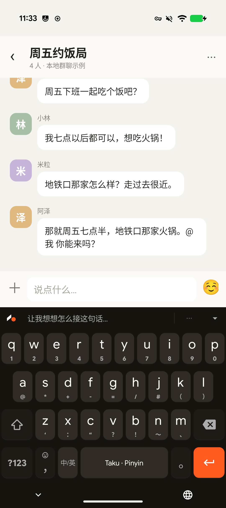
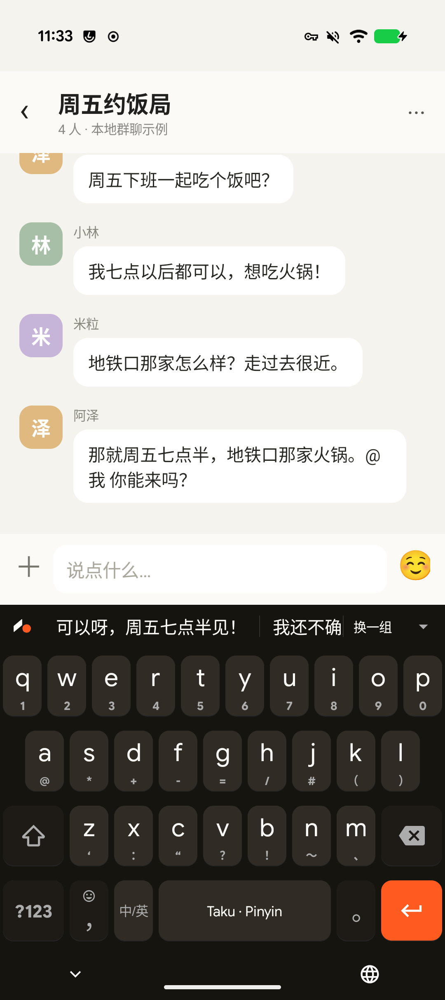
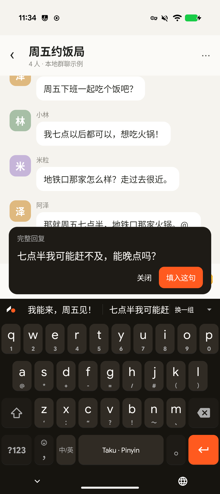
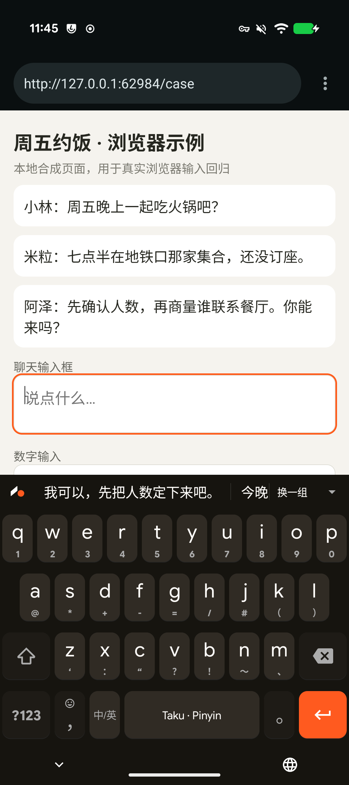
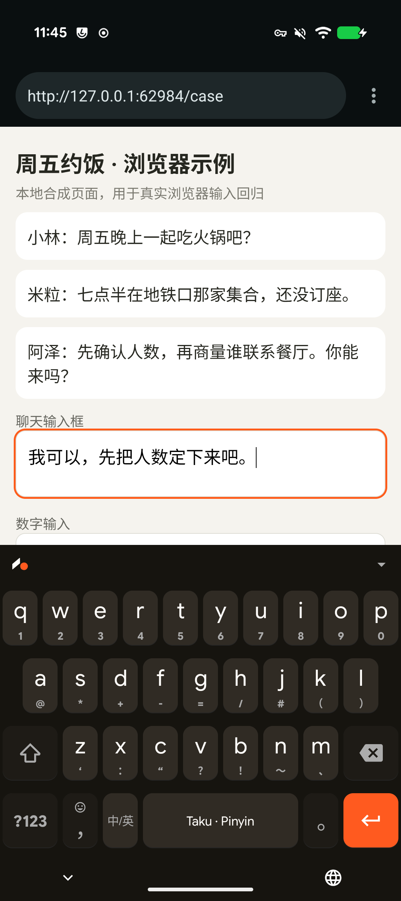
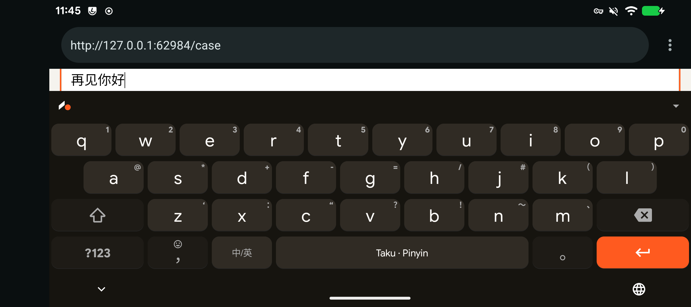
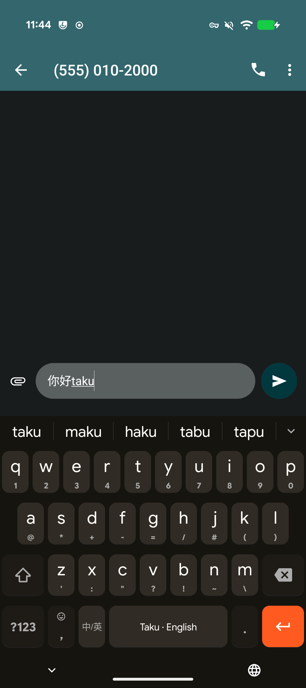

# IME 0.4.0: Pixel 9 hardware acceptance

2026-10-23, `physical_verified`, all 30 hardware checks passed. Took over after another conversation completed D→E upgrade and released the device: Android 17 / API 37, E `20261022160657`, SELinux Enforcing. This report does not replace OTA-release acceptance.

Final IME `0.4.0 / 10052`, assistant v63, and matching Broker installed; actual APK/runtime-file SHA-256 matched builds: [deployment](deployment.json). IME APK SHA-256: `ee9ad60092412db5d07638c436aa263d8b12faba10435f581816f2609fa63150`.

## Interaction and verification

Ordinary suggestion tap fills the current input directly, without confirmation or sending. Long-press alone opens full-text preview; its “Insert this reply” action is optional. Typing immediately dismisses AI and restores Pinyin candidates. Original 40dp strip/keyboard height retained.

All 9 [AI hardware checks](replies.json) passed: concurrent identical screenshots coalesce into one real request, same-image caching, new group bypassing cache/excluding previous exact sentences, full preview, exact insertion, authorization-revoke/regrant retry, typing cancellation/late-result prevention, protected windows, and password exclusion. Protected windows/passwords count separately; cancellation/late-result prevention share one check.

Native candidate bounds `[105,1466,975,1571]`, height 105px = 40dp at 420dpi; IME bounds `[0,1466,1080,2424]`. Candidate/q-key/IME bounds stayed identical through refresh, retry, and preview. Hardware exposed a duplicate status-bar offset in the preview overlay; fixed to absolute screen coordinates and added a button-above-strip check. This report uses only reinstalled/retested post-fix evidence.

| Path | Total Broker receipt time | Model time |
| --- | ---: | ---: |
| First real-image request | 4719ms | 3999ms |
| Completed-result cache | 1240ms | 0ms, no new model call |
| New group | 4499ms | 3392ms |
| Regrant and retry after revocation | 3585ms | 2546ms |
| Invoke again after cleanup | 6040ms | 5065ms |

These are individual samples, not latency percentiles/full UI tap timings. First image: 855×1024. Cache still checks foreground/protection and recaptures; reuse requires matching UID, app, actual window, model, policy revision, and complete JPEG hash, with at most four groups/20 seconds. Layout/cursor changes may miss. Concurrency evidence uses a stable test window: one of two independent subscribers reports `deduplicated:true`, with model count increasing once.

Model is system image default `codex/gpt-6-luna`, with real service replies; source is synthetic group chat without preset answers. Only the stable-frame benchmark hides the synthetic cursor; actual-app regressions retain ordinary editing.

## Actual apps and baseline input

All 8 [browser](browser.json), 2 [native-app](native-apps.json), and 11 [baseline-input](base-input.json) checks passed; together with AI 9, total 30. Actual apps: Jelly/WebView, Android Settings search, Android Messaging; page/message text is synthetic.

| Scope | Actual verification |
| --- | --- |
| Jelly/WebView | Real key input of a Chinese greeting followed by `taku12!`, replacing selected text with Pinyin candidates, continued landscape input, password/numeric keyboards, real webpage screenshot→Luna→strip, ordinary tap inserting complete model text. |
| Password/numeric boundaries | Neither input type shows AI controls; screenshot/model counts do not increase. |
| System Settings search | Entered/cleared keyboard with Taku IME; unauthorized app shows no AI. |
| Messaging | Entered a Chinese greeting followed by `taku` in a new draft for a fictional number, then cleared/exited; no send or existing-chat access. |
| Baseline input | Taku Logo toolbar, Pinyin/delete, Chinese/English switching, English, symbols, numbers, passwords, Chinese commit after IME restart, light/dark themes. |

Ordinary tap in real WebView produced an input value exactly matching the first model JSON candidate, without preview/confirmation, and dismissed AI candidates. Scripts handle bare HTML IDs, landscape scrolling/partially visible fields, Settings AutoCompleteTextView/task reuse, and Messaging empty values shown as hints. Final browser/native cases were rerun separately; failed attempts remain in ignored out and are excluded from passes.

[Post-cleanup state](final-state.json) confirms final APK hashes, default Taku IME, Enforcing, system text/image models, and IME AI permission. Temporary Jelly screenshot allowlist removed; themes/rotation restored; Probe/Fixture APKs and root diagnostic JAR removed. Memory accessibility was not enabled; controlled assistant drafts were not read/overwritten. Phone ended on real suggestions for the ordinary-cursor synthetic chat, with successful regeneration (6040ms). OTA conversation was notified of device release.

## Source and automated checks

[Host tests](host-tests.txt): 102 (strict JSON 23, error mapping 12, coordinator 37, system policy 30); [JVM](jvm-tests.json): 8; [independent patch reconstruction](source-reconstruction.json): 38 files; [repository checks](repository-verify.txt): all passed. Final Kotlin changes were recompiled/JVM-tested; coordinator/system policy were unchanged this round.

## Screenshots

Original ADB screencap, no cropping/composition. Ordinary tap inserts directly; preview below is optional after long-press.

| Waiting for real reply | Native candidate strip |
| --- | --- |
|  |  |

| Actual browser AI candidates | Direct insertion after ordinary tap |
| --- | --- |
|  |  |

## Deployment boundaries

This was an APK update/development-runtime bind mount after upgrade, without another image flash or full reboot. APKs/private configuration persist on data; current AI Broker/Magpie mounts need redeployment after the next full reboot or formal ROM integration. This report does not claim ROM persistence for the new AI runtime.
