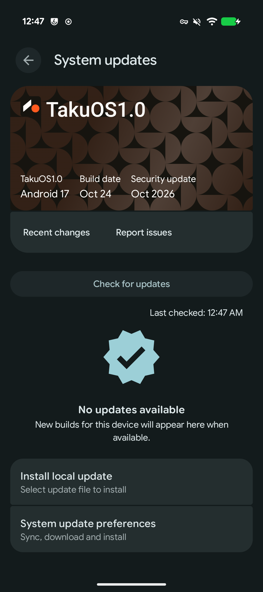
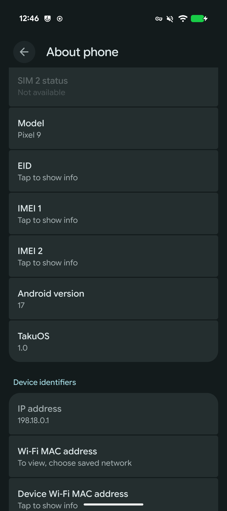
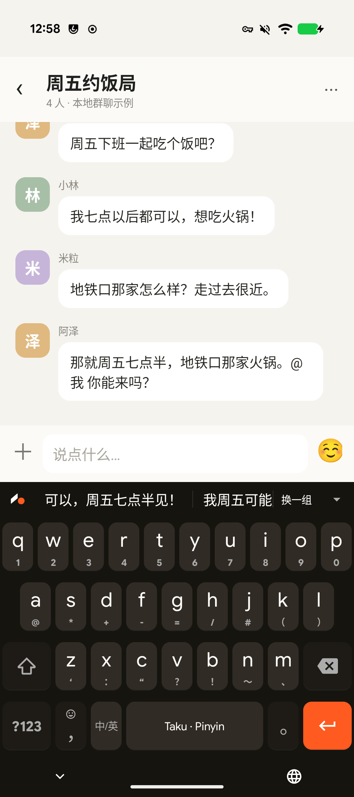
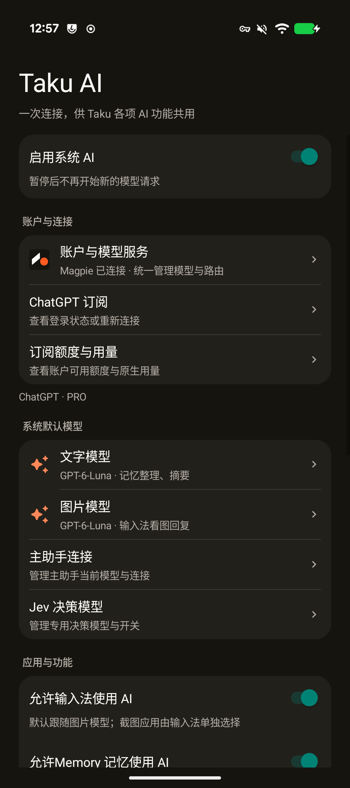
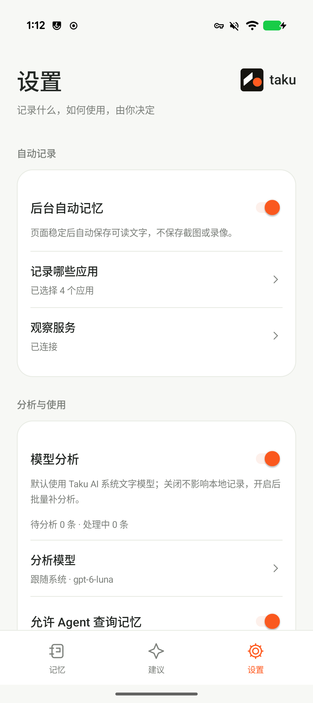
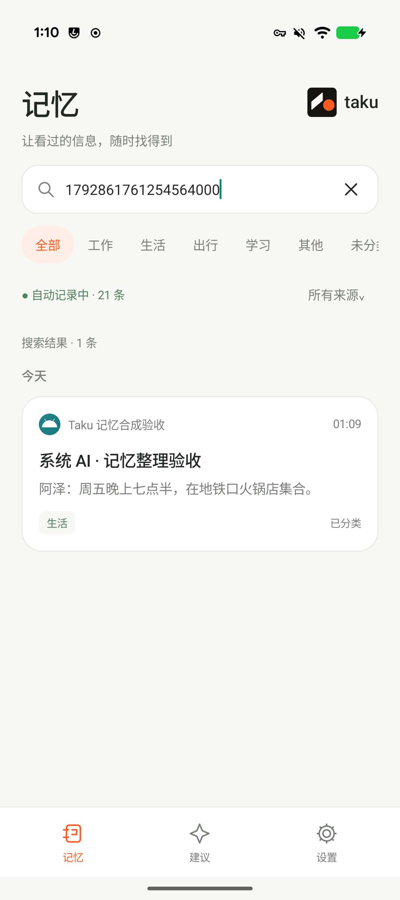

# Pixel 9: ROM hardware acceptance for system AI, IME, and Memory

2026-10-25, Beijing time. Coordinated with the main **Taku OS** conversation to install/reboot corrected ROM `20261024154635`; IME, system AI model settings, and the real Memory model chain passed. Active IME **10062**, Assistant **67**, and Memory **8** all load from read-only `/system_ext`.

## Integrated content and boot verification

ROM includes unified `systemAi` configuration, model resolution/generation APIs, `imeReplies` screenshot-reply service, Magpie startup wrapper, and runtime libraries. After reboot, existing subscription calls `codex/gpt-6-luna` without temporary backend, bind mounts, or product-APK overrides. Paths, hashes, and read-only mount origins were checked for APKs, broker, startup scripts, init files, 24 native files, and two symlinks.

Memory `android.permission.DUMP` allowlist is on the same partition at `/system_ext/etc/permissions/TakuMemory.xml`; hash matches actual build artifact and runtime permission is granted. SELinux Enforcing, user 0 unlocked, four init services healthy. All functional acceptance retained one boot ID, system_server PID `1692`, and startTicks `656`.

Build snapshot: `16fb163782b9e2d0f8224f3143fdae97c54b693c955dd178cfbecf6e8c64926e`. [result.json](result.json) binds actual build inputs, artifact reports, preinstall baseline, and runtime evidence by SHA-256. Hardware acceptance is separate; earlier E/H and immutable-artifact reports remain.

## Functional results

| Scope | Result |
| --- | --- |
| Unified settings/connectivity | 5 passed: Android Settings entry, IME/Memory inheritance, original-config checks, real text call after reboot |
| Suggestion tests | 9 passed: same-image coalescing, warm cache, new group, long-press full preview, exact insertion, retry after failure, typing cancellation, protected window, password exclusion |
| Actual apps | 10 passed: Jelly/WebView mixed Chinese/English/numeric input, selection replacement, landscape, password/numeric fields, real screenshot suggestions/direct tap insertion; Settings search and Messaging draft |
| Baseline input | 11 passed: Logo toolbar, Pinyin candidates/delete, Chinese/English, symbols, numbers, passwords, IME-process recreation, themes |
| Actual model-settings roundtrip | 7 passed: UI selection/inheritance for system text/image defaults; separate IME/Memory model selection with resolve checks; restore defaults/follow-system |
| Complete Memory chain | Actual accessibility captured synthetic dinner page, queued it, system Luna classified it as Life, analysis=`ready`; get/search and new completed receipt passed |

First screenshot/model total **3,129 ms**, model **2,312 ms**; warm same-image cache **1,005 ms**, model **0 ms**; new group **3,717 ms**. These are single-device samples. Preview, refresh, and retry retained strip/keyboard bounds; ordinary tap in the real browser inserted the original sentence without secondary confirmation or sending.

UI roundtrip actually selected `GPT-6.1-Sol`, verified via resolve, then restored `GPT-6-Luna`, without extra model calls. IME/Memory ended with empty overrides following system. Test pages/records are synthetic; model replies are real and Memory observations were not injected.

## Data, configuration, and cleanup

- Account and IME AI configuration hashes exactly matched the main-conversation preinstall baseline. Account contents were not read, exported, or restored.
- System AI enabled state, text/image models, and all app grants matched preinstall values. Revision changed 48→55 for three configure operations in authorization failure/retry and four UI model-default switches; all effective selections were restored.
- Memory capture/analysis/query/proactivity, four sources, 7-day retention, and follow-system settings restored. Original count 20 remained 20; observation service connected.
- Synthetic records were individually identified by unique marker/source and deleted; temporary search filters cleared; accessibility values restored to `org.agentos.memory/.ObservationService` and `1`.
- New fixture/probe/memorytests APKs and diagnostic JAR removed; existing ChatCase path/hash retained. Default Taku, Pinyin, and original night theme retained; Messaging draft cleared.

The first shared-settings script omitted scrolling to an off-screen entry. Memory force-stop also caused Android to remove accessibility registration; original values restored and QA changed to recreate only the Activity task. Two screenshot filters failed when Pinyin transformed ASCII markers; real-model processing had completed and synthetic records were cleaned. Failures remain unchanged; final unique numeric suffix filtering succeeded while preserving Pinyin. Final read-only gates and whole-run system_server checks passed again.

Raw evidence: `out/inputmethod/rom-cold-acceptance/I-acceptance-20261024T163454823870Z/`; complete local paths/hashes in [result.json](result.json). After handback, main Taku OS conversation independently sampled stability for 135.3 seconds/41 windows, result sampled-window-stable; final configuration/probe readbacks passed. Account/IME bytes matched; system AI differed only in revision 48→55, with DUMP/accessibility/effective selections healthy. No further phone commands were sent after handback.

## Branding and independent owner verification

Main conversation checked raw results/screenshot hashes individually and independently observed the same boot/PID/startTicks for 135.33 seconds/41 samples, with selected-data/config readback. Actual backup vs phone AI settings differed only in revision 48→55; account/IME bytes, original probe, and five ROM APK identities passed. Host paths/hashes/scope: [owner-verification.json](owner-verification.json), without changing immutable artifact reports.

System update and About phone actually show TakuOS 1.0 on Pixel 9 while retaining Android 17:

## Original screenshots

Actual screenshot-based AI candidates in the original top strip:

System text/image default models:

After independent-model roundtrip, Memory again follows system:

Actual capture/classification, filtered to this synthetic record only; record cleaned after screenshot:

