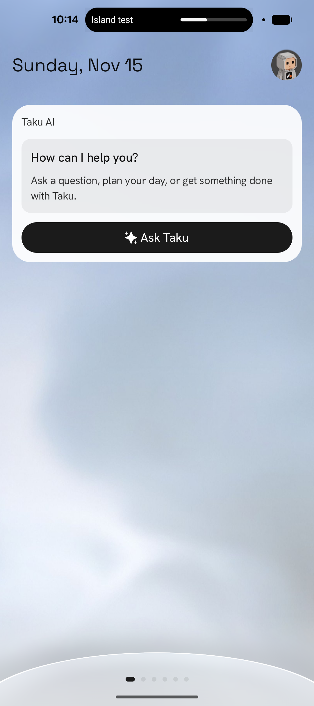
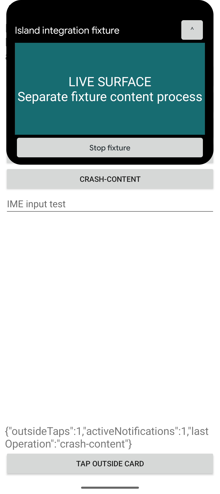
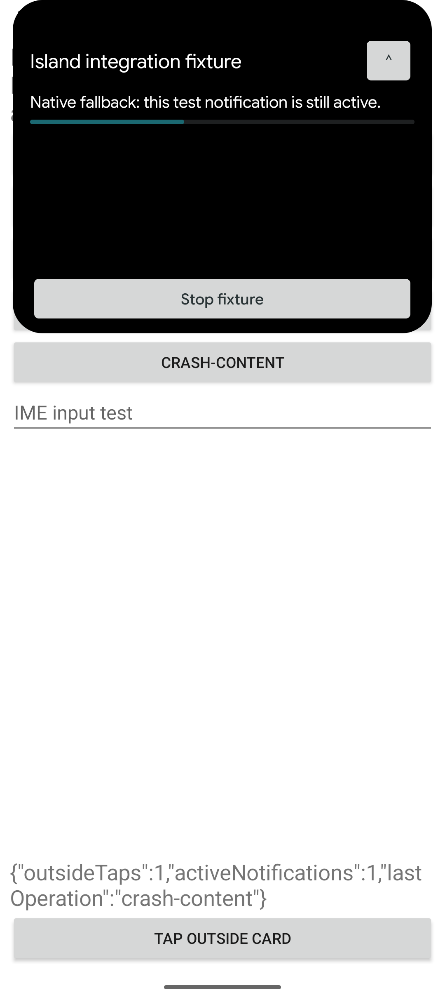
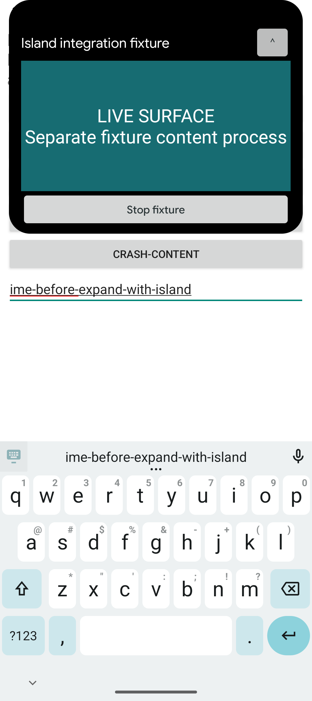

# Same-source Lineage emulator: build and runtime record

A complete ARM64 Lineage image booted on a new local emulator. SystemUI island integration has
passing device checks, **but covering-card input focus failed**. Issue #28 remains open.
This is an emulator integration checkpoint, not complete feature or Pixel hardware acceptance.

## Reproducible inputs and build

- Image/Agent source: immutable `116147f2a17da312b582fa47c349a33eb1a70446`, plus the
  isolated emulator product/build overrides. Concurrent desktop commits made after that freeze
  are not in this binary. The tooling committed with this record includes export/launch fixes
  discovered during validation; it is newer than the sealed build input.
- All **1,239** resolved platform project revisions match the Pixel build's pinned manifest:
  [comparison](platform.json). Framework: `7f6de40b6429462d47ba9ba351b99943269c8067`.
- Android 17 / Lineage 24; product `lineage_taku_emu_arm64-cp2a-userdebug`, Goldfish ARM64
  hardware/kernel instead of Pixel drivers. Build number `20261115082000`.
- Builder digest: `sha256:76fffd70eba28780934535eec83791a0534e5d3bdf837e9c1270f187d59c005c`.
  Sealed input digest: `7ef05018b2eddb465104273c6321767b50c84e1f5b16e84a79cf5327225be8d5`.
- Cloud `m -j48 droid` and final APK/component/document artifact gates passed. The original
  source checkout was protected by an isolated OverlayFS build; its mount and worker lock were
  released afterward. Networking was disabled during compilation.
- The wrapper subsequently failed because its container lacked zstd. Already-built images were
  packaged using host gzip, and the factory encryption image was added to the export. These were
  export-only recoveries, not another successful whole-wrapper invocation; its historical exit
  code 2 is preserved. The checked-in builder now exports all nine images with gzip.
- Pixel OTA remains unchanged for Pixel products; this emulator has only the disabled localhost
  OTA URI. Optional proprietary Google apps are excluded. Quickstep navigation remains present.

[Image hashes](images.json) and [APK verification](artifacts.json) describe the exported files.
Final `images.tar.gz` SHA-256:
`96116ab1ae34f4da5a88081ee698fa5fd86e0a7b2107e3f7f1405c2cd11e3b81`.
SystemUI SHA-256: `f07da09dfcaca6d7a26a11e60fa56eea12115ebf49528996e755bac1e0affa00`.
Agent SHA-256: `d4fb638cbe1568139d44ce93e4b43cd806dc9b44a731f30000d3001f9dd0059d`.
Both APKs use certificate SHA-256
`c8a2e9bccf597c2fb6dc66bee293fc13f2fc47ec77bc6b2b0d52c11f51192ab8`;
installed APK file hashes matched. Compile-time receipts deliberately retain their unverified
runtime flags: this partial checkpoint does not certify the full feature.

The SDK emulator requires canonical `system.img`, `vendor.img`, and `ramdisk.img` names for its
AVD image lookup even with explicit image arguments. Missing aliases caused a native startup
crash; aliases pointing to the unchanged Goldfish exports fixed startup. See the upstream
[partition parameter implementation](https://android.googlesource.com/platform/external/qemu/+/emu-master-dev/android-qemu2-glue/main.cpp).
The launcher validates hashes, creates those aliases, refuses foreign AVDs and occupied ports,
and disables metrics/crash-report prompts for its own invocation.

Local final tooling checks: full `npm run verify` passed on branch base `4e45937` plus this
change, including six image/AVD isolation tests. Fixture APK compilation/signature verification,
shell syntax and `git diff --check` passed. All nine factory image hashes were verified again
after device testing; launching the AVD did not change those exported image bytes.

## Local isolation and device checks

New AVD: `Taku_Lineage_Island_20261115`, serial **`emulator-5590`**. Original `emulator-5586`
was not modified. No account, credential, application data or AVD userdata was copied from it.
Local images are under `out/lineage-emulator-20261115/cloud-results`; new AVD userdata/logs under
`out/lineage-emulator-20261115/avds`. Setup Wizard was completed on the new instance before HOME
resolution was checked. [Device state](device.json) records boot, HOME, assistant and UI state.

| Check | Observed result |
|---|---|
| Boot and routing | Boot completed; HOME resolves to Taku Agent HomeActivity; HOME role and assistant/voice service point to the new Agent; no launcher chooser after setup |
| SystemUI integration | Presentation attached, Agent producer connected, SystemUI PID remained 896; crash buffer empty during these checks |
| Settings/Agent parity | GUI total switch OFF/ON and allow-list Save agree with command readback; see [settings](settings.json) |
| Publication boundary | Unallowlisted custom publication rejected while ordinary notification survives; allowing fixture permits extraction |
| Cross-app native card | Capsule on fixture and Taku desktop; tap expands window type 2041 |
| Outside touch | Underlying button counter increments with native and rich cards still expanded |
| Rich surface | Real SurfaceControlViewHost frame displayed from a separate content process |
| Actual content death | Content process self-SIGKILL yields native fallback; main notification and SystemUI survive; reopen rebinds a new content process ([death](surface-death.json), [rebind](surface-rebind.json)) |
| IME already open | Non-focusable below-bar card permits continued typing |
| Card opened before editor | **FAIL:** covering card keeps focus; subsequent input does not reach underlying editor ([evidence](focus.json)) |
| Back/shade/rotation | Back collapses focused card; downward capsule swipe opens shade; landscape collapses expanded card ([rotation](shade-rotation.json)) |
| Native action | Stop PendingIntent cancels the actual notification; list and NotificationManager agree ([action](native-action.json)) |

The focus failure is reproducible: the editor contains `ime-before-expand-with-island`; typing
`-cover-check` after opening a covering card leaves the text unchanged. Window focus remains
`TakuIsland`, with `cover=true` and `focusable=true`. By contrast, opening the IME first produces
`cover=false`, `focusable=false` and input continues. Soft IME with hardware keyboard was enabled
for both orders. The covering-card focus exception must be removed and Back routed through the
platform without stealing application focus, followed by both-order and remote-input regression
checks. This report does not waive issue #28's no-focus requirement.

| Desktop capsule | Real hosted surface | Native fallback after death | Covering-card focus reproduction |
|---|---|---|---|
|  |  |  |  |

## Continue manual validation

The new emulator is left running at Taku Home. The **Island integration fixture** is installed
and allowlisted; its last notification was canceled. It is a device-only test APK, not a ROM
component. The initial `cutout.emulation.hole` overlay was a **left-side** hole, not a
center hole. A follow-up switched this AVD to `com.android.internal.emulation.pixel_8`: the
1080-pixel display reports cutout bounds `Rect(479, 0 - 601, 132)`, centered at x=540.
Soft IME with hardware keyboard remains enabled on this new AVD. Rotation settings were restored. Rooted debugging and SELinux were not weakened.

```sh
adb -s emulator-5590 shell am start -n org.agentos.island.fixture/.Fixture
adb -s emulator-5590 shell content call --uri content://org.agentos.island.fixture --method publish-surface
adb -s emulator-5590 shell cmd statusbar island list
# Tap the capsule to expand, then use the activity's outside-touch/input controls.
adb -s emulator-5590 shell content call --uri content://org.agentos.island.fixture --method crash-content
adb -s emulator-5590 shell content call --uri content://org.agentos.island.fixture --method cancel
```

See [fixture operations and boundaries](../../../system/island/device-tests/README.md) and
[repeatable image build/launch instructions](../../../image/emulator/README.md).

## Remaining acceptance

- Fix covering-card focus and verify both IME orderings, outside input, Back and remote input.
- Verify actual Agent Compose content/backend and issue #25 F1–F5; fixture success is not AI acceptance.
- Third-party Live Updates, real dialer/alarm/recording/casting arbitration, HUN/FSI priorities,
  user switching, package updates, lock screen and AI-off operation remain open.
- Complete clock/network/cutout layout budgets, accessibility, and controlled frame timing;
  screenshots and collected framestats do not constitute a performance pass.
- Full Pixel ROM/device validation, production Agent release publication and source-lock refresh
  remain open. This emulator's missing modem simulator configuration and absent proprietary apps
  mean telephony/Google-service behavior has not been accepted.
