## 灵动岛通用化验收更新（已连接账号 · 当前开孔配置）

**结论：账号和模拟器配置导致的阻塞已解除，真实模型回复、麦克风采集、fal/Grok Live Talk 连接、桌面 Building 胶囊已验证；通用化需求仍未全部满足。** 第三方卡片回桌面不收起仍复现，缺少 fal Key 时的 Live Talk 引导遗漏也仍未修复。

验收日期：2026-11-23。设备：`emulator-5596` / `Taku_PR27_Fresh`，ARM64 Android 17。
本地分支 `vela/dynamic-island` 为 `ca2d36a9`，已安装 SystemUI、Agent、Assistant 的 SHA-256 均与 `a48ca6f1` 构建一致；两提交只差开发文档。底层仍复用此前 `main-65917a4` ROM，并非重新构建整包。
本轮使用恢复后的原版 APK，没有安装显示探针 APK 或向 Agent 注入假状态。

**外观证据已再次更新：下方主图全部改为当前 Mac 模拟器窗口实拍，包含真实显示的开孔遮罩。原来的 Android 内部截图不再作为当前外观主图。** 桌面、第三方避让开孔卡片正常；新发现 Agent 文字输入/带键盘回复时黑色开孔消失、退出后恢复，已列入问题 11。

### 与上一轮相比发生了什么

| 项目 | 当前实测结论 |
| --- | --- |
| 账号 | 权威接口返回 ChatGPT、Jev、fal 均为 `connected`，`ai=available`。ChatGPT 另经真实只读任务验证；Jev 本轮仅核对连接状态。 |
| 模拟器显示和输入 | 时间、底部手势横条、Taku 输入法及默认 HOME 正常。居中开孔已启用，桌面和第三方避让卡片的窗口实拍可见；Agent 文字输入模式下仍有遮罩消失问题，见 #11。 |
| 真实 Agent 请求 | 输入读取 Android 版本的任务，出现工作中状态，实际执行 `getprop ro.build.version.release`，返回 Android 17。上一轮的“没有账号、停在 needs_user”不再代表当前状态。 |
| 回复 → 完整会话 → 桌面 | 同一真实请求的回复可查看；进入完整聊天后展开岛消失，回到桌面没有遗留展开卡片。 |
| 普通语音输入 | 同日配置修复阶段的实测：本地 Zipformer 实际进入 Capturing，`ready=true`、PCM RMS 峰值约 0.3025；测试录音已取消，没有提交转写。这验证真实采集，不是完整语音识别准确率。 |
| fal 连接页面 | 手动打开现有连接卡片，显示 **Fal Connected**；这不是“缺少 Key 自动触发引导”的通过证据。 |
| Live Talk | 经用户同意，短暂实测 `fal-grok`：`lifecycle=active`、`capturing=true`、`error=null`，PCM RMS 峰值约 0.0709；截图后立即停止，读回 `closed` / `capturing=false`。未测试长时间对话或语音指令执行。 |
| Building 桌面胶囊（原问题 9） | 原版 Agent 执行最小 HTML 计数器生成任务期间，实际设置构建标记，Taku Home 前台显示 **Building...**，`compactVisible=true`、`suppressedByForeground=[]`；任务完成后 `buildingApp=false`。当前配置下通过，原失败由 HOME 被旧开机向导接管引起。 |
| 原有 Agent 样式 | 这次真实聆听、工作、回复及 Building 画面仍走现有 Agent 展示；没有出现第三方模板替换 Agent 的现象。确认、错误、长文滚动等仍沿用上一轮显示回归证据，不能宣称所有路径无回归。 |

构建测试只生成最小本地 HTML，不安装 APK；任务记录报告产物为 `/data/local/agentos/work/island-acceptance-20261123/index.html`。本轮没有验证该应用的页面交互或原生打包，ADB shell 直接读取此目录被权限拒绝。这里验收的是**真实任务期间的 Building 展示及退出**。

### 当前未满足项与复测范围

保留上一轮编号，避免把配置恢复误当作产品功能修复。

| # | 项目 | 当前状态 |
| --- | --- | --- |
| 1 | 第三方图标动画资源加载失败 | 上轮未通过，本轮未重新测试；没有对应代码修复，保留问题。 |
| 2 | 第三方展开卡片进入 App 再回桌面 | **本轮再次复现**：已进入 `content-detail`，回桌面后仍 `expanded=true`。 |
| 3 | 普通第三方自由设计 | 上轮固定模板、`reserved_content` 限制仍列未满足；本轮未重新做字段矩阵。 |
| 4 | 不限制操作按钮数量 | 上轮超过 32 个被拒绝；本轮未重跑数量边界。 |
| 5 | 持续性及重要性准入 | 上轮短时、静态错误也可上岛；连接 AI 账号不等于修复这一准入问题。 |
| 6 | 高频打扰冷却 | 上轮多次 false→true 可反复弹出；本轮未重新进行频率测试。 |
| 7 | 异形容器裁切 | **当前居中开孔配置下完整显示**；无开孔、矮状态栏的旧失败仍保留，未宣称所有屏幕配置已修复。 |
| 8 | 整个业务活动最多十二小时 | 上轮仅单通知寿命约束通过，取消重发可获得新寿命；本轮未重跑时限测试。 |
| 9 | Agent Building 桌面被抑制 | **当前模拟器配置修正后复测通过**，旧失败留档。不是发布了新的产品代码补丁。 |
| 10 | Live Talk 缺少 fal Key 的连接引导 | **仍待修复**：异步 `PROVIDER_NOT_CONFIGURED` 没有衔接到添加密钥提示，只有失败/重连。当前有 Key 时能连接，不代表无 Key 引导已修好。本轮保留账号，未删除 Key 重演故障。 |
| 11 | Agent 文字输入模式中的开孔遮罩 | **本次新发现，未通过。** Mac 窗口实拍中，桌面有黑色圆孔，打开文字输入及带键盘回复后未见圆孔；等待稳定后仍如此，退出文字输入回桌面恢复。开孔配置仍启用，原因待排查。这不能再归因于 Android 内部截图漏层；不外推到真机。 |

同日上一轮滑动复测保留首次未命中的 `18-third-hide` 原始记录：起点 x=370 在当前胶囊外，没有触发隐藏；改为从胶囊内 x=445 起滑后，A123 隐藏并显示剩余 FL123，见 `third-hide-confirmed`。本次窗口补拍直接使用胶囊内起点，右滑隐藏再次通过。

第三方普通签名测试 App 本轮重测：Taku JSON 摘要/展开、标准 Live Update 摘要/展开、两个 App 按新通知优先显示、左滑切换、右滑隐藏。白名单临时追加后恢复为 `org.agentos.notebook`，测试通知取消、两个测试 App 均卸载。
Notebook 的真实业务流程、完整十二小时运行、小米真机流畅度对比均未因此得到新的通过结论。

### 当前可复现的验收流程（包含开孔外观检查）

1. 保留已有账号，读取 onboarding/account 与 Audio 设置；核对 HOME、麦克风权限、输入法及居中开孔几何。外观通过 Mac 模拟器窗口截图验证，不能仅凭 Android 内部截图判断开孔是否可见。
2. 用原版 Agent 发起只读版本查询，观察文字输入、工作中、真实回复，再打开完整会话并返回桌面。
3. 普通语音输入观察真实 Capturing/PCM 后取消；独立打开 fal 设置确认已连接。
4. 在测试聊天启动 Live Talk，确认实际 provider、active/capturing/error，再立即停止并核对麦克风已释放。
5. 发起最小本地 HTML 生成任务，观察构建标记对应的桌面胶囊，完成后核对退出。
6. 临时安装普通签名通知测试 App，记录 JSON 和 Live Update 交互，分别拍摄 `cardPosition=cover` 与 `below` 的实际开孔关系，再恢复白名单并卸载。
7. 对照 Agent 文字输入/键盘显示与退出后的窗口画面，单独记录黑色开孔遮罩是否保留。当前此项未通过，不能把恢复桌面开孔等同于所有界面通过。

这是已连接账号的使用流程。首次 onboarding 与缺 Key 补充配置是另外两条路径，不能用本轮截图代替验收。

### 当前开孔环境的窗口实拍

这些图均在同一台已启用居中开孔的模拟器上通过 Mac `screencapture -l` 重新拍摄，没有后期补画圆孔。当前显示几何是 `Rect(479, 0 - 601, 132)`，`config_fillMainBuiltInDisplayCutout=true`，SystemUI 存在 `DisplayCutoutView`。

- **桌面、第三方摘要、below 卡片：**可以直接核对圆孔及卡片的避让关系。
- **cover 卡片、聆听和黑色背景：**圆孔会与卡片/背景重合，不能仅靠是否有明显边界判断位置，需结合布局读回。
- **Agent 文字输入/带键盘回复：**实拍确实缺少圆孔，已如实标注失败；退出文字输入后恢复，尚未定位原因。
- **Live Talk：**仍引用同日先前已授权实测的连接状态证据；本次只更新开孔外观，未再次启动云端录音，也不把旧的内部截图放入当前外观主图。

A 当前桌面、Agent 和服务连接

| 桌面：居中黑色圆孔 | 文字输入：异常，未见圆孔 |
| --- | --- |
|  | <a href="cutout-window-update/images/02b-text-entry-settled-cutout.png">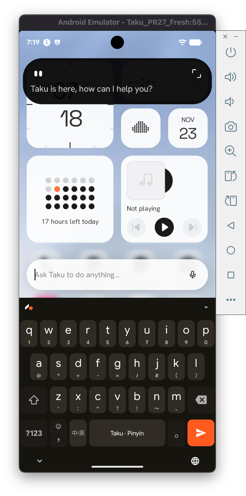</a> |

| 真实工作中：带键盘，未见圆孔 | 真实 Android 17 回复：未见圆孔 |
| --- | --- |
| <a href="cutout-window-update/images/03-real-working-cutout.png">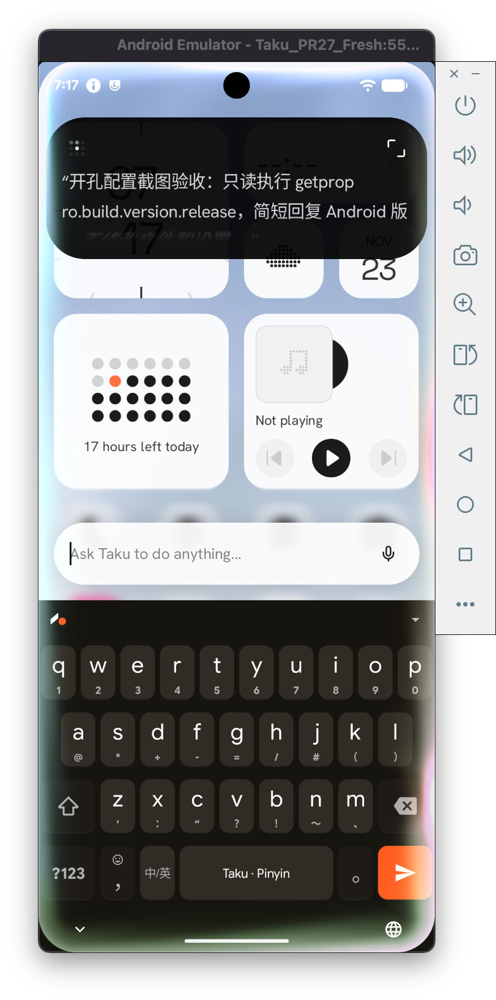</a> | <a href="cutout-window-update/images/04-real-reply-cutout.png">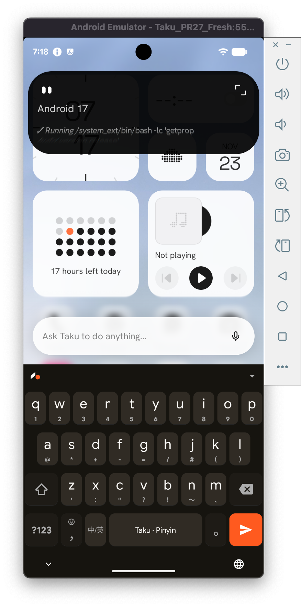</a> |

| 完整会话：黑色背景 | 返回桌面：圆孔恢复 |
| --- | --- |
| <a href="cutout-window-update/images/05-chat-cutout.png">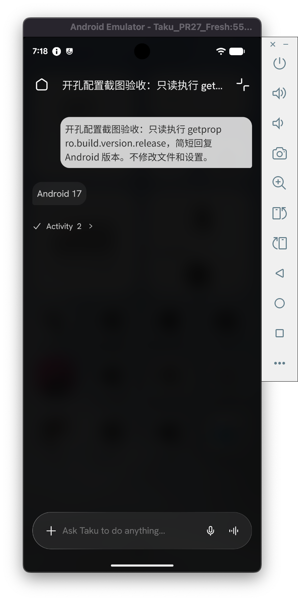</a> |  |

| fal 连接卡片：圆孔与卡片重合 | 本地聆听：覆盖开孔位置 |
| --- | --- |
| <a href="cutout-window-update/images/07-fal-card-cutout.png">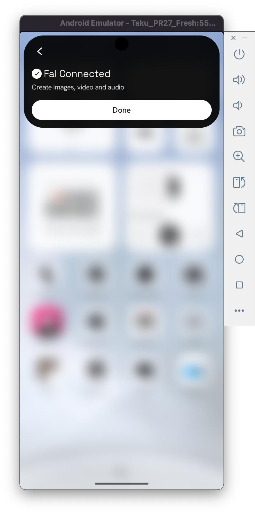</a> | <a href="cutout-window-update/images/08-local-listening-cutout.png">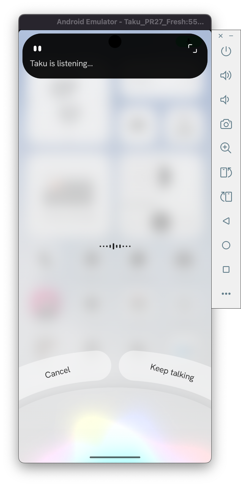</a> |

| 退出文字输入后圆孔恢复 |
| --- |
| <a href="cutout-window-update/images/09-input-keyboard-hidden-cutout.png">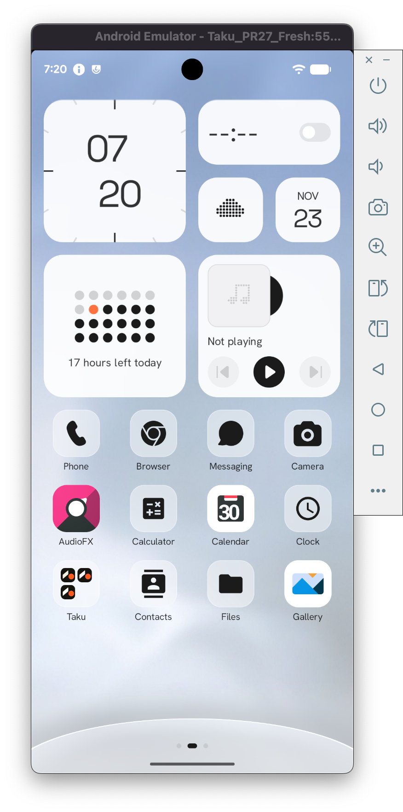</a> |

B 真实开发期间的 Building 胶囊

| 桌面 Building 胶囊与开孔 | 完成后返回桌面 |
| --- | --- |
| <a href="cutout-window-update/images/20-real-building-home.png">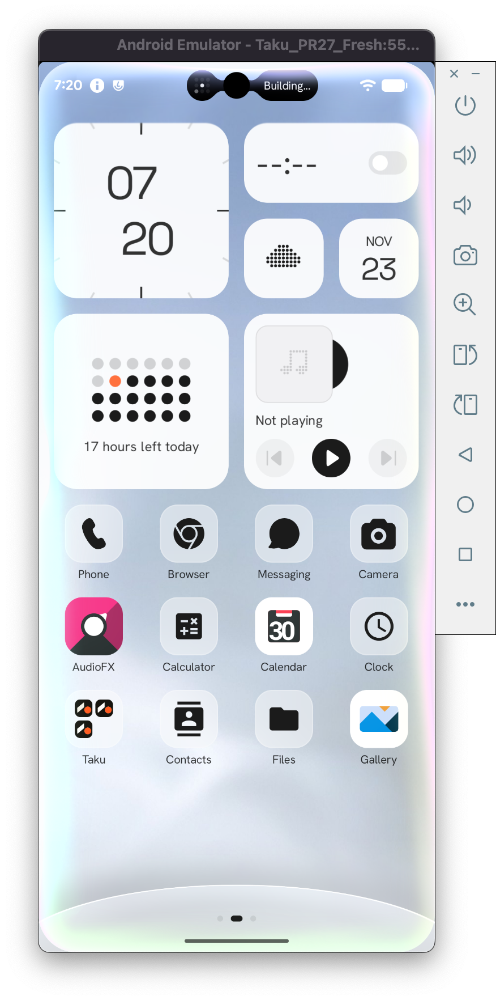</a> |  |

C 第三方通知与开孔位置

| JSON 摘要：开孔位于中间 | JSON 展开 |
| --- | --- |
|  | <a href="cutout-window-update/images/11-third-custom-expanded.png">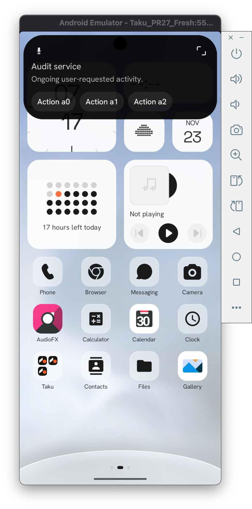</a> |

| 进入指定页面仍保持展开 | 回桌面不收起：仍未通过 |
| --- | --- |
| <a href="cutout-window-update/images/12-third-enter-app.png">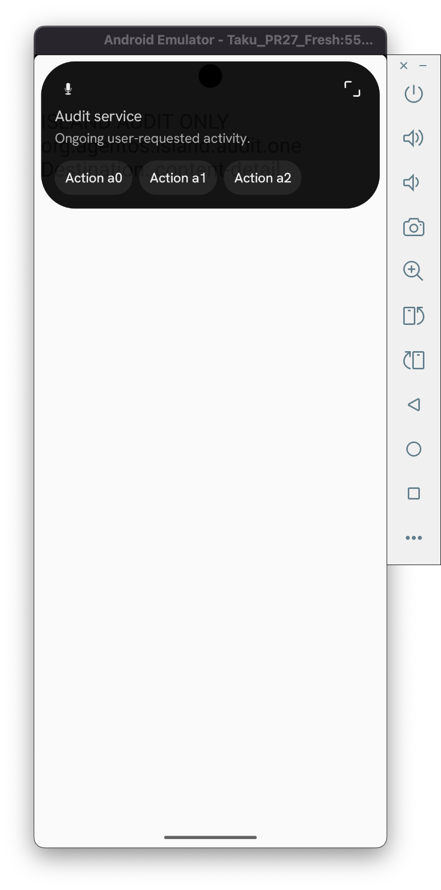</a> |  |

| below：卡片在圆孔下方 | cover：卡片覆盖圆孔区域 |
| --- | --- |
| <a href="cutout-window-update/images/14a-third-card-below-cutout.png">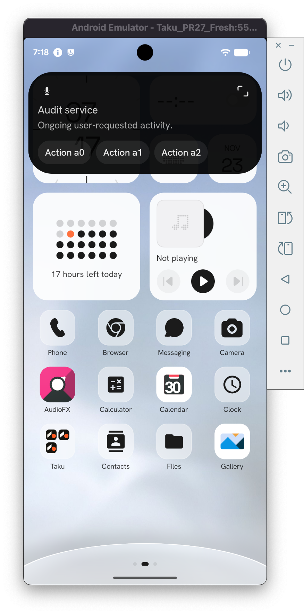</a> |  |

| 标准 Live Update 摘要 | 标准 Live Update 展开 |
| --- | --- |
| <a href="cutout-window-update/images/14-third-live-update-capsule.png">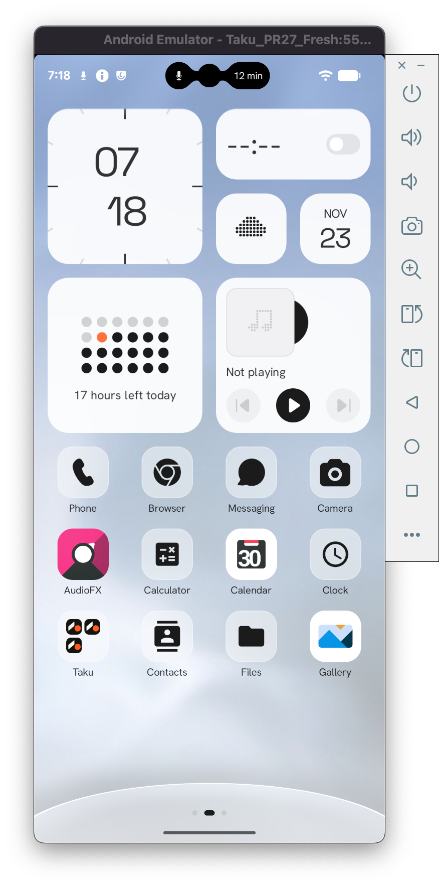</a> | <a href="cutout-window-update/images/15-third-live-update-expanded.png">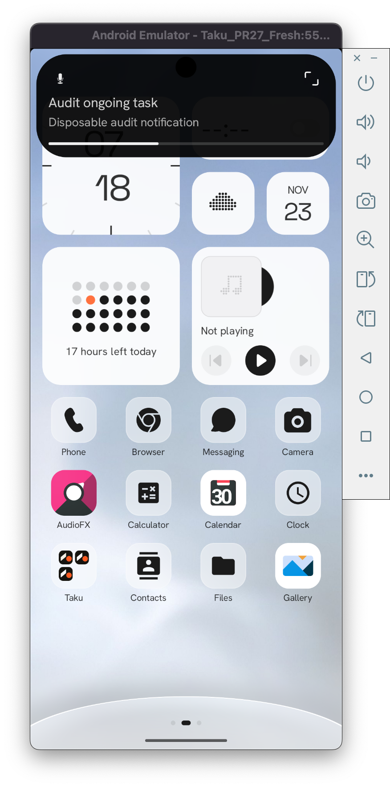</a> |

| 新活动 FL123 优先 | 左滑显示 A123 |
| --- | --- |
|  |  |

| 右滑隐藏 A123，剩余 FL123 |
| --- |
|  |

上一轮已连接账号的真实请求、Live Talk 连接、完整聊天按钮后续，以及 Android 内部截图，保留在[上一版账号连接复测](https://github.com/Taku-OS/taku-os/blob/b030a8581f2aa7df6e2e4f4e89872f66ff7646bd/docs/reviews/island-generalization-2026-11-23/README.md)。它们是历史流程/状态证据，不再充当本节的开孔外观参考。

### 证据与边界

- 本次开孔实拍的[证据目录](cutout-window-update/evidence)、[文件校验清单](cutout-window-update/manifest.json)。
- 本轮再次执行只读 Android 版本查询、短暂本地 Zipformer 采集并取消；开发任务仅为已有测试计数器添加重置按钮，未改动产品代码。临时通知 App 已卸载，白名单恢复，账号未清除。

- [连接状态](connected-update/evidence/connections.json)、[Audio 配置](connected-update/evidence/audio-settings.json)、[真实模型回复和执行步骤](connected-update/evidence/real-reply.json)。
- [Live Talk 连接](connected-update/evidence/live-result.json)、[停止后的读回](connected-update/evidence/live-stopped.json)、[本地麦克风](connected-update/evidence/local-microphone.json)。
- [Building 与 HOME](connected-update/evidence/building-home.json)、[任务结束](connected-update/evidence/building-finished.json)、[安装包一致性](connected-update/evidence/packages-verified.json)。
- [第三方回桌面仍展开](connected-update/evidence/13-third-return-home.json)、[滑动隐藏复核](connected-update/evidence/third-hide-confirmed.json)、[测试清理](connected-update/evidence/third-cleanup.json)。

真实版本查询在完整聊天中生成了两个选项；实际点击“查看 API 级别”，批准仅执行 `getprop ro.build.version.sdk` 的只读请求后，收到 API 37 回复，按钮状态变为 Request handled（[记录](connected-update/evidence/chat-choice-followup.json)）。这是完整聊天的动态操作按钮闭环。但本次岛状态的 `suggestions=[]`，岛内显示的是回复文本，不能把它计为“灵动岛建议按钮提交到模型”已通过。原生岛按钮的显示与横向滚动仍以历史回放为证。

本轮未修改产品代码，未注销账号或重置 onboarding；临时测试 App 已清理，Live Talk 已停止。测试聊天和最小 HTML 任务记录保留，未删除其他用户数据。此前本地模拟器启动器/说明的配置修正是独立改动，不混入这个证据分支。

上一轮未连接账号的失败、显示层回放、字段/时限/权限测试和接入方案讨论，完整保留在[历史验收记录](https://github.com/Taku-OS/taku-os/blob/fbe93b34545d435e7ddd4d29285800720d9b3268/docs/reviews/island-generalization-2026-11-23/README.md)。该记录中的“无账号”“当前桌面 Building 不显示”描述已由本次实测更新，其他未复测项目仍按原证据标注。
