## 灵动岛修复复验：`6dc400c7`（2026-11-23）

**结论：主要显示与交互修复已在真实 SystemUI 上通过，但还不能关闭全部验收问题。** 动画图标、进 App 收起、键盘下覆盖开孔、白色卡片、模糊与回退、左侧第二活动均已实测。**提醒冷却仍有重复弹卡漏洞；短时/静态内容准入与跨重发的业务总时长仍未满足原需求；缺 fal Key 的 Live Talk 引导不在这个版本内。**

这是接续[上一轮报告](https://github.com/Taku-OS/taku-os/issues/30#issuecomment-7096921204)的**新增复验记录**，保留旧结论和旧截图的历史，不覆盖原评论。

### 这次实际安装了什么

- 源码：`vela/dynamic-island`，[`6dc400c7d0eb6c6ccee09fe22b99b8445fe63134`](https://github.com/Taku-OS/taku-os/commit/6dc400c7d0eb6c6ccee09fe22b99b8445fe63134)。本地已快进到此提交，未改产品代码。
- 云端使用 x86_64 原生工具链、56 路并行、210 GiB 内存上限，复用 `/mnt/taku-build` 的源码及缓存，增量构建 `lineage_taku_emu_arm64-cp2a-userdebug` 的 **SystemUI**。真实 KSP/Dagger、Kotlin、Java、签名和 dexpreopt 均通过，构建耗时 10 分 12 秒。首次因验收打包遗漏平台清单中止，补齐后重试成功；不是源码编译失败。
- 安装到 `emulator-5596 / Taku_PR27_Fresh`，ARM64 Android 17；SystemUI staged 安装并重启后，设备 APK SHA-256 与云产物一致：`3fd5b24c9cdc529dee4aa0c78c25c9f1c747e9f1d5f0c803250cfa0ece83733e`。
- Agent 代码相对已安装的 `a48ca6f1` 未变化，保留原 APK；Assistant 重编并安装了更新后的接入技能文档。底层 ROM 未整包重刷，没有清除账号或用户数据。[完整构建及安装记录](evidence/build-receipt.json)
- 云构建产物已取回本机；确认无其他构建后，云机已关闭，源码及缓存保留。

### 对照旧问题逐项结论

| 旧编号 | 问题 | 本次结论 |
| --- | --- | --- |
| 1 | 第三方动画图标加载失败 | **通过。** 普通签名 App 自有 AnimatedVectorDrawable 成功显示，`animatingIcons=1`；进度环同时可见。见 08/09。 |
| 2 | 展开卡片进 App / 回桌面不收起 | **通过。** 点击卡片进入目标页即收起；独立把发布 App 切到前台也会收起；回桌面恢复胶囊。前台 App 的 alert 不主动弹卡。见 02–05、21。 |
| 3 | 普通第三方自由设计 | **部分支持，原限制仍在。** 白色背景及黑色文字/按钮已通过；普通签名 App 的 `expanded.content` 仍拒绝，错误 `reserved_content`。这不等于任意布局已开放。 |
| 4 | 不限制按钮数量 | **仍有 32 个上限。** 32 个按钮可显示并横向滚动；33 个返回 `too_many_actions`。按此次实现说明保留，但相对最初“不限数量”的需求不能算已完成。见 64/65。 |
| 5 | 持续性与重要性准入 | **部分修复。** 非 ongoing 通知返回 `not_ongoing`；但 `ongoing=true`、`timeoutS=3`、正文“Version updated”仍能上岛。重要性、营销/静态内容及最短持续时长并未自动约束。见 15/16、60。 |
| 6 | 高频/重复弹卡 | **未通过。** 取消重发冷却、30 秒后重新提醒通过；但初次 alert 的 5 秒窗口内，收起后连 `alert=false` 更新也会再次弹卡。下文有精确复现。 |
| 7 | 异形胶囊与矮状态栏裁切 | **本轮覆盖的尺寸通过。** 当前约 46.48 dp 开孔按真实半径绘制；无开孔矮状态栏读回缩放 `0.88095236`。另有 24 dp 状态栏的设备 Canvas 测试通过。不是所有设备/刘海形状的全覆盖验收。见 01、10、45。 |
| 8 | 同一业务活动总时长不超过 12 小时 | **仍未满足跨重发约束。** `43201` 秒被拒绝；但取消再发后 `firstSeen` 和到期时间重新计算，仍可延长同一业务的累计上岛时间。本次通过时间戳验证，未实际等待 12 小时。 |
| 9 | Agent Building 桌面胶囊 | **通过。** 原版 Agent 实际修改本地测试页面期间出现 Building，结束后 `working=false / buildingApp=false`。未注入虚假任务状态。见 37/38。 |
| 10 | Live Talk 缺少 fal Key 的引导 | **本分支未包含修复。** Agent 相关源码未变化；此次没有合并 `vela/live-talk-fal-setup`，也没有删除现有 Key 重测。连接页正常不能算缺 Key 引导通过。 |
| 11 | 键盘/文字输入下开孔与卡片位置 | **恢复稳定开孔配置后通过。** 文字输入时圆孔可见；工作、回复和聆听卡片均 `cover=true`、`top=21px`（8 dp），键盘不会再把卡片移到开孔下方。见 30–32、36。 |

补充通过：胶囊与卡片互斥；胶囊点击可直接进 App；独立 `expanded.tapAction` 能进入 `card-detail` 并收起；新通知优先；左滑切换、右滑隐藏；点击左侧第二活动可切换到该活动。普通签名测试 App 未获白名单时不能发布，临时授权后可以。

### 仍需修复：关闭后，`alert=false` 也会重新弹卡

同一 App、同一通知 ID，实际记录为：

1. `alert=true`，约 **1218 ms** 时卡片已展开。
2. 收起卡片，约 **1366 ms** 时 `expanded=false`。
3. 更新同一通知为 **`alert=false`**，约 **2576 ms** 时又变成 `expanded=true`，`reason=alert`。

这还在 30 秒冷却内。[完整时序](evidence/cooldown-reproduction.json)，截图 51→52→53。

代码原因与实测吻合：[`IslandStore`](https://github.com/Taku-OS/taku-os/blob/6dc400c7d0eb6c6ccee09fe22b99b8445fe63134/system/island/src/com/android/systemui/taku/island/IslandStore.java#L90)保留尚未结束的 `alertUntil`；[`IslandPresenter`](https://github.com/Taku-OS/taku-os/blob/6dc400c7d0eb6c6ccee09fe22b99b8445fe63134/system/island/src/com/android/systemui/taku/island/IslandPresenter.kt#L150)按 revision 再次触发展示。冷却目前限制了新的提醒时间，却没有阻止同一提醒窗口内被新 revision 再次展示。应统一“已展示过的提醒”与冷却判断，并覆盖用户收起后的更新。

### 原有 Taku Agent 样式与验证边界

实际执行了只读 Android 版本查询，收到 **Android 17** 回复；随后进入完整聊天、回桌面。工作、回复、普通本地语音聆听仍使用 `systemui-native / native-assistant`，没有被第三方模板替换。fal 手动连接页仍显示 **Fal Connected**。Building 来自真实测试页面任务。

卡片开启背景模糊时 `backdropBlur=true`；临时禁用系统模糊后变为 `false`，实拍是实体深色背景，底层控件文字不再透出。白色模板自动使用深色文字和控件。已对照 Figma [胶囊 1:4742](https://www.figma.com/design/MdImIDNqePpNZ62C0GLArW?node-id=1-4742)及[展开态 297:374](https://www.figma.com/design/MdImIDNqePpNZ62C0GLArW?node-id=297-374)检查；模拟器大开孔与设计的 24 dp 开孔不同，不宣称逐像素一致。

**不能据此宣称所有 Agent 路径无回归。** 本次未重新触发真实模型确认/错误卡片、首次 onboarding 或长时间 Live Talk。Live Talk 的实际云端连接仍引用上一轮已授权实测，本次只核对保留的账号与连接页，没有再次启动云端录音。Notebook 自己的语音备忘录等业务、锁屏、真实电话/闹钟、多用户及真机帧率也未验收。

### 测试配置与清理

本次额外发现：动态关闭再重新启用 Pixel 8 开孔 overlay 后，系统显示几何已恢复，但 SystemUI 的 `DisplayCutoutView` 一度没有重建；**重启后恢复**。这是本轮配置切换的环境问题，尚不能归因于此次灵动岛改动。正式 Agent 截图全部在重启并确认遮罩存在后重拍，未拿残留配置截图判产品失败。

临时通知 App、解析/渲染测试 App 均卸载；通知清除；白名单恢复为 `org.agentos.notebook`；原开孔、模糊设置、Taku 输入法及默认桌面恢复；账号保留；本地测试录音已取消。重启后的首次账号查询曾返回 ChatGPT `unknown`，随后真实请求成功，最终 ChatGPT/Jev/fal 均为 `connected`、`ai=available`。[清理与账号状态](evidence/final-cleanup.json)

测试记录：宿主机 40 项 store、15 项系统来源、105 项权限、91 项格式/转换检查及几何/动画检查通过；补丁检查通过；设备端 **70 项解析、70 项组件渲染检查通过**。组件测试与真实 SystemUI 交互测试是不同证据，未互相替代。[测试及原始状态目录](evidence) · [文件校验清单](manifest.json)

### 本轮流程截图

全部流程图均为更新后模拟器的 **Mac 窗口实拍**，没有补画摄像头。矮状态栏一图明确为临时关闭开孔的专项测试。点击可查看原图。

A · 第三方胶囊、卡片和多活动

| JSON 胶囊与真实开孔 | 展开卡片覆盖开孔 |
| --- | --- |
|  |  |

| 点击进入 App，卡片收起 | 回桌面恢复胶囊 |
| --- | --- |
|  |  |

| below：卡片避让开孔 | 白色卡片与深色文字 |
| --- | --- |
| <a href="images/06-card-below.png">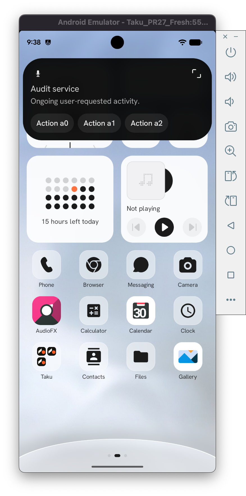</a> | <a href="images/07-white-card.png">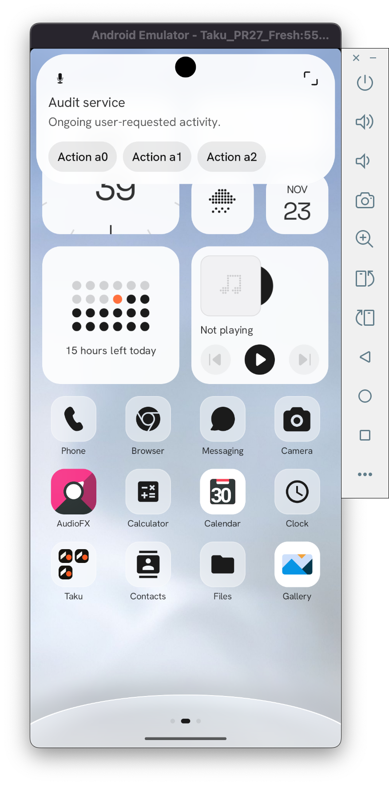</a> |

| App 动画资源与进度环 A | 同一动画的后续帧 B |
| --- | --- |
|  |  |

| 新通知优先，第二活动在左侧 | 左滑切换 |
| --- | --- |
| <a href="images/10-two-activities.png">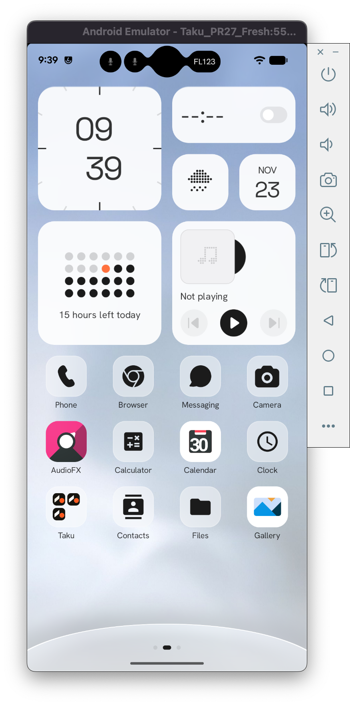</a> |  |

| 右滑隐藏当前活动 | 点击左侧小圆切换 |
| --- | --- |
|  | <a href="images/44-secondary-tap.png">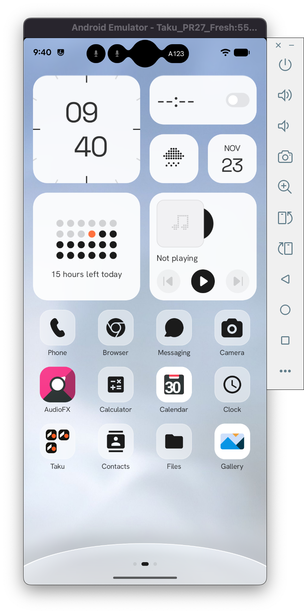</a> |

| 标准 Live Update 胶囊 | 标准 Live Update 展开 |
| --- | --- |
|  | <a href="images/14-live-update-card.png">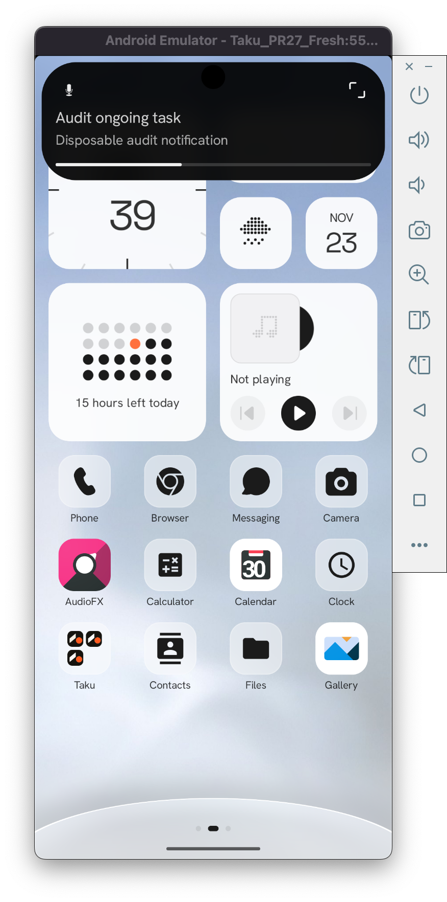</a> |

| 32 个按钮的展开卡片 | 按钮横向滚动 |
| --- | --- |
|  |  |

| 胶囊直接打开 App | 独立卡片操作进入 card-detail |
| --- | --- |
| <a href="images/66-capsule-opens-app.png">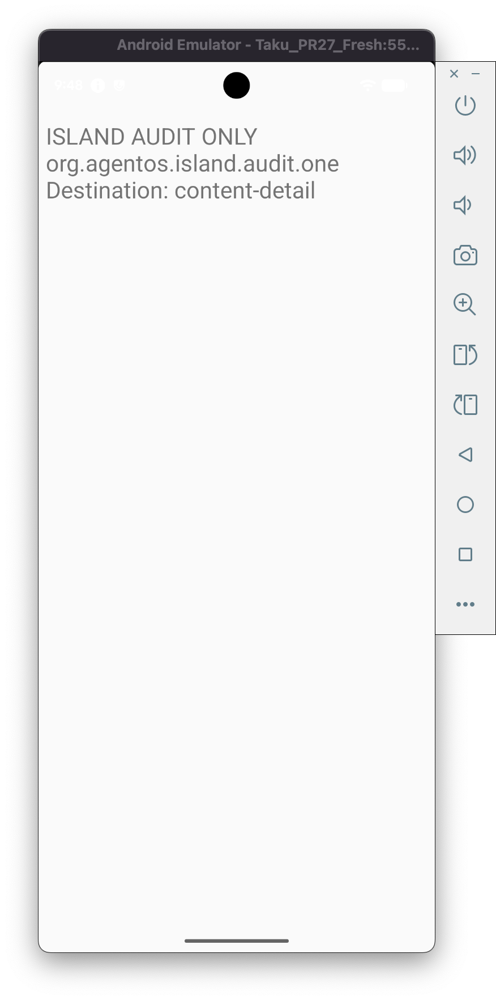</a> |  |

B · 原版 Agent 和账号连接流程

| 文字输入和键盘：圆孔保留 | 真实请求工作中 |
| --- | --- |
| <a href="images/30-agent-text-entry.png">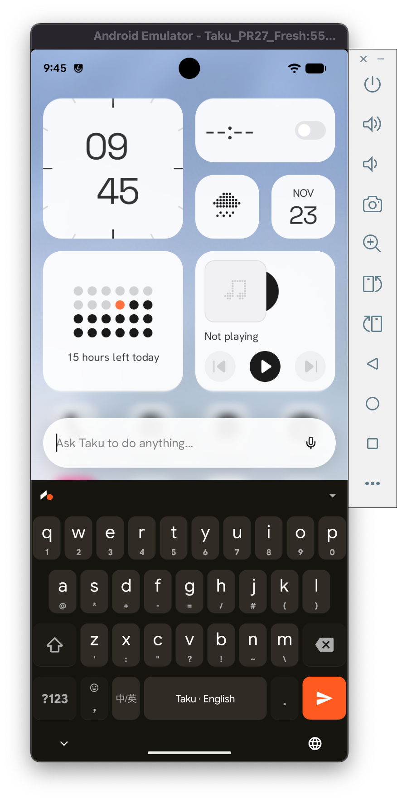</a> | <a href="images/31-agent-working.png">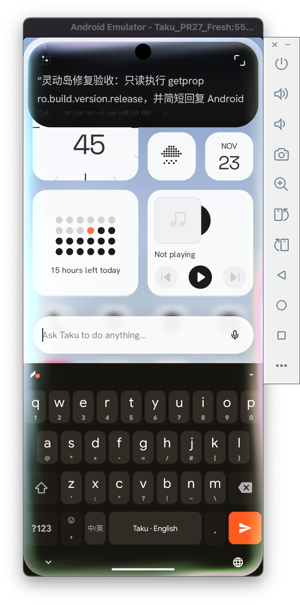</a> |

| 真实 Android 17 回复，卡片覆盖开孔 | 进入完整会话 |
| --- | --- |
| <a href="images/32-agent-reply.png">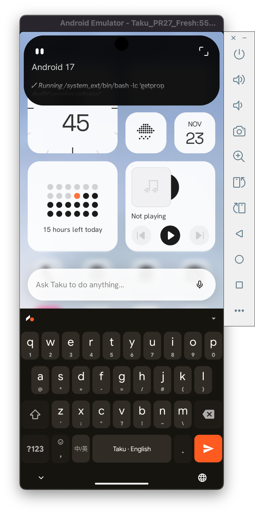</a> | <a href="images/33-agent-full-chat.png">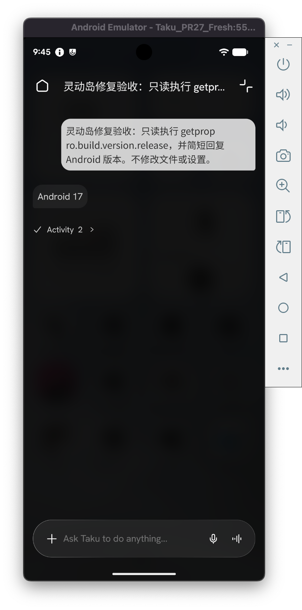</a> |

| 返回桌面 | 原有 fal 连接页面 |
| --- | --- |
| <a href="images/34-agent-home.png">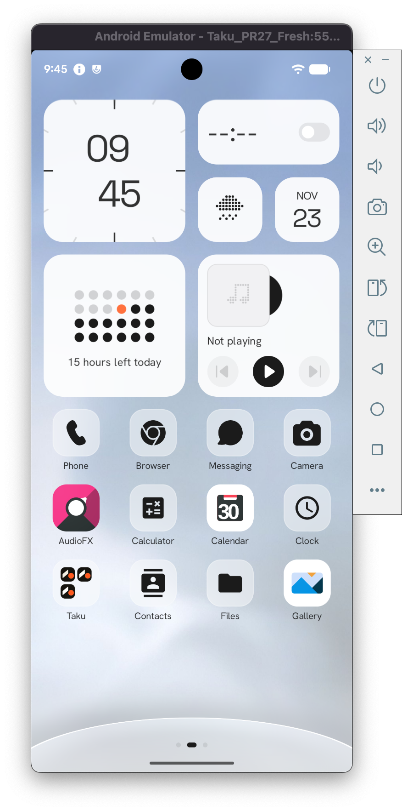</a> | <a href="images/35-fal-connected.png">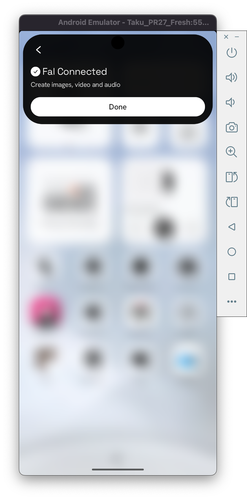</a> |

| 本地 Zipformer 聆听 | 真实任务的 Building 胶囊 |
| --- | --- |
| <a href="images/36-agent-listening.png">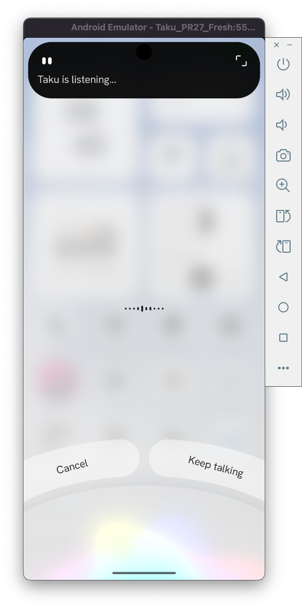</a> | <a href="images/37-real-building-home.png">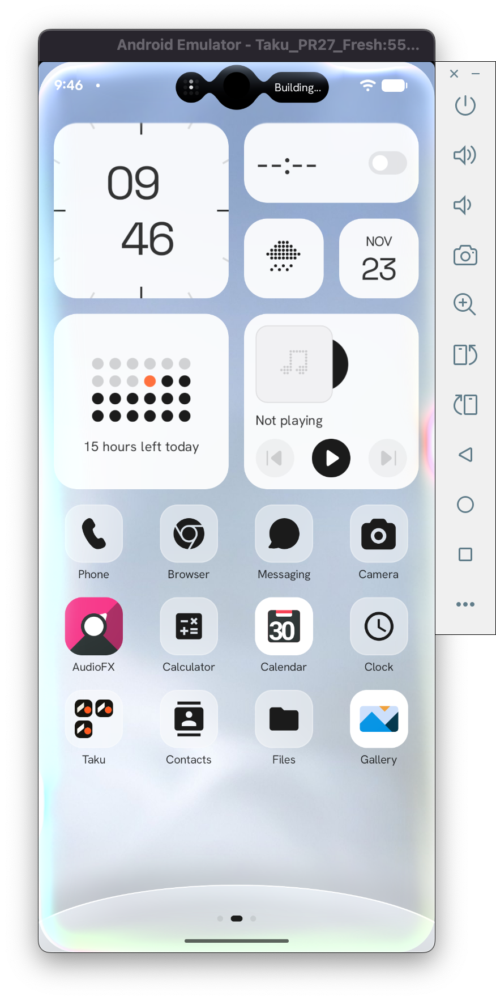</a> |

| 任务完成、退出构建状态 |
| --- |
|  |

C · 失败复现和显示边界

| 首次 alert 弹卡 | 用户/Agent 收起后 |
| --- | --- |
|  | <a href="images/52-alert-collapsed.png">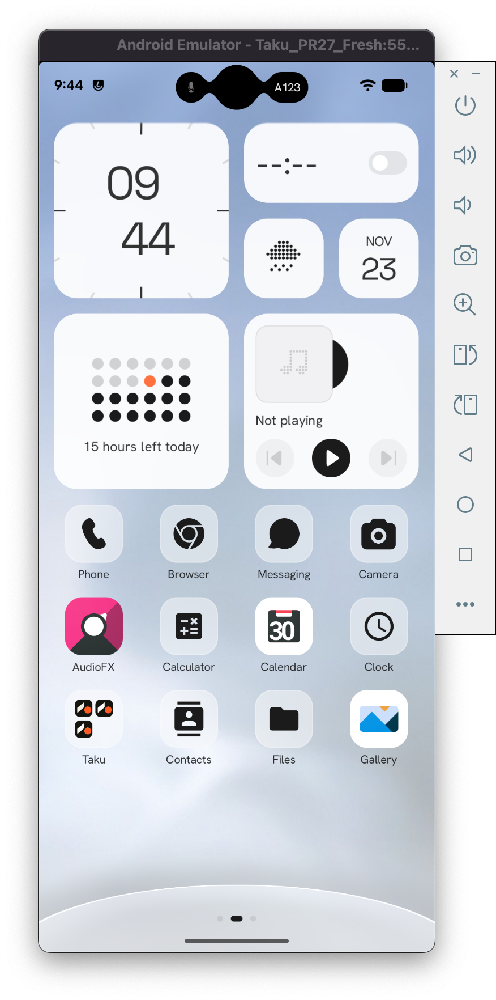</a> |

| 失败：alert=false 又弹出 | 仍可上岛：3 秒静态状态 |
| --- | --- |
|  |  |

| 系统模糊开启 | 关闭模糊后的实体背景 |
| --- | --- |
|  | <a href="images/41-blur-disabled.png">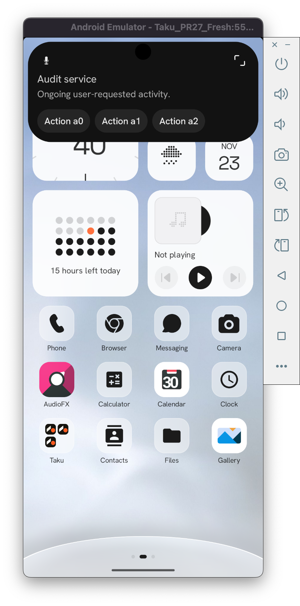</a> |

| 临时无开孔、矮状态栏缩放 | 清理完成，原开孔配置恢复 |
| --- | --- |
| <a href="images/45-short-statusbar.png">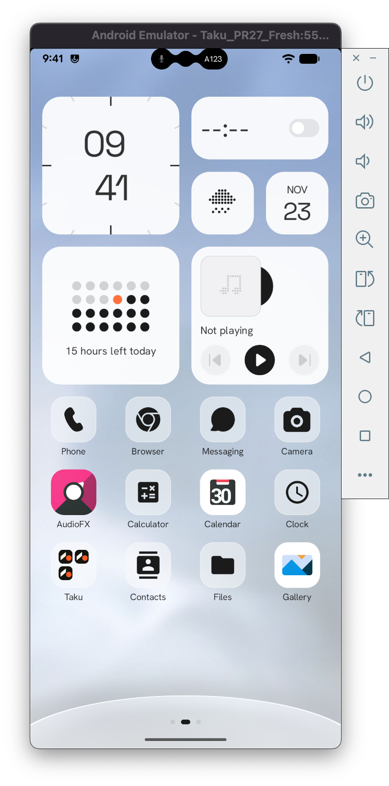</a> |  |

测试脚本的两处初始断言/时序问题也已复核：隐藏项不会留在活动列表中；点击卡片要等展开动画完成。更正依据分别见 12 的状态、68/69 的重测，未将它们误报为产品缺陷。
