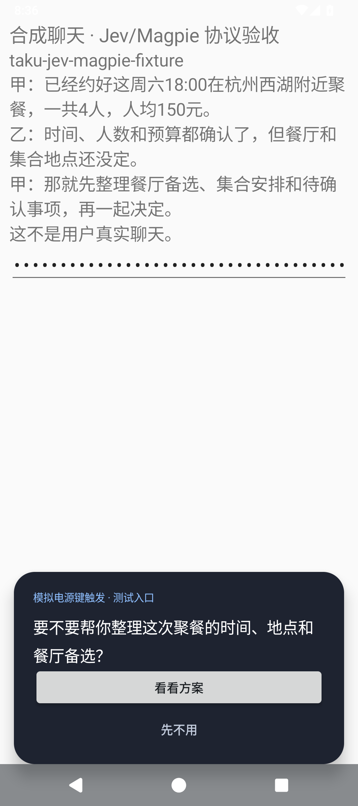
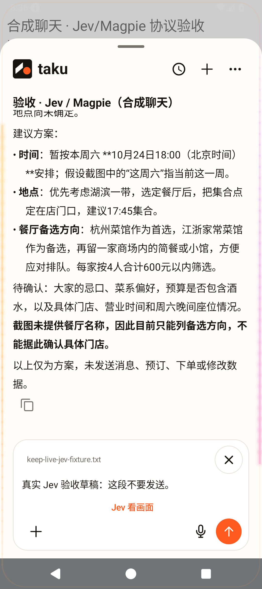

# Real Jev → phone Magpie → hint → original Agent

Date: 2026-10-21. Target: v57 `20261021-jev-magpie`; product APK/Broker use existing implementation in `987f4d9`. This round adds real-upstream acceptance and reproducible tests.

## Environment and boundaries

- Android 16 / API 36 / ARM64 development emulator `Taku_ImageIntegration_20261010`.
- Magpie 0.1.1290 and Codex 0.161.0 run inside Android. Jev uses local `/v1/systemone` with the existing OpenRouter provider upstream.
- Existing encrypted Jev credentials migrated through normal settings into Magpie and remain in Android private storage; repository, images, and acceptance output contain no keys, management links, or authentication caches.
- Main Agent retains the original ChatGPT account/connection and receives the original screenshot in a separate read-only conversation; no messages, bookings, orders, or actual business-service calls.
- The page is explicitly synthetic chat, with real upstream model replies. This does not establish real-private-chat, continuous screen monitoring, physical power-key, or complete business-flow acceptance.
- No physical-phone installation or full-ROM build/acceptance this round.

## Reproduction

Build/repository checks need JDK 17+ (JDK 21 and `JAVA_HOME` used this round). Reserve exclusive emulator UI time to avoid other tasks pausing the AVD or competing for focus. Preinstall v57 APK/Broker and pinned Magpie/Codex; reuse existing account/credentials without new login. Confirm migration through normal Jev settings and choose a model from the real catalog.

```sh
bash system/assistant/build-jev-magpie-tests.sh
adb -s emulator-5634 install --no-incremental -r out/jev-magpie-device-tests/fixture.apk
adb -s emulator-5634 push out/jev-magpie-device-tests/test.jar /data/local/tmp/taku-jev-live.jar
python3 scripts/test-jev-magpie-live.py --serial emulator-5634 --allow-live-model-calls
```

If an older synthetic fixture has another development signature, replace only `org.agentos.jevfixture`, never uninstall/clear assistant data. Driver permits only the specified development AVD and v57, requiring explicit real-model-call enablement. It starts no mock upstream or ADB reverse and reads no authentication caches/model keys; it incurs a small amount of real-model usage.

Tests check no Agent task before hint, no task from repeat triggers, exactly one completed task after acceptance, Agent reply containing dinner information from the screenshot, and preservation of original drafts/attachments. Cleanup restores original conversation/theme/screenshot settings, retains normally migrated Jev configuration, archives test conversations, and removes test attachments.

## Passed real chain

Final [structured record](acceptance.json) and [UI output](ui-test.txt) refer to the same task, turn, and Magpie route ID; model responses are not mocked.

| Check | Final result |
| --- | --- |
| Real decision | `typesafe/jev-1.14`, actually served `typesafe/jev-1.14-20261014`; OpenRouter HTTP 200 |
| Page classification | `chat` 0.99; `dining_plan` 0.85, retaining the existing 0.65 acceptance threshold |
| Local phone path | UID-restricted IPC → Android Magpie `/v1/systemone` → real upstream; route duration 2,470 ms |
| Hint | Trigger to visible suggestion 2,752 ms; no task before tap or from repeat triggers |
| Original Agent | Existing ChatGPT connection, `gpt-6.1-sol`; one completed task after acceptance, case duration 14,009 ms including test reads/UI checks |
| Screenshot content | Agent read Saturday 18:00, West Lake in Hangzhou, 4 people, CNY 150 each, and noted the restaurant remained undecided |
| Draft/recovery | Unsent draft/attachments retained; main connection unchanged; original conversation/theme/screenshot settings restored; test conversation archived |
| Hardware / ROM | Neither accepted; component runtime update, no cold-boot acceptance |

The catalog declared no image capability, so Jev used current Assist text while the original Agent received the screenshot. These inputs are recorded separately; real Jev text classification is not image-understanding acceptance. Device APK/Broker SHA-256 exactly matched original v57 artifacts at `987f4d9`; no production question, confidence threshold, or model result was changed to pass.





Original pretrigger page: [live-page-before-trigger.png](live-page-before-trigger.png). Raw receipts contain only model, decision, and latency; Magpie evidence uses an allowlist excluding provider-key IDs and management links. Full real replies remain in the structured record and do not imply restaurant searches, hours verification, or bookings occurred.

## Reliability fixes and earlier attempts

[Earlier attempts](diagnostics.json) are separate from final success: correct low-confidence rejection, one synthetic-text diagnostic, 429 from other decision models on the same service, and a failing run where Agent accurately recognized a startup screen. Thresholds were not lowered, suggestions not forced, and attempts not combined as passes.

Tests now wait for the chat page to appear/stabilize and explicitly match the actual provider-qualified Jev model ID rather than treating “Jev” in a provider name as model identity. Task enumeration skips only ended corrupt historical entries; unfinished abnormalities still error. Synthetic scenario adds time, area, party size, budget, and unresolved details while remaining clearly marked as an example.

Another conversation pausing the shared AVD interrupted settings startup; the final run completed after that session ended, without reboot or account cleanup. Product build, host regression, and repository checks each retain their scope and do not replace hardware/full-ROM acceptance.

[Host regression output](host-tests.txt) includes 41 gateway checks, 95 draft assertions, and 46 native-conversation assertions. After merging `592110c`, full `npm run verify` passed, including 21 system-surface lifecycle assertions. Existing Linux-only Ninja FIFO guard skipped on macOS.
