# 锁屏实机验收：9d0867a0（2026-11-25）

**结论：功能主路径已在 Android 17 ARM64 模拟器跑通，但本次验收不通过。确认 4 项交付／界面问题，另有 1 项验收脚本恢复问题。** 下面区分实际通过、明确缺陷和未覆盖项；不能将代码提交、类型检查或截图保存成功等同于设计验收通过。

## 版本与安装边界

- 分支：`vela/lock-screen`；验收代码：[`9d0867a0b25bfbb7ff1fa45380f4afdfc9effdec`](https://github.com/Taku-OS/taku-os/commit/9d0867a0b25bfbb7ff1fa45380f4afdfc9effdec)。
- 设备：当前打开的 `Taku_PR27_Fresh` / `emulator-5596`，Android 17、ARM64、1080×2424、420 dpi。
- 设计：[Figma 979:428](https://www.figma.com/design/MdImIDNqePpNZ62C0GLArW/Taku-Mobile-OS?node-id=979-428)，重点比对 979:429 和 979:574，并遵循本分支规格中已经确认的延期范围。
- 云构建：x86_64 主机，64 CPU / 256 GB，`lineage_taku_emu_arm64-cp2a-userdebug`，复用缓存，`m -j56 SystemUI TakuLockscreenSystemUIOverlay TakuLockscreenFrameworkOverlay`。没有在 Mac 编译 Android 代码。
- 安装：增量更新 SystemUI、两份 RRO 和字体。SystemUI APK 签名与原安装一致，安装后 SHA-256 为 `8b533b4b01930842c1f63322ca4dbce60622594278839dea8ca46c6f2fc37bb6`。
- **构建有临时集成处理**：原样构建先触发下述 LS-01。为继续验收，在临时云构建目录组合两份 Manifest 补丁；所有原生源文件与该 commit 一致，唯一额外组合项是保留已有 Island 条目后加入 `TakuShortcutAppActivity`。没有修改或推送产品分支代码。因此本报告不代表原始构建脚本已通过。
- 这是组件增量验收，保留了现有 Agent / Assistant / Broker 和模拟器数据，不是整机新镜像验收。字体和原 Broker 的运行时挂载会在重启后丢失，测试重启时由部署辅助脚本恢复；新镜像的默认壁纸属性及首次初始化默认值尚未验证。比对时临时设置了仓库设计壁纸。

构建／签名／安装记录见 [evidence/build-and-install.json](evidence/build-and-install.json)。

## 需要修复的问题

### LS-01 · P1：标准构建被两个补丁共享的 Manifest 阻断

**复现**：按 `image/emulator/build.sh`，先应用 Island 补丁，再执行 `apply-lockscreen-patches.py`。

**实际**：在 `/src/frameworks/base/packages/SystemUI/AndroidManifest.xml` 报 `ValueError: Unknown lock screen source bytes; preserving ...`，尚未进入本次模块编译。Island 已修改 Manifest，而锁屏 manifest 合同只接受自己的原始／最终 SHA，两者不再是文档所说的“互不相交文件”。单独的补丁测试没有覆盖这个顺序。

**预期／建议**：锁屏补丁以 Island 处理后的确定输入为基线，或采用共同的组合合同；同步更新生成器、hash 和文档，增加按实际构建顺序应用并重复校验的集成测试。不要简单移除 hash 校验。

入口：[构建顺序](https://github.com/Taku-OS/taku-os/blob/9d0867a0/image/emulator/build.sh#L42)、[失败的输入检查](https://github.com/Taku-OS/taku-os/blob/9d0867a0/image/apply-lockscreen-patches.py#L68)。[原始失败日志](evidence/original-build-failure.log)、[本次临时组合说明](evidence/integration-workaround.json)。

### LS-02 · P2：日期重复，未认证时还与状态栏文字重叠

**复现**：查看 PIN 锁定态，再查看无凭据的已认证锁屏态。

**实际**：Taku 日期之外还有一份原生 `Wed, Nov 25`。未认证时它跑到屏幕左上角，与 `Emergency calls only` 重叠；已认证时它出现在时钟与第一张卡片之间。重启后的首次锁屏也能看到。

**预期**：只显示设计稿中居中的日期。应让 Taku 时钟与原生 Smartspace／日期区域明确分工，同时保留其他时钟及无障碍行为。

排查入口：[保留所有 defaultBlueprint.sections](https://github.com/Taku-OS/taku-os/blob/9d0867a0/system/lockscreen/src/com/android/systemui/taku/lockscreen/TakuKeyguardBlueprint.kt#L40)、[Taku 自己添加日期](https://github.com/Taku-OS/taku-os/blob/9d0867a0/system/lockscreen/src/com/android/systemui/taku/lockscreen/TakuClockFaceView.kt#L23)。这是排查位置，未在本次验收中修改代码验证根因修复。

| 未认证锁屏：日期与状态栏重叠 | 已认证锁屏：多一行原生日期 |
| --- | --- |
| 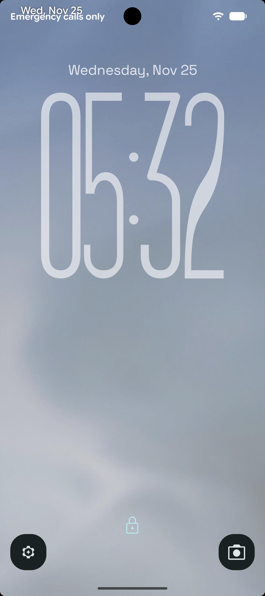 | 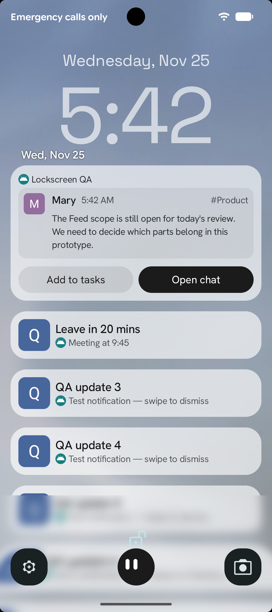 |

### LS-03 · P2：两侧快捷按钮配色／图标大小没有按设计落地

**实际**：两侧按钮使用深色底、浅色图标，图标仍采用原生视觉，需一并核对设计中的 24 dp 约束。设计和规格要求 56 dp 白色半透明圆形背景、深色 24 dp 图标；只有中央 Taku 按钮应该是深色。尺寸及位置的资源已生效，所以不能解释为覆盖包没有安装。

**预期／建议**：补齐快捷按钮背景、图标色和图标尺寸的状态样式，保留按住触发、按压反馈和激活态。

入口：[当前 RRO 只覆盖外部尺寸和位置](https://github.com/Taku-OS/taku-os/blob/9d0867a0/system/lockscreen/overlay/systemui/res/values/dimens.xml#L3)。

| 设计参考 | 本次 SystemUI 实测 |
| --- | --- |
| 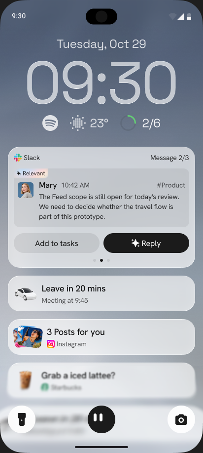 |  |

设计中的媒体、状态标签、AI Reply、Relevant 标签、分页等不计入本次缺陷；测试卡片使用普通 Notification.Action 按钮。

### LS-04 · P2：“打开应用”选择器的顶部应用被标题栏遮住

**复现**：系统 Wallpaper & style → Lock screen → Shortcuts → 长按 Open app。

**实际**：应用列表确实能打开，但从窗口顶部开始排布；`AudioFX` 被遮住，`Browser` 只露出部分图标，列表与 `Open app` 标题栏重叠。可见的项目可正常选择并保存。

**预期／建议**：正确处理 edge-to-edge / 状态栏 / ActionBar / 导航栏 inset，使首尾项目完整可见、可点击，不要只修改列表背景。

入口：[TakuShortcutAppActivity.onCreate](https://github.com/Taku-OS/taku-os/blob/9d0867a0/system/lockscreen/src/com/android/systemui/taku/lockscreen/TakuShortcutAppActivity.kt#L28)。

| 快捷方式入口 | 长按后的应用选择器 |
| --- | --- |
| 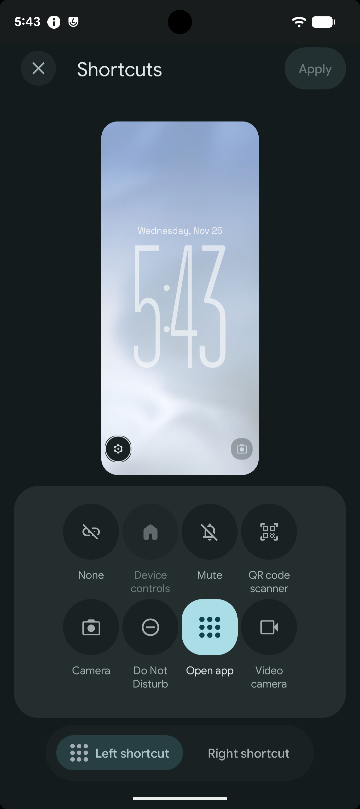 | 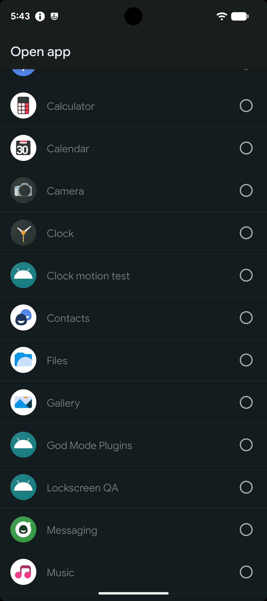 |

### LS-05 · P2（验收工具）：脚本不能恢复当前不可用的原快捷方式，而且不报告失败

**复现**：测试前 `bottom_start=[home]`、`bottom_end=[]`；`home` 在当前设备上为 disabled。运行分支自带 `acceptance.py`，它先把左侧切到 Open app。

**实际**：`finally` 调用 `shortcuts set bottom_start home`，得到 `SHORTCUT_UNAVAILABLE`，但没有检查返回值；左侧仍是测试用 Open app。因此“恢复所有设置”的承诺不成立。该问题与“设备原本的默认值不匹配”是两件事。

**预期／建议**：测试前确认原选择可恢复；不能恢复的用例应跳过或使用经过验证的完整快照／恢复机制。恢复后必须读回比对并报告失败，不能静默留下测试设置。

入口：[脚本 shortcuts_suite 的 finally](https://github.com/Taku-OS/taku-os/blob/9d0867a0/system/lockscreen/device-tests/acceptance.py#L108)、[拒绝 unavailable 的命令路径](https://github.com/Taku-OS/taku-os/blob/9d0867a0/system/lockscreen/src/com/android/systemui/taku/lockscreen/TakuLockscreenShortcuts.kt#L62)。[实际返回值](evidence/restore-unavailable-shortcut.json)。

## 已完成的功能验收

| 流程 | 实测结果与边界 |
| --- | --- |
| 重启首次解锁 | 临时 PIN 重启后显示高版时钟，通知为空，Taku 操作返回 LOCKED；正确 PIN 后进入 Taku Home。原脚本记录从提交 PIN 到检测到 Home 顶层 Activity 为 0.32 秒，不是开机总时长。 |
| PIN／密码／图案 | 三种方式的错误输入均被拒绝；正确输入均退出锁屏。 |
| PIN 错误次数限制 | 出现 60 秒重试倒计时，按键禁用；等待结束后正确 PIN 可解锁。 |
| 模拟指纹 | 录入临时虚拟指纹；未登记指纹被拒绝，已登记指纹直接进入 Home。HAL 记录 accept=1、reject=1；测试后删除临时指纹。不能替代真实传感器验证。 |
| 未认证的数据隔离 | 锁屏不显示通知卡片／Taku 按钮，命令返回空通知及 LOCKED。 |
| 已认证锁屏 | 无凭据的 swipe lock 显示紧凑时钟、展开卡片、普通卡片和 Taku 按钮；这是 UI 渲染覆盖，不是人脸验证成功路径。 |
| 通知点击／动作 | 点击普通卡片进入 `Leave in 20 mins` 测试目的页；点击 Open chat 按钮进入对应动作页。 |
| 滚动／清除 | 卡片列表可纵向滚动，保持在锁屏；横滑 QA update 5 后 GUI 和命令列表都移除该通知，数量 9→8。 |
| Taku 按钮 | 点击后退出锁屏，打开 Taku Home 的输入入口；没有发出 AI 请求。 |
| “打开应用” | 从系统 picker 长按进入选择器，选择 Settings；secure setting 与 Agent 命令读回一致。无凭据时直接启动；有 PIN 时先要求验证，再进入 Settings。 |
| 系统通知栏 | 前台应用内下拉原生通知栏，测试通知正常显示；锁屏下拉能进入原生 QS，半展开通知层的完整展示尚未确认。 |
| 时钟选择 | 切换 DEFAULT 后原生时钟正常出现，Taku 设置原值已恢复；不将切换中的过渡帧作为设计验收结论。 |
| 相机快捷方式 | 在 PIN 锁定态打开受限相机，图库保持锁定，没有解锁手机；只查看模拟器虚拟场景，没有拍照。 |
| 无效参数／第三方隔离 | 无效 slot、shortcut、组件、通知 key、action 均按脚本返回相应错误；普通测试 App UID 10206 调用 lockscreen 命令被 STATUS_BAR 权限拒绝。 |

原分支脚本为 **28/30**，包含截图保存和计时记录项，不是 28 项视觉通过。两项失败是默认左侧／右侧选择与脚本假定不符：当前用户为 `home`／空，而 RRO 查询的默认值已是 flashlight／camera。该结果不能替代全新镜像首启默认值验证。手电筒控制器在本模拟器上为 `mCameraId=null, mTorchAvailable=false`，未验证真实开灯。

## 对应流程截图

以下通知均来自本地 `Lockscreen QA` 测试 App，不是真实 Slack 消息。正式附图使用模拟器显示截图，包含单个摄像头开孔；安全输入界面的普通 adb 截图会变黑，本报告没有采用这些黑屏文件。

通知：卡片点击、按钮动作、列表滚动与横滑清除

| 点击普通卡片 | 点击 Open chat 按钮 |
| --- | --- |
| 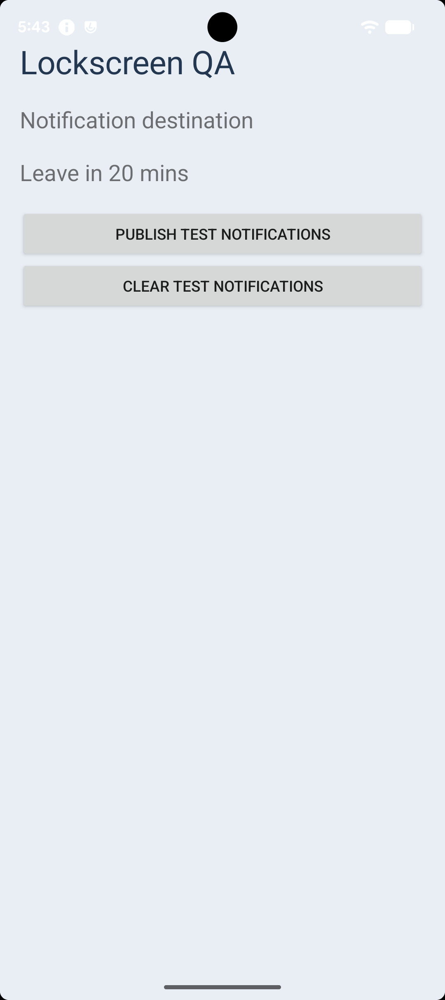 | 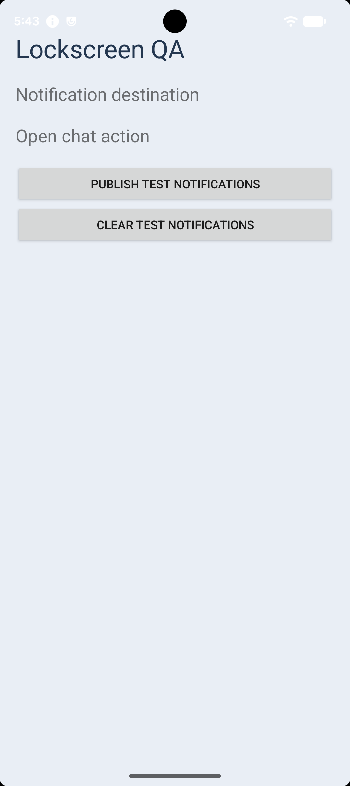 |

| 列表滚动后 | 横滑移除 QA update 5 后 |
| --- | --- |
| 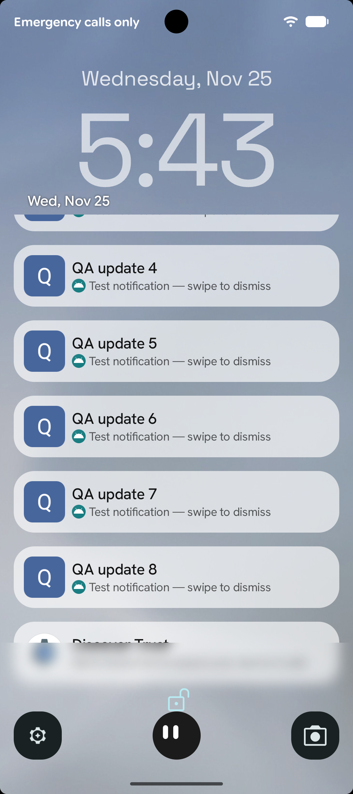 | 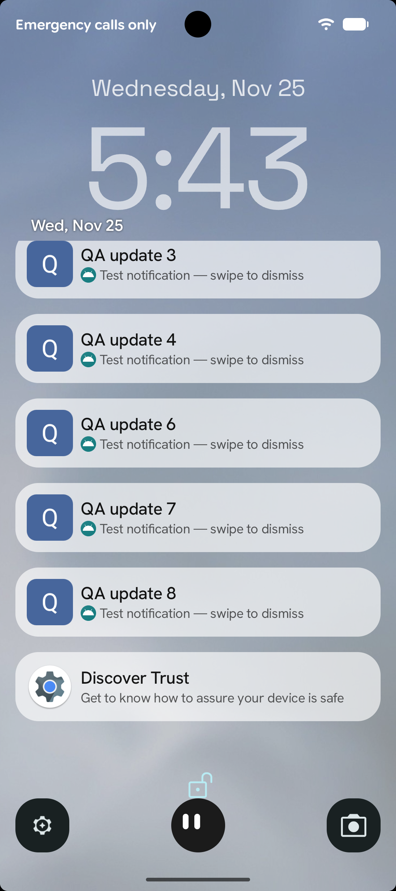 |

验证：错误 PIN／密码／图案、PIN 锁定与恢复、指纹

| 错误 PIN | 错误密码 | 错误图案 |
| --- | --- | --- |
| 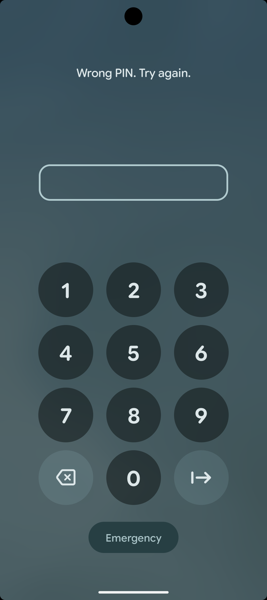 | 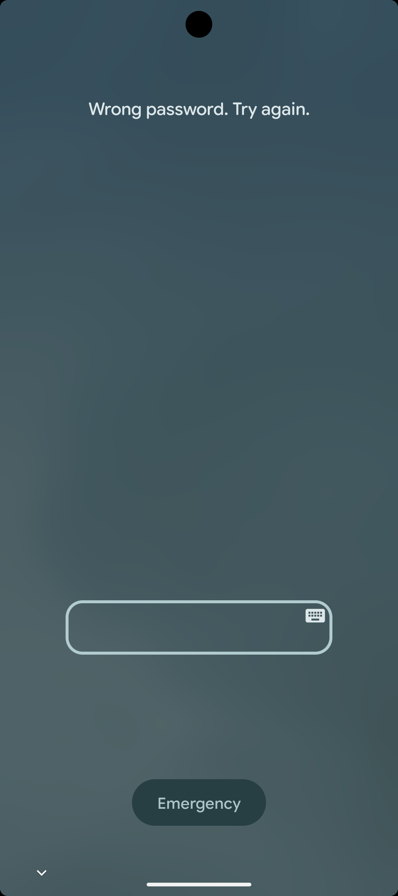 | 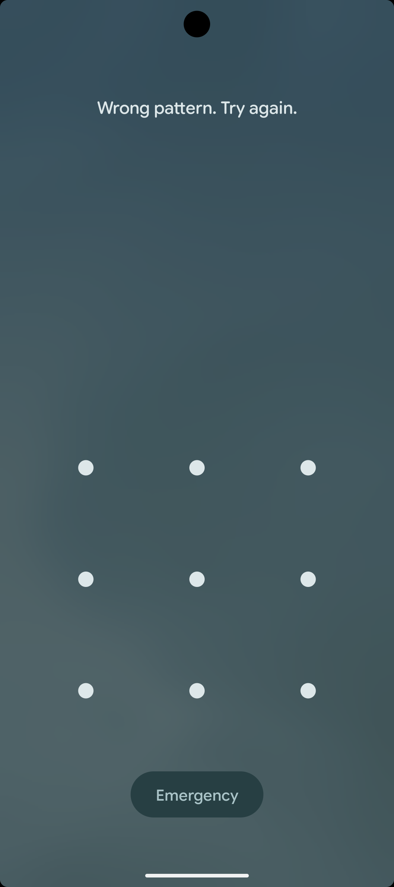 |

| PIN 重试限制 | 等待结束后解锁 |
| --- | --- |
| 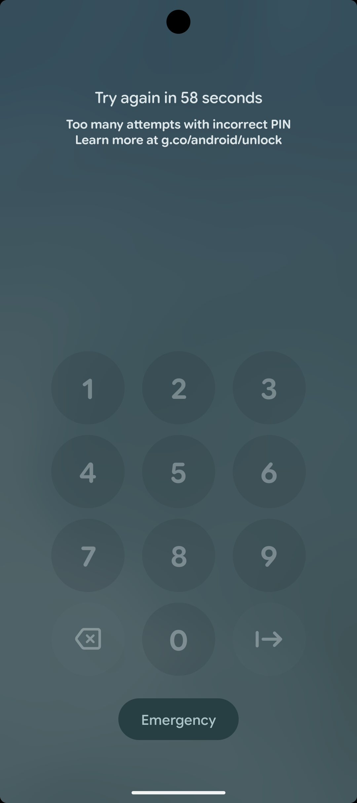 | 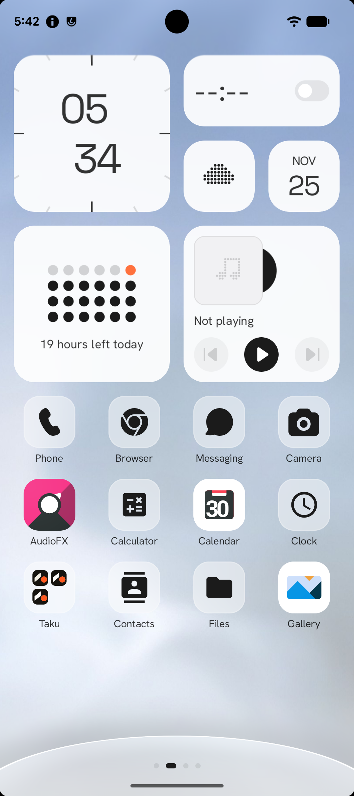 |

| 未登记指纹被拒绝 | 已登记虚拟指纹进入 Home |
| --- | --- |
| 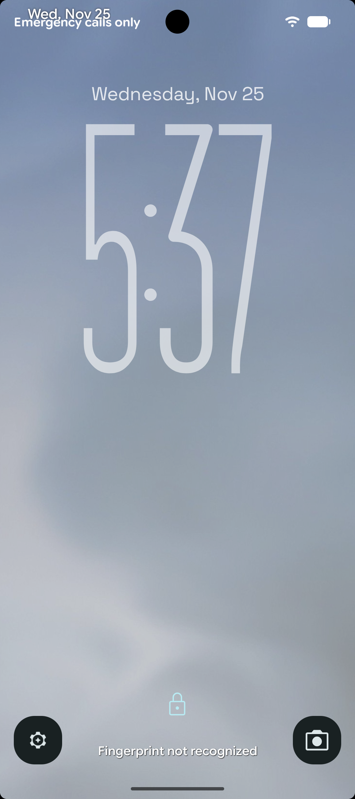 | 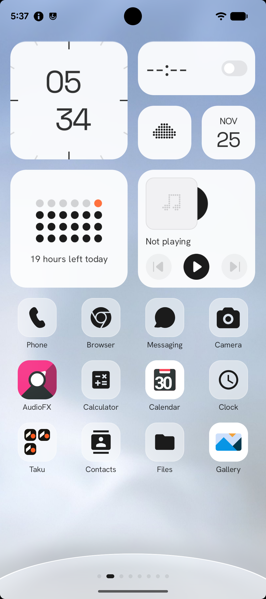 |

快捷方式、相机与 Taku 输入入口

| 应用快捷方式要求 PIN | 验证后进入 Settings |
| --- | --- |
| 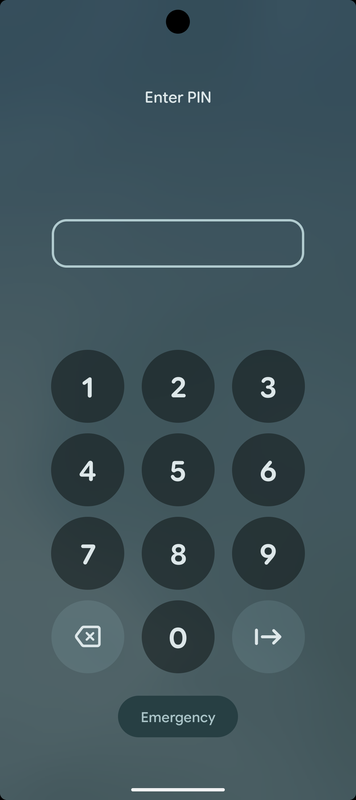 | 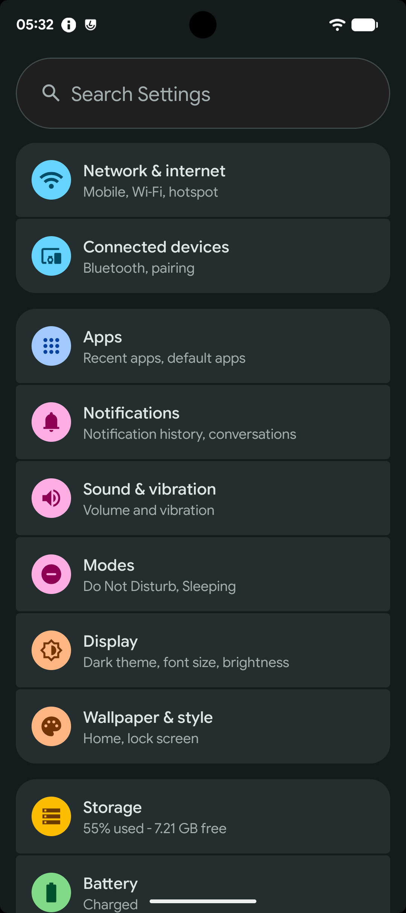 |

| 锁定态的受限相机（虚拟场景） | Taku 按钮打开输入入口 |
| --- | --- |
|  | 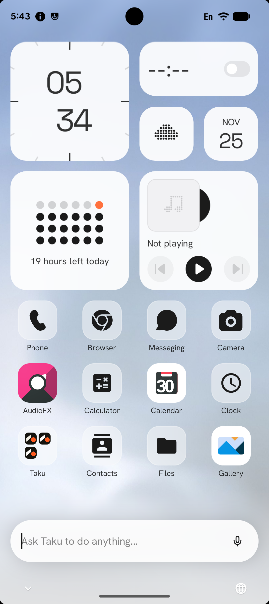 |

系统通知栏与时钟选择

| 前台应用的原生通知栏 | 锁屏下拉原生 QS | 切换 Android 原生时钟 |
| --- | --- | --- |
| 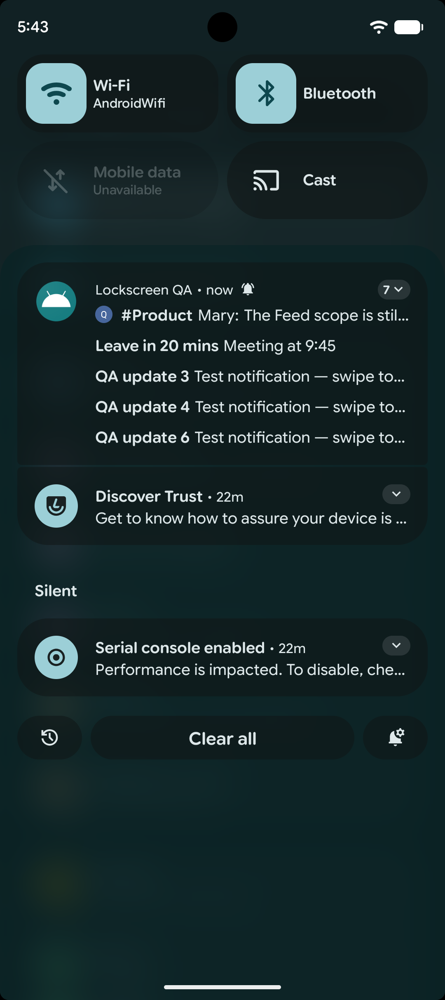 | 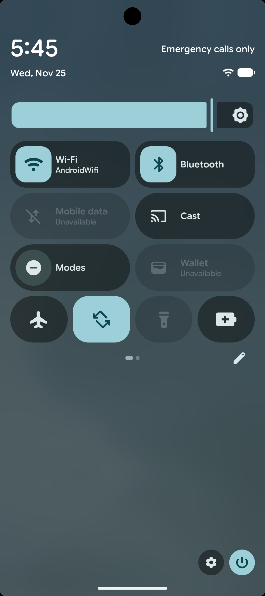 | 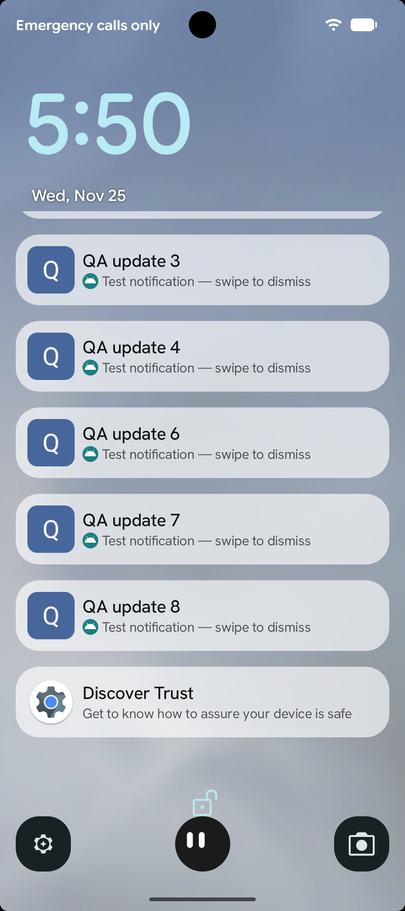 |

## 尚不能认定通过的范围

- 人脸硬件不在本模拟器上：人脸成功后留在锁屏、真实认证触发的完整 720/1050 ms 时钟形变、失败提示和传感器行为，需要真机复测。静态大／小时钟截图不等于动画验收。
- 新增 1、2、4、5、6、7、8 的拉伸字形仍需设计确认；本次没有穷举 1,440 个时间的 SystemUI 运行画面。
- Pixel 9 屏下指纹位置、真实手电筒、真实人脸与指纹硬件；无屏下指纹时锁图标在 Taku 上方属于已说明布局，不列为新增缺陷。
- 本机长按锁屏空白区未出现 Customize；通过系统 Wallpaper & style 页面可以配置快捷方式。锁屏长按入口是否受系统特性开关／触摸路由影响仍需确认，不能用选择器单独启动成功代替入口验收。
- 全新 ROM 的默认壁纸属性、首次初始化快捷方式、人脸默认不跳过锁屏；本次未刷完整 ROM。
- 通知启动动画的起点与设计的逐帧一致性尚未做测量；本次只确认目标页面和锁屏状态正确。
- 已延期的媒体、状态标签、AI 卡片功能、锁屏灵动岛不计入本次缺陷。

## 收尾与证据

已通过原生 CustomizationProvider 恢复测试前的 `bottom_start=[home]`、`bottom_end=[]`（用来补救 LS-05），读回一致。临时 PIN／密码／图案及虚拟指纹已清除；原来的无凭据、锁屏 disabled 状态、时钟选择、12/24 小时制、打开应用目标及壁纸继承关系均已恢复。只清理测试通知，未清空用户数据或账号。新 SystemUI／RRO 和运行时字体仍保留安装，QA App 保留用于复现。云构建机已确认无其他构建后停止，状态为 **TERMINATED**，源码与缓存保留。

- [自动脚本原始结果](evidence/automated-report.json)
- [PIN／密码／图案检查](evidence/authentication-report.json)
- [截图对应的状态与通知数据](evidence/screenshot-states.json)
- [第三方权限拒绝](evidence/third-party-access.txt)
- [GUI 选项与命令读回](evidence/gui-shortcut-setting.txt)
- [清理与恢复核对](evidence/cleanup.json)

截图说明：Home 页截图只用来证明解锁／启动目的地，不作为锁屏视觉通过的证据；原有桌面时钟、输入法等其他模块没有在本报告中归因给锁屏改动。
