# Issue #56 复验：bc18eca1 · 2026-11-25

**结论：5 项修复中，LS-01、LS-03、LS-04、LS-05 通过本轮复验；LS-02 仍未修复，Issue #56 保持打开。** 重复日期在高版和紧凑版锁屏都能稳定复现，高版仍与运营商文字重叠。

## 版本和部署

- 分支 `vela/lock-screen`，提交 [`bc18eca15e73abd19a70f8840706a77e11d34ab5`](https://github.com/Taku-OS/taku-os/commit/bc18eca15e73abd19a70f8840706a77e11d34ab5)。验收期间没有修改产品源码。
- 当前模拟器 `Taku_PR27_Fresh` / `emulator-5596`，Android 17 ARM64，1080×2424、420 dpi。
- Mac 发起云构建，云端 x86_64 / 64 CPU，使用缓存、`-j56` 编译 `SystemUI`、`TakuLockscreenSystemUIOverlay`、`TakuLockscreenFrameworkOverlay`；目标 `lineage_taku_emu_arm64-cp2a-userdebug`。构建用时 **10 分 14 秒**，退出码 0；没有在 Mac 编译 Android 代码。
- **本轮使用提交中的标准补丁脚本，没有上轮的 Manifest 临时组合处理。** 已在实际源码上验证 Island → lock screen 的首次应用、重复应用和两者的 `--verify-only`。
- 三份 APK 均通过平台签名校验。安装后及测试清理后读回的 SystemUI SHA-256 均为 `b57e14077f77f669d035811f1407cfc58e73b1cbac5f8561fd61bfb1c60c4bfa`。
- 这是保留数据的组件增量安装，不是全新 ROM 首启验收。字体及原有 Broker 使用既有运行时挂载方式，测试重启后恢复；没有升级 Agent / Broker，也没有清空账号和数据。

[构建、签名及安装证据](evidence/build-and-install.json)

## 逐项结论

| 项目 | 结论 | 实际验证 |
| --- | --- | --- |
| LS-01 · Manifest 冲突阻断构建 | **通过** | 标准脚本顺序应用、重复应用及恢复构建校验均通过，实际 SystemUI 和两份 RRO 编译成功。未做整套新 ROM 构建。 |
| LS-02 · 日期重复／与状态栏重叠 | **未通过** | Taku 日期之外仍显示 `Wed, Nov 25`。高版左上角与 `Emergency calls only` 重叠；紧凑版出现在时钟下方。切换原生时钟后再切回 Taku 仍复现。 |
| LS-03 · 快捷按钮样式 | **通过** | 实际锁屏的 Open app 和 Camera 已显示白底、深色图标；设备资源读回 56 dp × 56 dp、内边距 16 dp，对应 24 dp 图标区域。真实手电筒及激活配色本模拟器未覆盖。 |
| LS-04 · 应用选择器首行被标题遮住 | **通过** | 从系统 Wallpaper & style → Lock screen → Shortcuts 长按 Open app 进入；AudioFX 首行完整可见，滚动到底部后末项 Taku 输入法完整可见，两者均可选择保存；选择 Settings 后实际快捷方式正常启动 Settings。 |
| LS-05 · 验收脚本无法恢复不可用快捷方式 | **通过（本问题范围）** | 原始 `bottom_start=[home]` 不可用时，4 个选择相关检查明确跳过，原配置未被覆盖。另用可恢复的 Open app / Camera 配置执行，12/12 检查通过，选择和目标均读回恢复一致。完整脚本另有首次解锁超时，见下文。 |

[按钮运行时资源](evidence/shortcut-resources.json) · [可恢复配置的脚本结果](evidence/restorable-suite.json)

## LS-02：遗漏了本机实际使用的 KeyguardSliceView

复现步骤：

1. 使用 Taku 时钟，无凭据的 swipe lock 显示紧凑时钟，可见第二份原生日期。
2. 设置测试 PIN、重启，返回高版锁屏，可见左上角原生日期与运营商文字重叠。
3. 切换 `DEFAULT` 原生时钟后再切回 Taku，第二份日期仍存在。

实际视图树确认，第二份日期来自 **`com.android.keyguard.KeyguardSliceView` / `keyguard_slice_view`**。紧凑态其边界为 `84,571–1080,651`，高版锁定态为 `84,0–1080,80`，状态均为可见。

本次新增的 [`TakuStockDateSection`](https://github.com/Taku-OS/taku-os/blob/bc18eca15e73abd19a70f8840706a77e11d34ab5/system/lockscreen/src/com/android/systemui/taku/lockscreen/TakuKeyguardBlueprint.kt#L114) 只处理四个 Smartspace 日期／天气 ID，没有覆盖这个旧版 Slice 路径。因此不是旧 APK 没安装，也不是仅出现在时钟切换瞬间。

**需要继续修复**：Taku 时钟选中时同时处理实际启用的 Slice 和 Smartspace 日期路径；切换其他时钟时保留原生日期。高版时钟仍能看出约 18 dp 的额外下移，不能认定作者提到的 burn-in 位移修复已通过。高版仍有可见的 Slice 位于 y=0，建议连同该位移一起复核；本轮未修改源码验证其因果关系。

| 高版：重复日期与运营商重叠 | 紧凑版：时钟下仍有第二份日期 |
| --- | --- |
| 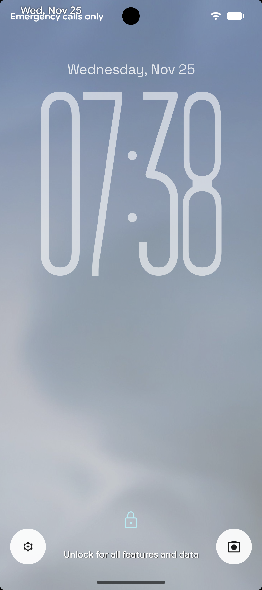 | 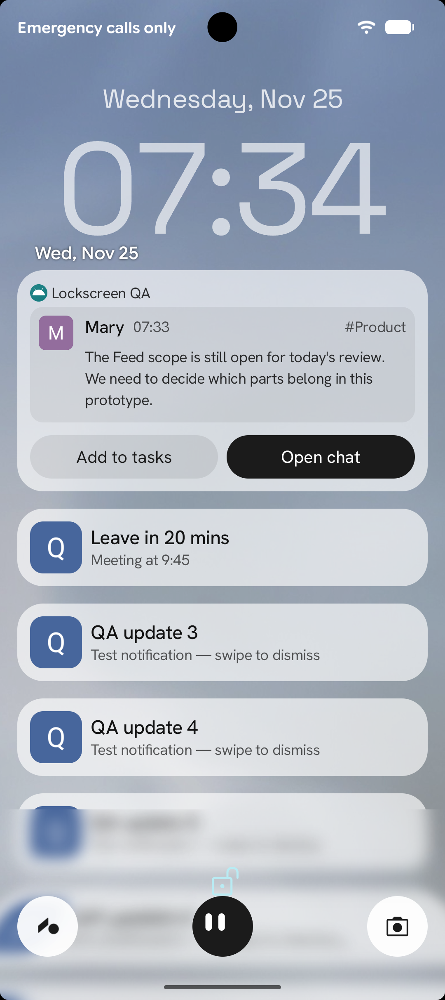 |

[最小化视图诊断证据](evidence/duplicate-date-diagnosis.json)

## 设计比对和已通过的界面修复

设计来源：[Figma 979:428](https://www.figma.com/design/MdImIDNqePpNZ62C0GLArW/Taku-Mobile-OS?node-id=979-428)，本轮重新读取 979:429 / 979:574。

| 高版设计参考 | 已认证设计参考 | 本次实际紧凑锁屏 |
| --- | --- | --- |
| 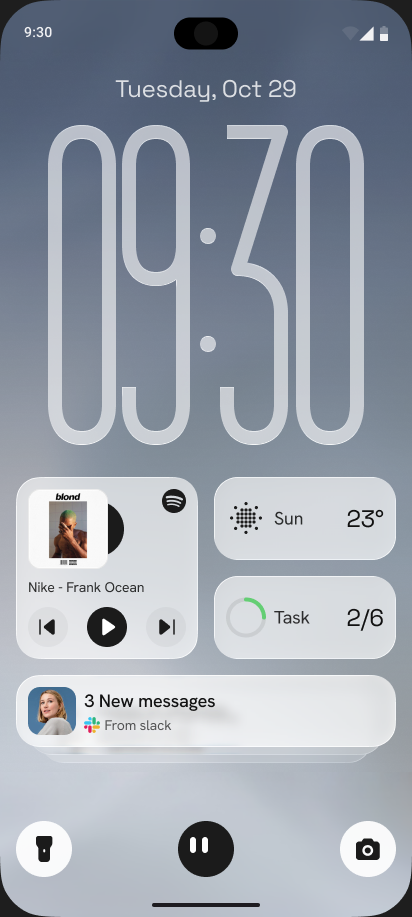 | 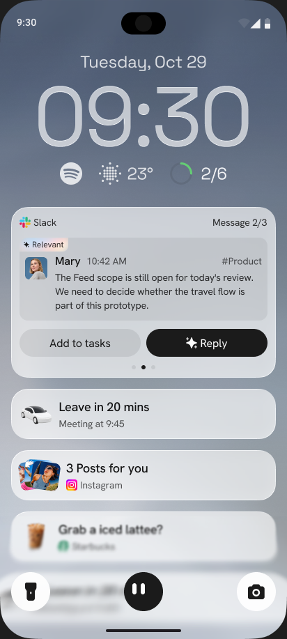 |  |

- 两侧按钮的白底深色图标已落地，中央 Taku 按钮保留深色。
- 普通卡片的 `Meeting at 9:45` 前已没有多余应用小图标，图片圆角也已更新。
- 日期问题仍失败；不能把以上局部样式通过写成整体完全符合 Figma。
- 测试通知来自本地 **Lockscreen QA**，不是实际 Slack 消息。摄像头开孔是当前模拟器的真实显示配置，只有一个开孔。

| 系统快捷方式配置入口 | 选择器首行 | 选择器末行 |
| --- | --- | --- |
| 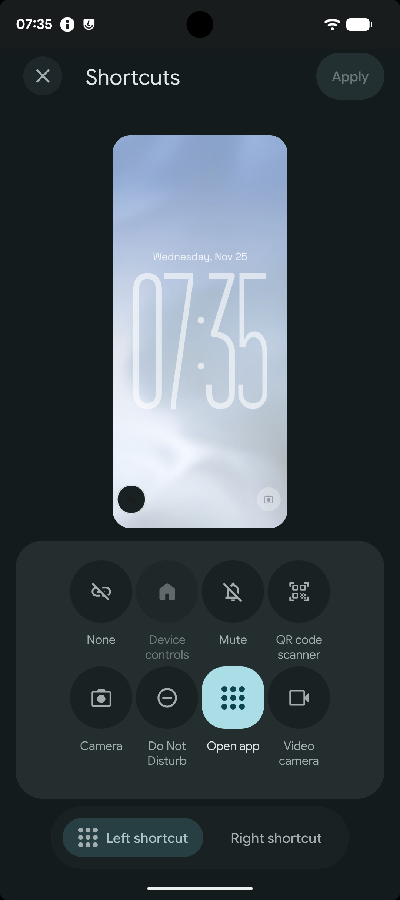 | 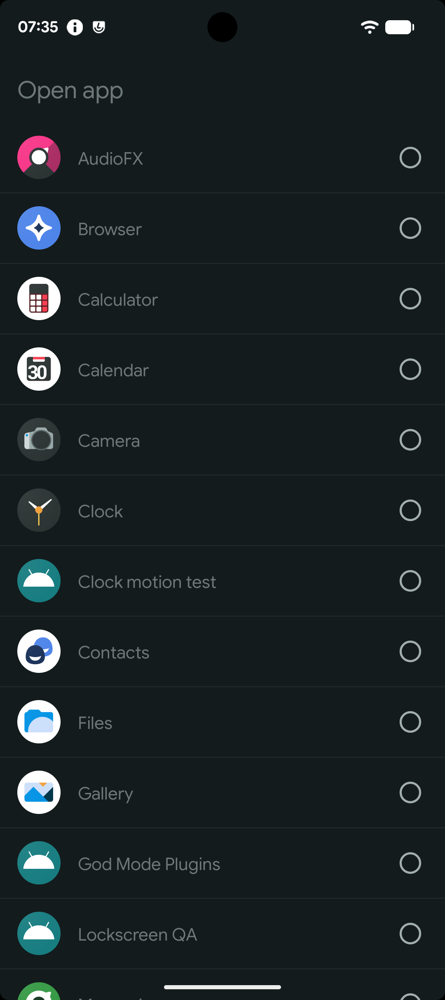 | 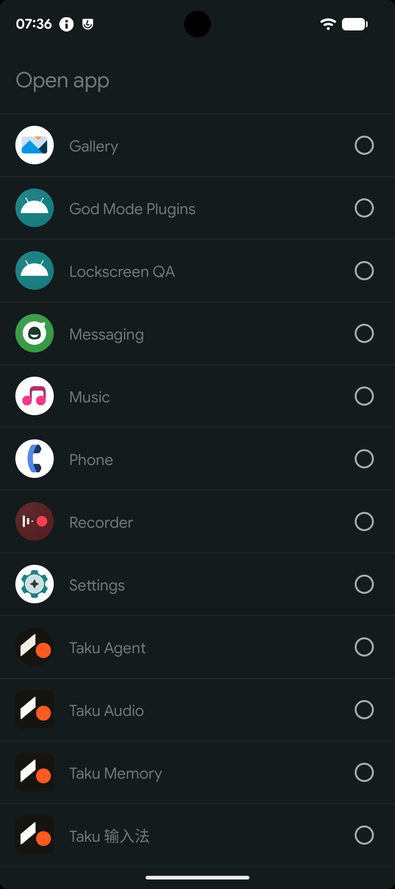 |

首项选择后命令读回 AudioFX；末项选择后读回 Taku 输入法；再选择 Settings，secure setting 与 `cmd statusbar lockscreen shortcuts app` 读回一致，锁屏长按快捷方式后实际进入 Settings。

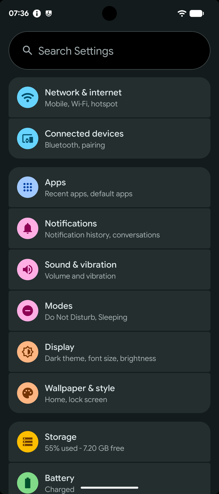

## 解锁和功能回归

分支脚本本轮结果是 **21/22 个执行检查通过、4 个跳过**。唯一失败是 `first unlock lands on Taku Home`：自动输入后 20 秒内未取得顶层 Activity，不能写成全绿。截图保存和耗时记录没有再计入通过数。

随后单独重新设置临时 PIN、重启，唤醒并观察真实 PIN 界面，通过屏幕数字按钮输入后，**实际退出锁屏并进入 Taku Home**；锁定时通知列表为空，Taku 命令返回 `LOCKED`。临时 PIN 已清除。自动用例的显示就绪／输入时序仍需排查，手动通过不覆盖其失败记录。重启早期得到的黑屏截图没有发布。

验收适配只负责重启后恢复增量部署的挂载、捕获模拟器显示以及最终设置清理，未修改分支脚本的判定条件。

[完整脚本结果](evidence/automated-report.json) · [手动首次解锁证据](evidence/manual-first-unlock-result.json)

| 重启后的 PIN 界面 | 正确 PIN 后进入 Taku Home |
| --- | --- |
| 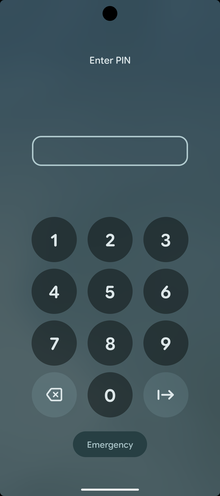 | 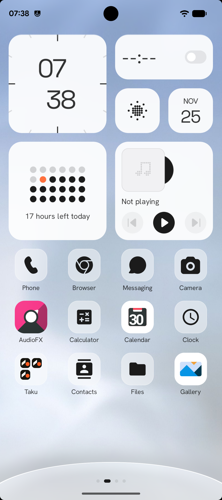 |

其他本轮回归结果：

| 流程 | 结果 |
| --- | --- |
| 通知按钮 | Open chat 按钮进入 `Open chat action` 测试目的页。 |
| 通知卡片 | 点击 `Leave in 20 mins` 卡片进入其对应目的页。 |
| 纵向滚动／横滑删除 | 列表正常滚动；横滑移除 QA update 5，命令列表同步由 9 条变 8 条。 |
| Taku 按钮 | 进入 Taku Home 输入栏，Taku 输入法正常显示；未发送 AI 请求。 |
| 时钟切换 | `DEFAULT` 原生时钟和原生日期可用；切回 Taku 后重复日期仍复现。 |

[功能读回证据](evidence/functional-checks.json)

通知、输入入口和时钟切换截图

| 点击按钮后的页面 | 点击卡片后的页面 |
| --- | --- |
| 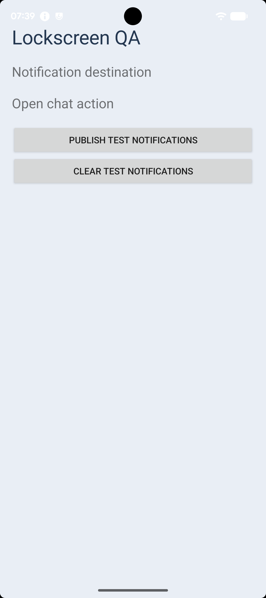 | 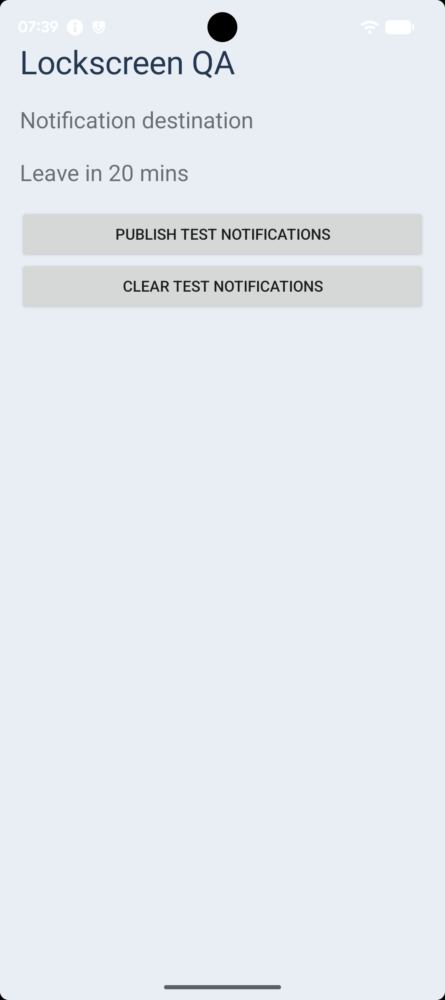 |

| 滚动列表 | 删除 QA update 5 后 |
| --- | --- |
| 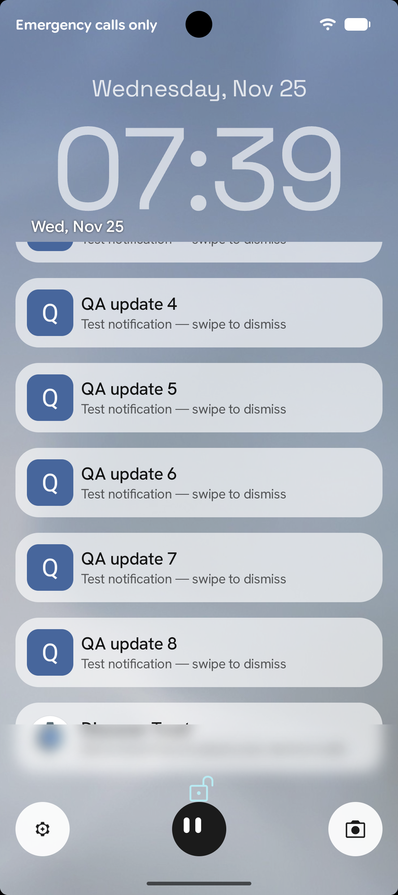 | 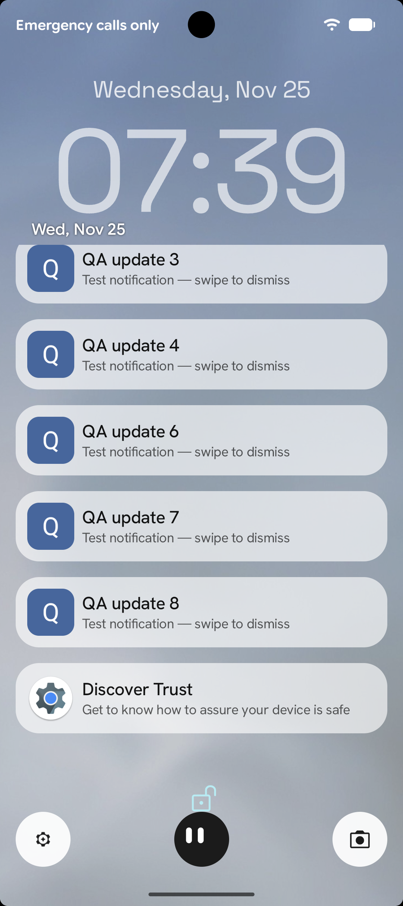 |

| Taku 输入入口 | 原生时钟 | 切回 Taku 时钟 |
| --- | --- | --- |
| 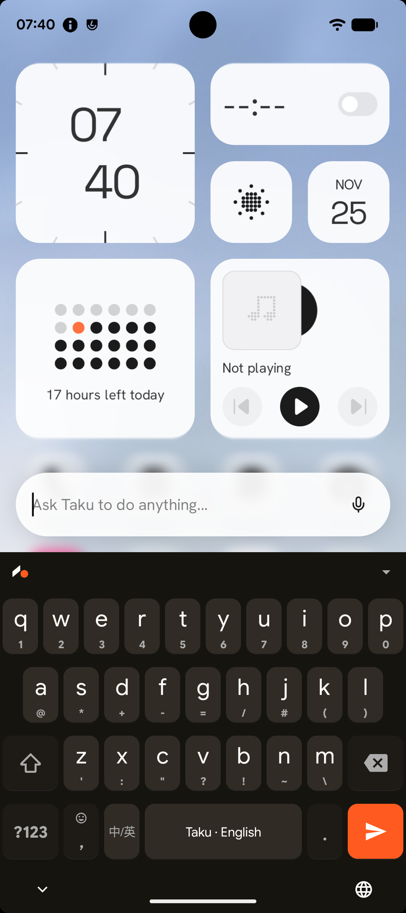 | 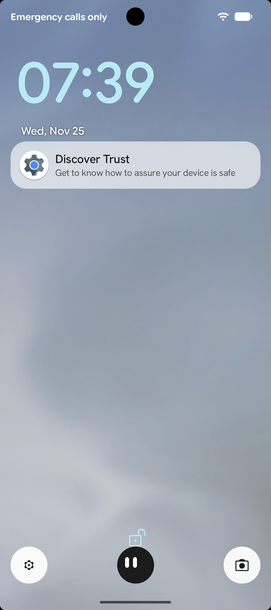 | 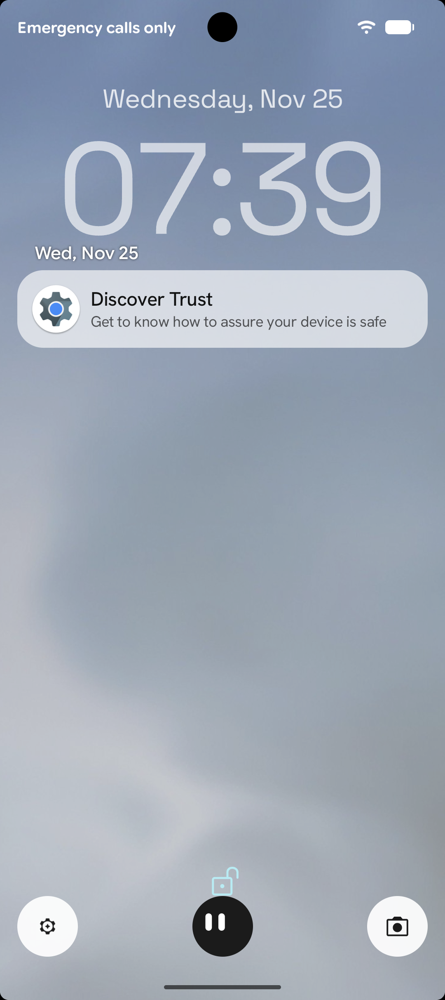 |

## 边界和清理

- 本轮针对 #56 的修复及相关回归；没有重跑上轮完整的密码、图案、锁定倒计时及虚拟指纹矩阵。模拟器没有可用的人脸认证路径，不能代替真实人脸／指纹设备验证。
- 手电筒实际开关、七个派生时钟数字的设计签字、全新 ROM 默认壁纸及首启初始化仍未覆盖。
- 已约定延期的媒体卡、状态标签、AI 建议／回复、锁屏灵动岛及指纹位置，不作为本轮未修复项。
- 原 `home`／空快捷方式、默认 Open app 目标、时钟选择、时间格式、壁纸继承、无 PIN 和禁用锁屏状态均已恢复；Home role 与 Taku 输入法保持原值。仅清理测试通知，未删除用户数据。
- 新 SystemUI／覆盖包保留安装。云构建机已确认无其他任务后停止，状态 **TERMINATED**，源码与缓存保留。

[设置恢复读回](evidence/restoration.json) · [截图哈希和对应状态](evidence/screenshots.json)

**后续：补齐 LS-02 的 Slice 日期路径，再跑高版／紧凑版及其他时钟切换复验；本轮不关闭 #56。**
