# PR #49 emulator acceptance — 2026-11-24

**Result: the new renderers work with explicitly structured input, but this PR is not ready for acceptance sign-off.** The basic prompt flow did not reproduce the themed scenes in the PR, the skill-selection integration is blocked, and valid money values do not produce a selected total. The timeline also has a visible label/rail overlap.

## Build and scope

- Tested PR head: `05dc09e7d8ff6fa4e93ab5d757707ded6a8d7df1`, `feat/genui-panel-scenes`. The PR head was checked again after testing and was unchanged.
- Cloud-built release TakuAgent APK: version `0.5.1` / code `13`, ARM64, built on the official x86_64 cloud builder. No Android build ran on the Mac.
- APK SHA-256: `d08408329ba99d8cdf516cfe38d96b383f0c2b89eb9585cdffbdbf6263c72779`. The installed APK was pulled back from the emulator and its hash matched.
- Device: Android 17 ARM64 emulator `Taku_PR27_Fresh`, serial `emulator-5596`. Existing application data and accounts were preserved.
- Only the Agent APK was replaced. Existing Assistant/Broker/SystemUI components were retained. This is not a clean full-ROM or Pixel-device acceptance result.
- Host checks: **481 tests passed**, typecheck passed, lint passed. These do not override the device failures below.
- The cloud builder was stopped after artifact retrieval and an idle-build check; source and caches were retained.

All images below are actual captures from the emulator after installing this APK. The illustrated controls used fictional data and local draft state; no real home devices, purchases, payments or messages were operated.

## 1. Basic prompt flow: themed output not reproduced

Each scenario started in a fresh Home assistant thread. `A day in New York`, `UA837`, and `Agent overview` were sent verbatim. The other four prompts included explicit fictional-data / no-external-action restrictions. They therefore cover the same scenarios, but are not exact prompt reproductions. [Exact prompts](evidence/prompts.json).

All seven completed with plain text blocks, rather than the themed structures described in the PR. The replies were inspected using the public `panels/pin` and `panels/open` APIs. Pinning and displaying them does not count as successful themed generation. The baseline test pins were subsequently removed; existing user Panels were preserved.

| Scenario | Observed output |
| --- | --- |
| A day in New York | Morning/afternoon/evening paragraphs; no timeline |
| Living room tonight | Clarification question; no controls |
| Ordering food | Clarification question; no menu choices |
| UA837 | Asks for the flight date; no flight-watch scene |
| Agent overview | Plain description of the active agent |
| Reply to Mom | Fictional text draft; no berry theme |
| Today's spending | Fictional expenses as text; no terracotta theme |

### Skill selection is blocked, and the skill is not delivered

The installed app logged `design skill not selected (attempt 1): PERMISSION_DENIED`, repeated through attempt 6. [Device log](evidence/design-skill-selection.txt).

- [AssistantSession.selectDesignSkill](https://github.com/Taku-OS/taku-os/blob/05dc09e7d8ff6fa4e93ab5d757707ded6a8d7df1/system/agent-app/modules/taku-home/android/src/main/java/org/agentos/agent/home/assistant/AssistantSession.kt#L1206) calls `skills/select` through the open-access provider.
- [AgentOpenAccessPolicy.requiredScope](https://github.com/Taku-OS/taku-os/blob/05dc09e7d8ff6fa4e93ab5d757707ded6a8d7df1/system/assistant/src/org/agentos/assistant/AgentOpenAccessPolicy.java#L22) classifies this operation as `taku.root`.
- [AppPermissionCatalog.isTrustedSubject](https://github.com/Taku-OS/taku-os/blob/05dc09e7d8ff6fa4e93ab5d757707ded6a8d7df1/system/assistant/src/org/agentos/assistant/AppPermissionCatalog.java#L78) only gives the ordinary-UID platform-signed `taku.root` exception to `org.taku.plugins.ui`, not TakuAgent.
- The device's `skills/read` catalog did not contain `taku-genui-design`. The PR does not bundle it and explicitly says it is maintained in a separate design folder.

These are two confirmed integration gaps, not proof that they explain every model-output difference. Retrying cannot fix either. Please make the design skill deployable/versioned with this feature and use the existing authorized native path for selecting it, rather than broadly granting TakuAgent root scope. Then rerun the basic prompts in that supported environment.

## 2. Explicit component prompts: what passed

The supplementary cases specified block kinds, icons, editor types and synthetic data. The actual Agent generated the replies; no fabricated reply was inserted into the runtime. **These demonstrate renderer behavior, not success of the seven short prompts above.**

| Test | Device result |
| --- | --- |
| Control / amber | Ceiling-light switch, brightness fill, climate stepper, curtain segment and play control render |
| Control state | On→Off, brightness 50→89%, temperature 24→25°, Close→Open, Paused→Playing |
| State parity | `card-view/read` matched the UI; control state survived reopening the Panel |
| Pick / terracotta | Top-pick card, item rows, selection and deselection work |
| Checklist | Selecting Water and Hat updates the UI to 2/3 and the native selected item IDs match |
| Plan / moss | Timeline, separate times, and raised/quiet stop cards render |
| Link action | Tapping the linked stop launched `org.lineageos.jelly` with the expected OpenStreetMap VIEW intent; this verifies dispatch, not online map loading or real navigation |

## 3. Confirmed bug: selected money total is missing

**Repro:** open the protocol-valid money menu, select Garden Bowl ($12.00) and Coffee ($4.00).

**Expected:** two selected items and a $16.00 total. **Actual:** only `Chosen 2` appears, although individual prices are correct. See screenshot 16 and [captured money request/state](evidence/money-total.json).

The returned values are valid protocol data:

```json
{"type":"money","value":"1200","currency":"USD","scale":2}
{"type":"money","value":"400","currency":"USD","scale":2}
```

[validUiValue](https://github.com/Taku-OS/taku-os/blob/05dc09e7d8ff6fa4e93ab5d757707ded6a8d7df1/system/agent-app/src/model/genui.ts#L61) requires money values to be integer strings. [chosenTotal](https://github.com/Taku-OS/taku-os/blob/05dc09e7d8ff6fa4e93ab5d757707ded6a8d7df1/system/agent-app/src/components/genuiInputs.tsx#L225) instead filters for `typeof option.value.value === 'number'`, so it drops valid money values before summing.

Please sum the protocol's integer-string amounts without losing precision, handle compatible currency/scale values, and add coverage using real protocol values. An earlier exploratory menu used ordinary numbers plus a USD unit; its missing total is not used as evidence for this bug. The subsequent valid-money case independently reproduced it.

## 4. Visual issue: the rail crosses the time labels

In screenshot 17, the vertical rail passes through the `09:00`, `11:00`, etc. label area. [Timeline styles](https://github.com/Taku-OS/taku-os/blob/05dc09e7d8ff6fa4e93ab5d757707ded6a8d7df1/system/agent-app/src/components/genuiWidgets.tsx#L259) place the rail at `left: 27`, while text is centered in the same 56-wide time column. Please separate the rail from the labels or interrupt it around the labels.

## Coverage limits

- No real device control, checkout/payment or message sending was tested.
- Image search, physical Pixel testing and a full-ROM build were not performed.
- Brightness dragging was tested on the short control page; conflicts on a genuinely long scrolling control page remain unverified.
- Complex conditional/repeated checklist layouts were not separately exercised.
- No feature code was changed during acceptance. Four useful test Panels were left on the emulator: PR49 Living Room, PR49 Menu, PR49 Park Day and PR49 Day Plan. The emulator was left on Living Room.

[Verification record](evidence/verification.json) · [Exact test prompts](evidence/prompts.json)

## Screenshots

The first seven are the basic-flow results. The remaining images are explicitly prompted renderer and interaction tests, including failures. Captions distinguish them.

### 01. Baseline: A day in New York — plain itinerary text, no timeline

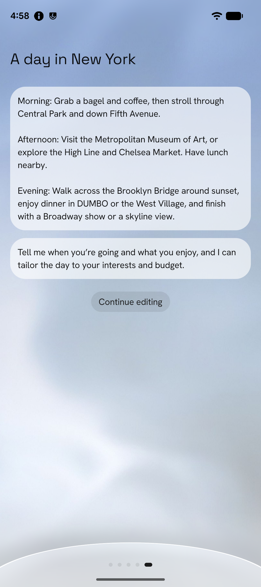

### 02. Baseline: Living room tonight — clarification question, no controls

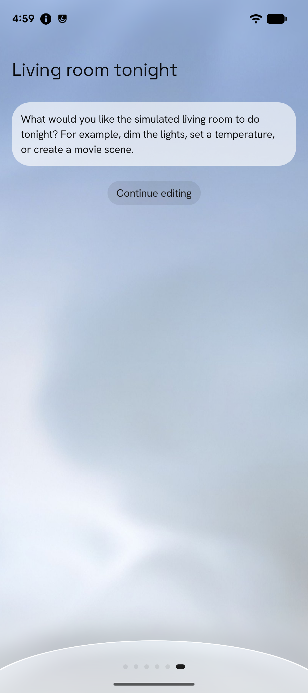

### 03. Baseline: Ordering food — clarification question, no menu

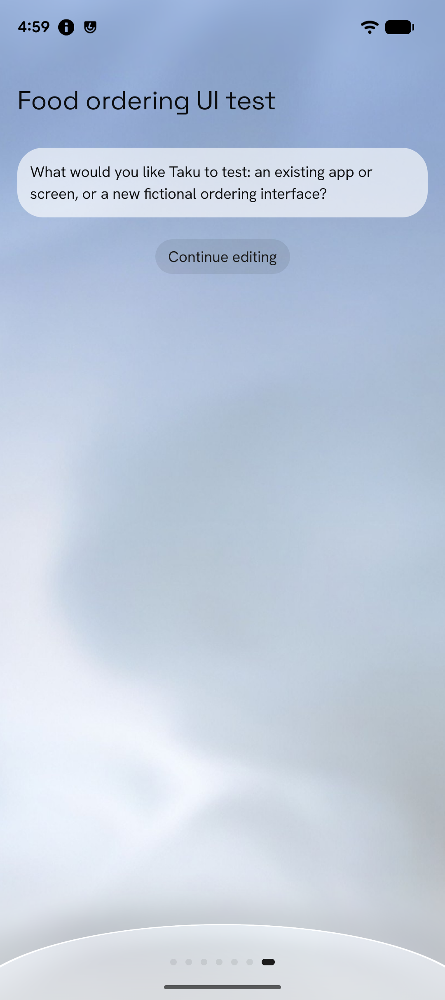

### 04. Baseline: UA837 — asks for the flight date, no watch layout

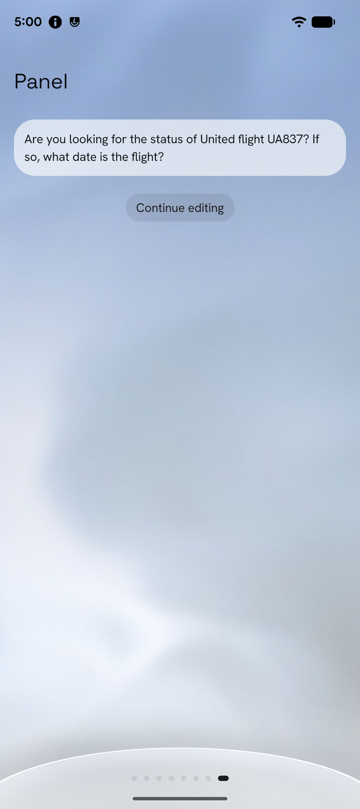

### 05. Baseline: Agent overview — plain text, no themed overview

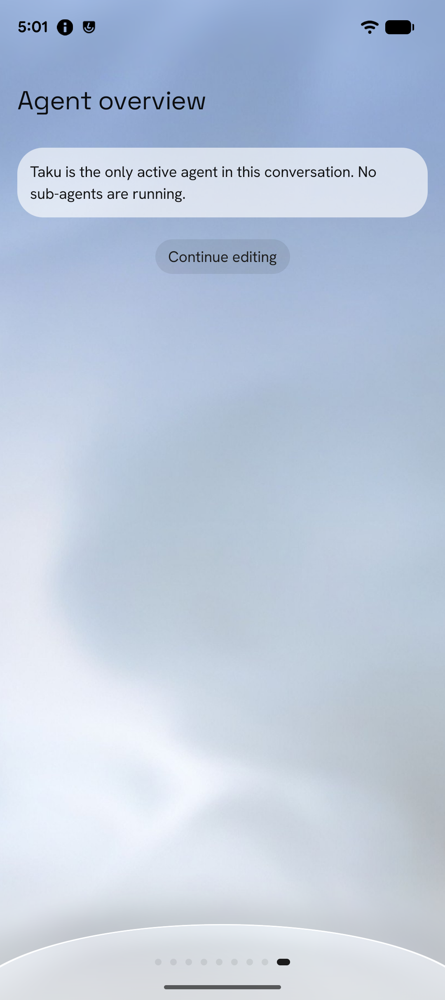

### 06. Baseline: Reply to Mom — fictional draft, no berry theme


### 07. Baseline: Today's spending — fictional expenses as text, no terracotta theme

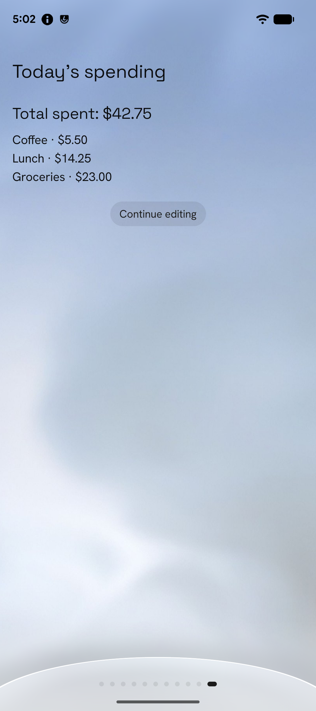

### 08. Explicit component prompt: control Panel before interaction

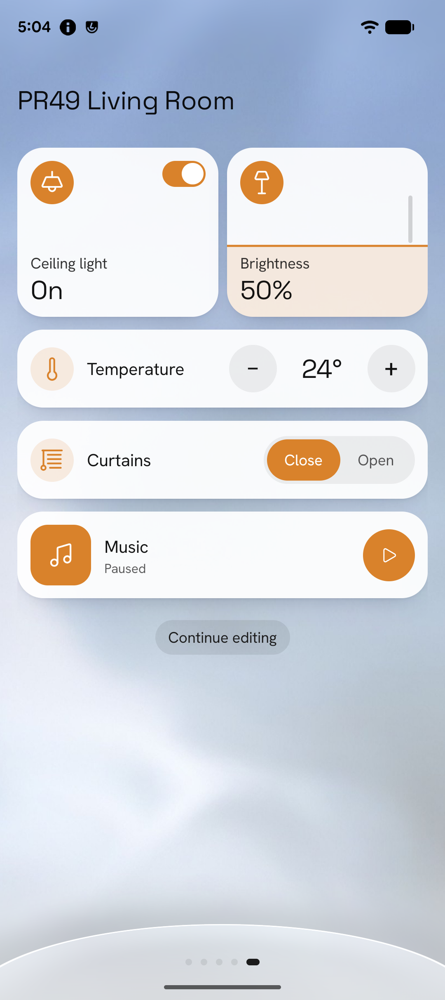

### 09. Exploratory number-with-unit menu: before selection

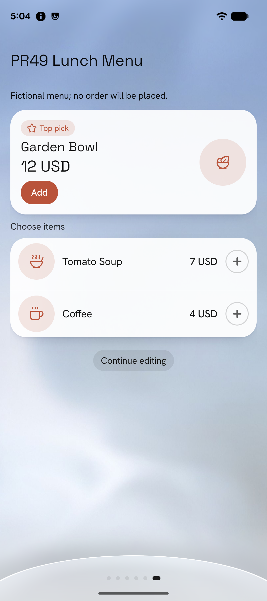

### 10. Explicit component prompt: timeline and packing checklist

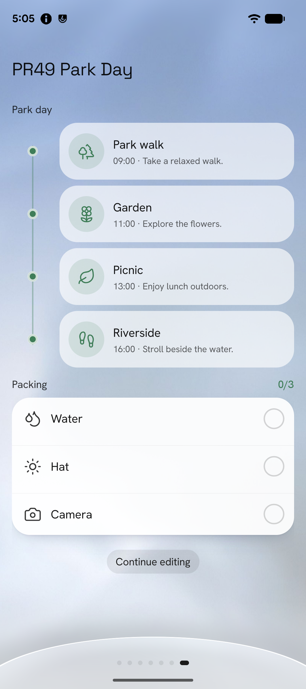

### 11. Control after interaction: Off, 89%, 25 degrees, Open, Playing

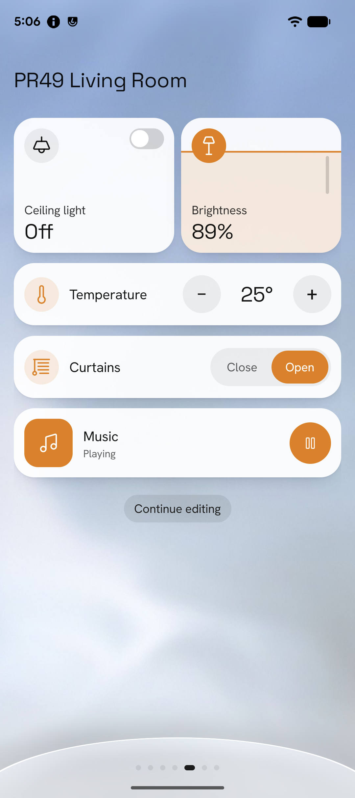

### 12. Number-with-unit menu: two selected; this is not a money-total test

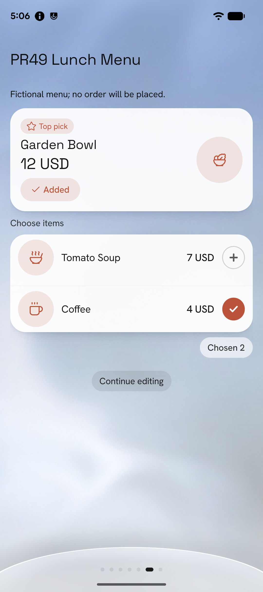

### 13. Checklist after selecting Water and Hat: 2/3

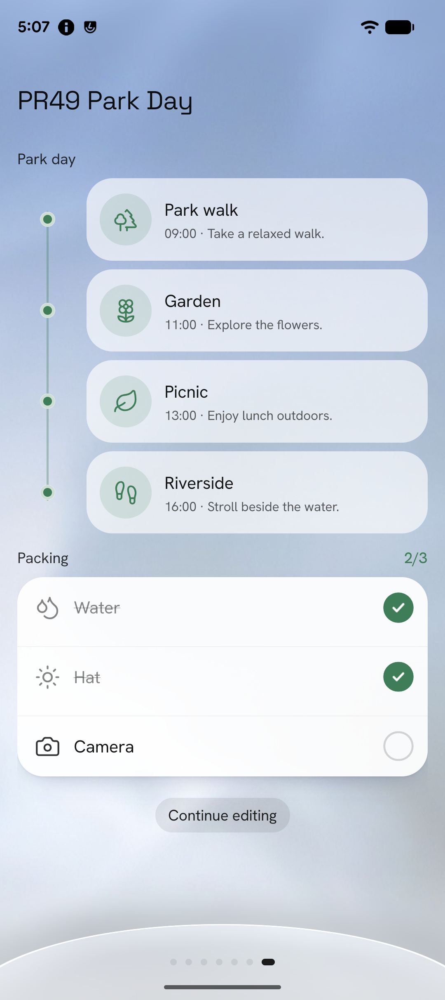

### 14. Protocol-valid money menu before selection

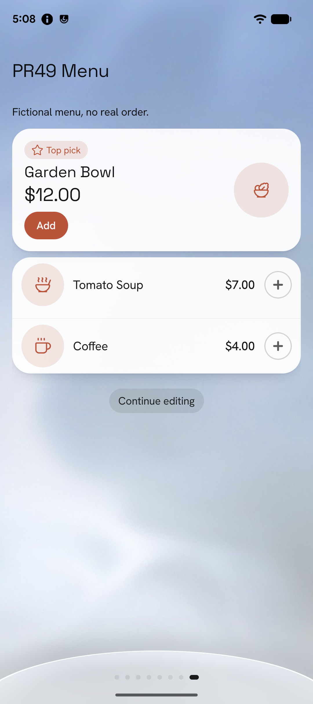

### 15. Timeline with separate time values and a map URL


### 16. FAIL: valid $12 + $4 money values show Chosen 2 without $16.00

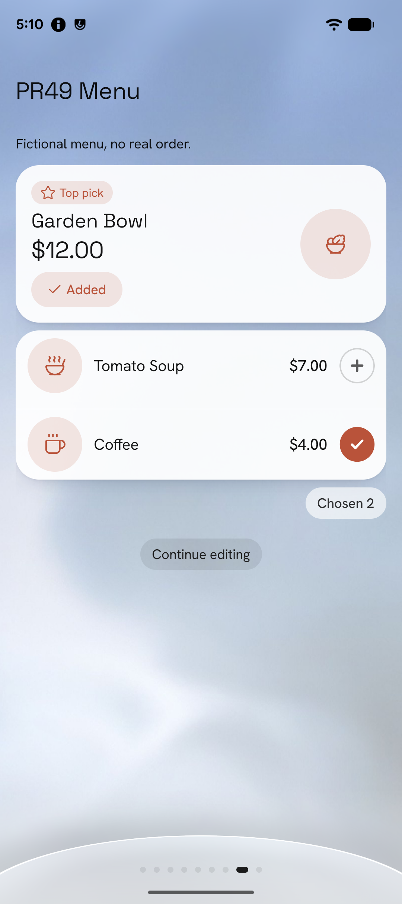

### 17. Timeline/link test: raised linked stop, Go action, and rail crossing time labels

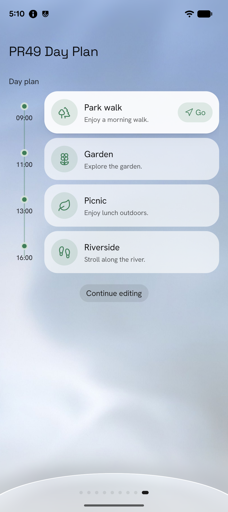
