# PR #50：云构建与模拟器复验（2026-11-25）

验收提交：`08117ff849091c597b7c9da3a448d12cf92ed661`（`vela/dynamic-island`），包含 `main` 的 `499e15e2`。本轮重新云编译并安装了 SystemUI、Taku Agent、Assistant 和 Broker，补完原先因构建机启动失败而缺失的 **#7 横屏布局修复装机验收**。

设备为 `Taku_PR27_Fresh` / `emulator-5596`，Android 17、ARM64、1080 × 2424、420 dpi。使用现有账号和数据；临时测试 App、发布白名单、旋转及模糊设置均在测试后恢复。截图来自本轮设备 framebuffer，已检查内容；不包含模拟器窗口边框或宿主机绘制的硬件外观。

## 结论

| 项目 | 本轮结果 |
| --- | --- |
| #7：展开卡片旋转至横屏 | **通过**。`cover`、`below` 各三轮，共六轮；卡片关闭，SystemUI PID 不变，无 crash-buffer 记录。 |
| 返回竖屏后的交互 | **通过**。胶囊摄像头锚点恢复，等待活动圆点正常，点击重新展开、上滑收起正常。横屏期间拒绝展开卡片；摘要仍可显示。 |
| 摘要、卡片和跳转 | **通过**。摘要点击展开／直接开 App、卡片跳到指定详情后关闭、回桌面恢复摘要、两种卡片位置、白底、动画图标、B 区图标。 |
| 多活动和按钮 | **通过**。新活动排序、等待圆点点击、左滑切换、右滑隐藏、无关活动结束后保留选择；操作按钮可横向滚动。 |
| Live Updates | **通过**。摘要和手动展开可用；“Driver arrived”重要更新保留 Android 原生横幅。 |
| 提醒防重入 | **17 项通过**。五秒窗口内安静更新不重新弹卡；持续 `alert=true`、冷却内重新置 true、取消重发均不绕过冷却；冷却后可再次提醒。手动卡片不被自动提醒超时关闭。 |
| Taku Agent | **通过**。离开运行中的聊天后隐藏，约 28 秒后出现本次回复，超过五秒仍保留，点卡返回原对话。主页浮层不会遮挡重开的同一对话；空闲时 New Chat 立即显示新问候并清除旧回复。 |
| 熄屏完成后恢复 | **Settings 通过，桌面仍失败**。详见下方本轮对照测试；这条既有问题仍未解决。 |
| Agent 接口一致性 | **通过**。`assistant/handoff` 和 `assistant/reclaim` 的状态读回与展示状态一致。 |

横屏记录包含 [41 项断言](evidence/rotation-results.json)。[通用记录](evidence/general-results.json)包含 25 项正常行为及下述两项已知限制的复现；[提醒记录](evidence/alerts-results.json)包含 17 项断言；[Agent 记录](evidence/agent-handoff-results.json)包含上述四组场景。

本轮没有修改产品代码。#6“遮挡期间也消耗本次提醒窗口”的既定行为保持不变。

## #7：横屏与恢复截图

| 遮挡开孔的卡片 | 返回竖屏后重新展开 |
| --- | --- |
| 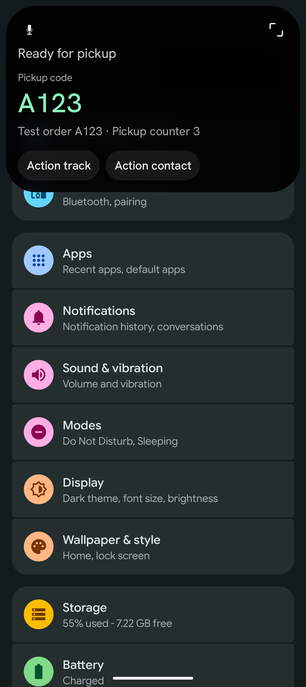 |  |

旋转到横屏后，展开卡片关闭，摘要保留，SystemUI 进程持续运行：

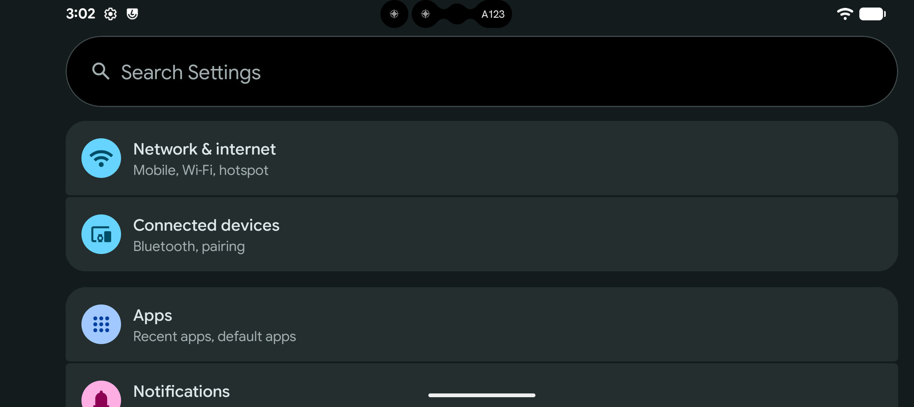

| 开孔下方的卡片 | 返回竖屏后重新展开 | 上滑收起 |
| --- | --- | --- |
| 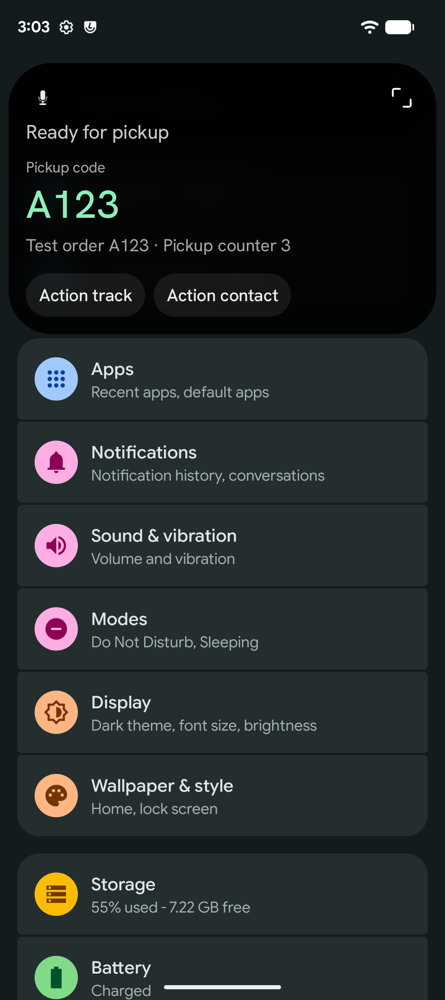 |  | 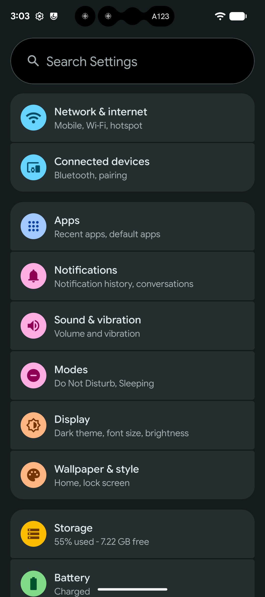 |

[状态：横屏](evidence/rotation-cover-0-03-landscape.json) · [状态：返回竖屏](evidence/rotation-cover-0-04-return.json) · [状态：上滑](evidence/rotation-below-06-swipe-collapse.json)

## 通用交互截图

| 摘要 | 展开 | 点击卡片打开指定详情 |
| --- | --- | --- |
| 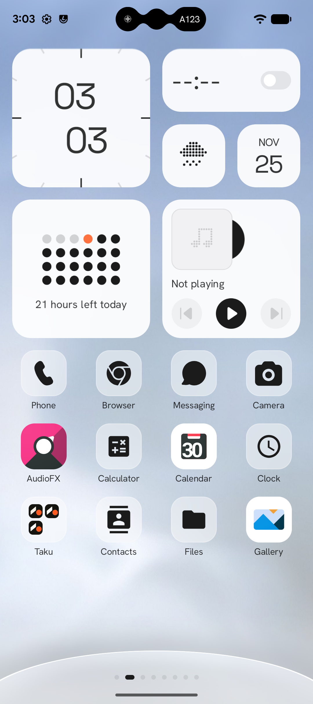 | 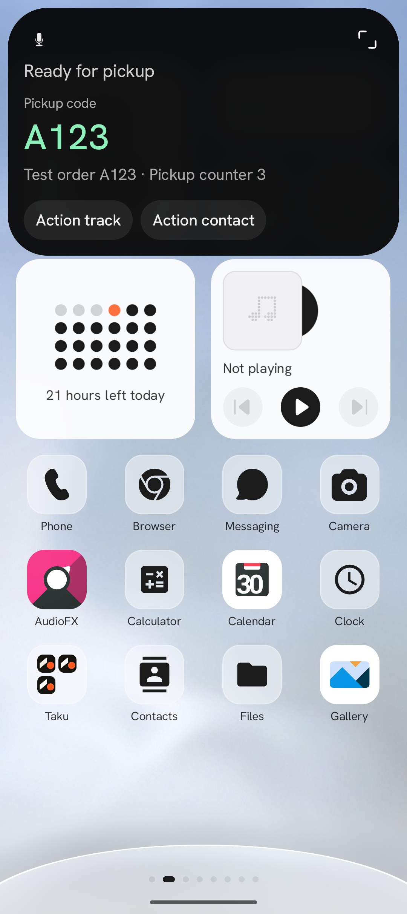 | 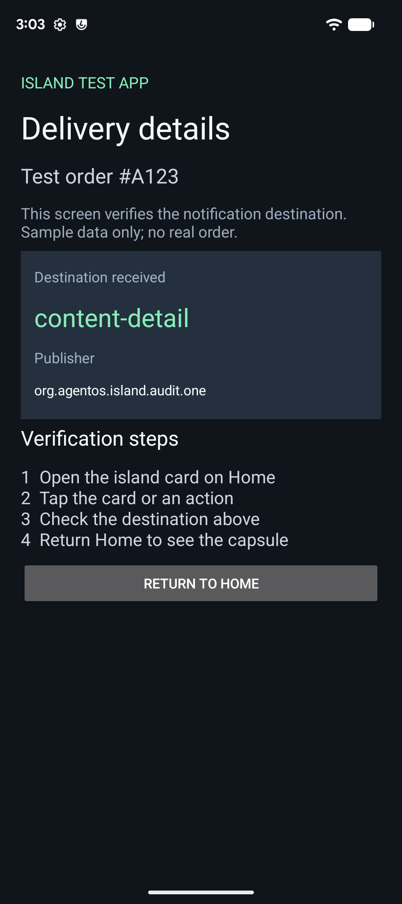 |

| 白色卡片 | 动画图标及进度圈 | B 区图标 |
| --- | --- | --- |
| 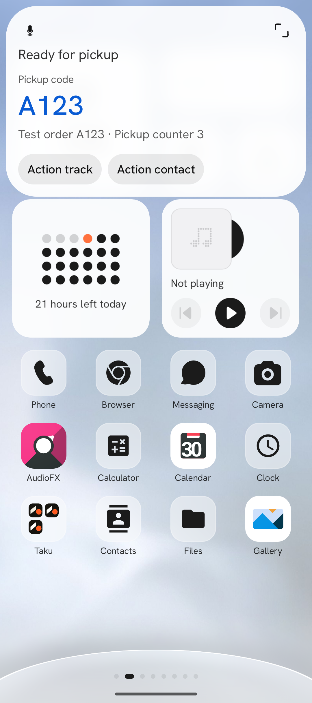 |  |  |

| 多活动 | 左滑切换 | 右滑隐藏当前活动 |
| --- | --- | --- |
|  | 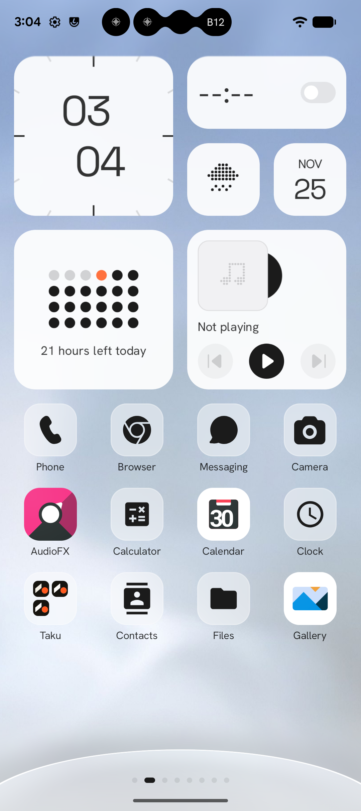 |  |

| Live Update 摘要 | Live Update 展开 | 重要更新的原生横幅 |
| --- | --- | --- |
| 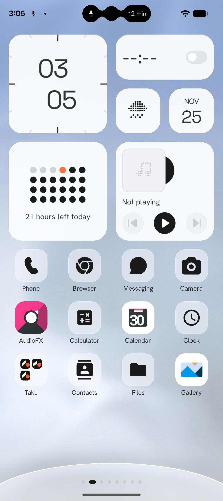 | 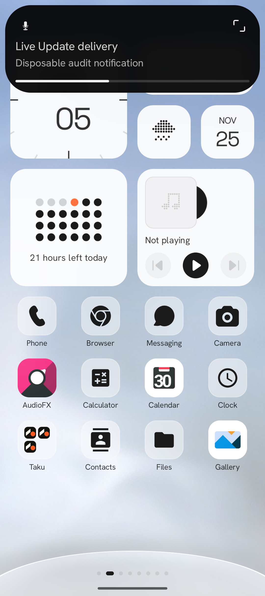 | 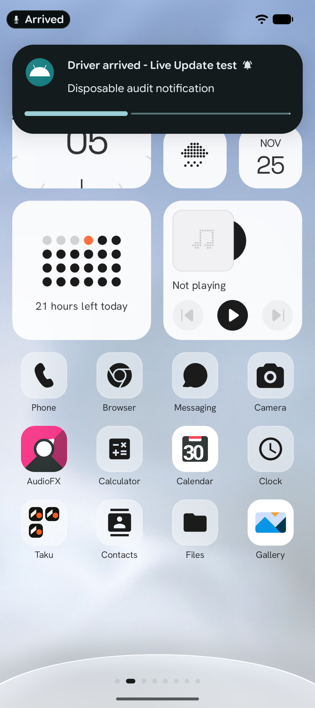 |

[回桌面恢复摘要](images/04-return-home-capsule.png) · [开孔下方位置](images/05-card-below.png) · [独立卡片跳转目标](images/06-custom-card-destination.png) · [摘要直接开 App](images/07-capsule-direct-open.png) · [点击等待圆点](images/14-waiting-disc-tap.png) · [按钮滚动前](images/19-actions-before-scroll.png) · [按钮滚动后](images/20-actions-after-scroll.png)

## Agent 流程截图

实际发送只读 `sleep 18` 任务，要求返回测试标记 `ISLAND0027HOME`，未使用伪造回复。

| 离开聊天后运行中隐藏 | 任务完成后回复卡片 | 点卡返回原会话 |
| --- | --- | --- |
| 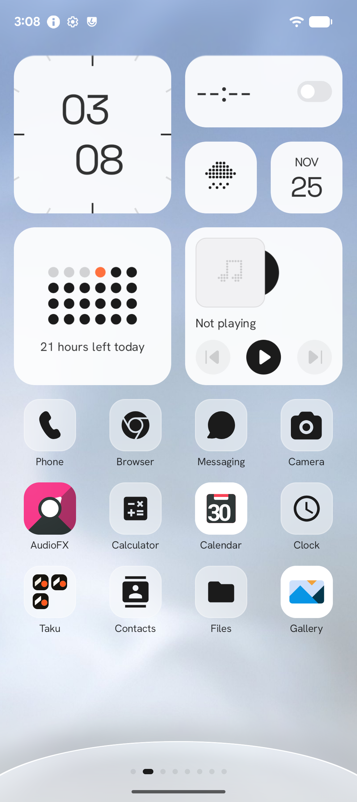 | 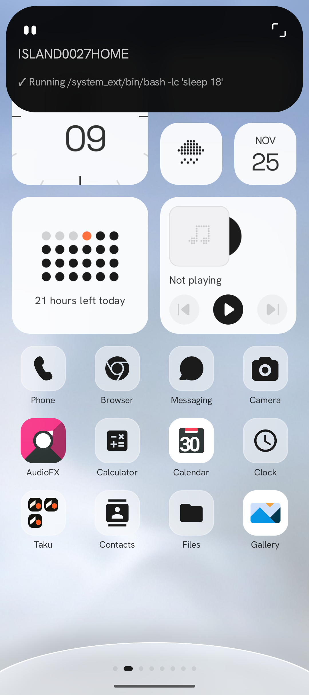 | 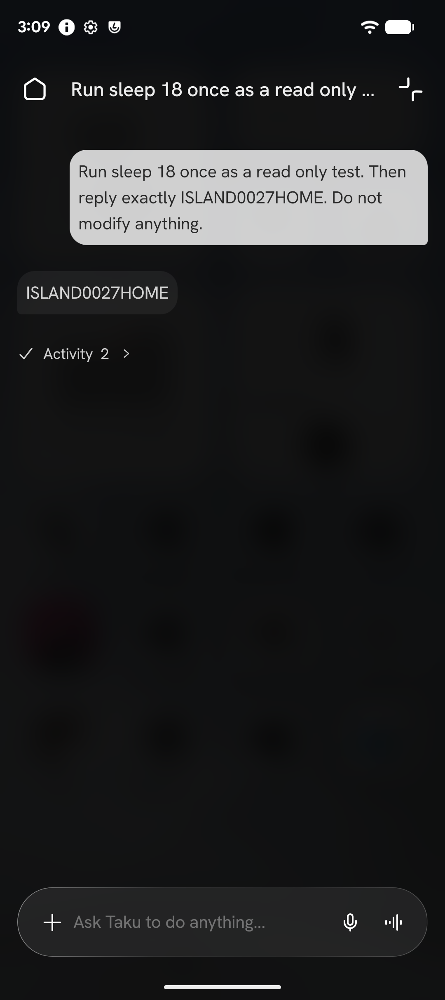 |

| 从主页浮层收起后的卡片 | 再次点卡，浮层已关闭 | New Chat 空白新会话 |
| --- | --- | --- |
| 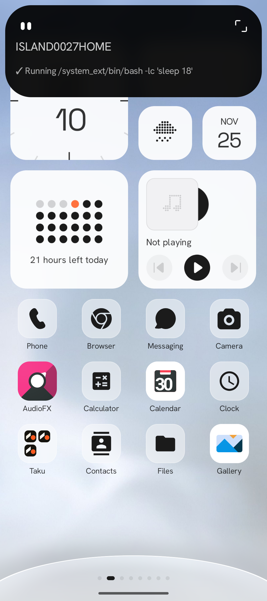 |  | 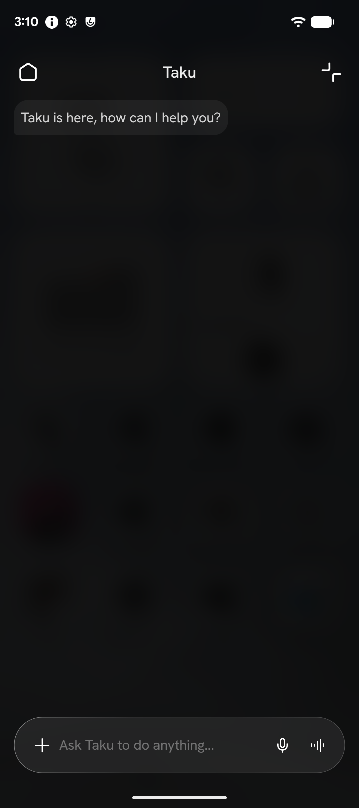 |

本轮仅复测 New Chat 空闲点击路径；发送期间点击和首条消息建会话的设备路径不在本轮新增结论内。

## 仍未解决：熄屏完成后解锁回桌面丢失回复卡片

分别发送只读 `sleep 20` 任务；进入运行状态后打开完整聊天，再切到 Settings／桌面，确认 `handoff=true` 后熄屏。确认回复在屏幕关闭期间已就绪，再唤醒并解锁。

| 对照场景 | 熄屏期间完成 | 解锁后 |
| --- | --- | --- |
| 回到 Settings | 24.57 秒时读到回复，`working=false`、`revealPending=true`、`expanded=false` | 1.32 秒时卡片已展开；点卡打开包含 `PR50WAKESETTINGS` 的原会话。 |
| 回到桌面 | 31.29 秒时读到回复，`working=false`、`revealPending=true`、`expanded=false` | 连续观察 30 秒未出现回复卡片，`revealPending=false`、`expanded=false`。 |

这次熄屏期间的待展示状态保留正常，但回到桌面后的展示仍丢失。这里仅记录观察结果，不将未证实的回调时序当作根因。该桌面问题按此前决定留待后续处理；不能因为 #7 通过就关闭这一项。[完整时间序列](evidence/wake-results.json)

| 解锁回 Settings：正常弹卡 | 点卡回对应会话 | 解锁回桌面：等待 30 秒仍无卡片 |
| --- | --- | --- |
| 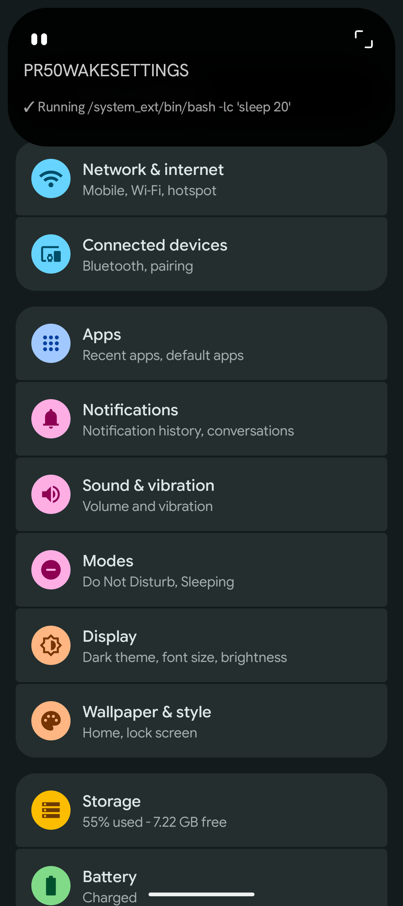 | 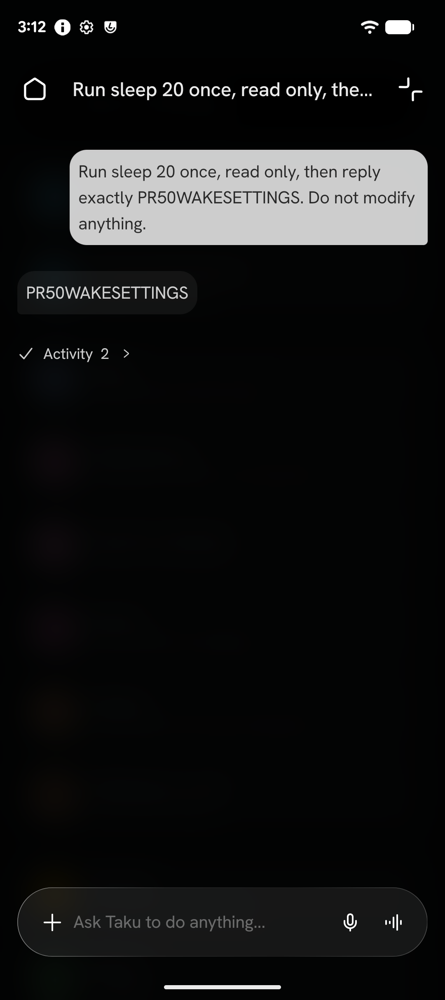 |  |

## 已知限制与验收边界

- `ongoing=true`、持续三秒的静态“Version updated”通知仍可上岛。语义重要性和营销内容仍需审核，系统准入不是语义审核。
- 取消通知后重新发布会产生新的到期时间，12 小时上限仍按单次活动发布计算；不是业务级累计时长限制。[记录](evidence/repost-lifetime.json)
- 本轮为匹配签名的组件覆盖安装，没有完整 ROM 或实体手机验收。Broker 使用运行时 bind mount，模拟器重启后需重新部署该 Broker，不能将重启后的旧 Broker 视作本轮版本。

## 构建和安装证据

构建在云端原生 x86_64、64 核 / 251 GiB 环境执行，复用 `/mnt/taku-build` 的源码和缓存；SystemUI 使用 `-j56`，目标 `lineage_taku_emu_arm64-cp2a-userdebug / SystemUI`，配套 Agent 为 ARM64。Mac 仅控制、下载及部署，没有本地 Android 编译。

SystemUI 用时 10 分 08 秒，Agent Gradle 用时 3 分 27 秒；489 项 Agent JS 测试、typecheck、lint、island checks、结构检查和 diff 检查通过。构建完毕并确认无其他构建后，主机已关闭（`TERMINATED`）。

[构建摘要](evidence/build.json) · [设备安装哈希及签名校验](evidence/installation.json) · [临时应用和白名单恢复](evidence/general-cleanup.json) · [旋转设置恢复](evidence/rotation-cleanup.json)
