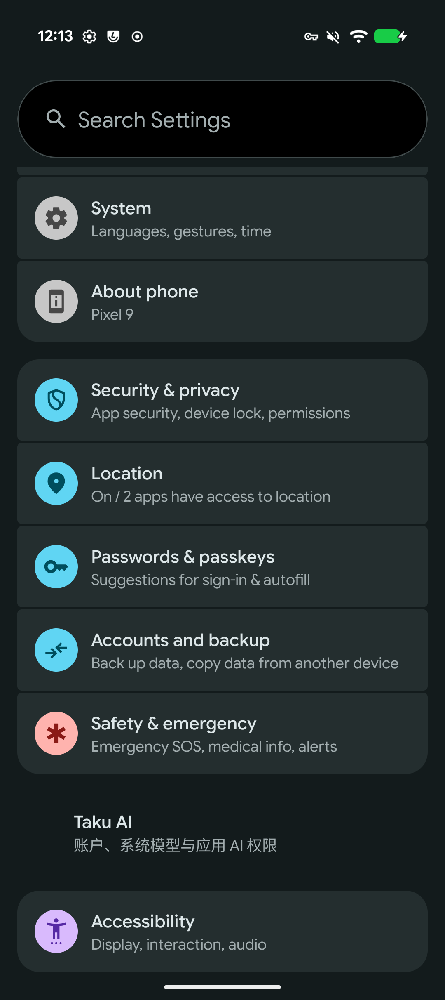
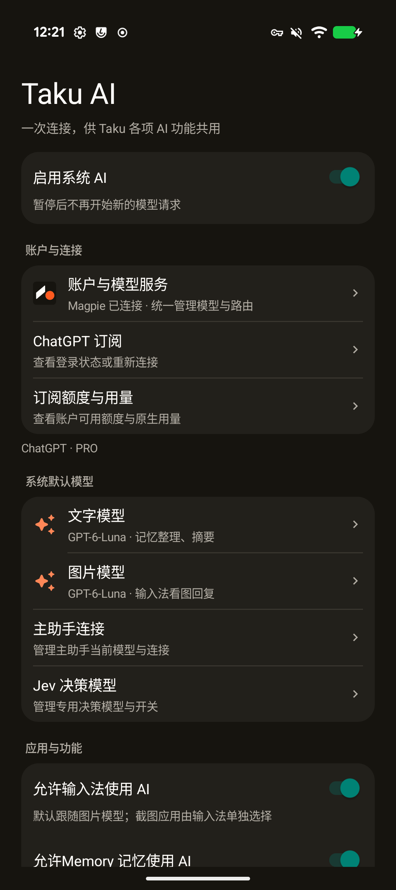
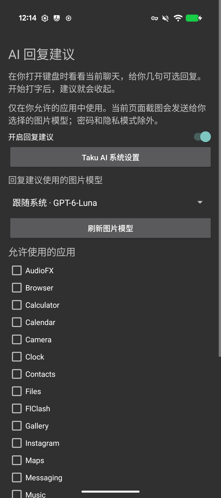
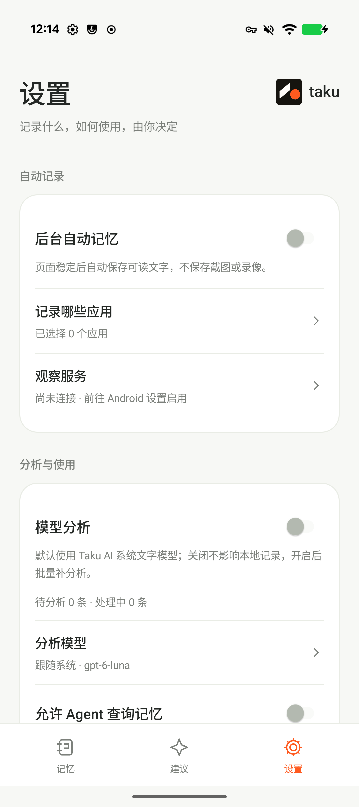
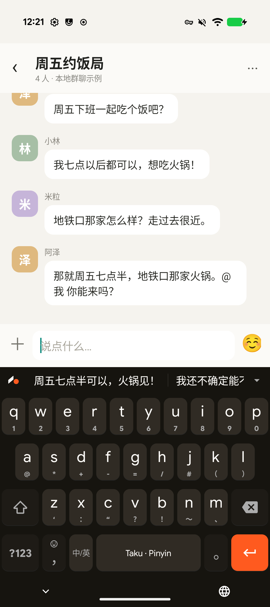
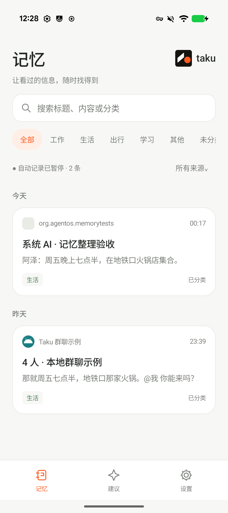

# Unified system AI settings: Pixel 9 hardware acceptance

2026-10-23, `physical_verified`. System assistant v62, IME 0.3.0, and Memory 0.6.0 installed on Pixel 9 / Android 17 (API 37), with installed hashes matching final builds. SELinux Enforcing. Existing ChatGPT Pro sign-in reused; text/image defaults both `codex/gpt-6-luna`, with IME/Memory following system.

## Delivered behavior

Android Settings home adds **Taku AI**; assistant settings, IME, and Memory all open the same page. It manages accounts/model providers, subscription sign-in/quota, system text/image defaults, app grants, and call state; main-assistant connection and Jev-specific settings reuse existing modules.

IME follows system image model by default; Memory follows system text model. Existing explicit overrides remain. Changing defaults invalidates older requests; pending Memory records remain and retry with new configuration. Model configuration does not enable Memory capture, analysis, queries, or proactive suggestions.

Provides a ContentProvider and source client reusable by ordinary Android apps. Caller identity comes from Binder UID; new apps default disabled and require individual user allowance in system AI settings. Clients hold no model credentials and cannot forge origin, override system models, or read another app settings. IME screenshot and Memory-data access retain their signature/identity checks.

## Acceptance results

| Verification | Result/evidence |
| --- | --- |
| System settings/module integration | All [9 hardware checks](ui-acceptance.json) passed: Android Settings entry, text/image selection/inheritance, both modules returning to unified settings, separate Memory revocation, master switch, quota entry. |
| Ordinary apps share models | After user allowance, an independently signed app used the public client for a real Luna reply meaning “System AI connected”; forged-origin/model-override checks passed. [Record](shared-client.txt) |
| Real IME replies | Synthetic group-chat screenshot → real Luna → strict JSON → native 40dp strip → exact tap-to-fill, no send. First Pinyin input dismisses; cancelled late results cannot return; passwords/FLAG_SECURE excluded. [7 checks](ime-live.json), generation 4176 ms. |
| Real Memory processing | Actual accessibility captured an independent test page without database injection; persistent queue used system text model to classify as Life, ready, 3557 ms. Unsent draft in editable nodes excluded. [Record](memory-live.json) |
| Master-switch coverage | Hardware verified disabling blocks IME, Memory, main-assistant turn/start, and Jev decide. Device has no usable dedicated Jev model, so realtime Jev inference is not claimed; compatibility covered by [41 regressions](jev-regression.txt). |
| Gateway isolation | After positive root catalog check, ordinary-app direct access to 3425 was denied by UID firewall; authorized public-client access still succeeded, avoiding mistaking service outage for enforcement. [Deployment/rules](deployment.json) |
| State persistence | Configuration/revision unchanged across Broker restart; private files have correct 0600/root permissions; real generation after restart took 4491 ms. [Final state](final-state.json) |
| Automation | [Host policy](host-tests.txt): 30 checks, plus JSON 21/error mapping 12; [isolated Android](isolated-tests/SystemAiTests.txt) plus five other groups: 205 total; [source reconstruction](source-reconstruction.json) and [npm run verify](repository-verify.txt) passed. |

Isolated SQLite/API tests use synthetic responses for state machines; real-model calls and IME/Memory integration above do not mock replies. All chat content is purpose-built fixture data, not user private chats.

After testing, restored Memory capture policy, source choices, analysis/query/proactivity switches, and original accessibility state (disabled); temporary test/probe APKs uninstalled. Kept default Taku IME, synthetic group-chat example, and processed test memory for the owner to inspect. No new credential import; repository/APKs/report contain no account tokens or keys.

## Original screenshots

Original ADB screencaps, without cropping/composition. Memory result was captured by reopening the library after cleanup, avoiding Android task reuse showing another settings page.

| Android Settings entry | Unified Taku AI settings |
| --- | --- |
|  |  |

| IME follows system | Memory follows system |
| --- | --- |
|  |  |

| Real image reply | Real Memory processing result |
| --- | --- |
|  |  |

## Deployment boundaries

This was an **APK update plus temporary system-file bind mounts**, without image flashing, full reboot, or OTA verification. Unified configuration persists on data and survived service restart; **full reboot removes these runtime mounts**, requiring development redeployment or formal ROM integration of Broker/Magpie wrapper. APKs/private configuration persist. This is not complete-ROM persistence acceptance.

Implementation, interface limits, rerun commands: [system AI module](../../../system/ai/README.md); machine-readable [evidence](../../../evidence/system-ai-20261023.json).
