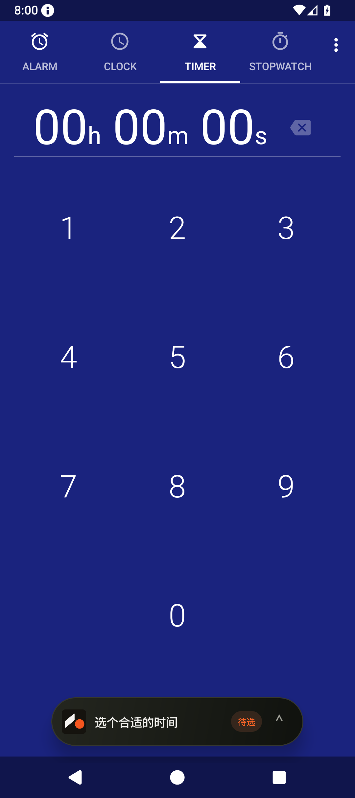
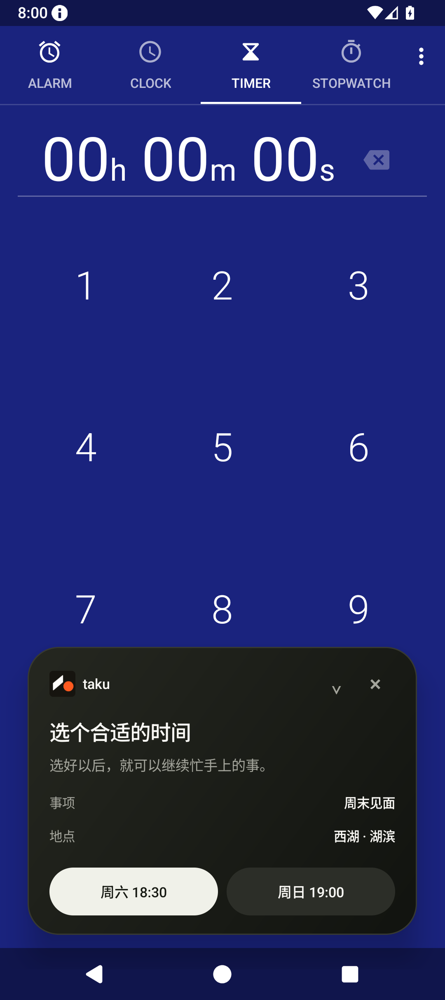

# System surfaces: visual and device verification

Initial record, 2026-10-21, development branch `codex/system-surfaces-20261021`, then an uncommitted tree based on `0d1119d`. Scope: independent system-surface component, calling protocol, and preview caller. Callers provide content; no model integration or business-execution flow. Original images/records retain the initial state; see [alignment acceptance](../system-surfaces-alignment-2026-10-21/README.md) for later styling.

## Visual sources

- Eugene Yarovoy / mindset: [Ticker](https://dribbble.com/shots/27545186-ticker-an-ambient-ai-companion-in-the-dynamic-island), reference for compact capsules, one-line information, and small status markers.
- Masum Parvej / Halal Lab: [Dynamic Island Component](https://dribbble.com/shots/26808109-Dynamic-Island-Component-Delivery-App), reference for expanded-card black material, corners, text hierarchy, and action density.

Adapted to phone dimensions using the repository Taku brand vector; no external images or fixed flows such as delivery progress were copied. Styles live in `SurfaceStyle`, layout in `SurfaceWindow`, with independent protocol/lifecycle.

## Actual screenshots

Original screenshots of the final component APK on an API 36 emulator, with content from an independent preview caller. Clock is another foreground app; these are not generated mockups or connected calendar/dining workflows.

| Collapsed | Expanded |
| --- | --- |
|  |  |

The bottom capsule moves above the keyboard: [keyboard verification](keyboard.png).

## Verified

| Check | Result |
| --- | --- |
| Repository `npm run verify` | Passed; existing Linux FIFO-only cases skipped on macOS |
| Pure Java lifecycle checks | 21 assertions passed: caller isolation, versions, expiry, capacity, and selection deduplication |
| Component and independent preview APKs | Build and signature verification passed |
| Cross-app rendering | Capsule displays, expands, and collapses over Clock without stealing input focus |
| Selection callback | Valid selection returned once; repeated taps did not duplicate it |
| Caller process exit | Surface window cleaned up |
| Invalid content / TTL | Unknown types rejected; expiry event received and window removed |
| IME avoidance | Bottom capsule moved from `[156,2118,923,2266]` to `[156,1343,923,1491]`; underlying input remained usable |

Tests fixed independent-Service window context, clipped button edges, invisible windows after cross-app switching, and bottom windows covering the IME. Preview caller stopped afterward; emulator returned to paused state.

Build/screenshot hashes and results: [verification record](../../../evidence/builds/2026-10-21-system-surfaces.json). Raw device events/window information remain in ignored `out/system-surfaces-20261021/` in the Mac mini worktree.

## Verification boundaries

Only the independent component and API 36 emulator were verified, not Pixel 9, complete ROM, landscape, enlarged fonts, or TalkBack. Lock-screen hiding/unlock restoration exists but was not separately exercised on-device. Android 17 immutable build inputs were unchanged; build-follow-up automation remained paused.
