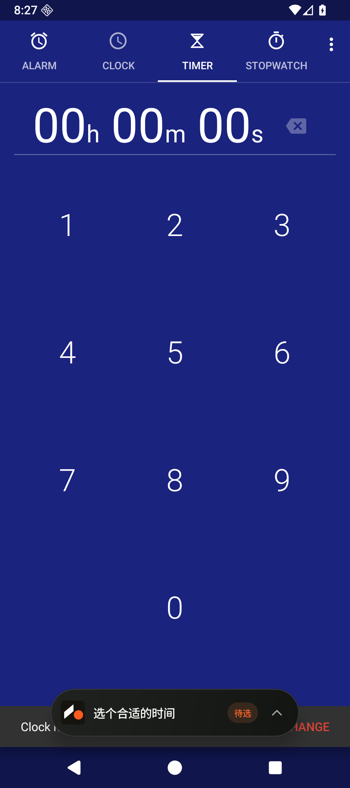
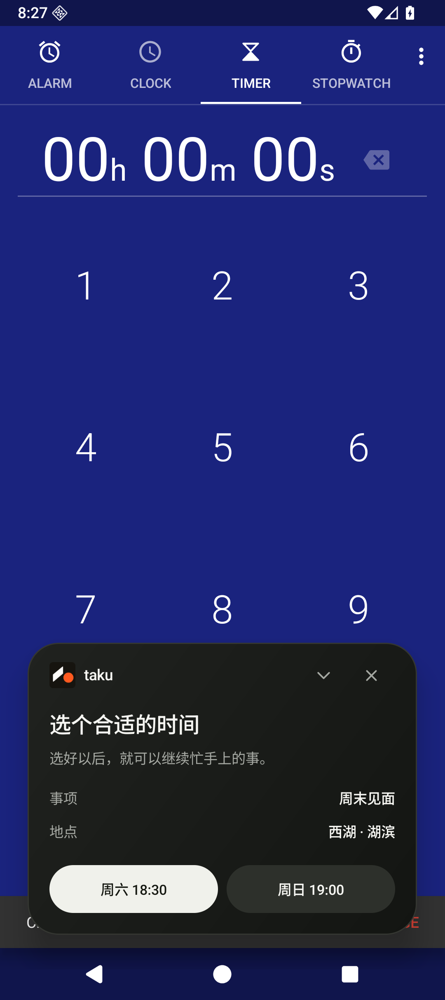
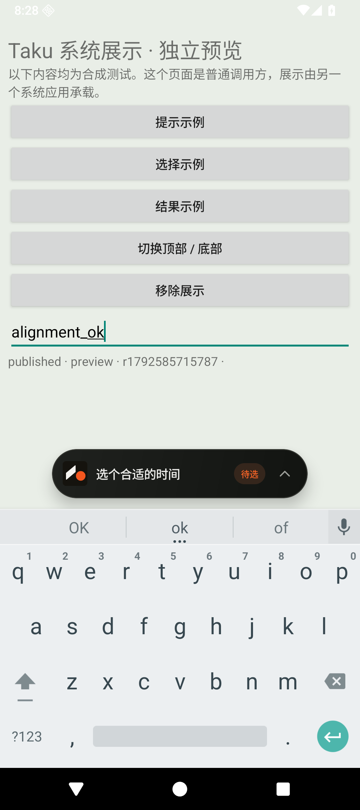
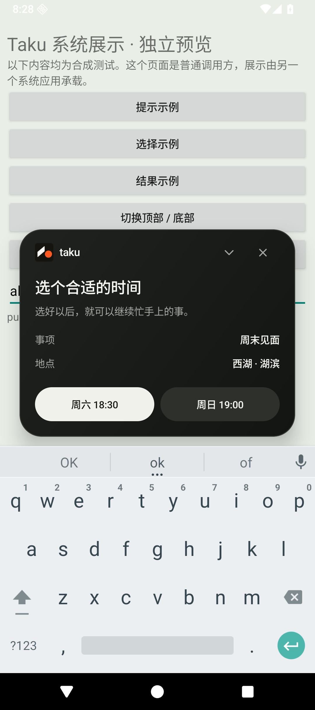

# System surfaces: alignment

2026-10-21, independent system surfaces organized from main `987f4d9`. This page records the aligned version; [initial screenshots/acceptance](../system-surfaces-2026-10-21/README.md) retain the original state.

## Changes

- Card content uses consistent 20dp left/right margins; title, body, field labels, and bottom actions share alignment edges.
- Unified body line height and group spacing; labels/values align at the first line, with long text wrapping to column width.
- Expand, collapse, and close use equally sized vector icons in 44dp touch targets, without text-arrow font-baseline dependence.
- Capsule status marker has fixed 24dp height, vertically centered with title, brand icon, and expand control.
- More neutral dark material; two actions have equal widths, an 8dp gap, and line height/padding supporting two lines.

Styles are centralized in `SurfaceStyle`, layout in `SurfaceWindow`; visual changes do not alter calling protocol, business content, or lifecycle. Standard `npm run build:android` now includes surfaces; `npm run build:surfaces` builds them separately without the test preview.

## Emulator tests

| Capsule | Expanded card |
| --- | --- |
|  |  |

| Keyboard visible | Expanded above keyboard |
| --- | --- |
|  |  |

Screenshots: API 36 / `emulator-5586`, a read-only cold-boot instance of an existing AVD, with synthetic content from an independent preview caller and Clock in the foreground. Checked cross-app display, returning to original position after collapse, callbacks, underlying input, IME avoidance, and installed APK/build hash match. Keyboard regression waits for actual IME/window movement rather than inferring failure from a fixed short delay.

`npm run verify` and `npm run build:android` passed, including 21 pure-Java lifecycle assertions; existing Linux FIFO-only tests skipped on macOS. Raw window/events remain in ignored `out/system-surfaces-alignment-20261021/` in the isolated MacBook worktree; the [compact record](../../../evidence/builds/2026-10-21-system-surfaces-alignment.json) binds screenshot/source hashes.

Preview stopped and read-only emulator closed, preserving original AVD installation/data; remote emulator returned to paused state. Nothing installed on Pixel 9; no full-ROM build/flash. Landscape, enlarged fonts, TalkBack, and lock screen were not tested this round; Android 17 follow-up automation stayed paused.
