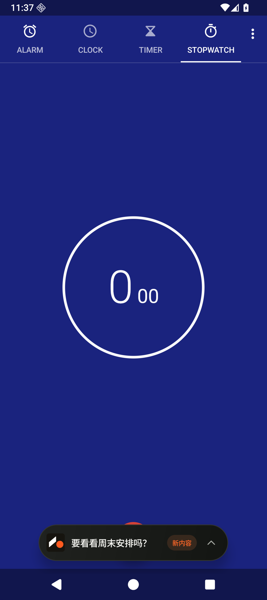
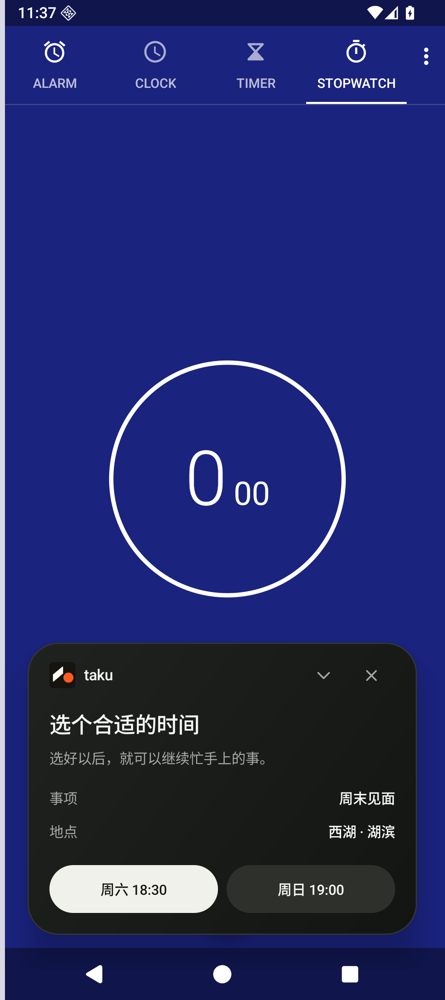
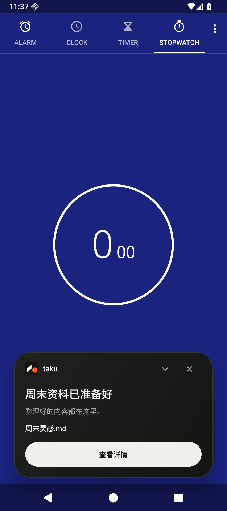
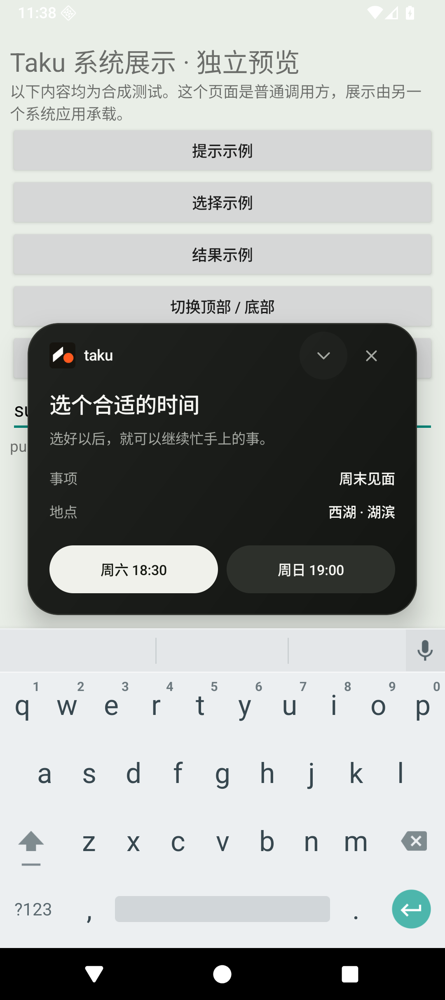

# System Surfaces SDK 0.2: calling-interface acceptance

2026-10-21. Scope: standalone Android SDK, v2 message protocol, three presentation behaviors, and callbacks. See [calling API](../../../system/surfaces/API.md); original v1 remains compatible.

## Exposed calls

| Call | Default presentation | User action and callback |
| --- | --- | --- |
| `showHint` | Bottom compact capsule | Body tap returns caller action ID directly; right arrow expands |
| `showChoice` | Bottom expanded card | Option tap returns option ID; manual collapse available |
| `showResult` | Bottom compact capsule | Body tap returns `open-details` and `artifact.ref/mediaType/title` |

`publish(SurfaceSpec)` customizes top/bottom placement, initial expanded/collapsed state, lifetime, and text fields; `dismiss/close` remove surfaces/clean connections. SDK exports `taku-surfaces-client.jar` without host windows, resources, AI, or business execution.

## Results

- 37 pure-Java lifecycle/calling-contract assertions passed.
- 16 actual Android JSON encode/decode assertions passed, covering v1/v2, Chinese text, artifact references, unknown fields/versions, and invalid actions.
- Independent consumer example compiled with only Android SDK and exported client JAR, without host source/resources.
- Installed APK hashes on API 36 / `emulator-5586` matched build artifacts.
- Independent preview over foreground Clock verified: hint tap directly calls back once; choice opens expanded and returns option; result callback contains complete artifact reference; right arrow only expands without triggering an action.
- A new revision of the same ID can apply new presentation state; v1 retains capsule-tap expansion.
- When IME appeared, expanded-card bottom moved from 2266px to 1491px while the underlying keyboard remained visible.
- Repository `npm run verify` and all-component `npm run build:android` passed; existing Linux FIFO-only checks skipped on macOS.

Device regression: [verify-device.py](../../../system/surfaces/tests/verify-device.py), requiring explicit serial and installed-artifact verification first. Callbacks come from real SDK/Binder/window taps, not fabricated model/business results. The [record](../../../evidence/builds/2026-10-21-system-surfaces-api.json) binds source, SDK, APK, and screenshot hashes.

## Original screenshots

| Hint | Choice |
| --- | --- |
|  |  |

| Expanded result | Keyboard avoidance |
| --- | --- |
|  |  |

## Boundaries

Screenshot content and artifact references are synthetic examples; no real materials, background work, or detail pages were created/opened. Screen recognition, AI, background tasks, artifact resolution, and detail routing remain caller responsibilities. Each revision accepts one action; publish a higher revision to reopen interaction.

Used a read-only cold-boot instance of an existing AVD, stopped preview, and closed the temporary instance afterward, preserving original data. No Pixel 9 installation, flashing, ROM-input changes, or resumed build automation. Hardware, full ROM, lock screen, landscape, enlarged fonts, and TalkBack are outside this acceptance scope.
