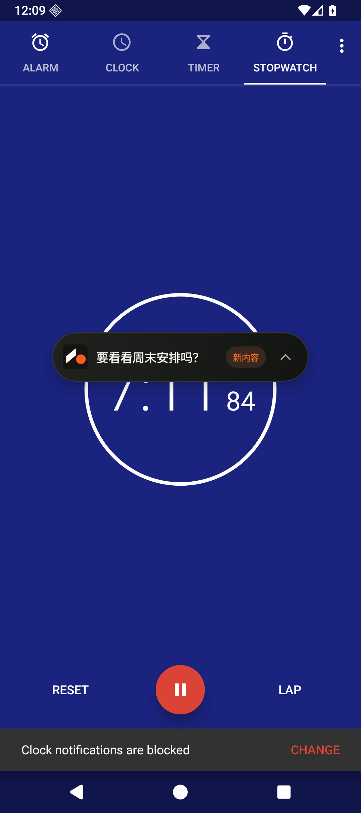
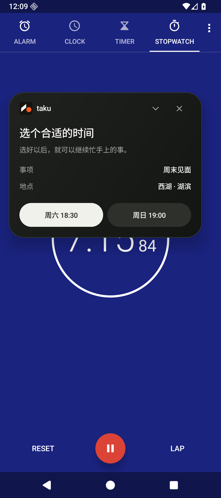
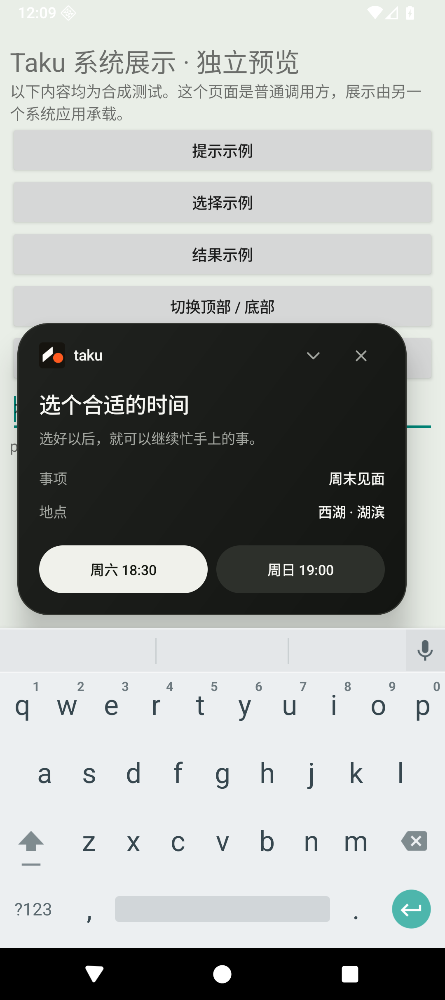
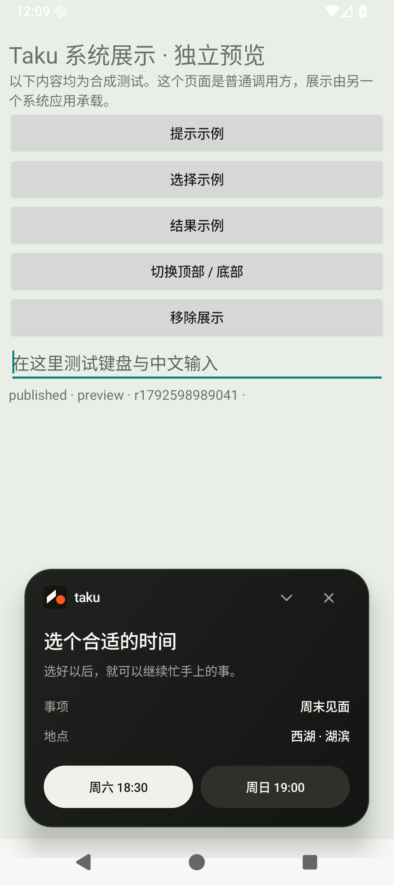
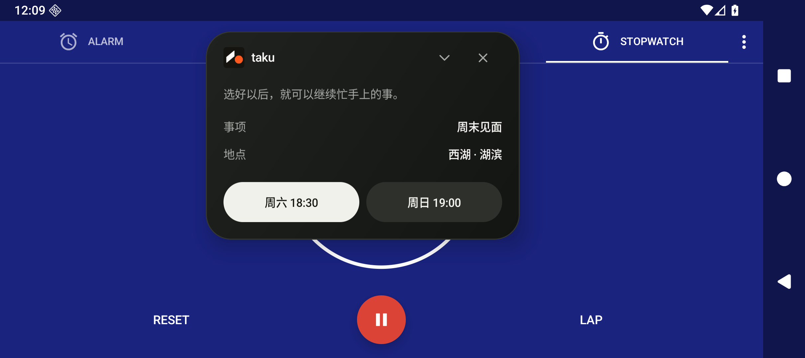

# System surfaces: dragging and position memory

2026-10-22, `emulator_verified`. Scope: user layout preferences in the independent surface host; original SDK, v1/v2 protocols, and business callbacks remain compatible, without AI, background execution, or detail routing.

## Usage

- Drag the capsule or the expanded-card top brand/control bar; release to save position.
- Capsule/card share one saved center; actual window bounds are constrained near edges, and collapse restores capsule position.
- Later content and service restarts retain user position. Rotation scales within safe bounds and restores on return; keyboard avoidance is temporary and restores after dismissal.
- Long-press the capsule/card top and select “Restore default position” (translated UI text) to follow the current caller top/bottom setting again.

Only two normalized center coordinates persist in host-specific preferences, without content, actions, caller identity, or artifact references. Position is user-controlled and needs no new caller parameters. Implementation separates `SurfaceDragHandle` (gestures), `SurfacePosition` (pure geometry), and `SurfacePositionPrefs` (persistence); windows apply results. [Full calling documentation](../../../system/surfaces/API.md).

## Actual verification

API 36 / `emulator-5586`, temporary read-only cold-boot instance of the original AVD; installed host, independent caller, and real-JSON test APKs after hash verification. [verify-device.py](../../../system/surfaces/tests/verify-device.py) `--position` collected real touches, Binder callbacks, window coordinates, and screenshots.

- 37 lifecycle/calling-contract and 17 position-geometry assertions passed; 16 actual Android JSON encode/decode assertions passed.
- With Clock as another foreground app, capsule/expanded card both drag; dragging from the arrow neither expands nor triggers an action; ordinary tapping after release still returns one callback.
- Expand/collapse share the saved center; force-stop/reconnect of host and caller restores position, and new content retains it.
- Landscape window stays on-screen; card body scrolls to action buttons without moving the card; returning to portrait restores position.
- A custom low card moved its bottom from 1997px to 1491px for the keyboard and restored afterward; temporary avoidance did not rewrite saved position.
- Off-screen drag was constrained to `[42,95][987,803]`, avoiding system bars; long-press menu restores default position.
- Repository `npm run verify` and all-component `npm run build:android` passed; existing Linux FIFO-only checks skipped on macOS.

Source, installed APK, screenshots, and test hashes: [independent verification record](../../../evidence/builds/2026-10-22-system-surfaces-position.json). Pretest artifacts were frozen under ignored output; later full-component builds may have different ZIP timestamps, whose hashes must not be treated as installed-APK hashes.

## Native screenshots

| Capsule dragged to screen center | Card dragged to upper half |
| --- | --- |
|  |  |

| Keyboard avoidance at custom position | Restore default position |
| --- | --- |
|  |  |

Action buttons fully visible after scrolling landscape content:

## Verification boundaries and cleanup

All screenshot content is synthetic. Service restart, rotation, and keyboard recovery were tested; full-device reboot, enlarged fonts, TalkBack, multitouch, floating keyboard, and multiple displays were not. Position cancellation/multitouch-interruption handling does not establish device acceptance for those cases.

After success, restored default position/rotation, stopped preview, and closed the read-only emulator, preserving original AVD data. No Pixel 9 installation, flashing, active/archived ROM-input changes, or resumed Android 17 automation. This is independent-component acceptance, not full-ROM/hardware acceptance.
