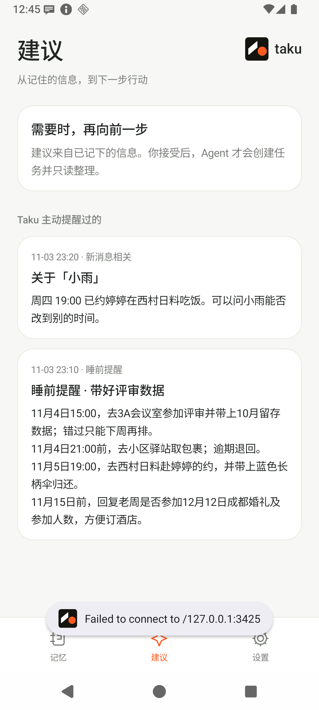

# Taku Memory 0.10.0: proactive reminders

2026-11-03 (Beijing time), Android 16 / API 36 / ARM64, dedicated test AVD `TakuRecall` (`emulator-5634`, `sdk_phone64_arm64` userdebug, SELinux Enforcing). Taku Memory 0.10.0 (versionCode 12), `agentos-task-broker` built from the same commit, assistant v74. Acceptance below completed before merging latest main, when this version was called 0.9.0 (versionCode 13); main had used 0.9.0 / 11 for OTA enablement, so after merging it became 0.10.0 / 12. Post-merge retesting appears below. Artifact SHA-256 values: [acceptance.json](acceptance.json).

**Status: emulator_verified; experimental feature, disabled by default.** Effectiveness figures come from one synthetic user's 22-day timeline; model answers were run one to three times. Scenario quotations/names below are translated/transliterated; raw evidence preserves actual Chinese inputs and replies.

## Implementation

Memory is no longer used only when the user asks. Two triggers:

- **Time trigger: bedtime reminder.** After nightly organization (after 20:00, once per evening), a user card selected for “Today is nearly over; what matters tomorrow and over the next two days?” goes to the model, which writes at most eight reminders ranked by the cost of missing them.
- **Message trigger: a new notification intersects remembered information.** For each notification, the phone first checks locally without a model call:
  - It names someone on the card who is asking/inviting, or has an arrangement in the next three days;
  - It shares an identifier/code (flight number, pickup code) or at least three words with a remembered item;
  - It asks/invites for a day (“Tomorrow evening,” “Thursday,” “The 22nd”) that already has plans, suggesting a conflict;
  - Its question relates to a user habit (“What was that Japanese restaurant you mentioned?”).

  Only a match sends the notification and a few relevant memory lines (plus other plans that day) to the model to decide whether and how to remind. Notifications only: captured chat-list pages contain multiple speakers, and replay models often misattribute statements, so those do not trigger yet.
- **Delivery**: shows a system-surface hint when connected, otherwise a notification in the Proactive reminders channel, opening Suggestions on tap. Suggestions adds “Taku proactively reminded you,” covering the latest seven days.
- **Boundaries**: Settings → Organization and assistant → Proactive reminders (experimental), disabled by default; enabling explains what goes to the model and requests notification permission.
  - At most eight message reminders daily; at most one model query per two minutes; no repeat of the same event within twelve hours.
  - Instruction-like notifications or notifications containing links do not wake the model.
  - Model calls go through Broker and obey Taku AI's Memory switch; threads are nonpersistent, without tools or assistant background. Recommended model: `gpt-6-luna`; a user-specified organizer model is reused.

## Results

### Bedtime reminders (time trigger)

Actual Broker calls for 21 annotated evenings ([original reminders](evening-briefs.json)) mentioned **59 of 70** warranted evening reminders. Comparison: the preceding card-only experiment with the same model scored 57 for 0.8.1 cards and 62 for 0.8.2 cards (slightly different prompts). About 4,600 tokens per call. Main misses: gas-inspection rescheduling (needs latest action date), Ajie's farewell, suit pickup, and items displaced by the eight-item limit.

### Message trigger

**Annotated key moments**: supplied messages as notifications to the actual path, running each three times ([originals](message-moments-3runs.json)).

| Moment | Reminded in three runs | Points mentioned |
| --- | --- | --- |
| Xiaoyu asks “What was that Japanese restaurant?” | 3/3 | Jiangsu Road, Nishimura Japanese restaurant in all three |
| Xiaoyu asks what Ajie wants lately | 3/3 | Aurora K75 in all three; gathering on the 22nd at 6 p.m. in two |
| Early-morning flight YC1203 canceled | 3/3 | All three mention impact on 11 a.m. meeting with Mr. Wang; none mention leaving at 2 p.m. or competitor interest |
| Xiaoyu invites for tomorrow evening (already promised Tingting 19:00 at Nishimura) | 3/3 | All three identify conflict and suggest another day |
| Landlord asks whether Wednesday afternoon works for water-heater repair | 1/3 | That one wrongly labels “Check data” as a conflict |

Total expected points: 23/30. These three runs used the penultimate prompt; final prompt adds only “Do not speak if the conclusion is no conflict, consistent, or already done.” End-to-end smoke used the final prompt.

**Interruption rate in full replay**: of 195 notifications over 22 days, local checks woke the model 32 times (about 1.5/day), and the model spoke 20 times (about 0.9/day). A stronger model (`gpt-6.1-sol`) graded each Useful / Low value / Incorrect: 13 useful, five low value, two incorrect ([per-item results](replay-nudges-graded.json)).

- Useful examples: ordered electric-blanket specifications differ from the promise to Grandma; interview conflicts with waiting home for repair; final payment due that day; Auntie's insulated cup ordered in the wrong model.
- Two incorrect items: one attributed “Ask Lily to book a meeting room” to the user's own commitment; another conflated hotel check-in with the meeting end time.

If captured chat-page content is included (disabled this time), 1,510 records wake the model 285 times and produce 112 reminders: 59 useful, 26 low value, 27 incorrect. Of 27 incorrect items, 25 came from chat pages, motivating notifications-only triggering. The grading model saw only the message and supplied memory lines, not earlier original statements from that day; some “incorrect” grades reflect missing evidence.

### End-to-end ([smoke script](smoke15.sh), [log](smoke15.txt))

Fresh debug installation, proactive reminders enabled, seven synthetic notifications sent (including another person's resignation plans and an instruction-disguised message). Organization completed at simulated 23:10:
- Bedtime reminder with four items: bring data to tomorrow's 15:00 review or wait until next week; collect parcel before tomorrow 21:00 or it will be returned; meet Tingting Thursday 19:00 and return umbrella; confirm wedding headcount to Mr. Zhou before November 15.
- Resignation plans and instructions were absent.

At 23:20, Xiaoyu sent “Hotpot Thursday evening? I'll reserve.” A reminder appeared: “You already have dinner with Tingting at Nishimura Thursday 19:00. Ask Xiaoyu about another time.” A subsequent casual notification did not wake the model. Each of the two calls used about 4,500 tokens (quotations translated).



[Notification shade](notifications.png) · [Setting](setting-zh.png)

## Component tests

**128 StoreTests** (new: tomorrow-evening invitation surfaces tomorrow's existing plans; shared pickup code wakes the model; casual/instruction-like notifications do not; parsing tomorrow evening/Friday/next Monday/the 22nd; bedtime reminder from user card; disabled default; saved reminders avoid repetition). Other groups passed as usual ([output](store-tests.txt)). `npm run verify` passed.

## Reproduction

```bash
TAKU_DEBUG_HOOKS=1 bash system/memory/build.sh      # Debug: simulated time and replay methods
bash system/memory/build-tests.sh && bash system/assistant/build.sh
# Evaluate a specified time (root, debug build): kind is evening or message; run=true actually queries the model through Broker; deliver=true sends the reminder
adb shell content call --uri content://org.agentos.memory --method proactive --arg '{"kind":"message","now":<ms>,"title":"Xiaoyu","text":"Dinner together tomorrow evening?","run":true}'
# Replay local trigger decisions without model calls; writes proactive-replay.jsonl in the app-private directory
adb shell content call --uri content://org.agentos.memory --method proactiveReplay --arg '{"offset":0,"limit":200}'
```

Run only on the dedicated test AVD; do not rerun capture cases on a device containing real memories. After acceptance, the device held merged 0.10.0 debug (proactive reminders off), 22-day synthetic data, merged Broker, and assistant v76. The English command above illustrates the same interface; reproducing the recorded Chinese-locale scenario requires the original fixture inputs in the linked smoke script.

## After merging latest main

After merging main `0866b88`, Memory became 0.10.0 (versionCode 12), retaining main's new open-access provider (`MemoryOpenAccessProvider`) and browsing-pagination changes; assistant is main v76 (`20261102-delivery-recovery`). Retested with Memory debug, Broker, and assistant built after merging:

- All seven component-test groups passed (StoreTests 128).
- Proactive smoke ([log](smoke15-merged.txt)): three bedtime reminders—bring review data, parcel pickup, Thursday meeting with Tingting; Xiaoyu's Thursday hotpot invitation prompted a conflict reminder; casual chat did not wake the model.
- After restoring 22-day data, asked “Xiaoyu invites me to dinner tomorrow evening”; assistant v76 still identified the conflict with Tingting at 19:00.

## Known limits

- Incorrect-reminder rate remains material (two of twenty notification-replay reminders), mainly misattributing actions or calling unrelated events conflicts; user feedback (useful, wrong, done) is not yet written back to memory.
- Captured chat-page content cannot trigger reminders yet.
- Bedtime reminders depend on successful organization that evening; none if organization fails.
- Reminders lack action buttons (draft reply, add calendar event); tapping only opens Suggestions.
- The system-surface path (Dynamic Island-style hints) was not tested on this device, which has no system-surface service and uses notifications.
- The notification small icon reuses the brand graphic and appears as a blank square in the notification shade.
- Latest action dates and cost of missing still use keyword rules; organization should write them into the graph next.
- Content already sent to model services cannot be retracted.

[Historical language evidence](../HISTORICAL-LANGUAGE.md) documents the intentionally retained Chinese-locale raw inputs, outputs, and reproduction scripts for this historical review.
