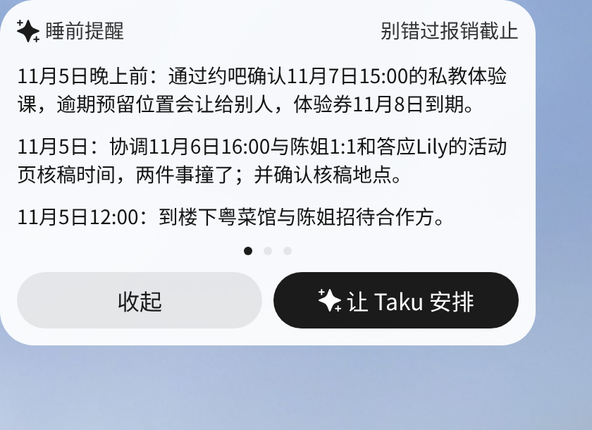
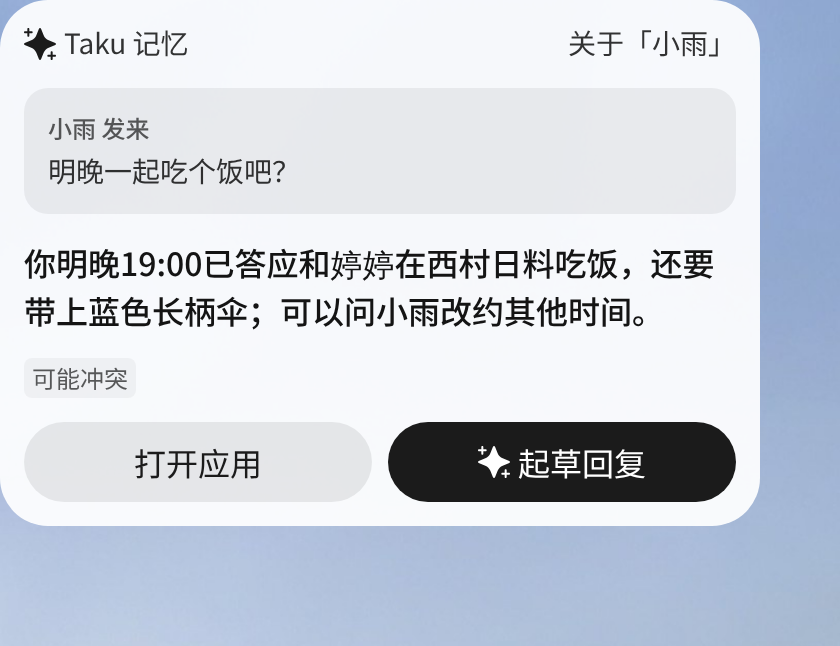
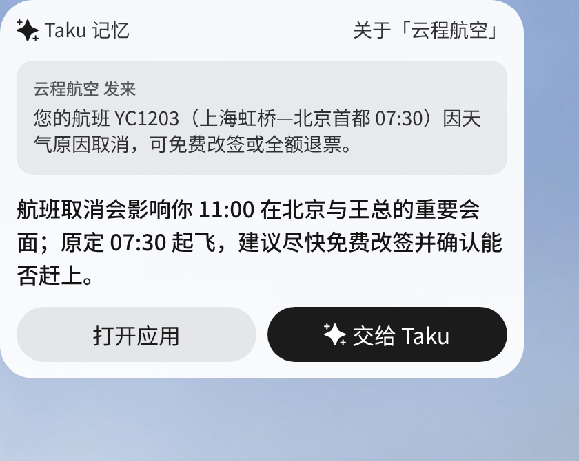
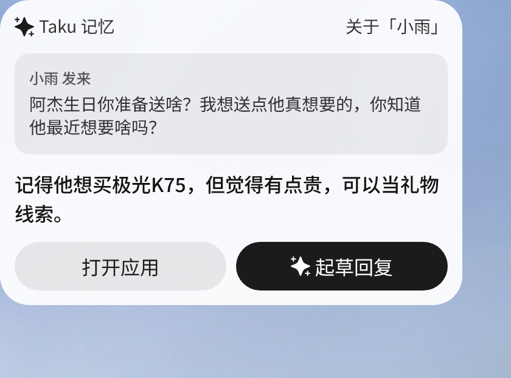

# Taku Memory 0.13.0: proactive reminders in the Taku home feed

2026-11-05 (Beijing time), Android 16 / API 36 / ARM64, dedicated test AVD `TakuRecall` (`emulator-5634`, `sdk_phone64_arm64` userdebug, SELinux Enforcing). Taku Memory 0.13.0 (versionCode 15); Broker and assistant retained from 0.12.0 acceptance. Artifact SHA-256 values: [acceptance.json](acceptance.json).

**Status: card-publication path emulator_verified; card appearance viewed only in the home project's web component preview, not yet on a phone with Taku Home installed.** Proactive reminders and home cards are both disabled by default. Scenario/UI quotations and names below are translated/transliterated; raw evidence retains the original observations.

## Implementation

Vela built Taku Home's card feed on `vela/TAKU-new-UI` (`4020c7a`), offering other modules two entry points: push JSON cards directly, or describe them in natural language for that module's AI to generate. This version integrates the first.

**Format** follows the home module's `modules/taku-home/CONTRACT.md`:

- Envelope `taku.feed-card/1`; body is json-render structure from the `taku-feed-1` component catalog;
- Publish through `content://org.agentos.agent.home-feed` method `feed/publish`; retract with `feed/retract`.

Memory uses only nine catalog components: Column, Row, AppHeader, Inset, Text, Tags, Pager, Dots, Button (`FeedCards`).

**Two card types**:

- **Bedtime reminder** `memory.brief.<reminder id>`:
  - Header “Bedtime reminder” and model-generated title;
  - Up to nine items, three per horizontally pageable page; at most two lines each, truncating sentences that do not fit;
  - Dismiss and Let Taku plan buttons: hand these items to Taku to plan tomorrow; replies to others are drafts only, without sending;
  - Retract the previous night's card after successfully publishing the new one; retain the old card if the new one is rejected. Expires at 23:59 the next day.
- **Message reminder** `memory.nudge.<reminder id>`:
  - Quotes original message above, with sender and text;
  - Taku's remembered information below;
  - Adds Possible conflict tag where applicable.
  - Buttons:
    - Left: Open app when a source app exists, otherwise Dismiss;
    - Right: Draft reply for invitations/questions/possible conflicts, otherwise Hand off to Taku; prompts explicitly say “Show me first; do not send.”
  - Expires after 24 hours.

**Rules**:

- Card content comes only from the reminder itself, without another model rewrite; wording matches the notification.
- One card and ID per reminder. Reminder table adds `card`, also returned by `nudge`.
- Card publication accompanies reminder delivery; notifications/system surfaces continue unchanged. Missing Home, rejection, or timeout only logs one line and does not affect the reminder.
- Switch in Settings → Organization and assistant, visible only when proactive reminders are enabled and a feed-capable Home is installed ([screenshot](shots/settings-toggle.png)). Open interface `content://org.agentos.memory.open-access` methods `configure` / `status` also read/write `feedCards`, documented in the assistant's `taku-open-access` guide.

## Results

### Home's own validation

- Used home project's `validateFeedSpec` (`src/feed/feedCatalog.ts`) plus envelope validation ([script](validate-cards.mjs)), running inside the home project.
- All [26 cards](feed-cards.json) passed:
  - 21 bedtime reminders using original model text from 0.12.0 acceptance;
  - Five message reminders using text from [one model run](message-cards.sh);
  - All assembled with 0.13.0 ([script](feed-preview.sh), no model call or delivery).
- All three cards published on the test device below also passed: `31 cards, 0 invalid`.
- The same script rejected deliberately corrupted cards: unknown components, buttons targeting nonexistent actions, and overlong pinned descriptions.

### In Home's component preview

Home project's `npm run gallery` (Expo web), `/components?feed=<id>`, width 420:

| Bedtime reminder (night four) | Message reminder: possible conflict |
| --- | --- |
|  |  |
| **Message reminder: canceled flight** | **Message reminder: gift clue** |
|  |  |

Also see [night eighteen](shots/brief-17.png).

Two initial layout problems were fixed:

- Checklist bedtime items showed only one line, truncating sentences; changed to paginated text;
- A corner badge over the original message obscured its body; removed it and wrote “From [sender]” inside the box.

### Actual card-publication path on the test device

Taku Home is absent on the test device. `build-tests.sh` separately creates `TakuHomeFeedStub.apk`:

- Same authority, method names, and return format as Home's `HomeFeedProvider`;
- Accepts cards and records the calling application.

After installing the stub, the [script](feed-e2e.sh) used debug `proactive` (`run` + `deliver`) to make actual model calls through Broker and actually deliver reminders ([results](feed-e2e.json)):

| Step | Reminder | Stub received |
| --- | --- | --- |
| Enable home cards; night eighteen bedtime reminder | “Handle Dad's birthday gift first,” eight items | Publish `memory.brief.9` |
| Xiaoyu: “Dinner together tomorrow evening?” | Possible conflict marked, recheck passed, mentions 19:00 dinner with Tingting | Publish `memory.nudge.10`, with Possible conflict, Open app (`com.tencent.mm`), and Draft reply buttons |
| Night nineteen bedtime reminder | “Handle urgent deadlines first,” eight items | Publish `memory.brief.11`, then retract `memory.brief.9` |
| Disable home cards; Xiaoyu asks what Ajie wants | Normal reminder mentioning Aurora K75 | No new card |

- All four calls came from `org.agentos.memory`.
- First three reminder rows stored their card IDs; the reminder after disabling had an empty card ID.
- Published cards shown in Home preview: [bedtime reminder](shots/device-brief.png), [message reminder](shots/device-message.png).

Open interface:

- Enabled/disabled `feedCards` through `org.agentos.memory.open-access`; Memory's own `status` returned matching values;
- Wrong type rejected without changing the original value.

### Component tests

All seven groups passed ([output](store-tests.txt)). **302 StoreTests**, with added checks:

- Structure, buttons, actions, and truncation for both card types;
- Only the nine components above used;
- Every button points to an action present in the card;
- Pinned tags/descriptions within length limits;
- Empty bedtime reminder produces no card;
- Reminder table stores card ID.

## Coordination needed with Home

1. **Feed open to local applications**:
   - Under AGENTS.md, `feed/list` requires no permission; any local app can list all cards.
   - Original messages and remembered content placed on Home are therefore readable by other local apps.
   - The switch explains this and defaults off.
2. **Component catalog copied from `feedCatalog.ts`, unavailable at runtime**:
   - If Home changes components/properties, Memory cards may be rejected, logging only while reminders still deliver.
   - Needs an API to read the catalog or its version.
3. **Source normalized to `agent`**: Home cannot directly identify Memory cards. Currently distinguishable only by `memory.` ID prefix and `source.app` / `source.package`.
4. **User responses require polling**: dismissals/button clicks appear in `feed/list` → `recentActions` (latest 50). Memory does not yet read them back.
5. **Home determines execution of Let Taku plan / Draft reply**:
   - Memory supplies only `ask-taku` prompts;
   - Which Agent receives them and whether the user sees them first have not been verified.

## Reproduction

- **Validation**: after `npm ci` in `system/agent-app` on `vela/TAKU-new-UI`, run:

  ```bash
  node <this-directory>/validate-cards.mjs feed-cards.json feed-e2e.json
  ```

- **Preview**:
  1. Prepend cards to `cards` in `public/feed-assets/sample-feed.json`;
  2. Run `npm run gallery`;
  3. Open `http://localhost:8083/components?feed=<id>`.
- **Publication path**:
  1. Build stub with `bash system/memory/build-tests.sh`;
  2. Install `out/tests/TakuHomeFeedStub.apk`;
  3. Push/run [feed-e2e.sh](feed-e2e.sh);
  4. **Uninstall stub afterward**: `adb uninstall org.agentos.memorytests.homefeed`. It occupies Home's authority and prevents installation of real Home while installed.

Run only on the dedicated test AVD; do not rerun capture cases on a device containing real memories. Device state after acceptance:

- 0.13.0 debug, proactive reminders and home cards both off;
- 22-day synthetic data rebuilt by 0.12.0;
- 0.12.0 Broker and assistant v76;
- Stub uninstalled.

## Known limits

- **Not viewed on real Home**:
  - Home project (`TakuAgent.apk`) could not be built this round: needs NDK, with some permissions also requiring platform signing.
  - Native rendering, button actions (`ask-taku`, `open-app`, dismiss), pinning, and expiry not verified on-device;
  - Only web preview and stub verified.
- **Same reminder appears twice**: notification and home card coexist; handling one does not yet dismiss the other.
- **Truncation**:
  - Bedtime reminder: at most nine items (model produces at most eight), two lines each;
  - Original message: at most 200 characters/four lines;
  - Taku's remembered sentence: at most 160 characters.
- **JSON entry point only**: natural-language entry and user-response readback remain unimplemented.

[Historical language evidence](../HISTORICAL-LANGUAGE.md) documents the intentionally retained Chinese-locale raw inputs, outputs, and reproduction scripts for this historical review.
