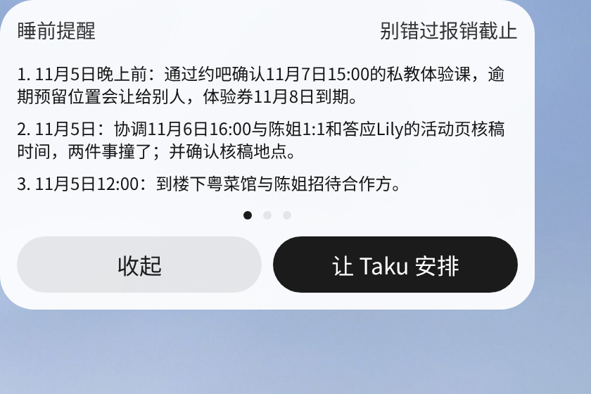
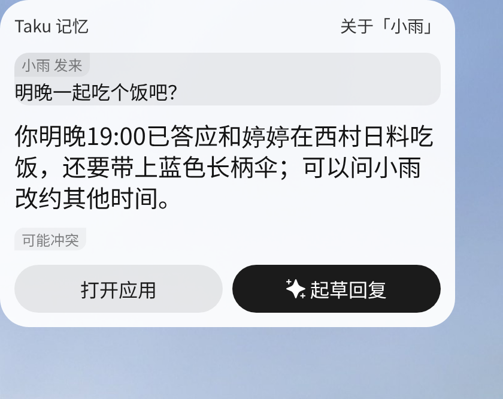

# Taku Memory 0.14.0: describe reminders for Home AI to design cards

2026-11-07 (Beijing time), Android 16 / API 36 / ARM64, dedicated test AVD `TakuRecall` (`emulator-5634`, `sdk_phone64_arm64` userdebug, SELinux Enforcing). Taku Memory 0.14.0 (versionCode 16); Broker and assistant retained from 0.12.0 acceptance. Artifact SHA-256 values: [acceptance.json](acceptance.json).

**Status: description path completed with a Home stub on the test device; Home AI results verified on the computer using Home's own generation code.** Not yet run on a phone with Taku Home installed. Proactive reminders, home cards, and Home AI card design are all disabled by default. Scenario/UI quotations and names below are translated/transliterated; raw evidence preserves the original observations.

## Implementation

Vela added `feed/generate` on `vela/TAKU-new-UI` (`9f8b497`):

- Given a description, Home generates a card through its configured model route (Android Magpie `agent-ui.text`);
- After validation, places it at the top with ID `agent-generated:<uuid>`.

0.13.0 integrated direct JSON publication; this version integrates descriptions.

**Switch**: after enabling Place in home feed, a new Let Home AI design cards option appears (`feedDescribe`, default off). UI, `configure`, and open interface all read/write it ([screenshot](shots/settings-describe.png)).

**Description contents** (`FeedCards.describeEvening` / `describeMessage`):

- Header wording;
- Text to copy verbatim:
  - Numbered bedtime-reminder items;
  - Original message and Taku's reminder sentence;
- Tag for possible conflicts;
- Buttons:
  - Supplies actions JSON directly and requires verbatim reuse;
  - Taku handoff text still says “Show me first; do not send.”
- Additional empirically derived writing requirements, discussed under Description wording below.

Descriptions use the UI language, Chinese or English.

**After receiving a card** (`ProactiveNotice.described`, `FeedCheck`):

- Read back the entire card through `feed/get` and check:
  - Actions match requirements, ignoring whitespace;
  - Every action is reachable by a button;
  - Every supplied passage appears verbatim, at least its first 24 characters.
- Retract nonconforming cards.
- If Home fails to generate or produces a nonconforming card, retry at most once; if still unsuccessful, publish a 0.13.0 fixed-style card.
- Do not retry a nonresponse from Home, because it may already have generated a card.

**Expiry retraction**:

- Generated Home cards do not expire (`expiresAt` empty), so Memory stores deadlines itself in `feedExpiring`:
  - Message cards: 24 hours;
  - Bedtime cards: next day 23:59, also replaced by the next evening's card.
- Retraction occurs:
  - Before each card publication;
  - After nightly organization, even when switches are off.

**Do not block reminders**: card publication moves to a separate serial background thread. The description path can wait up to two minutes; notifications do not wait for it.

**Debugging**: `feedPreview` with `describe: true` returns description, actions, required text, and expiry without model calls or delivery.

## Results

### Home generation code + actual model on the computer

1. On the test device, 0.14.0 converted the 26 reminders from 0.13.0 (21 bedtime, five message) into descriptions ([script](describe-preview.sh), [descriptions](describe-asks.json)).
2. Passed to Home's own `prepareFeedGeneration` ([script](generate-real.mjs)): same instructions, strict JSON parsing, and `validateFeedSpec`.
3. Model `gpt-6-luna`, via local Codex, no tools, low effort. The actual phone model is determined by `agent-ui.text` and may differ.
4. Accepted cards then checked by Memory's `FeedCheck`, running the same Java source as on the phone, on the computer ([CheckRun.java](CheckRun.java)).

Two runs ([per-item results, cards, and original model output on failures](generation-runs.json)):

| | First run | Second run |
| --- | --- | --- |
| Home generation code passed | 24 / 26 | 24 / 26 |
| Also passed Memory checks | 24 | 24 |
| Usable in at least one run | 25 / 26 | |
| Time per card (median / maximum) | 24 seconds / 36 seconds | 24 seconds / 29 seconds |

- Failures:
  - Night ten had one extra JSON bracket in both runs (`INVALID_MODEL_OUTPUT`); its items were longest.
  - Two other cards had buttons disconnected from the root (`INVALID_SPEC`), one different card in each run.
- Memory retries each such case once, then publishes a fixed-style card if needed, so a card still appears.

Resulting appearance in Home's web component preview, width 420:

| Bedtime reminder (night four) | Message reminder: possible conflict |
| --- | --- |
|  |  |

Also see [night eighteen](shots/generated-brief-17.png), [gift clue](shots/generated-nudge-3.png).

### Description wording

For the same 26 items and model, wording made a large difference (single runs):

| Description | Home generation passed | Also passed Memory checks |
| --- | --- | --- |
| Only says each button dispatches its corresponding actionId on press | 14 | **0** |
| Writes out on.press JSON | 19 | 5 |
| Says add an on field alongside type, props, children, and output summary, actions, ui in that order | 24, 21 | 24, 21 |
| Additionally avoids avatar-requiring components and requires Pager/Dots attachment (final) | 24, 24 | 24, 24 |

- **Buttons did nothing**: most Home-validated cards in the first two versions had this issue. Home validation allows buttons without actions; Memory rejected 26 such cards (`no button for …`), plus two that changed Taku handoff text (`intent changed`).
- **Avoid literal “on.press”**: the second version wrote it in the description, and the model literally created a `"on.press"` property in props.
- **Effort**: changing the second version to medium did not improve it (13 passed, eleven usable).

### Description path on the test device

Taku Home is absent. Stub `TakuHomeFeedStub.apk` adds `feed/generate` and `feed/get`:

- No model call; places the original description on the card and builds buttons from its actions;
- `feed/stub` switches to tampered Taku handoff text (`tamper`) or rejection (`refuse`).

The [script](describe-e2e.sh) uses debug `proactive` (`run` + `deliver`) to make actual model calls through Broker and actually deliver reminders ([results](describe-e2e.json), [log](describe-e2e-logcat.txt)):

| Step | Stub mode | What happened |
| --- | --- | --- |
| Night eighteen bedtime reminder | Normal | Generated Home card retained; reminder table stored `agent-generated:…` |
| Xiaoyu: “Dinner together tomorrow evening?” | Normal | Same |
| Xiaoyu asks what Ajie wants | Tampered Taku handoff text | Both attempts rejected by checks and retracted; fixed-style `memory.nudge.15` published |
| Night nineteen bedtime reminder | Reject | First retracted Xiaoyu's card older than 24 hours; after two rejections published fixed-style `memory.brief.16`, then retracted night eighteen's card |

- All calls came from `org.agentos.memory` on the background thread.
- In four descriptions recorded by the stub, message and Taku wording were this run's original model text.
- Open interface:
  - Enabled/disabled `feedDescribe` through `org.agentos.memory.open-access`; `status` read matching values;
  - Wrong type rejected, original value unchanged.

### 0.13.0 fixed-style cards

Vela recently changed the component catalog to stricter validation. Rerunning 31 cards from 0.13.0 through `9f8b497`'s `validateFeedSpec` still yielded `31 cards, 0 invalid`.

### Component tests

All seven groups passed ([output](store-tests.txt)). **319 StoreTests**, with added checks:

- Descriptions list each item in order and verbatim, skipping empty items;
- Original actions included, secondary button first; Taku handoff retains Do not send wording;
- Fixed-style and description buttons agree;
- Bedtime cards retracted next day, message cards after 24 hours;
- Descriptions of nine long items remain within Home's 16,000-character limit;
- Validation:
  - Fixed-style card itself passes;
  - Changed Taku handoff, extra actions, changed reminder text, and buttons without actions are rejected;
  - Text stored in state and bound into the UI also counts;
  - One extra trailing newline does not count as alteration.

## Coordination needed with Home

Four points from 0.13.0 remain: permission-free feed, unavailable component catalog, source normalized to `agent`, user responses available only by polling. Description generation adds:

1. **Buttons without actions pass validation**: Home publishes these cards even though pressing does nothing. Memory blocks them; other callers do not.
2. **One-shot generation**: one wrong JSON bracket fails the entire card. Home-side retry or format repair would avoid Memory-side retry.
3. **Generated cards do not identify Memory**: `source.app` fixed to Taku; pinned label uses the first 24 summary characters; no expiry. Memory must track IDs and retract on time.
4. **Another model call**: descriptions contain original messages and memory content, sent again to a model service through Home's `agent-ui.text` route.

## Reproduction

- **Descriptions**: run [describe-preview.sh](describe-preview.sh) on a debug build.
- **Home generation code + actual model**:
  1. Run `npm ci` in `system/agent-app` on `vela/TAKU-new-UI`;
  2. Set `TAKU_SIM` to a taku-sim with Codex already logged in, then run:

     ```bash
     node <this-directory>/generate-real.mjs describe-asks.json <output-directory> 4
     ```

  3. Compile/run `CheckRun.java` with Memory's `FeedCheck.java` and `org.json`.
- **Description path on test device**:
  1. `bash system/memory/build-tests.sh`；
  2. Install `TakuHomeFeedStub.apk`;
  3. Push/run [describe-e2e.sh](describe-e2e.sh);
  4. **Uninstall stub afterward**: `adb uninstall org.agentos.memorytests.homefeed`.

Run only on the dedicated test AVD; do not rerun capture cases on a device containing real memories. Device state after acceptance:

- 0.14.0 debug, proactive reminders, home cards, and Home AI card design all off;
- 22-day synthetic data rebuilt by 0.12.0;
- 0.12.0 Broker and assistant v76;
- Stub uninstalled.

## Known limits

- **Not run on real Home**:
  - Actual phone model for `agent-ui.text` and latency unmeasured;
  - Native rendering and button actions of generated Home cards untested.
- **Computer results represent only `gpt-6-luna`**: called through Codex, unlike Home's on-phone invocation; another model may yield different pass rates.
- **Checks only the first 24 characters**: model changes later in a passage go undetected.
- **Home nonresponse can leave an unknown card**: for example, timeout or process exit around submission. Memory lacks its ID and will not retract it.
- **User responses still unread**: dismissals and button clicks have not yet been read back into Memory.

[Historical language evidence](../HISTORICAL-LANGUAGE.md) documents the intentionally retained Chinese-locale raw inputs, outputs, and reproduction scripts for this historical review.
