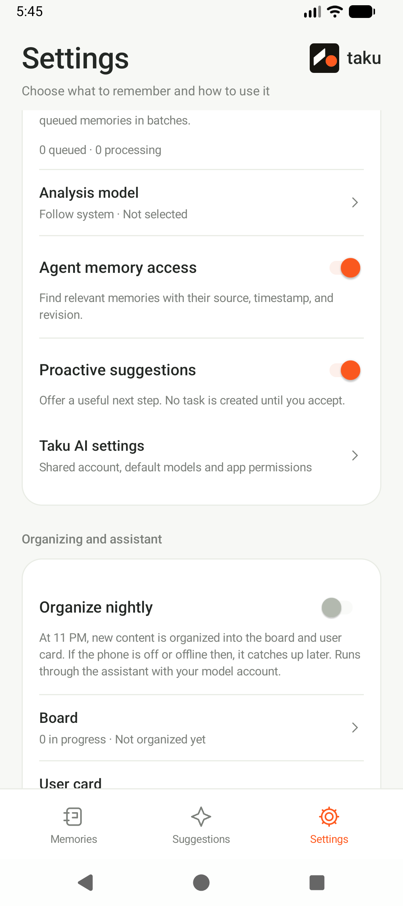
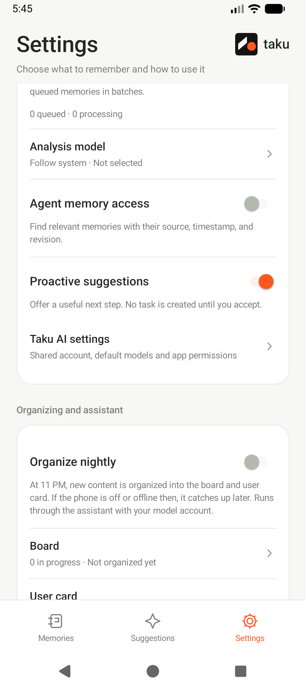

# Memory 0.15.1: supplemental acceptance on 2026-11-13

This round used synthetic data only in isolated AVD `Taku_OpenSourceAcceptance_20261113` (Android API 37, ARM64). No physical phone was operated and no new ROM was released.

## Query-switch fix

Source fix `3fb8475` was followed by a normal main merge to `b8040a463c05c8df57e2a60809d31a7d63a01d9f`, without changing Memory source. Open interfaces and signed consumers share the Store query implementation, with authorization checks and reads under the same lock. Clearing Binder identity does not inherit the application's own query exemption.

- [Ordinary-UID open-interface checks](OpenAccessQueryTests-query-switch.txt): **32/32**. Without ACCESS_MEMORY signature permission, eight read categories reject access while the switch is off, work after explicitly enabling it, and reject again after disabling it. Reads never silently change settings.
- [Actual SQLite storage checks](StoreTests-query-switch2.txt): **386/386**. Public edits with querying disabled return only `id/revision`. Old content/history remain stored but do not leak through edit receipts; explicitly enabling access permits history queries.
- [Actual GUI round trip](gui-query-roundtrip.json): enabling Agent memory access in Memory settings permits public `nudges`; disabling it in the same GUI returns false status and explicit read failure.
- Release APK (`debug hooks=false`) and independent test APK compiled/installed successfully; `npm run verify` passed.

Release APK SHA-256: `cc46c652442f9780a23c62564aeb47aedd30dfe42ae65739f51b7ad0dbc39f96`.
Test APK SHA-256: `0c724db7be8867aa6c3d4b63c2cc4516f7fc75129011cd005b373905bfec7239`.

Management operations such as `configure` retain GUI parity; Agents/local applications may explicitly change operating switches. This fixes queries returning content while the switch is off, not isolation from malicious local apps. Local GUI browsing and explicit API edits remain available.

## Home cards and maintenance

These independent component checks occurred the same day before the query-switch fix; they are not complete model-conversation acceptance:

- [Lifecycle script](feed-e2e-api37-longtime.json): all original 22 checks passed, using real Memory publication/readback and synthetic HomeFeedStub. Android mksh's 32-bit epoch-arithmetic issue was fixed. The script now covers both disabled/enabled open-access expectations, already covered by ordinary-UID tests above; the revised complete 23-check script was not rerun.
- [Actual Taku Home Hide button](real-home-hide.json): tapping Hide on a synthetic card recorded `origin=gui`; Memory read back the same remove/action:hide.
- [Actual Android JobScheduler 4101](real-home-scheduled-expiry.json): actual Home received a synthetic card; with automatic organization disabled, advancing only Memory's debug clock and triggering maintenance retracted it. System time was unchanged; release builds still use only system time.

## Not covered

The isolated emulator had no real model account; full SharedAiClientTests model-connection acceptance did not pass. These checks did not borrow production model credentials. Physical-device acceptance was paused at the user's request. Source merge, CI, security review, and new-ROM publication each need separate confirmation; this report does not replace them.

[Historical language evidence](../HISTORICAL-LANGUAGE.md) documents the intentionally retained Chinese-locale raw inputs, outputs, and reproduction scripts for this historical review.
