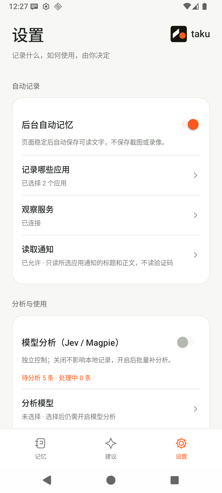
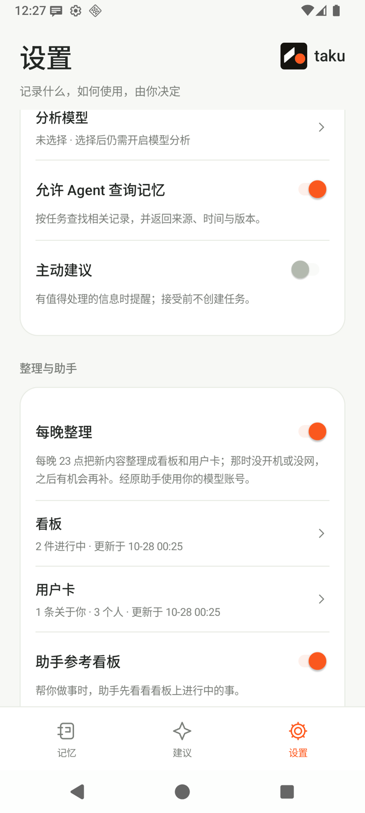
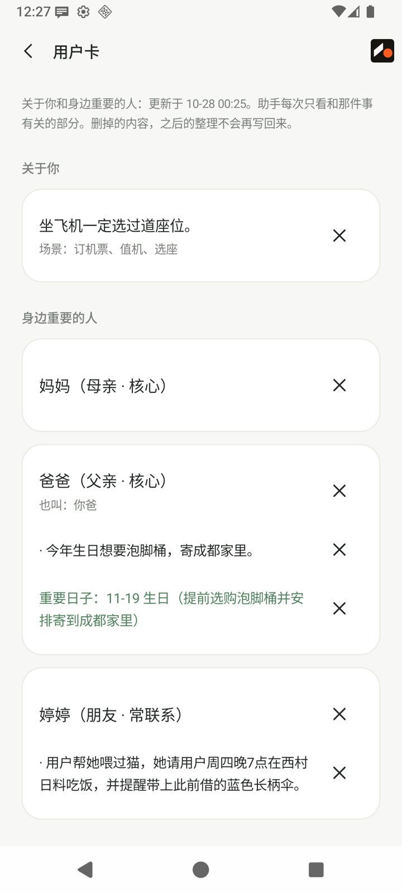
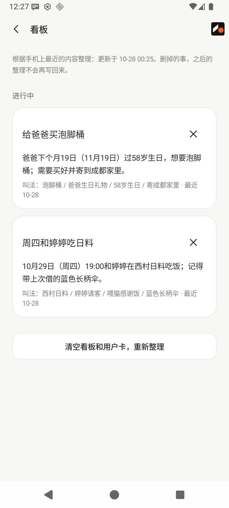

# Taku Memory 0.5.0: emulator acceptance

2026-10-28 (Beijing time), Android 16 / API 36 / ARM64, dedicated test AVD `TakuRecall` (`emulator-5634`, `sdk_phone64_arm64` userdebug, SELinux Enforcing). Based on team commit `96e2409` (pre-merge branch baseline), Taku Memory 0.5.0 (versionCode 6; changed to 0.7.0 / versionCode 9 after merging into main) and `agentos-task-broker` built from the same commit. Artifact/dependency SHA-256 values and results are in [acceptance.json](acceptance.json).

**Status: emulator_verified.** Physical hardware at the same version, full ROM (the ONNX Runtime JNI-library and model-resource declarations in `Android.bp` have not been built in an AOSP tree), cold startup, and long-term power consumption remain untested. Effectiveness figures come from one synthetic user's 22-day timeline, with each question run once or twice.

## Changes in this version

- **Storage and retrieval (since 0.4)**: stores only newly added lines relative to the latest version of a page; no forgetting by default. Notifications come through user-authorized notification access. On-phone bge-small-zh-v1.5 vectors (offline), keywords, and graph nodes are combined by rank fusion.
- **Nightly organization**: through the existing assistant Broker and the user's own model account, organizes new content into graph nodes, a “Recent activity” board, and a short user card. If the 23:00 hour is missed (power off, sleep, no network), catches up later; retries failures after 30 minutes.
- **How the assistant uses it**: supplies the entire board; selects user-card entries per message: persistent personal habits and core family; people with appointments or occasions in the next three days; people and habits relevant to this message; today's new statements not yet organized into the card (quoted, excluding links and instruction-like wording). Notes whose dates have all passed are marked “Date passed.”
- **Deletion and correction**: invalidates graph-node, board, and user-card versions that cited deleted/corrected records. Background jobs promptly reorganize remaining records (including corrected text); deletion during organization prevents saving stale results; node IDs are not reused. Corrected content replaces the entire original record in search, full text, and vectors; previous versions remain in edit history.
- **Privacy**: applies rule-based filtering again before saving and display. User cards exclude other people's illnesses/body details, physique, relationship/family conflicts, finances, and private resignation/job-change plans. Medical checkups/hospitalization remain only when written alongside something the user must do; colleague departures retain only handover details. Excludes the user's diagnoses, medication, income, and accounts; masks long numbers; drops instruction-like entries.
- **User control**: Settings → Organization and assistant shows the board and user card, with single-entry deletion, whole-person deletion, and clear/rebuild. Besides informing the organizer model about deletions, direct name/similar-wording checks block deleted content before saving and display. “Assistant references board / user card” can be disabled separately.
- **Build and switches**: simulated time, organization at a specified time, and user-card-only rebuild exist only in `TAKU_DEBUG_HOOKS=1` debug builds and are root-only. Release builds reject these parameters and must bundle the vector model. `vector-dependencies.json` pins vector dependencies; the first build downloads and verifies them automatically.

## Fresh release installation

Uninstalled and installed the release package, using real time and actual organization without test switches:

| Check | Result |
| --- | --- |
| Test switches | Simulated time, organization at a specified time, and user-card-only rebuild all rejected |
| Capture and retrieval | All seven synthetic notifications stored and vectorized with the bundled model; keyword + vector retrieval hit |
| Nightly organization | About 48 seconds once; graph / board / user card each about 20,000 tokens |
| Privacy | Synthetic “I want to resign and open a guesthouse in Dali” and a message disguised as an instruction did not enter the board or user card (quotation translated) |
| Per-message card selection | First call 52 ms, subsequent calls about 8 ms |
| Record deletion | Graph nodes 7 → 5; board and user-card versions invalidated; background job rebuilt automatically; deleted facts no longer appeared on the card |
| Record correction | Old wording no longer searchable, new wording hit version 2; graph nodes rebuilt from new content with new IDs; user card updated accordingly |
| Retention | Enabling one day no longer crashes (cleanup and reads previously called each other recursively without bound) |
| UI deletion | Deleting one user-card note took effect immediately and entered the “Do not restore” list |

## Storage tests

Isolated SQLite tests using production `MemoryStore`, retrieval, organization, and privacy code: all **97 StoreTests** and **69 QueueTests** passed ([output](store-tests.txt)). Covers deletion/correction invalidation and rebuilding of graph/board/user card, no node-ID reuse, no saving after mid-organization deletion, hard user-deletion blocking, privacy tiers, release rejection of test switches, and organization timing (catch-up, no duplicates, failure wait).

## Conversation regression

Debug package, restoring the same 22-day synthetic timeline, asking the original assistant at each question's timestamp, and scoring whether replies recalled the expected points:

| | 0.5.0 | Previous round (without this version's filters and labels) |
| --- | --- | --- |
| Difficult cross-topic questions (twice) | 6, 8 / 11 | 7, 8 / 11 |
| Association questions | 10/11 | 10/11 |
| Trigger messages | 5/7 | 5/7 |
| Bedtime review | 21/25 | 21/25 |

Added filters and labels did not reduce effectiveness; individual questions shifted ±1 in both directions. Earlier results on the same timeline: bedtime review 13/25 with only the board, 15/25 with the first user card; difficult cross-topic questions 5/11 without a user card.

## Screenshots

| Settings: notification access | Settings: organization and assistant |
| --- | --- |
|  |  |
| **User card, with per-entry deletion** | **Board** |
|  |  |

## Reproduction

```bash
bash system/memory/build.sh                         # Release; first build prepares vector dependencies automatically
TAKU_DEBUG_HOOKS=1 bash system/memory/build.sh      # Debug package for replay evaluation
bash system/memory/build-tests.sh
bash system/assistant/build.sh                       # Matching Broker
adb install -r system/memory/out/tests/TakuMemoryTests.apk
adb shell am instrument -w org.agentos.memorytests/org.agentos.memory.StoreTests
adb shell am instrument -w org.agentos.memorytests/org.agentos.memory.QueueTests
```

Run only on the dedicated test AVD; do not rerun capture cases on a device containing real memories. After acceptance, the test device retained the debug package and 22-day synthetic data.

## Known limits

- The assistant answers only the specific question asked; facts already on the card but outside that question (such as a family birthday tomorrow) are not proactively mentioned. One-off errands are recalled inconsistently; associations when receiving a message are about 70%.
- Nightly organization uses about 90,000–100,000 tokens per user per night. Deleting very old records requires reorganizing the board and user card from before that point; cost grows with the time span.
- Deletion does not retract old conversation content already sent to the assistant.
- Release package is about 107MB (fp32 model 95MB); quantized models have not been evaluated.

[Historical language evidence](../HISTORICAL-LANGUAGE.md) documents the intentionally retained Chinese-locale raw inputs, outputs, and reproduction scripts for this historical review.
