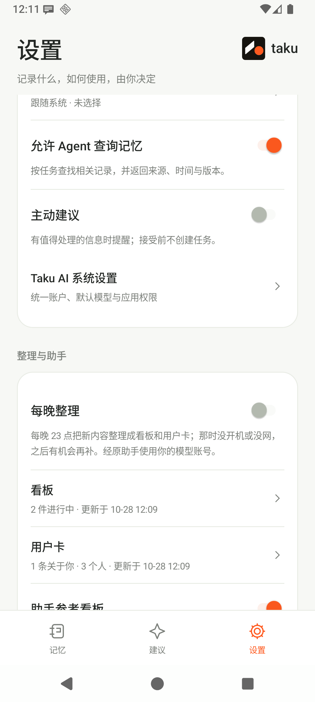
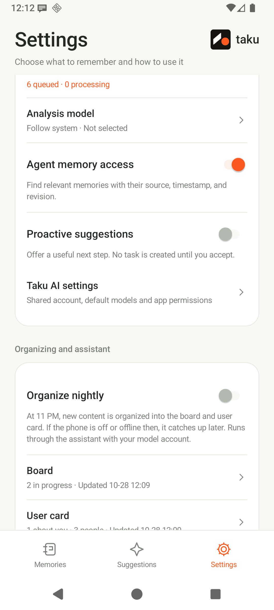
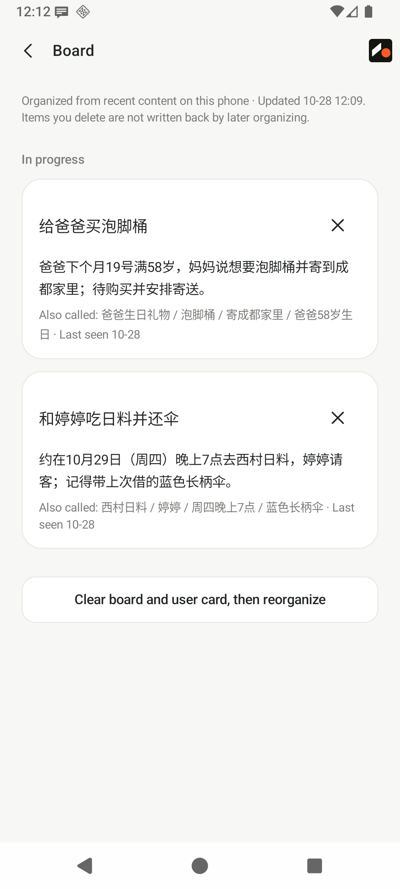
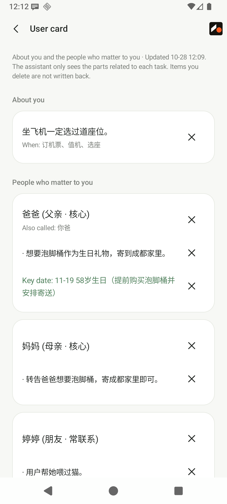

# Taku Memory 0.7.0: emulator retest after merging main

2026-10-28 (Beijing time), Android 16 / API 36 / ARM64, dedicated test AVD `TakuRecall` (`emulator-5634`, `sdk_phone64_arm64` userdebug, SELinux Enforcing). Taku Memory 0.7.0 (versionCode 9), after merging the 0.4–0.5 branch (baseline `96e2409`, acceptance in the [0.5 record](../taku-memory-0.5-2026-10-28/README.md)) with main `1199de2` (Memory 0.6.0, assistant v73), with matching assistant APK v73 and `agentos-task-broker` built from the same commit. Artifact SHA-256 values are in [acceptance.json](acceptance.json).

**Status: emulator_verified.** Physical hardware at the same version, full ROM, cold startup, and long-term power consumption remain untested. The 22-day synthetic timeline's conversation regression was not rerun on the merged version (recall, organization, and privacy code were unchanged in the merge; see below).

## Merge changes

- **Version**: main had already used 0.5.0 / versionCode 6 and 0.6.0 / versionCode 8; the merged version is 0.7.0 / versionCode 9, allowing overwrite installation over older versions from either line.
- **System AI**: nightly organization (Broker `MemoryGen`) follows the Taku AI switch, like per-record analysis; settings changes during organization discard results; calls enter the same recent-call log. Organization still uses fixed organizer models rather than following the system text model.
- **UI**: settings rows added in 0.5 (notification access, organization and assistant), board/user-card pages, organization status, and errors now all use main's Chinese/English string resources. Retention adds bilingual “Forever” wording and removes the obsolete “At most 1,000 records.”
- **Content presentation**: main's title/summary extraction now reads full text (a single-line record's body may be empty with incremental storage).
- **Build**: `build.sh`, `build-tests.sh`, and `Android.bp` include both main's Markdown and 0.5's vector dependencies; APK includes ONNX Runtime and bge-small-zh-v1.5 license text.

## Storage and component tests

In the same test APK, all **97 StoreTests**, **69 QueueTests**, **8 ResultTests**, **36 PresentationTests**, **2 GatewayBoundaryTests**, and **24 SystemAiTests** passed ([output](store-tests.txt)). SharedAiClientTests requires a tester to authorize the test app in Taku AI and make a real model call; it was not run this round. It tests main's shared client, unchanged by the merge.

## In-place upgrade

The test device held the 0.5.0 debug package and 22-day synthetic data (schema 3). Direct overwrite installation of the 0.7.0 release retained 1,537 records, 1,537 vectors, 265 graph nodes, and 22 board/user-card versions; the new “Follow system model” option was default. Upgrade from main's 0.6.0 (schema 2) was not tested on-device; it uses the same migration verified for 0.3.1 → 0.5.

## Fresh release installation ([log](smoke11.txt))

First installed assistant v73 and Broker from the same commit and restarted; then uninstalled Memory and freshly installed 0.7.0 release, using real time and actual organization:

| Check | Result |
| --- | --- |
| Test switches | Simulated time, organization at a specified time, and user-card-only rebuild all rejected |
| Capture and retrieval | Seven synthetic notifications stored and vectorized (model extracted from APK, 94,851,877 bytes); keyword + vector retrieval hit |
| Nightly organization | About 64 seconds; graph / board / user card about 27,000 / 25,000 / 27,000 tokens; all three calls recorded as `memory` in Taku AI recent calls |
| Privacy | “I want to resign and open a guesthouse in Dali” and instruction-disguised messages excluded from board and user card (quotation translated) |
| Per-message card selection | First call 105 ms, later 12 ms |
| Record deletion | Graph nodes 8 → 6; board/user-card versions invalidated; background job rebuilt in about 38 seconds; deleted wedding invitation no longer on card |
| Record correction | New wording hit version 2; user card rebuilt from corrected content (massager → foot-soaking tub) |
| Retention | Enabling one day did not crash; then restored Forever |
| Disable Memory in Taku AI | With new content present, manual organization rejected (“System AI has paused this feature,” translated); graph, board, and user card unchanged, no new call record; normal after settings restored |

## Interface

| Settings (Chinese) | Settings (English) |
| --- | --- |
|  |  |
| **Board** | **User card** |
|  |  |

Board and user-card content was written in Chinese by the organizer model and does not translate when the UI language changes.

## Known limits

- Conversation regression over the 22-day synthetic timeline was not rerun on the merged version; 0.5 branch results are in the [0.5 record](../taku-memory-0.5-2026-10-28/README.md).
- Nightly organization uses fixed models (`gpt-6.1-sol` for graph/user card, `gpt-6-luna` for board); selecting a different system text model in Taku AI does not affect organization.
- This round used more organization tokens than the same 0.5-branch smoke test (about 60,000); model output varies between individual runs.
- Physical hardware at the same version, full ROM (ONNX Runtime JNI-library and model-resource declarations in `Android.bp` not built in an AOSP tree), cold startup, and long-term power consumption remain untested.
- After retesting, the device held assistant v73, Memory 0.7.0 release, and this smoke test's data; backup of the original 22-day synthetic data is on-device at `/data/local/tmp/recall/backup-0.5-22day.tgz`.

[Historical language evidence](../HISTORICAL-LANGUAGE.md) documents the intentionally retained Chinese-locale raw inputs, outputs, and reproduction scripts for this historical review.
