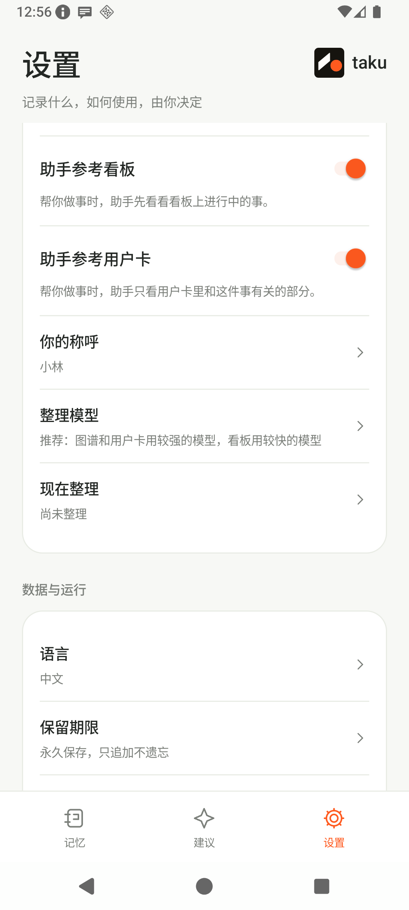

# Taku Memory 0.8.0: emulator acceptance

2026-10-29 (Beijing time), Android 16 / API 36 / ARM64, dedicated test AVD `TakuRecall` (`emulator-5634`, `sdk_phone64_arm64` userdebug, SELinux Enforcing). Taku Memory 0.8.0 (versionCode 10) and `agentos-task-broker` built from the same commit; main's assistant v73 on the test device. Artifact SHA-256 values: [acceptance.json](acceptance.json).

**Status: emulator_verified.** Physical hardware at the same version, full ROM, cold startup, and long-term power consumption remain untested. Effectiveness figures come from one synthetic user's 22-day timeline, each question run once or twice.

## Changes in this version

- **English privacy rules**: added English handling for other people's sensitive information, medical care/actions, departure/handover, the user's sensitive information, instruction-like content, and date normalization for deletion comparison. Today's original statements follow the same filtering and can match messages by English words.
- **Organizer models and cost**: choose Recommended / Follow Taku AI text model / specified Codex model. Organization threads no longer persist to disk; organizer instructions replace the runtime's coding-assistant instructions and unused tools are disabled. Settings show tokens and models for the latest organization; old organizer conversations are deleted at the first organization.
- **Proactive reminders**: per-message user-card selection adds “Plans and deadlines over the next two days” from the memory graph. After answering, the assistant mentions important occasions, deadlines, and conflicts from today through the day after tomorrow, without repeating them in the same conversation.
- **Notify assistant after deletion**: after deleting/correcting a record or deleting/editing the board or user card, an already-started conversation receives one invalidation notice on the next turn without restating deleted content.
- **Quantized vector model**: dynamically quantized bge-small-zh-v1.5 (24MB), automatically recomputing all vectors after upgrade. Release package 107MB → 37MB.

## Component tests

All 253 passed: **114 StoreTests** (13 new English privacy cases, four two-day schedule cases), QueueTests 69, ResultTests 8, PresentationTests 36, GatewayBoundaryTests 2, SystemAiTests 24 ([output](store-tests.txt)).

## Fresh release installation ([log](smoke12.txt))

Uninstalled and installed 0.8.0 release, using real time and actual organization with the same seven synthetic notifications as 0.7.0:

| Check | 0.8.0 | 0.7.0 |
| --- | --- | --- |
| Tokens for one organization (recommended models) | **35,689** | 79,114 |
| Follow Taku AI (`gpt-6-luna`) to organize one new notification again | 36,979; all three steps used `gpt-6-luna`, source recorded as `system` | — |
| Vector model | Extracted 24,010,842 bytes from APK; all seven records vectorized | 94,851,877 bytes |
| Test switches | All rejected | All rejected |
| Privacy | Other people's resignation plans and instruction-disguised messages excluded from board/user card | Same |
| Record deletion | Graph nodes 7 → 5; board/user-card versions invalidated; background rebuild about 38 seconds; wedding invitation no longer appeared; board received by Broker included `revokedAt` | Same (without `revokedAt`) |
| Record correction | User card changed to foot-soaking tub | Same |
| Disable Memory in Taku AI | Organization rejected; derived content unchanged | Same |
| Old organization conversations | 207 old archived organization conversations containing memory evidence on the test device deleted at first organization | — |

The first organization took about three minutes, mainly deleting those 207 old conversations; subsequent runs were comparable to 0.7.0. Graph nodes, board, and user card were of the same kind as 0.7.0. The board model (`gpt-6-luna`) once misclassified dinner that evening as already past; 0.7.0 uses the same model.

## Quantized model comparison

Compared fp32 and quantized versions on the computer using the same tokenizer, 1,537 records from the 22-day synthetic dataset, and 72 queries (regression questions and expected points):

| | Dynamic quantization `model_quantized` (adopted) | `model_int8` |
| --- | --- | --- |
| Document-vector cosine similarity to fp32 (mean / minimum) | 0.990 / 0.984 | 0.967 / 0.956 |
| Same top result as fp32 | 91.7% | 72.2% |
| Top-10 overlap with fp32 | 88.5% | 81.2% |
| fp32 top five retained in top ten | 99.2% | 97.8% |
| Encoding time per document (relative to fp32) | About 0.4× | About 0.33× |

Upgrading from 0.5 fp32 data on the test device recomputed 1,537 documents and 354 graph-node versions in about 30 seconds.

## Conversation regression

Debug package, restoring the same 22-day synthetic timeline (board, user card, and graph organized by 0.5), asking assistant v73 at each question's timestamp. Rescored 0.5 answers using the same criteria:

| | 0.8.0 | 0.5 |
| --- | --- | --- |
| Difficult cross-topic questions (twice) | **10, 9 / 11** | 6, 8 / 11 |
| Association questions | 11/11 | 11/11 (then recorded as 10/11) |
| Trigger messages | 5/7 | 5/7 |
| Bedtime review | 21/25 | 21/25 |

- Improvement on difficult cross-topic questions came from proactive reminders: asking about dinner with Xiaoyu tomorrow evening mentioned Dad's birthday tomorrow; asking about overtime tomorrow evening mentioned the air-fryer balance due tomorrow; asking about tomorrow's workout mentioned locker renewal and cleaning time. Scenario names and quotations are translated/transliterated here; raw regression evidence retains the actual Chinese inputs and replies.
- Bedtime-review score stayed unchanged with different misses: newly recalled credit-card repayment and medical-insurance renewal (one-off items in the two-day schedule), but newly missed the Beijing hotel and Ajie's birthday-party time.
- Trigger messages were unchanged: still did not proactively mention Ajie's birthday-party time or significance such as “A competitor is also pursuing this.”
- Assistant tokens per question were comparable to 0.5 (about 95,000–150,000); some answers included quite a few incidental reminders.

## After merging latest main

After merging main `8319d1a`, every Memory APK file matched the accepted version above; Broker additionally included main's workspace fix (SHA-256 in acceptance.json). Replaced Broker on the test device with the merged version: service started normally and the organizer-model list returned normally. Reran one regression question (difficult cross-topic “Xiaoyu invites me to dinner tomorrow evening”); it still identified the conflict with dinner with Tingting and reminded the user of Dad's birthday tomorrow.

## Screenshot



## Reproduction

```bash
bash system/memory/build.sh                         # Release; first build prepares quantized vector dependencies automatically
TAKU_DEBUG_HOOKS=1 bash system/memory/build.sh      # Debug package for replay evaluation
bash system/memory/build-tests.sh
bash system/assistant/build.sh                       # Matching Broker
adb install -r system/memory/out/tests/TakuMemoryTests.apk
adb shell am instrument -w org.agentos.memorytests/org.agentos.memory.StoreTests
```

Run only on the dedicated test AVD; do not rerun capture cases on a device containing real memories. After acceptance, the device held the 0.8.0 debug package, 22-day synthetic data (vectors recomputed using the quantized model), assistant v73, and 0.8.0 Broker.

## Known limits

- The smoke-test Broker lacked one change from the final commit: old-organization cleanup also covers unarchived conversations (one remained on the test device). Listing/deleting that case was verified only locally with Codex 0.161.0, not rerun on the test device.
- Associations when receiving messages (trigger messages 5/7) did not improve; bedtime-review total stayed unchanged.
- Fixed organization overhead fell to about one third, but mandatory runtime tool definitions still dominate each request; nightly tokens grow with new content volume.
- Board and user-card content is written in Chinese by the organizer model and does not translate with UI language.
- Content already sent to model services cannot be retracted; invalidation notices constrain only subsequent answers.
- Quantized-model comparison measures agreement with fp32, not independently labeled retrieval accuracy.

[Historical language evidence](../HISTORICAL-LANGUAGE.md) documents the intentionally retained Chinese-locale raw inputs, outputs, and reproduction scripts for this historical review.
