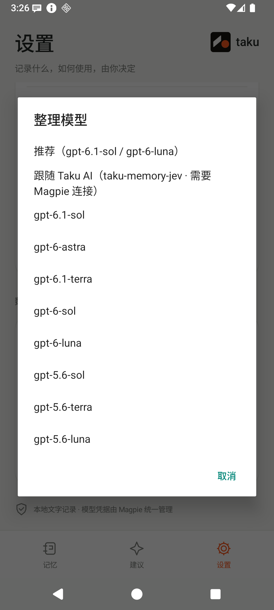

# Taku Memory 0.8.1: latest-main retest and emulator acceptance

2026-11-02 (Beijing time), Android 16 / API 36 / ARM64, dedicated test AVD `TakuRecall` (`emulator-5634`, `sdk_phone64_arm64` userdebug, SELinux Enforcing). Baseline main `a4bc391`. Taku Memory 0.8.1 (versionCode 11) and `agentos-task-broker` built from the same commit; main's assistant v74 (`20261028-main-workspaces`) on the test device. Artifact SHA-256 values: [acceptance.json](acceptance.json).

**Status: emulator_verified.** Physical hardware at the same version, full ROM, cold startup, and long-term power consumption remain untested. Effectiveness figures come from one synthetic user's 22-day timeline, each question run once or twice.

## Changes in this version

- **Organization threads no longer carry assistant background**: Broker added assistant context (device environment, skill directory, board, user card) to every `turn/start`, including organization threads. This was particularly visible after assistant task execution: each organization call rose from about 12,500 to about 40,000 tokens. Since 0.8.1, organization threads contain only organizer instructions and their own input; organizing the same seven notifications uses **16,000 tokens** (latest-main freshly started Broker the same day: 35,000; after regression: 117,000). Organization requests no longer carry assistant device environment, skill directory, or board/user-card copies.
- **Relevant arrangements and significance in message replies**: when helping reply or handle notifications, the assistant first identifies people involved, then incorporates their relevant arrangements (time/place) and significance (why it matters) from the user card (`HarnessContext`).
- **Deduplicate two-day schedules**: retain one item for similar titles on the same date.
- **Show availability of Follow Taku AI**: main had changed this option to the Memory-scenario route group on a Magpie connection with no fallback (`985f469`). 0.8.1 labels it “Magpie connection required” in the organizer-model list, prompts configuration when selected, and does not save that choice; `organizeModels` additionally returns `systemReady`.

## Latest-main retest (`a4bc391`, unchanged)

First built main's Memory release (0.8.0), Broker, and assistant v74 unchanged, installed them, and restarted.

**Component tests**: StoreTests 114, QueueTests 69, ResultTests 8, PresentationTests 36, GatewayBoundaryTests 2, and SystemAiTests 24 all passed. Main's new SystemSettingsObserverTests passed (old leases rejected, ABA changes observed, startup invalidation). SharedAiClientTests requires tester authorization of the test app in Taku AI and was not run, as in 0.7.0.

**Fresh release installation** ([log](smoke13-main.txt)), using the same seven synthetic notifications as 0.8.0:

| Check | Result |
| --- | --- |
| Organization (recommended models) | 35,353 tokens; rebuild after correction 34,735 |
| Vectors | Extracted 24,010,842 bytes from APK; all seven records vectorized |
| Test switches | All rejected |
| Privacy | Other people's resignation plans and instruction-disguised messages excluded from board/user card |
| Record deletion | Graph nodes 8 → 6; board/user card invalidated with `revokedAt`; background rebuild about 25 seconds; wedding invitation no longer appeared |
| Record correction | User card changed to foot-soaking tub |
| Follow Taku AI | Organization interrupted: “Configure a Magpie connection and route group for Memory” (translated; test device connected directly to Codex, without Magpie); no fallback is main's design |
| Disable Memory in Taku AI | The smoke test originally edited `/data/local/agentos/ai/settings.json`, which no longer takes effect on main, so organization continued. Switching to `settings put global taku_ai_app_memory 0` rejected organization ([script](gate13.sh)); changing back to 1 restored it |

Conclusion: main's capture, vectors, organization, privacy, deletion, and correction worked. “Follow Taku AI” interrupts every organization on a device without Magpie; Settings' Organize now row shows the reason, but selection did not reveal it. 0.8.1 adds that indication.

## Component tests (0.8.1)

**115 StoreTests** (one new two-day deduplication case), QueueTests 69, ResultTests 8, PresentationTests 36, GatewayBoundaryTests 2, SystemAiTests 24, and SystemSettingsObserverTests all passed ([output](store-tests.txt)). `npm run verify` passed.

## Fresh release installation (0.8.1, [log](smoke14.txt))

Uninstalled and installed 0.8.1 release, real time and actual organization, same seven synthetic notifications. After replacing Broker, first had the assistant execute one task, then began the smoke test:

| Check | 0.8.1 | Before fix ([log](smoke14-before-fix.txt)) |
| --- | --- | --- |
| Tokens for one organization (recommended models) | **16,343** | 116,525 |
| Rebuild after correction | 15,358 | 115,975 |
| Vectors, test switches, privacy, deletion, correction | Same as main | Same as main |
| Follow Taku AI | List says “Magpie connection required,” `systemReady: false`; direct configuration interrupts organization and explains why | Same (without list label) |
| Disable Memory in Taku AI (`taku_ai_app_memory=0`) | Organization rejected: “System AI has paused this feature” (translated); derived content unchanged; switching back to 1 restores organization | Same |

Organization output was not reduced: the same notification batch produced the same number of graph nodes and comparable board/user-card content.

### Why organization cost grew

Successive comparisons on the same test device (one new notification followed by organization each time; tokens for each of the three steps):

| Condition | Graph | Board | User card |
| --- | --- | --- | --- |
| Before fix, Broker just restarted | 12,508 | 24,270 | 12,880 |
| Before fix, after assistant executed one task | 39,963 | 79,231 | 40,315 |
| After fix, after assistant executed one task | **5,532** | **5,440** | **5,886** |

`CodexAppServer.nativeRequest` calls `HarnessContext.prepare` before every `turn/start` to add device/app context to native threads; organization threads also passed through it. Nightly organization usually follows daytime assistant tasks, making real cost closer to row two. The 36,000-token figure from 0.8.0 acceptance was measured on a freshly restarted Broker. The fix skips only organization threads (`MemoryGen.owns`); assistant conversations retain their context.

## Conversation regression

Debug package, restoring the same 22-day synthetic timeline (board, user card, and graph organized by 0.5), asking assistant v74 at each question's timestamp ([answers](regression-answers.txt)). Regression Broker lacked only final organization-thread isolation; these questions do not perform organization. Rescored 0.8.0 answers under the same criteria. Scenario quotations/names below are translated/transliterated; raw evidence preserves the actual Chinese inputs/replies:

| | 0.8.1 | 0.8.0 |
| --- | --- | --- |
| Difficult cross-topic questions (twice) | 10, 10 / 11 | 10, 9 / 11 |
| Association questions | 11/11 | 11/11 |
| Trigger messages (twice) | **7/7, 7/7** | 5/7 |
| Bedtime review | **24/25** | 22/25 (recorded as 21/25 on 10-29) |

- **Trigger messages**: when Xiaoyu asked “What will you give Ajie for his birthday?”, both drafts suggested Aurora K75 and arranged “November 22, 6 p.m., usual place.” For a canceled early-morning flight, both stated “This involves next quarter's cooperation and a competitor is pursuing it,” prioritizing the 11 a.m. meeting with Mr. Wang and finishing before 2 p.m. 0.8.0 mentioned neither point.
- **Bedtime review**: newly recalled the Beijing hotel on November 10 evening (Ji Hotel on Jianguo Road, reimbursable up to CNY 459) and Ajie's gathering doubling as a farewell on the 18th evening; still missed that gathering's specific time and place on the 18th evening.
- **Difficult cross-topic questions**: both missed “Cousin's wedding candy and invitations are at the parcel station; collect before 21:00 on the 19th.”
- Assistant tokens per question were comparable to 0.8.0 (about 47,000–217,000).

## Screenshots



[English list](organize-model-en.png) · [Prompt when selecting unavailable Follow Taku AI (English)](organize-model-en-toast.png)

## Reproduction

```bash
bash system/memory/build.sh                         # Release package
TAKU_DEBUG_HOOKS=1 bash system/memory/build.sh      # Debug package for replay evaluation
bash system/memory/build-tests.sh
bash system/assistant/build.sh                       # Matching Broker
adb install -r system/memory/out/tests/TakuMemoryTests.apk
adb shell am instrument -w org.agentos.memorytests/org.agentos.memory.StoreTests
adb push docs/reviews/taku-memory-0.8.1-2026-11-02/smoke14.sh /data/local/tmp/recall/   # Release smoke test; clears Memory data
```

Run only on the dedicated test AVD; do not rerun capture cases on a device containing real memories. After acceptance, the test device held 0.8.1 debug, 22-day synthetic data (vectors recomputed with the quantized model), 0.8.1 Broker, and assistant v74.

## Known limits

- Follow Taku AI was not tested through a Magpie connection; this test device connects directly to Codex.
- Bedtime review still misses Ajie's gathering time/place; difficult cross-topic questions still miss parcel-station pickup.
- Effectiveness figures come from one synthetic user's 22-day dataset; regression reuses the board and user card organized by 0.5.
- Board and user-card content is written in Chinese by the organizer model and does not translate with UI language; the Follow Taku AI failure reason comes from Broker and is Chinese-only.
- Content already sent to model services cannot be retracted, including assistant background included in earlier versions' organization requests.

[Historical language evidence](../HISTORICAL-LANGUAGE.md) documents the intentionally retained Chinese-locale raw inputs, outputs, and reproduction scripts for this historical review.
