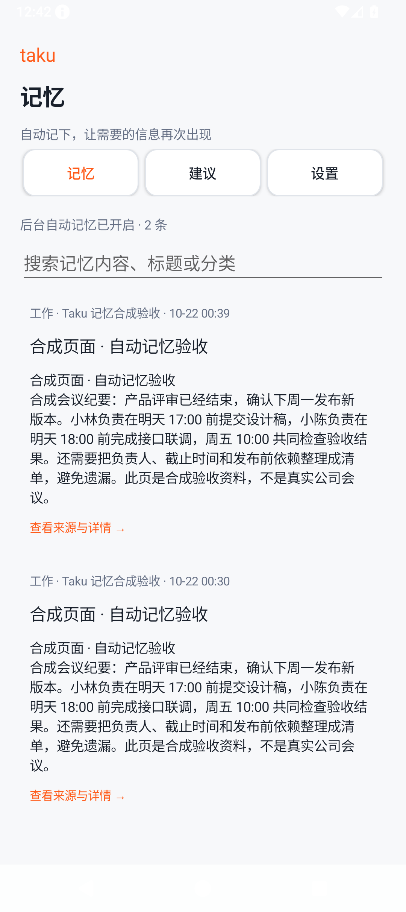
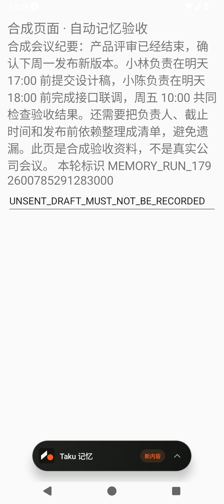
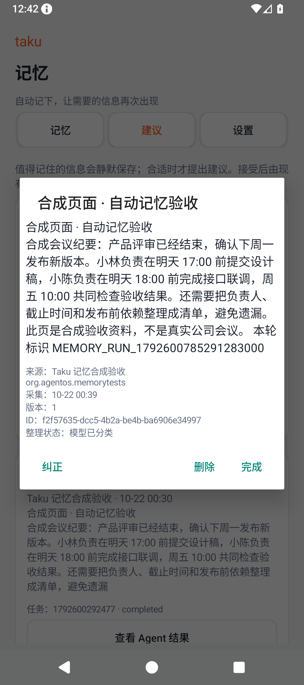
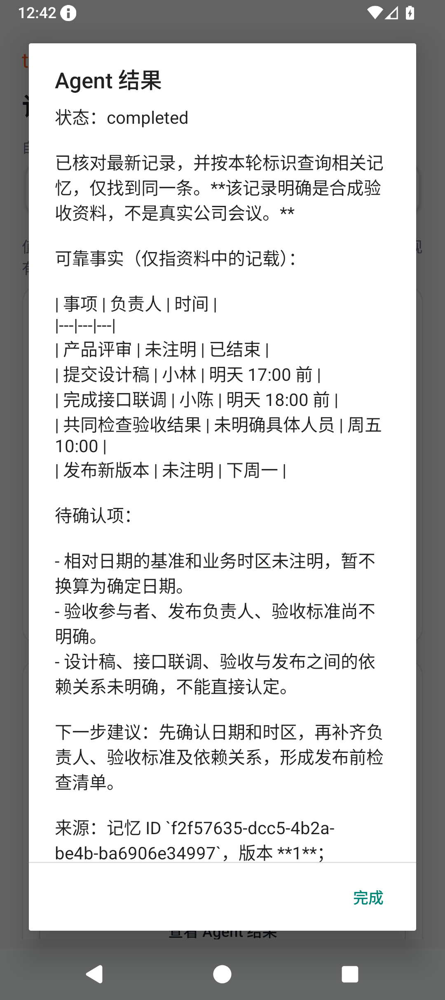
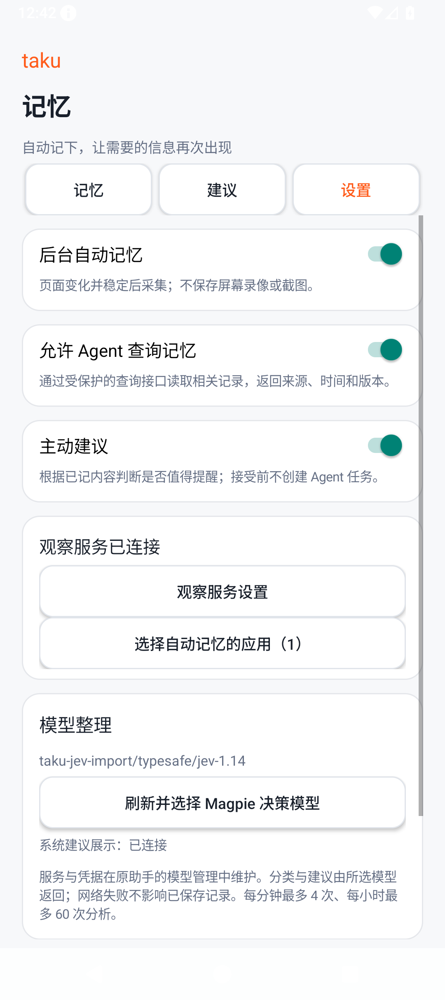
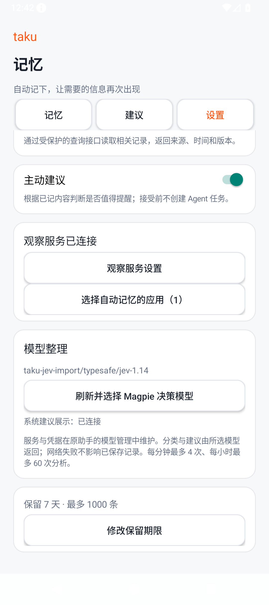

# Taku Memory initial release: emulator end-to-end acceptance

2026-10-22 (Beijing time), Android 16 / API 36 / ARM64, dedicated development AVD `Taku_ImageIntegration_20261010`, SELinux Enforcing. Based on main `0116c76`, Taku Memory 0.1.0, assistant v58, system-surface host v2. See [acceptance.json](acceptance.json) for artifact SHA-256 values, source-file digests, runtime results, and call receipts. Installed APK and Broker JAR digests matched this build's artifacts.

**The initial emulator component workflow passed; physical hardware at the same version, a full ROM, cold startup, and long-term power consumption remain untested.** `image/taku.mk` includes a development package declaration; this does not mean a full ROM was rebuilt. Model connections were unchanged; no authentication cache was read and no new login created. The emulator's existing Magpie / Jev and Codex services were used. All page material was explicitly labeled synthetic acceptance content, not user conversations or real company meetings; model responses came from the actual service.

## Workflow actually completed

1. Enabled automatic background memory once, selected the synthetic-page app, and browsed meeting text in it. Real Accessibility events created memories, without a per-item “Remember” button or a test API injecting bodies into the production memory database.
2. Text was first saved in the independent APK's private SQLite database. Jev analyzed it through the existing assistant signature bridge and on-phone Magpie, returning “Work / Organize” with confidence **0.92**, above the fixed **0.75** threshold. Local policy determined timing and frequency; the capture/classification/visible-hint stage check took about 7.1 seconds, not a model-latency benchmark.
3. No new TaskBroker task existed while the actual system capsule was displayed. Only after physically clicking the capsule to accept was task `1792600848057` created, reusing the existing TaskBroker and native Codex conversation.
4. The Agent used `gpt-6.1-sol` and successfully executed real `taku_phone.memory_get` and `memory_search` calls. Structured receipts verified memory ID, version 1, source, body, and capture time; the body excluded the synthetic input field's unsent draft.
5. The Agent returned reliable facts, items needing confirmation, and next-step suggestions, preserving uncertainty about relative dates and citing sources. The task declared `permissionMode=readOnly`, with no main-screen screenshot, original conversation draft, or attachments. All tool calls in this round queried memory; none sent, booked, ordered, or wrote business data.
6. Repeated acceptance returned the same task ID; only one task entered the queue. The app's Suggestions page updated the task to completed and actually opened/displayed the Agent result; Memory details showed source, time, ID, and version.

Memory ID for this round: `f2f57635-dcc5-4b2a-be4b-ba6906e34997`; native conversation ID: `01a15f56-3b3f-76a3-95b2-478dfc4b4583`. Only this round's synthetic evidence was retained; no account files or other conversation contents were committed.

## Regression and limits

| Check | Result and scope |
| --- | --- |
| Isolated SQLite / permission regression using actual production `MemoryStore` | **32 passed**, including disabled defaults, source allowlist, deduplication, keyword/SQL escaping, correction versions/history, forgetting tombstones, expiry cleanup, persistent frequency budget, repeated acceptance, query-disable/model-switch/stale-version rejection, and task-receipt ownership. The test APK used a different certificate and was denied both memory and model-bridge access. See [raw output](store-tests.txt) |
| Actual page observation and management | Automatic saving, deduplication, retrieval of latest version after correction, deletion and prevention of same-page resurrection; pause, excluded source, password pages, and `FLAG_SECURE` pages produced no records; editable input was not saved |
| Independent APK and shared services | Memory UID **10162**, assistant UID **1000**; no shared UID or network permission in the Memory APK; model directory and credentials reused the existing service; API signature-protected |
| Native UI and upgrade | Same-platform-signature overwrite installation retained records; returning to the app refreshed lists; Suggestions read back task completion and actually opened results, sources, model, and retention settings |
| Engineering checks | Memory, assistant, Broker, test, and system-surface components built; `npm run verify` passed, including 37 surface-lifecycle and 17 positioning assertions; Linux-only FIFO tests skipped on macOS under the existing rule |

During integration, a binary question directly asking whether interruption was worthwhile produced only 0.46–0.68 confidence for three synthetic scenarios; all remained silent records and created no Agent tasks. Model responsibility was then changed to general action classification (organize / summarize / no action), with timing and frequency handled by local policy. The threshold was not lowered, no fixed answer was injected into final classification, and the actual upstream was not replaced. The emulator's existing system-surface host was also found to be v1 and upgraded to main's v2; the final rerun included main's new capsule-dragging implementation.

After acceptance, automatic observation was paused, the original Accessibility configuration restored, and the originally paused AVD returned to paused state. Synthetic memories remain for inspection and the test conversation was archived; no original assistant data or accounts were deleted. Retained components are this acceptance version.

## Screenshots

| Memory and source | Automatic suggestion and result |
| --- | --- |
|  |  |
|  |  |
|  |  |

## Reproduction

[Component documentation](../../../system/memory/README.md) covers builds, permissions, model selection, and interfaces; the [device driver](../../../scripts/test-memory-device.py) provides `install → storage → capture → live → finish → ui → restore` stages. `live` requires explicit allowance for real model usage, and the on-screen hint must actually be clicked before `finish`. Initial installation permits only the designated development AVD, an idle queue, and a fresh Memory environment; do not rerun capture cases directly on a device containing real memories.

The initial release handles only currently accessible text from allowed sources and keyword search; it is not continuous recording of all screen content. It includes no vector search, multimodal understanding, cross-app fact merging, preference inference, or production-isolation conclusion. The system test-platform certificate is also not a production signature.

[Historical language evidence](../HISTORICAL-LANGUAGE.md) documents the intentionally retained Chinese-locale raw inputs, outputs, and reproduction scripts for this historical review.
