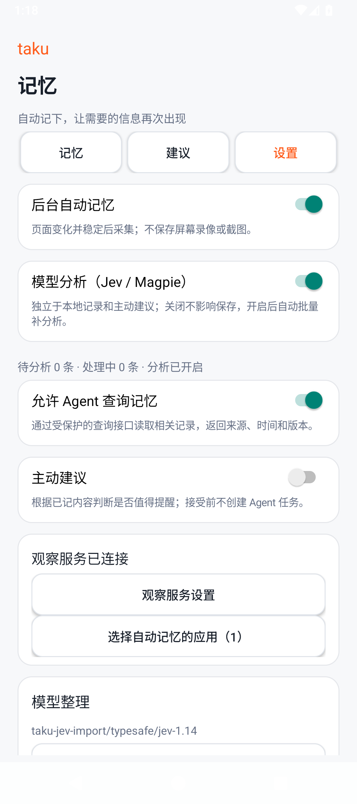
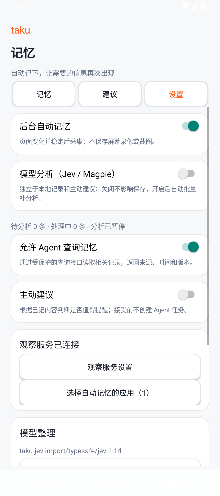
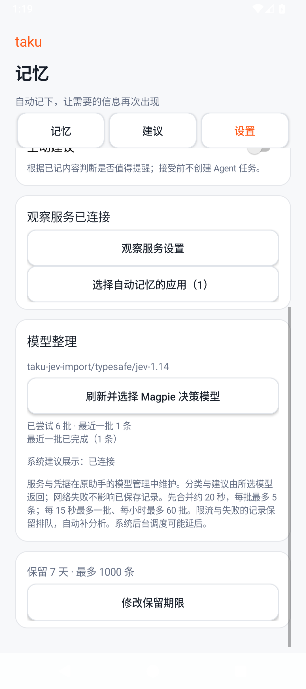

# Taku Memory 0.2.0: decoupling local recording and batch analysis

2026-10-22 (Beijing time), dedicated Android 16 / API 36 / ARM64 development emulator `Taku_ImageIntegration_20261010`, SELinux Enforcing. Taku Memory 0.2.0, assistant v59, existing TaskBroker and on-phone Magpie. Based on main `0a41eb2`, upgraded in place with the same platform test signature; memory, assistant data, and accounts were not cleared.

**Emulator verification passed; physical hardware, full ROM, cold startup, and long-term power consumption remain untested.** Artifact digests, in-place upgrade, real Jev results, regressions, and cleanup state are in [acceptance.json](acceptance.json); file digests confirmed the installed APK / JAR matched this build.

## User controls

- **Automatic background memory** controls only new local capture. Saving and queueing occur in one SQLite transaction without waiting for the model.
- **Model analysis** is independent and disabled by default; choosing a model alone sends no request. Disabling retains the queue; enabling processes the backlog. When local recording is paused, the saved queue still follows this switch.
- **Proactive suggestions** controls only reminders. Disabling it does not stop enabled classification, and successful classification alone never creates an Agent task.
- **Agent queries** continues to independently control read access for query tools.

The queue coalesces for about 20 seconds, with up to five records per batch analyzed by one typed Decisions request. Bodies stay separated by ID, version, and source; answers map to individual records without overwriting different pages into one memory. At most one batch per 15 seconds and 60 per hour; rate limiting does not discard records. Failures back off exponentially from 30 seconds to at most 30 minutes, still subject to budget. System background scheduling may delay execution; the minimum waiting window is not an exact schedule.

## Actual emulator results

Each round used six explicitly labeled synthetic meeting pages, saved automatically through actual Accessibility events. No bodies were injected into the production database or queue, and Jev responses were not mocked.

1. Selected existing `taku-jev-import/typesafe/jev-1.14`, kept analysis off, and browsed six distinct pages. After waiting beyond the coalescing window, all six were locally saved and queued, with **0** analysis requests.
2. Terminated only the Memory app process and reconnected the service; all six records, switches, and queue remained. Accounts were not cleared and the whole Android system was not rebooted; this is not cold-start acceptance.
3. Enabled analysis; actual Jev through existing Magpie processed **5 + 1 records in two requests**, completing all six. One record was actually observed still queued after the first batch, then processed, without rate-limit loss.
4. Proactive suggestions remained off while classification completed normally; TaskBroker created no Agent task. Existing Agent query tools and acceptance-task code remain; the tested initial hint-to-Agent scope remains the [v58 historical record](../taku-memory-2026-10-22/README.md). This round does not claim a new Agent-execution acceptance run.
5. Operated the actual app switches: recording remained enabled when analysis was disabled; re-enabling required a separate confirmation; an empty queue did not re-request already analyzed records. The page displayed pending count, processing count, attempted batches, and latest batch size.

The final APK again verified the same six-record/two-batch result; three real-classification rounds totaled eighteen records/six batches. Final-round details are retained separately in structured evidence. Tests actively woke the system JobService to shorten emulator background waiting, **without bypassing the actual 20-second coalescing window, 15-second interval, hourly budget, or queue checks**; elapsed time is therefore not a natural-background-scheduling or model-performance benchmark.

## Upgrade and failure limits

| Check | Result and scope |
| --- | --- |
| 0.1.0 → 0.2.0 in-place upgrade | Body digests, versions, and deduplication digests of two existing memories unchanged; UID remained independent; new analysis switch disabled by default; database upgraded in place to v2 |
| Existing storage and permission regression | **32 passed**; differently signed test app still denied by memory API / model bridge; see [output](StoreTests.txt) |
| Persistent queue regression | **69 passed**, running actual production SQLite code under an isolated test UID: disabled default, coalescing/overflow, duplicate claims, minute/hour budgets, failure backoff and new records not advancing retries, switch/model generations, correction/deletion/exclusion, ID mapping, process-recreation lease recovery, and v1 migration; see [output](QueueTests.txt) |
| Clock and failure-test scope | Hourly limits, in-flight lease expiry, failures, and invalid responses used a fake clock and synthetic answers in the isolated test database. They are not real Jev fault injection or an hour-long device experiment; the production API has no clock/answer injection entry |
| Engineering checks | Memory APK, assistant, Broker, and test APK built; `npm run verify` passed; Linux-only FIFO check skipped on macOS under the existing rule |

Deletion, correction, expiry, and source exclusion revoke corresponding queued work; disabling analysis or changing models rejects old-generation results. Already-sent requests are not guaranteed retractable. If the process exits after server processing but before saving a local result, lease recovery may request again; this is not network exactly-once delivery, and attempted-batch count is not an upstream billing statement.

After acceptance, restored original Memory configuration and Accessibility settings and returned the originally paused AVD to paused state. Synthetic records remain for inspection; old assistant data and accounts were not deleted.

## Screenshots and reproduction

| Analysis enabled and queue | Analysis disabled while recording stays enabled |
| --- | --- |
|  |  |

[Module documentation](../../../system/memory/README.md) covers builds and switch responsibilities. The [device driver](../../../scripts/test-memory-batch-device.py) requires the designated development AVD, idle queue, disabled analysis, and installed fixture; stages: `capture → live --allow-live-model-calls → ui → restore`. It uses existing device credentials without new login or reading credential caches. Initial driver baseline records the original Accessibility state; if an external controller resumed a paused AVD, preserve the original paused state as in this record.

Isolated tests run `am instrument -w org.agentos.memorytests/org.agentos.memory.StoreTests` and `.../org.agentos.memory.QueueTests`. Test components are not included in product APKs or ROMs.

[Historical language evidence](../HISTORICAL-LANGUAGE.md) documents the intentionally retained Chinese-locale raw inputs, outputs, and reproduction scripts for this historical review.
