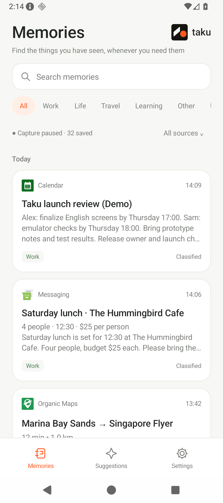
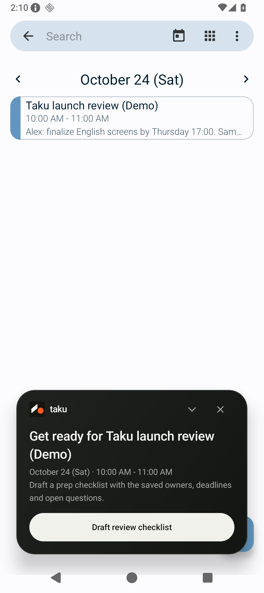
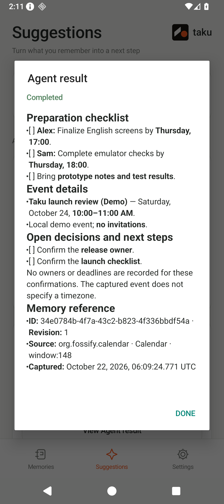

# Taku Memory 0.5.0: useful titles and concrete suggestions

[Chinese version](README.zh.md) · [Module guide](../../../system/memory/README.en.md) · [Acceptance data](acceptance.json)

Accepted on the dedicated API 36 ARM64 emulator on October 22, 2026. Cards name the saved event, meal or route; suggestions describe the task the Agent will perform. English remains the default resource language, with matching Chinese copy.

| Source | Reading title | Suggestion and actual task |
| --- | --- | --- |
| Android Messaging, local demo SMS | Saturday lunch · The Hummingbird Cafe | Draft lunch checklist; confirmed arrangements, owners, deadlines and open meeting-point questions |
| Fossify Calendar, local demo event | Taku launch review (Demo) | Get ready for Taku launch review (Demo), with date and time; Draft review checklist |
| Previously captured Organic Maps route | Marina Bay Sands → Singapore Flyer | 12 min • 1.0 km; previous Travel / none / 0.69 decision retained, no new offer or task |

The app name remains a source label. Presentation is extracted locally from saved text, adds no model calls, and never rewrites evidence. The original Calendar title remains in record information and Agent APIs. Existing records need no migration or reanalysis, and user-corrected titles take precedence. These bounded rules do not imply universal semantic extraction or translation of user content.

## English screenshots

Raw native emulator screenshots, with prepared local demo content in genuine Android apps. No image editing, fixture UI, outgoing messages, invitations or bookings.

The second screenshot precedes lunch acceptance. Its accepted design review is an earlier record redrawn with the new copy; the old Agent reply is unchanged. The new launch review was accepted through the actual system hint below.

[Completed suggestions](memory-suggestions-completed-en.png) · [Actual Messaging source](source-chat-en.png) · [Actual Calendar source](source-calendar-en.png)

## Chinese adaptation

[Chinese library](memory-home-zh.png). Source event names, dates and captured prose stay intact. Interface copy, meal subjects, quantities and task buttons follow the app locale. Chinese task instructions are implemented; this run's actual Agent tasks were English. A Chinese UI check is not reported as a new Chinese end-to-end task acceptance.

## Verified flow

1. Receive demo SMS through the emulator SMS interface and display it in actual Messaging; no outgoing message is sent. Create a local Fossify event, with no reminder or invitation and no sync. Automatically capture each readable screen with analysis off: zero model calls during saving.
2. Enable analysis using the existing on-device Magpie and `taku-jev-import/typesafe/jev-1.14` credentials. Real results: chat Work / organize / 1.00; calendar Work / organize / 0.97. No records, model answers or task acceptance are injected.
3. Tap **Draft lunch checklist** on the actual Suggestions page. Expand the actual calendar system hint and tap **Draft review checklist**. No task exists before acceptance; each acceptance creates one original TaskBroker read-only task.
4. Verify the bounded `meal_checklist` and `event_prep` focus, English response locale, and no screenshot. The Agent successfully calls `taku_phone.memory_get` for the corresponding ID. Source, revision and full body exactly match captured evidence. Replies deliver the requested checklists while keeping missing information unresolved.

[Chat task and reply](chat-proof.json) · [Calendar task and reply](calendar-proof.json) · [Actual tool evidence](tool-call-evidence.json)

**179 isolated assertions passed:** 66 storage, 69 queue, 8 native result rendering, 36 bilingual presentation. Presentation cases vary events, venues, dinner, Chinese meals, route names, unknown locations, corrections, long titles and emoji truncation; there is no acceptance-record ID or fixed demo-title special case.

English → Chinese → English preserved 32 records without extra analysis batches. Only two new demo records were added, all 30 prior records retained, and the three original daily-app records and histories stayed exactly unchanged. Analysis attempts rose from 9 to 11 for the two new classifications. Original configuration, accessibility and emulator pause state were restored; no queued analysis, in-flight analysis or active tasks remained.

[Locale proof](language-proof.json) · [Original evidence proof](original-evidence-proof.json) · [Restored state](restored.json) · [Installed artifact hashes](installed-hashes.json)

## Reproduction and scope

Build Memory, its test APK and the matching Broker; use Assistant v59 and TakuSurfaces v3 / 0.2.1, protocol v2. Memory is v6 / 0.5.0; the database remains `taku.memory/2`, without INTERNET permission. SHA-256 values are in acceptance.json. Updating Memory alone cannot upgrade older Broker task behavior.

`scripts/test-memory-daily-device.py` separates capture, classify and finish around actual UI acceptance. Use `TAKU_MEMORY_DAILY_OUT` for a separate evidence directory, `--allow-live-model-calls` for classify, and `--expected-focus meal_checklist` or `--expected-focus event_prep` for finish. Reconnect observation after UIAutomator inspection, then produce a real app event before capture.

**Emulator component acceptance only.** Same-version physical-device acceptance, full-ROM acceptance, product ROM integration, cold boot and long-term power validation remain pending. On-device Magpie proxies the existing model; this does not mean Jev inference is offline. This run did not reclassify the map route or rerun earlier Agent tasks.

[Historical language evidence](../HISTORICAL-LANGUAGE.md) documents the intentionally retained Chinese-locale raw inputs, outputs, and reproduction scripts for this historical review.
