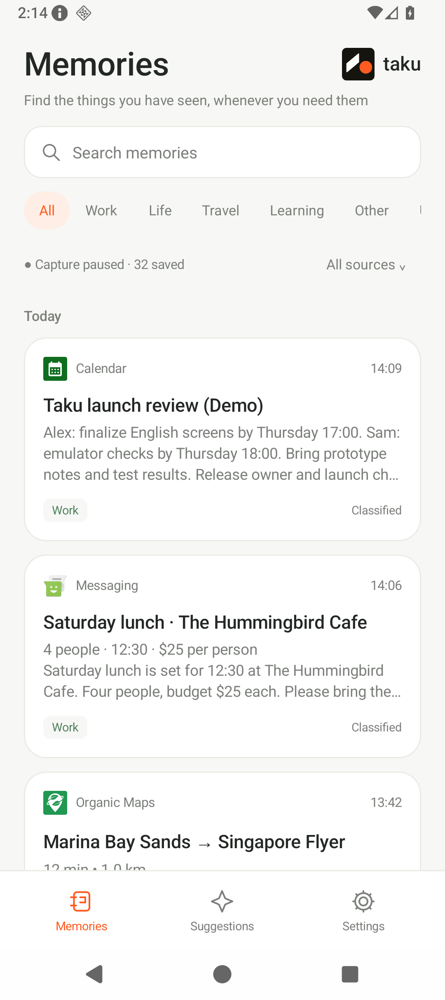
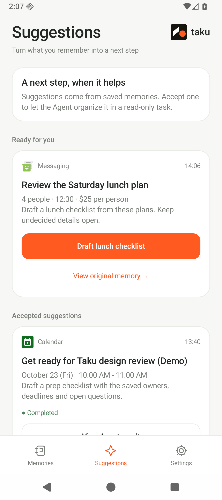
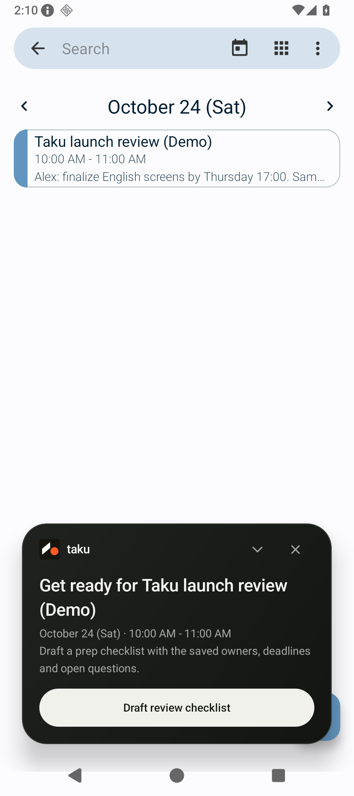
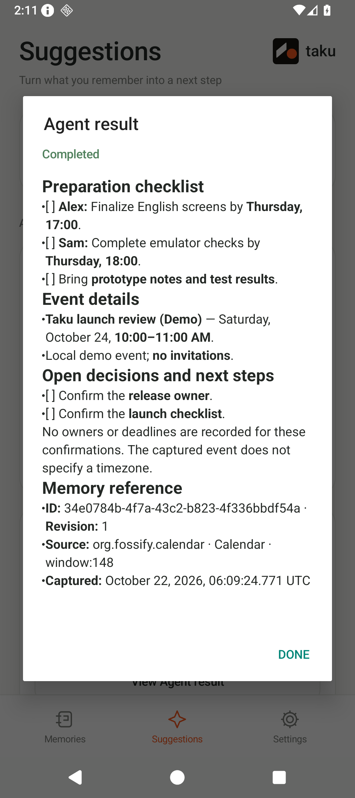
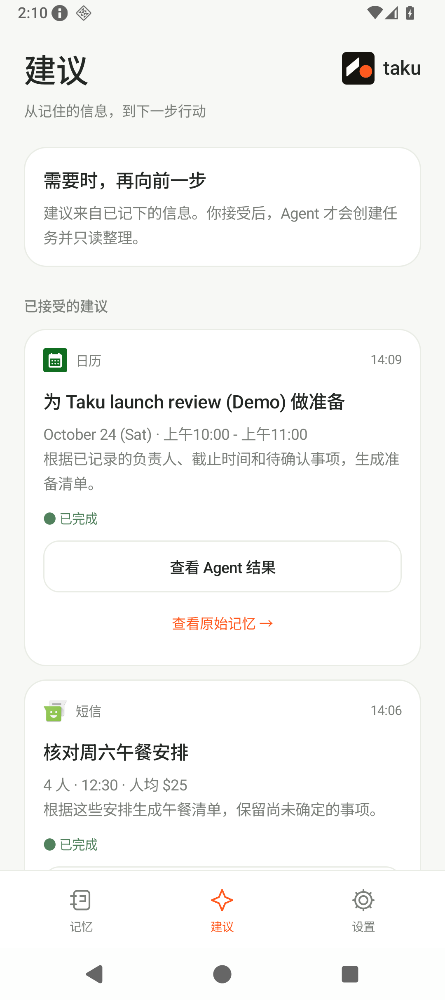

<!-- Intentionally retained Chinese-language version; English: README.md. -->
# Taku 记忆 0.5.0：内容标题与具体建议

[English](README.md) · [模块说明](../../../system/memory/README.md) · [机器可读验收](acceptance.json)

2026-10-22，在专用 API 36 ARM64 模拟器完成验收。卡片用事件、聚餐和路线说明记住了什么，主动建议说明具体能做的任务。英文为默认资源，中文同步适配。

| 场景 | 内容标题 | 建议和实际任务 |
| --- | --- | --- |
| Android Messaging 的本地演示短信 | Saturday lunch · The Hummingbird Cafe / 周六午餐 · The Hummingbird Cafe | Draft lunch checklist / 生成午餐清单；Agent 分清人数、时间、预算、订位负责人和待确认集合点 |
| Fossify Calendar 的本地演示日程 | Taku launch review (Demo) | Get ready for Taku launch review (Demo)，附日期和时间；Draft review checklist / 生成评审准备清单 |
| 上一轮 Organic Maps 的真实离线路线 | Marina Bay Sands → Singapore Flyer | 显示 12 min • 1.0 km；保留上一轮 Travel / none / 0.69，无新提示或任务 |

应用名仍作为来源标识显示。标题和提示在本机从已保存文字提取，不调用模型、不改写证据；原始 Calendar 标题仍保留在记录信息及 Agent API 中。旧记录直接获得新的展示，用户纠正的标题优先保留。这是有界的提取规则，尚不代表任意 App 的通用语义理解，也不自动翻译用户原文。

## 英文主要界面

以下均为模拟器原生 `screencap` 截图，没有改图或网页替代。应用里的数据是标明 Demo 的本地演示内容，不是私人会话、真实公司日程或预订。

此建议页截图拍于午餐接受前；其中 design review 是上一轮已接受的记录，旧任务结果保持原文。本轮新建的 launch review 通过下面的真实系统轻提示接受。

[英文已完成建议](memory-suggestions-completed-en.png) · [实际短信来源](source-chat-en.png) · [实际日历来源](source-calendar-en.png)

## 中文适配

[中文记忆库](memory-home-zh.png)。日期、活动名与聊天原文保留来源内容，界面文案、聚餐主题、数量和任务按钮随应用语言切换。新任务的中文回复指令已同步实现；本轮真实 Agent 验收以英文执行，未把中文界面检查称为新增中文任务的端到端验收。

## 闭环证据

1. 通过模拟器 SMS 接口接收演示短信，在真实 Messaging 会话中显示；没有向他人发送消息。Fossify 中新增本地事件，无提醒、无邀请、从不同步。先关闭模型分析，页面自动保存，采集阶段模型请求为零。
2. 开启分析后使用已有手机内 Magpie 和 `taku-jev-import/typesafe/jev-1.14` 凭据。短信真实返回 Work / organize / 1.00；日历返回 Work / organize / 0.97。没有注入记录、模型答案或任务。
3. 短信在建议页实际点按 **Draft lunch checklist**；日历实际展开系统轻提示并点按 **Draft review checklist**。接受前无任务，接受后各产生一个原 TaskBroker 只读任务。
4. 任务分别携带允许的 `meal_checklist`、`event_prep`，英文回复，无截图。Agent 成功调用对应 ID 的真实 `taku_phone.memory_get`，来源、版本和正文与自动采集完全一致，再生成对应清单，缺失信息保留为待确认。

[短信任务与回复](chat-proof.json) · [日历任务与回复](calendar-proof.json) · [真实工具调用](tool-call-evidence.json)

179 项隔离检查通过：66 项存储、69 项队列、8 项原生结果渲染、36 项双语标题和建议。展示检查还覆盖不同事件、不同餐厅、晚餐、中文聚餐、路线更名、未知地点、用户纠正、长标题及 emoji 截断，规则没有绑定验收记录 ID 或固定演示标题。

英文 → 中文 → 英文保留 32 条记录，切换和查看未增加分析批次；本轮只新增两条演示记录，原 30 条保留，三条原日常 App 证据及其历史逐字段不变。分析尝试从 9 增至 11，对应两轮新的真实分类。原配置、无障碍状态与模拟器暂停状态已恢复，待分析和处理中均为零，无执行中的任务。

[语言检查](language-proof.json) · [原证据检查](original-evidence-proof.json) · [恢复状态](restored.json) · [已安装制品校验](installed-hashes.json)

## 复测和边界

构建 Memory、测试 APK 和配套 Broker；使用助手 v59、TakuSurfaces v3 / 0.2.1、协议 v2。Memory 为 v6 / 0.5.0，数据库仍为 `taku.memory/2`，没有新增网络权限。制品 SHA-256 见 acceptance.json；只更新 Memory APK 不会升级旧 Broker 的任务提示。

`scripts/test-memory-daily-device.py` 的 capture / classify / finish 保持实际 UI 接受边界。用 `TAKU_MEMORY_DAILY_OUT` 指定独立证据目录；classify 需 `--allow-live-model-calls`，finish 分别加 `--expected-focus meal_checklist` 或 `--expected-focus event_prep`。UIAutomator 检查会影响观察服务，采集前应重新连接服务，再进行真实页面操作。

本轮仅为开发模拟器组件验收。**同版真机、完整 ROM、产品 ROM 集成、冷启动和长期耗电均待验收。** 手机内 Magpie 提供已有模型代理；不表示 Jev 模型在本地离线推理。本轮未重新请求地图模型，也未重新执行旧的 Agent 任务。
