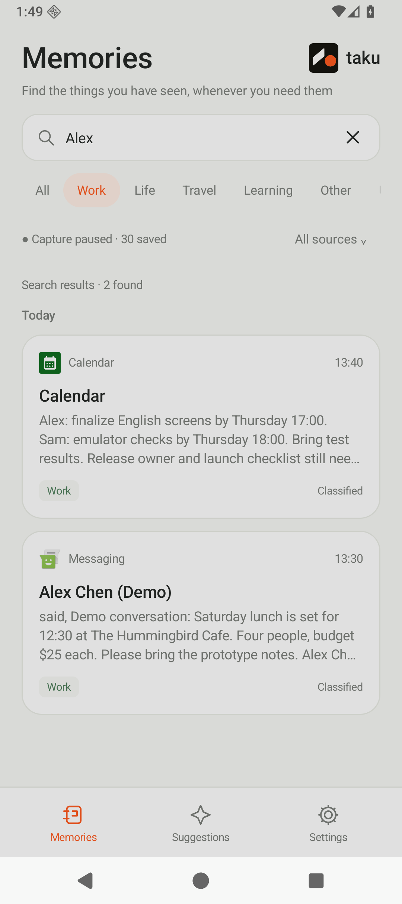
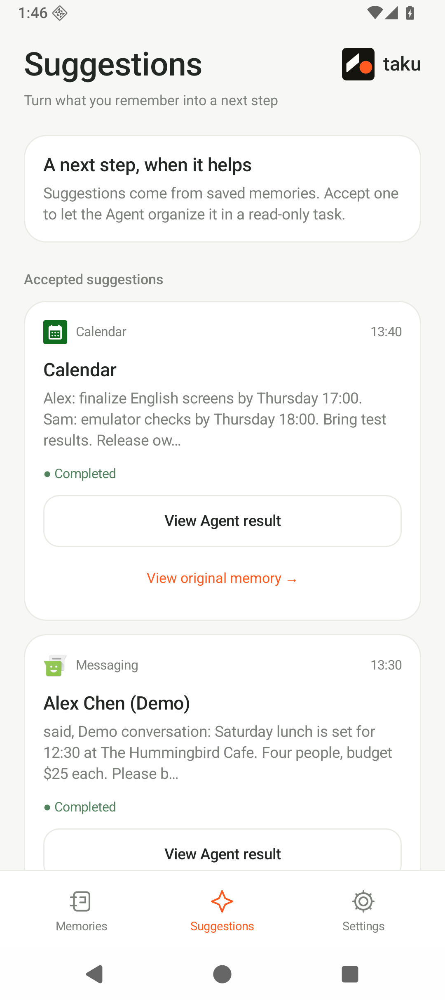
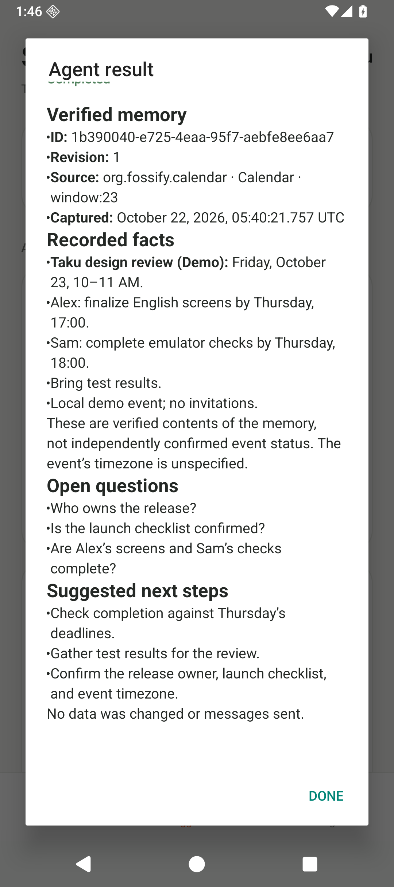
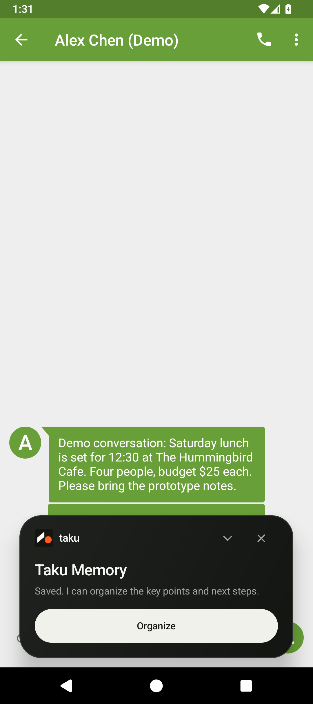
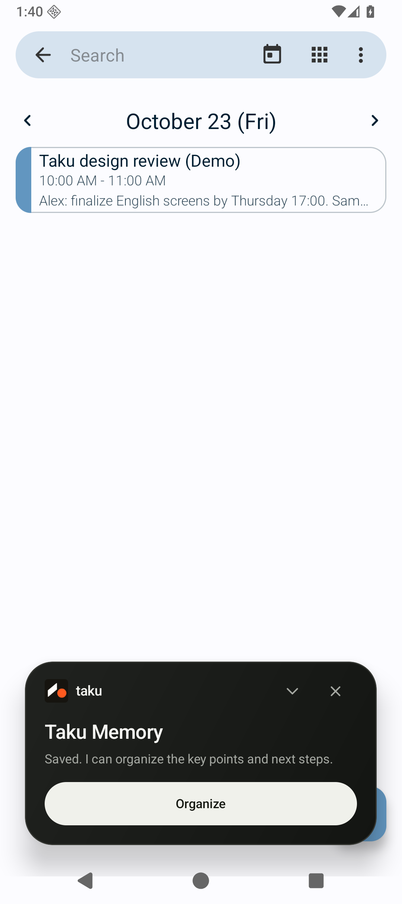
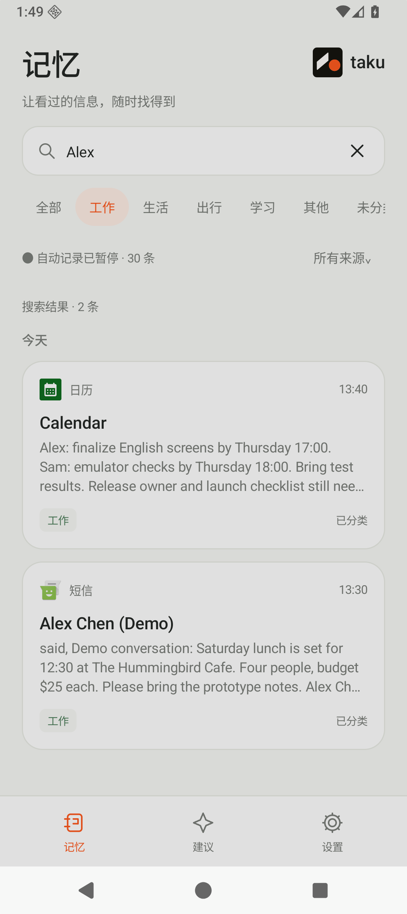

# Taku Memory 0.4.0 — daily Android apps and bilingual UI

[Chinese summary](README.zh.md) · [Exact evidence and hashes](acceptance.json) · [Successful native tool calls](tool-call-evidence.json)

On the dedicated API 36 ARM64 emulator, **actual Android Messaging, Fossify Calendar, and Organic Maps** supplied automatically captured text. No browser page or fixture app stood in for these apps. The screenshots below are raw emulator captures.

| Actual app | Real Jev classification | Proactive / Agent result |
| --- | --- | --- |
| Android Messaging 1.0.001 | Work · organize · confidence 0.98 | Actual English hint accepted; one TaskBroker task; successful memory_get for the exact captured record; completed English reply |
| Fossify Calendar 1.12.0 | Work · organize · confidence 0.95 | Actual English hint accepted; one TaskBroker task; successful memory_get for the exact captured record; completed English reply |
| Organic Maps 2026.09.29-32 | Travel · none · confidence 0.69 | Correct quiet outcome; no hint and no Agent task |

**Demo content, real apps and runtime:** incoming SMS was delivered using the emulator SMS interface, with a clearly named demo contact. The event is local and has no invitations or reminders. Organic Maps computed a 12-minute, 1.0 km walk between Marina Bay Sands and Singapore Flyer using official offline maps. Its `.web` package suffix identifies the native APK distribution; this is not a webpage. No message was sent to another person and no booking was made.

Local records did not require per-item Remember actions. Jev ran through the existing on-phone Magpie model and credentials. Accepting the actual UI reused TaskBroker and the existing Agent, with read-only memory_get calls and no attached screenshot. Full body equality, source, revision, thread, and task IDs are recorded in the linked evidence. A quiet decision was retained as a valid outcome rather than manufacturing a suggestion.

## English interface

Search for Alex retrieves the actual calendar and chat memories without deleting the older acceptance library. Category display labels and controls are English; captured content is preserved.

Accepted suggestions expose their completed Agent result:

## Actual app scenes

[Chat before the hint](source-chat-en.png) · [Calendar before the hint](source-calendar-en.png) · [English compact hint](calendar-suggestion-en.png)

## Chinese and language settings

The actual Language picker completed English → Chinese → English. The 30 retained records, original bodies, stored categories, model configuration, and batch count were preserved. No model request was needed to switch language. The final app preference is English. Existing replies stay in their original language; new accepted tasks use the selected UI language.

[English settings](memory-settings-en.png) · [Language picker](memory-language-en.png) · [Chinese settings](memory-settings-zh.png)

## Verification and scope

- **66 storage + 69 queue + 8 native result-rendering checks passed**, in a differently signed test APK with its own UID/database. The production memory database was not reset. CommonMark output renders as native styled text; raw HTML remains literal and model-generated links are inert.
- Repository verification passed. Installed Memory 0.4.0, TakuSurfaces 0.2.1, and the Broker match the final artifact hashes in acceptance.json. The Assistant APK remains v59; models and credentials were not replaced.
- Live loops ran during 0.4.0 candidate updates. Final artifact/UI checks and record/receipt readback followed the display-only changes; they did not replay model requests just to take newer screenshots.
- Local batch reservations increased from 6 to 9. One calendar batch also classified an automatically observed empty adjacent day as Other / none. That new QA navigation record was deleted through the normal forget API; the original 27 records and the three useful daily-app records remain. Reservation counts are not upstream billing counts.
- The emulator unexpectedly exited. It was restarted with its original arguments and performed a cold boot without a snapshot. Existing memory and the completed chat task survived. This observation does not establish general cold-boot, power, or full-ROM reliability.
- Original capture, analysis, source selection, proactive, accessibility, and pause settings are restored after acceptance; English stays selected as requested. Demo records remain inspectable.

**Acceptance is limited to this emulator.** Same-version physical-device testing remains pending. The standalone Memory APK is not yet wired into the product ROM build, and no full ROM is claimed as accepted. Long-term power use, universal app compatibility, semantic search, cross-app fact merging, and multimodal memory remain outside this result. Navigation-only text may also be recorded.

Reproduction: prepare local demo content in the actual apps, snapshot the original configuration, and use scripts/test-memory-daily-device.py in capture / classify / finish stages. Classify requires explicit --allow-live-model-calls. Use no-offer for non-actionable records. Reconnect the observer after UIAutomator inspection, trigger an actual page event, and accept a suggestion through the actual UI. The script does not inject memory rows, model answers, or task acceptance.

App sources: [Fossify official release](https://github.com/FossifyOrg/Calendar/releases/tag/1.12.0), [Organic Maps official release](https://github.com/organicmaps/organicmaps/releases/tag/2026.09.29-32-android), [official offline maps](https://cdn.organicmaps.app/), [routing integration](https://github.com/organicmaps/api-android).

[Historical language evidence](../HISTORICAL-LANGUAGE.md) documents the intentionally retained Chinese-locale raw inputs, outputs, and reproduction scripts for this historical review.
