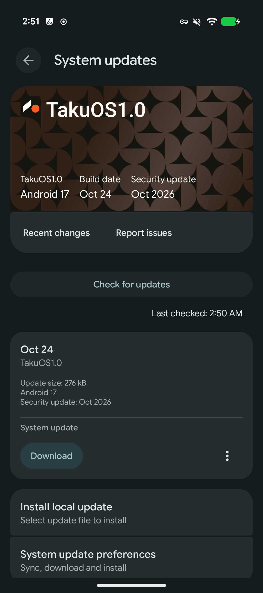
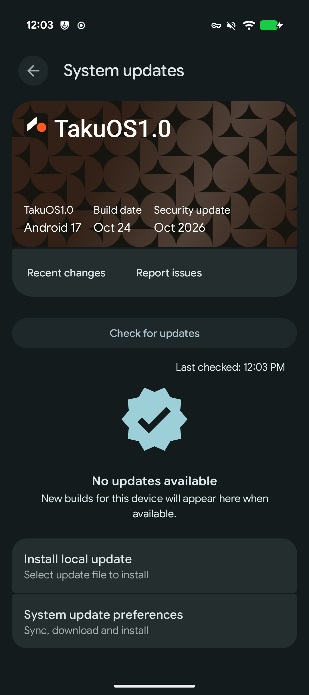
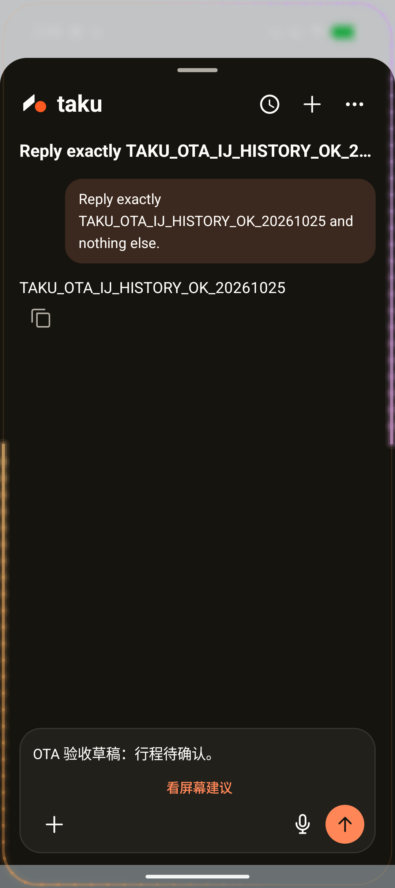

# Pixel 9: TakuOS 1.0 I→J incremental OTA acceptance

2026-10-25: the same Pixel 9 downloaded/installed via native update and rebooted from I `20261024154635` to J `20261024174448`. Full receipt, target AVB, A→B switch, natural merging of six snapshots, and listed data/functions passed. Automation paused; stable unopened.

## Build and CI

I/J share frozen inputs `16fb163782b9e2d0f8224f3143fdae97c54b693c955dd178cfbecf6e8c64926e`, changing only build number. J reused source/build/kernel caches; actual build, full OTA/payload/AVB signatures, immutable export passed without source resync/kernel rebuild. Build-control commit `d2a3641dfa9003878924d1bad81568f2d4cf843a`; actual `sourceTreeDirty=true` retained, exact business inputs bound by snapshot.

[Premerge CI 40120005274](https://github.com/Taku-OS/taku-os/actions/runs/40120005274) and [main CI 40120420001](https://github.com/Taku-OS/taku-os/actions/runs/40120420001) passed; host validator `2979dc4a443c62953266d51e5ef08649ffa0cf40`. Prior full `npm run verify` passed; final Toybox numeric-file-type fix passed 156 OTA checks. Unit tests do not replace image/hardware acceptance.

| Artifact | Bytes | SHA-256 |
| --- | ---: | --- |
| J full OTA | 1,961,596,513 | `d2a8d5ab618c71836a06ba4640911a717fa39940637033eaa98e2cb9c4ce409f` |
| J target-files | 4,749,158,694 | `e355e9bb1c861185dd1a7dd15255fcc380ff36757bd06557b7f23144633097a6` |
| I→J incremental OTA | 275,720 | `45df2023e3f3fef8270b86e0a467d5e8043fd28c2ca34989478b4cae258bc65c` |

This approximately 269 KiB delta represents only identical business inputs with changed build numbers, not future feature-update sizes. Full archive: Mac mini ignored `out/pixel9-android17/artifacts/20261024174448-16fb163782b9e2d0/`.

## Installation and data checks

I was directly installed from nine controlled images, without fabricated sideload records. Authenticated its actual archive/original commands/postboot proof, then read-only checked prefixes of 26 source partitions, totaling 5,958,320,128 bytes. All delta `old_partition_info` and source-read operations matched. before/2 reused the original independent probe without reinstall/reset.

Phone downloaded exact delta via existing Worker/CloudFront, matching delivery size/SHA. At initial IDLE, observer fsync-sealed unique engine process, boot, log inode/prefix before native Install confirmation. 112 callbacks included applying, unique `kSuccess(0)`, `UPDATED_NEED_REBOOT(6)`; follow/host exited 0. Unique actual `ApplyPayload` file/offset/size/all properties bind the delta; engine confirmed target preparation. `binderCallerVerified=false` retained; separate screenshots/operations evidence native taps.

Native Reboot entered Android 17/API 37, J, `_b`; AVB `12b2a6f0f11c2ae1fb9e3c9f2dc43a78f44f95ad9dd49aab6632ba7326824416`. Six target `MergeCompleted` records, global merge/cleanup `kSuccess`, successful slot, snapshot none, and no remaining COW/descriptors independently verified.

- Original probe APK, UID, preferences, SQLite, private files unchanged.
- Five system APK embedded/active bytes and UIDs passed: IME 10062, Assistant 67, Memory 8, Updater 3, Settings 37 directly from ROM, without data overrides.
- Default IME, Memory accessibility, selected system AI/IME replies/account bytes matched, including after actual model calls and cleanup.
- Pre-reboot real-model conversation/unsent Chinese draft restored with unchanged draft revision; another real reply after reboot passed. Only controlled conversations operated; draft cleared, test archived, original selection restored.
- Four services, Memory permission policy/DUMP, Enforcing passed. Forty-one samples across 167.29 seconds retained boot/PID/startTicks; bounded sampling, not continuous/future stability guarantee.
- J native updater rechecked successfully, showing TakuOS1.0 / Android 17 and no next update.

These are scoped checks; `allUserDataVerified=false` remains. No exhaustive third-party-data or general first-install acceptance for other systems. Formal native receipt passed; original generator/delivery/probe scope fields stay unchanged, with later merge/functions in separate proofs.

## Channel and evidence retention

Reused R2 `releases`, Worker, CloudFront; 7 immutable objects, 3,923,472,018 bytes, all readback SHA verified; zero temporary objects/incomplete multipart uploads. Public objects include I/J full OTAs, delta, necessary metadata only; target-files/device observations/account config/probe/raw logs remain local. CDN checks cover full delta, full-package HEAD/first-last ranges, not a full-package CDN download.

One If-Match write added I→J canary, preserving D; host verified D unchanged, I exactly J, J empty. Routes use source build, not device serial. Public immutable status stays `signed-awaiting-device-acceptance`; local hardware success was not backfilled, stable not promoted.

[Sanitized results/raw SHAs](result.json) record the chain. Private originals remain in ignored `out/reviews/J-ota-20261025/`; failures/logs/inputs/caches/backups retained, no credentials/private config committed.

### Phone detects update

### Recheck after J reboot

### Chinese draft and conversation restored

