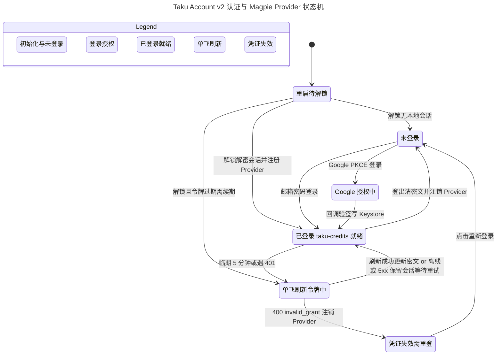

# Taku OS × Taku Account 集成设计规范（v2 精简版）

> **状态**：Draft v2（基于最新产品优先级结论重写，替代 v1 方案）  
> **适用范围**：`taku-os` 系统 AI（Magpie、`org.agentos.assistant`、`taku_broker`、`org.agentos.agent`）  
> **前置假设**：手机端 **BYOK 与个人订阅（如 ChatGPT Subscription）优先级远高于 Taku Account**。Taku 账号仅作为已有 Taku 用户的**次级回退通道（Fallback Provider）**，用于登录一次并消费账户内的 Taku Credits。

---

## 1. 范围收敛与架构决策摘要（v1 → v2）

| 维度 | v1 设计（已废弃） | v2 最终方案（已锁定） | 核心原因 |
| :--- | :--- | :--- | :--- |
| **路由地位** | 全局默认 AI 出口 | **次级回退 Provider（`taku-credits`）** | BYOK（OpenRouter/fal 等）与订阅（`connection.json` `openai` 模式）永远优先 |
| **鉴权与策略** | `Execution Policy v3`（`L1–L3`、`/session-bindings/v1/sessions`、`/ai/execution-leases/*`、30s 心跳） | **全部砍掉** | 不做执行等级控制；通过公共 AI Gateway `https://worker.taku.ai` 访问已放行模型及 `worker.taku.ai/typesafe/v1` |
| **前端入口** | 独立全套 iOS 风格用户中心（头像、改资料、销号、账单、订阅管理） | **极简登录态卡片（仅登录）** | 挂在 `Taku AI`「管理模型与服务商」内，样式与添加 BYOK Provider 一致 |
| **注册与后端改造** | `taku-workers` 对接 Turnstile 新用户注册 + 发码策略扩展 | **零服务端改动（仅登录）** | 默认用户已有 `taku.ai` 账号；移动端无注册与重置密码流程 |
| **运维前提** | — | **服务端关闭 `Single session per user`** | `auth.taku.ai` 与桌面端 `taku` 共用同一 Supabase 项目，避免手机登录踢掉桌面端刷新令牌 |

### 明确保持不变的模块（Out of Scope）
- **Vela 音频与语音引擎（`system/audio-engine`）**：`fal-kotoba`、`fal-grok`、`fal-whisper`、Zipformer、Kokoro 及现有 OpenAI Realtime 链路**完全不动**。
- **已有 BYOK 与订阅通路**：`ByokProviders.java`（OpenRouter / fal / 自定义 BYOK）与 `ModelConnection.java`（ChatGPT `openai` 连接模式）逻辑与优先级保持原样，禁止被 Taku Account 覆盖。

---

## 2. 系统架构：Magpie `taku-credits` Provider + `TakuProxyRelay`

### 2.1 为什么不把 JWT 直接写入 Magpie 配置文件

根据 [system-ai-data-contract.md](./system-ai-data-contract.md) 与 [MagpieSettings.java](../system/assistant/broker/org/agentos/lab/MagpieSettings.java)、[MagpieProviderSecrets.java](../system/assistant/broker/org/agentos/lab/MagpieProviderSecrets.java)：
1. `Settings.Global` 中的 `taku_system_ai_config`、`taku_magpie_providers`、`taku_magpie_models`、`taku_magpie_groups`、`taku_magpie_scene_bindings` **严禁保存任何密钥、Token、Header 或 URL Query 凭据**；密钥必须剥离并通过 `credentialRef` 写入 `/data/local/agentos/magpie/config/magpie/taku-credentials.json`（`0600`）。
2. Supabase `access_token` 是短时效 JWT，依赖单飞 `refresh_token` 轮转刷新；若把动态 JWT 直接静态落盘到 `taku-credentials.json`，每次刷新都要触发 Magpie Provider 重载且存在竞态过期风险。

### 2.2 架构拓扑：Broker 环回代理 + `taku-credits`

在 `taku_broker` 内新增轻量环回转发器 **`TakuProxyRelay`**（监听 `127.0.0.1:3426`）：

```text
┌────────────────────────────────────────────────────────────────────────────┐
│ 优先级排序：1) BYOK (OpenRouter/fal/自定义) > 2) 个人订阅 > 3) taku-credits │
└────────────────────────────────────────────────────────────────────────────┘
                                       │ (仅当路由选中 taku-credits 时进入)
                                       ▼
┌─────────────────────┐  Bearer / x-api-key: TAKU_PROXY_RELAY_TOKEN  ┌──────────────────────┐
│ Magpie Runtime      │ ───────────────────────────────────────────► │ taku_broker:         │
│ (:3425 / :3430)     │   http://127.0.0.1:3426/{openai,claude,decide}│ TakuProxyRelay:3426  │
│ provider:           │                                              └──────────┬───────────┘
│  taku-credits       │                                                         │
└─────────────────────┘                  SO_PEERCRED (uid 0|1000) 拉取最新 JWT   │
                                         （单飞提前 5min 刷新 + 401 强制重试）    │
          ┌──────────────────────────────────────────┬──────────────────────────┴───────────────────────────┐
          ▼                                          ▼                                                      ▼
OpenAI Chat / Responses (/openai/v1/*)     Anthropic Messages (/claude/v1/*)        Catalog Models (/models/v1/*)     Jev Decision (/decide/*)
https://worker.taku.ai/openai/v1/          https://worker.taku.ai/claude/v1/        https://worker.taku.ai/models/v1/ https://worker.taku.ai/typesafe/v1/
  chat/completions & responses               messages & models                         responses & messages              models & systemone
```

#### 上游环境常量与路由映射（已核实）
源自 `taku/src/shared/config/publicRuntimeDefaults.ts`、`taku-workers` `PROXY_GATEWAY.publicOrigin`（统一公共 AI Gateway，内部鉴权与计费后转发至 `ai-proxy.taku.ai`）与 [TakuProxyRelay.java](../system/assistant/broker/org/agentos/lab/TakuProxyRelay.java)：
- **Supabase Auth URL**：`https://auth.taku.ai`
- **Publishable Key**：见 `TakuAccountClient.DEFAULT_PUBLISHABLE_KEY`（`sb_publishable_*` 公开 Key）
- **AI Gateway Base URL**：`https://worker.taku.ai/`
  - **OpenAI Chat / Responses**：`http://127.0.0.1:3426/openai/v1/*` → `https://worker.taku.ai/openai/v1/chat/completions`、`https://worker.taku.ai/openai/v1/responses`
  - **Anthropic Messages**：`http://127.0.0.1:3426/claude/v1/*` → `https://worker.taku.ai/claude/v1/messages`（以及 `/claude/v1/models`、`/claude/v1/messages/count_tokens`）
  - **Catalog Models Gateway**：`http://127.0.0.1:3426/models/v1/*` → `https://worker.taku.ai/models/v1/responses`、`/models/v1/messages`
- **Worker Origin（Jev Decision）**：`http://127.0.0.1:3426/decide/*` → `https://worker.taku.ai/typesafe/v1/models`、`https://worker.taku.ai/typesafe/v1/systemone`（注入 `Authorization: Bearer <taku_access_token>` 并透传 `Idempotency-Key` / `X-Request-Id`）

#### 环回安全隔离与凭据投影
1. **UID 级访问控制**：参照 [adapters/magpie-runtime/magpie](../adapters/magpie-runtime/magpie#L20-L28) 对 `:3425` 的保护方式，在 `iptables` 的 `taku_ai` 链补充 `--dport 3426` 规则，仅放行 `--uid-owner 0`（root，`taku_broker`）与 `--uid-owner 1000`（system），对其余应用 UID `REJECT --reject-with tcp-reset`。
2. **本地共享密钥校验**：`TakuProxyRelay` 校验请求携带的 `TAKU_PROXY_RELAY_TOKEN`，通过后剥离本地认证头并替换为真实 `Authorization: Bearer <taku_access_token>`（详见 **2.3 令牌体系与全链路验证规范**）。
3. **Magpie Provider 幂等注册**：在生产设备上，`taku-credits` Provider 注册必须写入权威配置源 `Settings.Global`（[MagpieSettings.java](../system/assistant/broker/org/agentos/lab/MagpieSettings.java#L71-L84) 中的 `taku_system_ai_config` 仅保留 `"credentialRef": "taku-credits"`）与 `/data/local/agentos/magpie/config/magpie/taku-credentials.json`（`0600`），通过 `MagpieSettings.sync()` 增量投影至 `providers.json`（与 [MagpieDecisions.java](../system/assistant/broker/org/agentos/lab/MagpieDecisions.java#L145-L148) 的生产路径一致），**绝不重置或删除用户已有 BYOK Provider 与 `connection.json` 配置**；`http://127.0.0.1:3430/api/provider/save` 与 `/api/provider/delete`（需 `web.key` 鉴权，见 [ByokProviders.java](../system/assistant/broker/org/agentos/lab/ByokProviders.java#L245-L266)）仅用于隔离 host fixture 测试路径。

### 2.3 令牌体系与全链路验证规范

v2 集成链路横跨“本机环回 → 跨进程 IPC → 登录签发 → 上游云端服务”4 道信任边界，各层令牌必须采用 **Fail-Closed（默认拒绝）** 与最小权限验证：

| 凭据 / 边界 | 签发方 | 存储与传输载体 | 验证方 | 验证方式与核心规则 | 轮换与吊销 |
| :--- | :--- | :--- | :--- | :--- | :--- |
| **本机环回令牌** `TAKU_PROXY_RELAY_TOKEN` | `TakuAuthManager` / `taku_broker`（登录激活时） | 存 `taku-credentials.json`（`0600`）+ 投影至私有 `providers.json`；传 `Bearer` 或 `x-api-key` | `iptables` + `TakuProxyRelay`（`:3426`） | `uid 0\|1000` 过滤 + 协议白名单取头 + `MessageDigest.isEqual` 常量时间比对 | `Logout` / `expired` / 重启重连即生成新随机值并清零旧内存 |
| **跨进程 IPC 通道**（`taku_broker` ↔ `TakuAuthManager`） | Linux 内核凭证 + `org.agentos.assistant` | 抽象域 `LocalServerSocket`；内存返回短期 `access_token` | `TakuAuthManager` Socket 服务端 | `SO_PEERCRED` 校验 `uid == 0 \|\| uid == 1000`，仅吐出短期 `access_token` | 进程随生命周期回收；永不向 Broker 暴露 `refresh_token` |
| **登录期凭据**（`sb_publishable_*` / PKCE `state`、`code_verifier`） | `auth.taku.ai` 配置 + `TakuAuthManager` | `apikey` Header；PKCE 参数仅存系统内存 `ConcurrentHashMap`（10 分钟 TTL） | `auth.taku.ai` + `TakuAuthManager` 深链回调入口 | 严格校验回调 scheme/host/path、`state` 常量时间比对、`S256` PKCE 换取与 `GET /auth/v1/user` 身份复核 | `state`/`code_verifier` 单次消费即焚 |
| **云端会话令牌** `access_token` / `refresh_token` | `auth.taku.ai`（Supabase GoTrue） | `session.enc`（`AndroidKeyStore` AES-256-GCM 密文）；出站仅走 `Authorization: Bearer <access_token>` | `worker.taku.ai`（转发至内部 `ai-proxy.taku.ai`） | 以 GoTrue `GET /auth/v1/user` 为最终权威验证源（Workers 辅以 15s 缓存） | 单飞提前 5min 刷新 + `401` 强制重刷；仅 `400 invalid_grant` 吊销会话 |

#### 2.3.1 本机环回令牌 `TAKU_PROXY_RELAY_TOKEN`（Magpie `:3425` → `TakuProxyRelay :3426`）
1. **生成与格式**：每次登录成功注册 `taku-credits`（或 `taku_broker` 重启解锁激活本地会话）时，由 `SecureRandom` 生成 32 字节（256-bit）密码学随机数，编码为 `taku-relay-<64位小写hex>`（对齐 [magpie](../adapters/magpie-runtime/magpie#L41-L45) 中 `web.key` 32 字节随机密钥强度），**严禁使用类似 `"taku-android"` / `"taku-system-ai"` 的静态固定字符串**。
2. **投影与内存边界**：仅通过 `credentialRef: "taku-credits"` 写入 `taku-credentials.json`（`0600`）并投影至 Magpie 私有 `providers.json`（`0600`），`Settings.Global` 严禁包含密钥明文；`TakuProxyRelay` 仅在进程内存中持有当前活跃令牌的 `byte[]` 副本。
3. **三道入站验证（Fail-Closed）**：
   - **第一道（内核网络层）**：`iptables` `taku_ai` 链限制 `-o lo -p tcp --dport 3426` 仅 `--uid-owner 0` / `--uid-owner 1000` 可达，其余应用 UID 直接 `TCP RST`。
   - **第二道（协议头提取与冲突拒绝）**：
     - `/openai/v1/*` 与 `/decide/*`：**仅接受** `Authorization: Bearer <token>`（`Bearer ` 后非空、无空白/控制字符）。
     - `/claude/*`（适配 Anthropic SDK / Magpie 客户端行为）：接受 `x-api-key: <token>` **或** `Authorization: Bearer <token>`。
     - **Fail-Closed 拒绝条件**：缺少对应认证头、格式不合法、或请求**同时**携带 `Authorization` 与 `x-api-key` 且两者令牌不一致时，一律返回 `401 Unauthorized`（响应体脱敏，绝不回显请求头内容）。
   - **第三道（常量时间比对与会话门禁）**：使用 `MessageDigest.isEqual(presentedBytes, activeBytes)` 做常量时间比较；若当前未登录、未解锁或处于 `expired` 态（`activeBytes` 为空），一律拒返 `401`。
4. **出站清头与令牌注入**：入站校验通过后、转发至上游前，强制剥离全部入站认证相关头（`Authorization`、`x-api-key`、`Cookie`、`Proxy-Authorization`、`User-Agent`），再按上游要求统一注入 `Authorization: Bearer <taku_access_token>` 与固定 `User-Agent: taku-os-relay/1`（防止 Cloudflare Bot 规则以 `1010` 拦截非标准客户端 UA）；`/decide/*` 同步透传 `Idempotency-Key` 与 `X-Request-Id`。
5. **即时吊销与擦除**：触发 `Logout` 或 `400 invalid_grant` 迁入 `expired` 时，先在内存中 `Arrays.fill(activeBytes, (byte) 0)` 立即令旧令牌失效，随后移除 `taku_system_ai_config` 与 `taku-credentials.json` 中的 `taku-credits` 条目并调用 `MagpieSettings.sync()` 同步擦除投影。

#### 2.3.2 跨进程本机令牌通道（`taku_broker` ↔ `org.agentos.assistant`）
- 沿用 [AccountBridge.java](../system/assistant/broker/org/agentos/lab/AccountBridge.java#L10-L33) 模式建立受控抽象域 `LocalServerSocket`，每次 `accept()` 第一时间读取内核 `client.getPeerCredentials().getUid()`（`SO_PEERCRED`），非 `uid == 0 || uid == 1000` 直接断开，且严禁在异常或调试日志打印任何 payload。
- 请求协议支持只读拉取 `getAccessToken(forceRefresh: boolean)`：正常请求按 `forceRefresh=false` 获取（内部自动判断 5 分钟 TTL 缓冲），上游返回 `401` 时携带 `forceRefresh=true` 请求 `TakuAuthManager` 触发单飞刷新。
- **最小暴露面**：跨进程响应体**只允许返回短期 `access_token`、`expiresAtMs` 与 `email`**，`refresh_token` 与 `AndroidKeyStore` 加密密钥材料永远不离开 `org.agentos.assistant` 进程边界。

#### 2.3.3 登录期签发、PKCE 与回调验签（`auth.taku.ai`）
1. **Supabase Client 凭据绑定**：所有发往 `https://auth.taku.ai/auth/v1/*` 的请求（密码登录、PKCE 换 token、`/auth/v1/user`、`token?grant_type=refresh_token`）均携带固定 `apikey`（取自 `TakuAccountClient.DEFAULT_PUBLISHABLE_KEY`，符合 `taku-ai-proxy-go/internal/config/config.go` 仅认可 `sb_publishable_` 前缀与标准 anon JWT 的约束）。
2. **Google OAuth PKCE 校验链**：
   - **发起阶段**：生成 128-bit 随机 `state`（防 CSRF / 回调伪造）与 32 字节以上随机 `code_verifier`（派生 `S256` `code_challenge`），绑定请求上下文以 10 分钟 TTL 缓存在 `TakuAuthManager` 内存中。
   - **深链回调校验**：系统浏览器 Custom Tabs 重定向回宿主 deep link 时，严格验证 URI `scheme`/`host`/`path` 白名单、`state` 与内存记录的常量时间一致、且必须从 URL query 参数取得一次性 `code`（**拒绝任何 URL fragment `#access_token=...` 隐式流回传**）；校验后立刻销毁内存中的 `state`/`code_verifier` 防止重放，调用 `POST /auth/v1/token?grant_type=pkce` 完成换取。
3. **落盘前会话校验**：无论是 Google PKCE 还是邮箱密码登录，收到新 `Session` 后均先校验 `access_token` 为合法三段式 JWT、`sub` 与 `exp` 非空，并以该 `access_token` 调一次 `GET /auth/v1/user` 确认与 `user.id` / `email` 一致，再加密写入 `session.enc` 并激活 `taku-credits`。

#### 2.3.4 上游服务端实际验证方式与客户端 `401`/`503` 裁决规则
结合上游两个服务端仓库的现网代码，客户端必须按各自不同的鉴权语义处理响应：

1. **公共入口 `https://worker.taku.ai`（统一公共 AI Gateway，内部鉴权后转发至内部 `ai-proxy.taku.ai` 执行器；已核实 `taku-ai-proxy-go/internal/middleware/auth.go`、`cmd/server/main.go` 与 `taku-workers/src/routers/proxy-business/index.ts`）**：
   - 所有公开模型路由（含 `/openai/v1/chat/completions`、`/openai/v1/responses`、`/claude/v1/messages`、`/models/v1/responses`）均经 `worker.taku.ai` 入口鉴权：**仅从 `Authorization: Bearer <token>` 读取 JWT**（不认 `x-api-key`），`TakuProxyRelay` 同时固定出站 `User-Agent: taku-os-relay/1`。
   - **验证机制**：不采用本地 JWKS 离线验签，而是经 Workers 15s 短缓存 + Supabase `GET /auth/v1/user` 实时向 Supabase GoTrue 校验。
   - **错误返回分化**：仅当 GoTrue 返回 `400/401/403` 且 JSON `error_code` 为 `bad_jwt`、`no_authorization`、`user_not_found`、`session_not_found`、`user_banned` 时返回 `401 Unauthorized`；若 GoTrue / 内部执行器不可达返回 **`503 Service Unavailable`**（避免将上游故障误判为客户端凭证失效）。
2. **`https://worker.taku.ai/typesafe/v1/*`（已核实 `taku-workers/src/middleware/user-auth.ts`）**：
   - 从 `Authorization` 提取 Bearer token，经 `resolveUser()` 两级检查并随后执行 `checkLegalAccess(c)`：
     1. **本地结构与过期预筛**：Base64URL 解码 JWT payload 检查 `exp`，若已过期（`exp * 1000 <= Date.now()`）直接返回 `null` → `401 Unauthorized`（非本地开发无签名兜底，生产环境 `allowsUnsignedLocalDevJwt` 恒为 `false`）。
     2. **15s 内存缓存 + 单飞去重 + GoTrue 校验**：以 `SHA-256(supabaseUrl + "\0" + pubKey + "\0" + token)` 为 key 查询 15 秒短期缓存（上限 512 条，有效截止时间取 `min(now + 15_000ms, jwt.exp)`）及同 token 并发合并 `inflightUserLookups`；未命中时调用 `supabase.auth.getUser(token)` 验证真实用户身份。
   - **注意差异**：`worker.taku.ai` 当 `getUser(token)` 网络超时或上游异常时同样返回 **`401 Unauthorized`**（而非 `ai-proxy` 的 `503`）。
3. **客户端统一 `401` / `503` 处理铁律（禁止绕过刷新态直落 `expired`）**：
   - `TakuProxyRelay` 收到 `ai-proxy` 返回 `503 Service Unavailable` 时，直接按上游瞬态不可用回传，**不刷新、不掉登录**。
   - 收到 `ai-proxy` 或 `worker.taku.ai` 返回 `401 Unauthorized` 时，**严禁直接将状态置为 `expired`**（因为可能是本地时钟微偏、服务端提前吊销 session、或 `worker.taku.ai` 掩盖了 GoTrue 瞬态异常）：
     1. 触发 `TakuAuthManager.getAccessToken(forceRefresh = true)`（走单飞刷新通道，仅最多重放上游请求 **1 次**，防止无限 401 循环）。
     2. **最终裁决权仅在 `auth.taku.ai` 刷新端点**：只有 `/auth/v1/token?grant_type=refresh_token` 明确返回 `400 invalid_grant` / `refresh_token_already_used` 时才迁移至 `expired`（清除 `session.enc` 与 `taku-credits`）；若刷新因无网 / 超时 / `5xx` / `429` 失败，则标记 `transientOffline = true` 并**保留会话等待重连**。

### 2.4 Coexistence & Fallback 优先级落地约束
1. **模型选择与场景绑定**：
   - 当用户已配置 BYOK 或开启个人订阅（如 `ModelConnection.java` 切换至 `openai` 模式）时，现有场景绑定与默认组优先级保持第一，界面明确提示 `Taku Credits` 仅作回退渠道。
   - 仅当某个场景未绑定更高优先级模型、或用户主动在模型组中选择 `taku-credits/*` 时，流量才经过 `:3426` 消耗 Taku Credits。
2. **存量硬编码模型清理（Phase 2）**：
   - 审计发现 [SystemAi.kt](../system/assistant/broker/org/agentos/lab/SystemAi.kt)（第 424 行 `if (model == "codex/gpt-6-luna")`）、`SystemAiSettings.java` 与 `MemoryGen.java` 仍包含 `"codex/gpt-6-luna"` / `"gpt-6.1-sol"` / `"gpt-6-luna"` 等旧硬编码模型名；Phase 2 需统一迁移至 Magpie scene binding 或下方已验证的 legacy 兼容目录 ID。

---

## 3. `worker.taku.ai` Legacy 兼容模型白名单（已核实）

因 v2 砍掉了 `Execution Policy v3`，`TakuProxyRelay` 发起的请求不带 `X-Taku-Execution-Policy` / `session-bindings` 头，因此**只允许注册 `Status: "legacy"` 且对应协议在 `LegacyRequestIDs` 中显式放行的模型**。

数据来源：`taku-ai-proxy-go/internal/service/model_route_catalog.go`。

### 3.1 允许注册到 `taku-credits` 的模型与协议矩阵

| 公开模型 ID / 系列 | `LegacyRequestIDs` 允许协议 | 别名兼容性 / 路由说明 | 是否可用于 Codex (`wire_api=responses`) |
| :--- | :--- | :--- | :--- |
| **`glm-5.2`** | `OpenAIChat`、`Responses`、`Messages` | 支持 `"glm-5.2"`、`"zai/glm-5.2"`、`"z-ai/glm-5.2"`；`DiscoverableOn: {Messages: true}` | **是**（支持 `Responses`） |
| **`glm-5.3`** | **仅 `OpenAIChat`** | 使用 `AgentPlan` 队列调度（`WaitForCapacity: true`）；**未放行** `Responses` 与 `Messages` | **否**（不可挂到 Codex/Anthropic 接口） |
| **Claude Legacy 系列**：`claude-opus-4-8`、`claude-opus-4-7`、`claude-opus-4-6`、`claude-sonnet-4-6`、`claude-opus-4-5`、`claude-sonnet-4-5`、`claude-haiku-4-5-20251001` | `OpenAIChat`、`Messages` | 同时兼容 `anthropic/claude-*` 对应请求别名；`DiscoverableOn: {Messages: true}` | **否**（未放行 `Responses`） |
| **`gpt-5.5`** | `Responses`、`OpenAIChat` | `Responses` 支持 `gpt-5.5` / `openai/gpt-5.5` / `openai.gpt-5.5`；`OpenAIChat` 支持前两者 | **是**（支持 `Responses`） |
| **`gpt-5.6-luna` / `gpt-5.6-terra` / `gpt-5.6-sol`** | `Responses`、`OpenAIChat` | 非主动发现模型（`DiscoverableOn: {}`），需显式配置模型 ID | **是**（支持 `Responses`） |
| **`deepseek/deepseek-v4-pro`** / **`deepseek/deepseek-v4-flash`** | **仅 `OpenAIChat`** | `AgentPlan` 队列调度（`WaitForCapacity: true`） | **否** |
| **`moonshotai/kimi-k2.7-code`** | **仅 `OpenAIChat`** | `AgentPlan` 队列调度（`WaitForCapacity: true`） | **否** |
| **Gemini Legacy**：`MainGeminiG31ProID`（Gemini 3.1 Pro）、**`gemini-3.5-flash`** | **仅 `Gemini`** | 仅 Gemini 原生协议；若 Magpie 仅接 OpenAI/Claude 协议则不注册 | **否** |

> **关键约束**：不得将 `glm-5.3`、`deepseek/*`、`kimi-k2.7-code` 或 Claude 系列误配置给要求 `wire_api=responses` 的 Codex app-server（见 [ModelConnection.java](../system/assistant/broker/org/agentos/lab/ModelConnection.java)）；若 `taku-credits` 为 Codex 提供回退，只能选择 `gpt-5.5`、`gpt-5.6-*` 或 `glm-5.2`。

### 3.2 明确禁止注册的模型（需 Execution Policy v3，无策略头必被拒）
- `glm-latest`（`Status: "active"`，但 `LegacyRequestIDs` 为空）
- `claude-opus-5`、`claude-sonnet-5`（`Status: "policy-only"`，`LegacyRequestIDs` 为空）
- Doubao Seed 2.1 系列：`ArkSeed21TurboModelID`、`ArkSeed21ProModelID`（`Status: "policy-only"`，`LegacyRequestIDs` 为空）

---

## 4. `TakuAuthManager` 持久化、加密与防掉登录设计

### 4.1 硬件级密钥封装与 CE 存储边界（对标 `JevCredentialStore.java`）

放弃 [SkillCredentials.java](../system/assistant/broker/org/agentos/lab/SkillCredentials.java) 的 `/data/local/agentos/private/` 明文文件做法，复用 [org.agentos.assistant](../system/assistant/AndroidManifest.xml)（`sharedUserId="android.uid.system"`、`allowBackup="false"`）内 [JevCredentialStore.java](../system/assistant/src/org/agentos/assistant/JevCredentialStore.java) 已验证的持久化规范：

1. **AndroidKeyStore AES-256-GCM**：
   - Master Key 存放在硬件 Keystore（不可导出），每次写入生成 12-byte 随机 IV 并拼接 128-bit GCM Tag。
   - **禁止使用 `setUnlockedDeviceRequired(true)` 导致锁屏无法后台刷新**：语义对齐 iOS `kSecAttrAccessibleAfterFirstUnlockThisDeviceOnly`——只要首次解锁过（`USER_UNLOCKED`），即使随后息屏锁屏，`TakuProxyRelay` 的后台任务仍可在需要时解密使用会话。
2. **CE 存储 + `USER_UNLOCKED` 门禁**：
   - 密文固定落盘在 `org.agentos.assistant` 的 CE 私有目录（如 `files/taku_account/session.enc`）。
   - 系统冷启动未解锁前（`BOOT_COMPLETED` 早于 `USER_UNLOCKED`），状态机处于 `locked_boot`，**严格禁止尝试解密或暴露会话**；待 `MatterReceiver` 收到 `Intent.ACTION_USER_UNLOCKED` 后再解封 `session.enc` 并向 Magpie 同步注册 `taku-credits`。
3. **原子落盘与内存清理**：
   - 先写 `.tmp`（模式 `0600`）-> `FileDescriptor.sync()`（`fsync`）-> 原子重命名替换 `session.enc`；解密明文 `byte[]` 与临时 `refresh_token` 缓冲在使用完毕后立刻 `Arrays.fill(..., (byte) 0)` 清零。
4. **跨进程访问限制**：
   - `taku_broker` 不直接持久化 Taku 令牌；仅通过受 UID 限制（`uid 0 | 1000`）的本地 socket（复用 [AgentAccount.java](../system/assistant/broker/org/agentos/lab/AgentAccount.java) / `AccountBridge.java` 同款通道）按需向 `TakuAuthManager` 拉取当前短期 `access_token`。

### 4.2 严禁在瞬态故障下丢登录（解决 `taku-auth` 原型缺陷）

调研发现桌面端 `taku/packages/taku-auth/src/session-manager.ts` 在刷新失败或网络异常时会统一返回 `null`，若直接照搬到手机端，会导致地铁弱网或 Supabase 抖动后整机直接掉登。`taku-os` v2 强制区分两类错误语义：

1. **单飞并发锁（Single-Flight Refresh）**：
   - 仅 `TakuAuthManager` 拥有刷新权限；`TakuProxyRelay` 遇过期（提前 5 分钟缓冲）或上游 `401` 时均调用同一个 `refreshInFlight` `CompletableFuture`，防止并发消费一次性 `refresh_token` 引发误踢。
2. **错误分级处理**：
   - **瞬态错误（DNS 失败、超时、无网、HTTP `5xx`、HTTP `429`）**：**绝不清空 `session.enc`、绝不注销 `taku-credits` Provider**！保留当前 `refresh_token` 与账号展示（UI 标注“网络异常，待重试”），并在下一次请求触发、用户点击刷新或监听到网络恢复时自动重放刷新。
   - **永久失效（HTTP `400 invalid_grant` / `refresh_token_already_used`）**：确认令牌已被服务端吊销，执行确定性退场：擦除 `session.enc`、从 Magpie 注销 `taku-credits` Provider、UI 迁移到 `expired`（`凭证失效需重登`），提示用户一键重登。

---

## 5. 状态机形式化验证（TLA+ / TLC & Statechart）

状态机覆盖 6 个显示状态与核心登录/刷新/失效迁移边（`CancelOAuth` 取消回边在视觉渲染中简化，以保持主路径清晰）。

### 已验证成立的 7 条安全不变量（All Rules Hold）
1. `TypeOK`：状态集合与布尔标志始终处于合法域内。
2. `NoDecryptBeforeUserUnlocked`：`userUnlocked = FALSE` 时必为 `locked_boot` 且 `providerRegistered = FALSE`（FBE 未解锁绝不解封或暴露）。
3. `ProviderRequiresActiveSession`：`taku-credits` 在 Magpie 已注册当且仅当处于 `signed_in` 或 `refreshing`、已解锁且持有有效刷新令牌。
4. `TransientErrorNeverDropsSession`：发生离线或 `5xx` 瞬态错误后，`refresh_token` 与 `taku-credits` 注册状态绝不丢失。
5. `LogoutLeavesNoCredential`：登出及未登录态下，`providerRegistered`、`refreshTokenStored` 与 `transientOffline` 全清零。
6. `ExpiredDisablesProvider`：进入 `expired`（`400 invalid_grant`）时同步清除残留刷新令牌并注销 `taku-credits`。
7. `NoDeadlock`：全状态空间无死锁。



---

## 6. 极简 UI 交互设计（`3. A+`）

入口位于 [system-ai.tsx](../system/agent-app/src/app/system-ai.tsx) 的「**Taku Credits**」（及原生兜底 [SystemAiActivity.kt](../system/assistant/src/org/agentos/assistant/SystemAiActivity.kt)），遵循 Taku Mobile Design System v0.8（无阴影 6dp 圆角 `Ink / Neutral` 按钮、无冗余说明文字）：

- **未登录态（Login-Only）**：
  - 主按钮（Ink `#1B1B1B`）：**使用 Google 登录**（拉起系统浏览器 Custom Tabs + PKCE，回调至本地应用深链完成交换）。
  - 次按钮（Neutral）：**使用邮箱登录**（展开邮箱 + 密码输入与 Ink **登录** 按钮，提交 Supabase `grant_type=password`；展开态下 **使用 Google 登录** 降级为 Neutral）。
  - 无注册入口、无忘记密码流程、无解释性段落。
- **已登录态**：
  - 展示已登录 **Email**、当前 **Taku Credits 余额**与状态圆点（`已启用` / `离线，联网后自动重试` / `同步中`）。
  - 操作按钮：**刷新**、**退出登录**（清空 Keystore `session.enc` + 注销 `taku-credits`，绝不触碰 BYOK 或订阅）。
- **失效态（`expired`）**：
  - 显示“登录已过期”与 Ink **重新登录** 按钮。

---

## 7. On-Device Agent 对等契约（遵循 `taku-os/AGENTS.md`）

依据仓库根目录 [AGENTS.md](../AGENTS.md)，系统级设定的全部状态发现与操作必须向机上 Agent 开放，与 GUI 共享同一份权威校验逻辑与数据源，**禁止以“防普通应用”为由阻断 Agent**。

### 7.1 非敏感状态可发现性（`Settings.Global`）
- Taku 账号仅将**非敏感状态摘要**投影至 `Settings.Global`（例如 `taku_account_state` JSON：`{"authState":"signed_in","email":"...","providerRegistered":true,"transientOffline":false,"creditsUpdatedAt":...}`）与 `taku_magpie_providers`（仅含 `taku-credits` 元数据及 `credentialRef`，无任何 JWT/密码）。
- Keystore 中的 `session.enc`、`access_token`、`refresh_token` 密码文本**永远不写入** Settings、属性或 `logcat`。

### 7.2 机上 Agent 接口（`AgentOpenAccessProvider` + CLI / `cmd` 封装）
通过 [AgentOpenAccessProvider.java](../system/assistant/src/org/agentos/assistant/AgentOpenAccessProvider.java)（`content://org.agentos.assistant.open-access`）与对应 shell/cmd 入口暴露 5 个权威操作（与 UI 共用 `TakuAuthManager` 同一套校验与状态机）：

| 操作名 | 参数 | 返回 / 行为 | 错误码 |
| :--- | :--- | :--- | :--- |
| `taku_account_status` | 无 | 返回 `authState`、`email`、`providerRegistered`、`transientOffline`、`creditsBalance` 及与 BYOK/订阅的相对优先级；**脱敏返回，不含 Token** | `ERR_USER_LOCKED` |
| `taku_account_login_password` | `email`、`password`（推荐从 stdin / 文件描述符传参避免进命令行历史） | 触发校验并登录、写 Keystore、注册 `taku-credits` | `ERR_USER_LOCKED`、`ERR_INVALID_CREDENTIALS`、`ERR_TRANSIENT_OFFLINE` |
| `taku_account_login_oauth_start` | 可选 `redirect_uri` | 生成并启动 Google PKCE 授权 URL（供机上 Agent 或用户接管浏览器完成最后 OAuth 授权同意） | `ERR_USER_LOCKED` |
| `taku_account_refresh` | 无 | 触发单飞令牌健康检查并刷新 Credits 余额 | `ERR_NOT_SIGNED_IN`、`ERR_TRANSIENT_OFFLINE`、`ERR_TOKEN_EXPIRED` |
| `taku_account_logout` | 无 | 清除 Keystore `session.enc`、注销 `taku-credits` Provider、置空状态 | `ERR_USER_LOCKED` |

### 7.3 预置文档与隔离模拟器验证要求
1. **预置 Agent 文档同步**：随改动同步更新系统预置 Agent 文档，记录上述 5 个接口的真实调用格式、参数、错误码，并如实注明 *Google OAuth 同意页面依赖交互式浏览器完成外部身份授权*，而状态查询、邮箱密码登录、刷新与登出均具备 100% 机上对等能力。
2. **隔离模拟器验收**：功能落地时必须在隔离 ARM64 模拟器实机核对：
   - GUI 登录后 via `settings` / `content` 读取到完全一致的 `signed_in` 与 `taku_magpie_providers` 状态；
   - 通过 Agent CLI 执行 `login_password` / `refresh` / `logout` 后 GUI 实时同步变化；
   - 验证 `logcat`、`/data/local/agentos/private/` 与 `Settings.Global` 中**零明文 Token**；
   - 验证断网重试不掉登录、存在 BYOK 时优先走 BYOK 不切到 `taku-credits`。

---

## 8. 两阶段落地与验收清单

### Phase 1：核心认证 + `taku-credits` Provider + 极简登录 UI
1. **服务端运维确认**：确认 Supabase（`https://auth.taku.ai`）关闭 `Single session per user`。
2. **Android Keystore 认证核心（`org.agentos.assistant`）**：实现 `TakuAuthManager` 与 AES-GCM `session.enc` 存储、`MatterReceiver` 监听 `USER_UNLOCKED` 解封、单飞刷新与瞬态错误保留策略。
3. **Broker 环回代理（`taku_broker`）**：实现 `TakuProxyRelay`（`127.0.0.1:3426`）、扩展 `taku_ai` iptables UID 白名单、`TAKU_PROXY_RELAY_TOKEN` 校验与 `SO_PEERCRED` IPC，完成 `/openai/v1/*`、`/claude/v1/*`、`/models/v1/*` 至公共 AI Gateway `https://worker.taku.ai` 及 `/decide/*` 至 `https://worker.taku.ai/typesafe/v1/*` 转发。
4. **Magpie 增量注册与极简 UI**：仅注册表 3.1 核准的 `LegacyRequestIDs` 兼容模型；在 `Taku AI` 服务商页落地严格登录态（Google PKCE + 邮箱密码 + 刷新/登出，零注册零忘记密码，符合 Taku Mobile DS v0.8）。
5. **Agent 契约落地与文档更新**：接入 `AgentOpenAccessProvider` 5 个操作，更新预置 Agent 文档，完成隔离模拟器双路径一致性验证。

### Phase 2：健壮性增强与存量债务清理
1. **存量硬编码清理**：替换 [SystemAi.kt](../system/assistant/broker/org/agentos/lab/SystemAi.kt) 第 424 行、`SystemAiSettings.java` 与 `MemoryGen.java` 中的旧硬编码模型字串，统一收敛到 Magpie scene bindings 与 3.1 合法目录 ID。
2. **网络恢复自动重刷与优先级回归测试**：监听 `CONNECTIVITY_CHANGE` 自动重放 `transientOffline` 挂起刷新，并补齐「BYOK / ChatGPT 订阅优先于 `taku-credits`」及「断网不掉登 vs `invalid_grant` 退场」集成测试。
