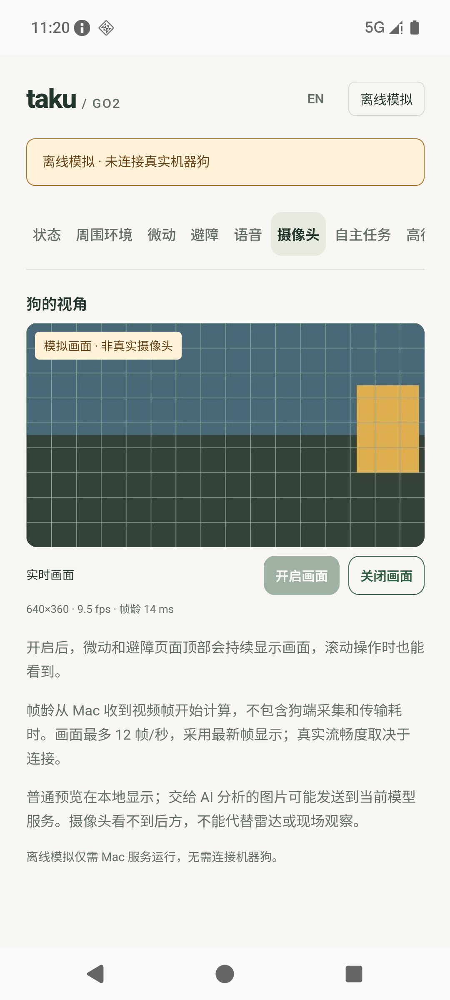
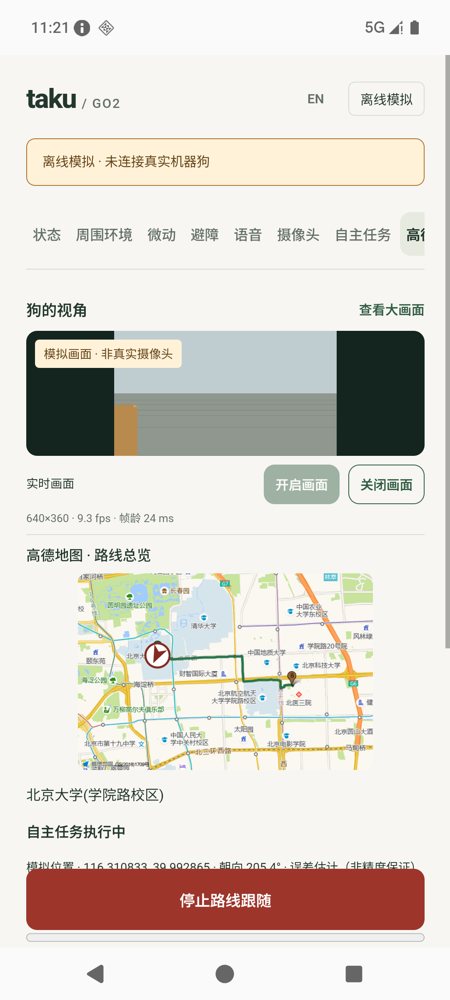

# 开发包验收 · 2026-10-27

环境：Mac Apple Silicon；API 36／ARM64／userdebug 的 `TakuBase_API36_ARM64`；仅模拟，无实机连接或运动。PR 分支从远端 main `1d8a1bd` 整理，不包含旧实验分支的喂食器、温控或 Phone Link 历史。

## 本次交付验证

- 在独立目录新建 Python 3.12 环境并通过 `setup.sh` 安装固定依赖与固定社区驱动，未复制原 venv。
- Go2 离线检查通过 **133 项 Python 测试、16 项 JavaScript 逻辑测试**及脚本语法检查。新增 6 项安装／打包测试覆盖：必须显式目标、错误 AVD 不写入、APK 安装无 root/JDK 依赖、AI 工具显式安装、物理设备拒绝开发 AI 安装、归档损坏／额外文件／路径穿越拒绝。
- `npm test` 20 项通过，`npm run check` 和 `npm run check:structure` 通过。仓库完整 `npm run verify` 在显式 JDK 17 与 UTF-8 环境下通过；本机默认 javac 占位器／ASCII 编码不适合直接运行这些既有 Java 测试，未为此改动其他系统组件。
- Android APK 与 CLI 构建成功，版本为 `0.1.0-preview.1`／versionCode 2；使用公开 AOSP 测试签名。
- 从干净提交打包，解压到与实验源码不同的目录；包内 `doctor`、完整离线回归和独立模拟服务运行成功。
- **实际使用解压包的预编译 APK、CLI、技能安装到上述 Taku 模拟器**。`adb reverse` 两端口建立成功，已有 Taku 环境和其他 App 保留。
- 解压包实际 WebView 通过 **11 组摄像头／控制验证**：约 9.5 fps、前后左右微动同时显示画面、避障页布局、过期画面清除、停止／重启／断线、中英和不同宽度。
- 解压包实际 WebView 通过 **6 组高德验证**：真实搜索 10 个 POI、步行路线／图片、双语及四种宽度、服务错误恢复、查询不触发连接或运动。
- 地理界面通过 **4 组验证**：实时监控、人工标定使旧路线失效、地图点选、新路线查询。模拟原生控制和任务守卫不因打包而放开。
- Android CLI 验证地图查询、路线保存、App 同步对应地图、启动／心跳／停止。任务结束确认 `source=simulation`、`active=false`、`stopConfirmed=true`。
- ZIP 逐文件 SHA-256 验证通过；额外 SHA256SUMS 覆盖整包和独立 APK。审查未发现个人高德 Key、.env、模型认证、录音、录像、工作日志或签名私钥进入归档。
- 固定 requirements 的 pip-audit 检查 25 项，未报告已知漏洞；不覆盖 Git 驱动源码、所有原生依赖或固件。

截图来自本次解压包安装后的真实 Android WebView，内容为模拟场景／公开地点示例，非用户或机器狗实际位置：

| 摄像头页面 | 路线与实时画面 |
| --- | --- |
|  |  |

历史完整路线实验：真实高德路线前 10 m 绕合成纸箱后停止，以及 4 m 完整转弯路线到达，见 [地理导航验收](../GEO-NAVIGATION-VERIFICATION.md)。这些历史结果不等于本次重新完成实机验收。

## 尚未验证或未发布

- 真实狗视频、扬声器及各固件兼容性，可靠绝对位置、真实雷达配准、PRO 原生避障与自主路线执行仍受既有边界约束。
- 物理手机安装、其他 CPU／操作系统尚未验收；自动 AI 工具安装只开放已校验的开发模拟器。
- GitHub Actions 工作流已提供，但尚未在远端运行：当前认证账号对私有仓库只有 Read，且仓库 `allow_forking=false`，分支推送返回 403。没有声称已经创建 PR、发布 Release 或生成可供同事访问的 GitHub 下载链接。
- 可直接转交完整 ZIP；有权限的同事也可按 [发布步骤](RELEASE.md) 导入 Git bundle、推送 PR 分支，再发布私有 prerelease。

本机详细输出位于 ignored 的 `out/go2-lab/release-check/`，不作为源码或安装包分发。文档与截图追加后重新打包，以最终 manifest.sourceCommit 和校验和为准；源码逻辑与本次安装验收版本一致。
